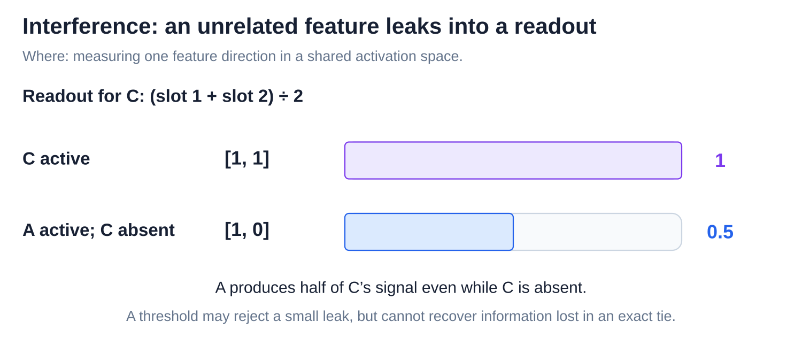
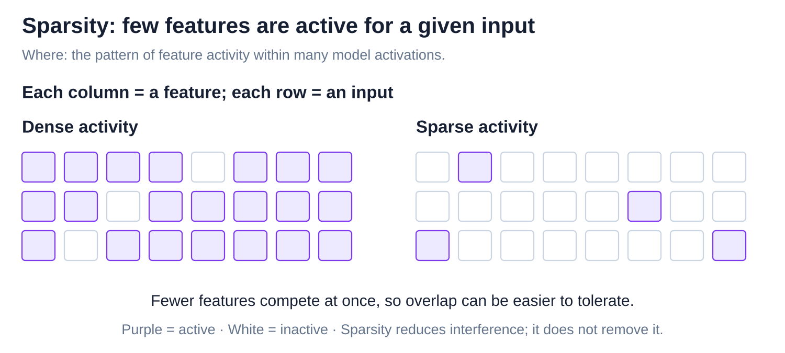
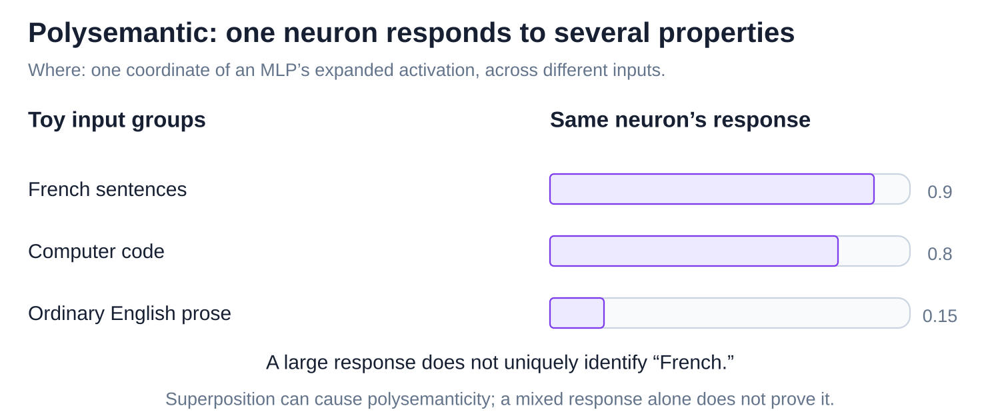

# Internals: Superposition and mechanistic interpretability

[Back to Artificial Intelligence](../Readme.md#content)

**Superposition means representing more features than a vector has dimensions, using overlapping directions. Mechanistic interpretability seeks to explain how internal computations produce behavior.** We start with overlap, then examine tools for finding features and testing proposed mechanisms.

## Where this fits

A **feature** is a property represented by the model. The model's **activations** are working numbers calculated for an input; a vector groups numbers into an ordered list.

The upper map highlights research on these internal values, separate from the model's ordinary computation. The lower panel connects packed feature directions, a tool for separating them, and controlled tests of their role.

## Dimensions and superposition

A **dimension** is one numerical coordinate or slot. In this toy, three feature directions share two dimensions. The right panel shows the ambiguity: A plus B produces the same vector as C alone.

The exact collision is a toy case. Spreading one feature across several slots alone does not prove superposition. [Features and the linear representation hypothesis](../Features%20and%20the%20linear%20representation%20hypothesis/Readme.md) examines the direction-based picture.

## Interference

**Interference** occurs when one feature contributes to a measurement intended for another. The C readout below averages both coordinates, so A alone produces half of C's full signal even when C is absent.

A cutoff can reject some small leaks. It cannot distinguish two feature states that yield exactly the same vector.

## Sparsity

**Sparsity** means few features are active for a given input. Read each row as one input and each column as one feature. Fewer simultaneous features make interference easier to tolerate, as demonstrated in toy models.

## Polysemantic neurons

A **neuron** is one numerical slot inside a network. A **polysemantic neuron** responds to several unrelated properties. The toy bars show one neuron responding to both French and code. Superposition is one possible explanation, not the only one.

## Sparse autoencoders: candidate features

A **sparse autoencoder (SAE)** is a separate analysis model trained on saved language-model activations. Follow the top lane, then the four definition panels:

- The **encoder** maps the activation to candidate feature values.
- The **sparse code** contains many slots but few nonzero values.
- The **decoder** combines active directions from its learned **dictionary** to rebuild the input.
- **Reconstruction error** is the difference between the original and rebuilt vectors.

Only the SAE is trained here. The language model stays fixed. SAE training balances reconstruction with sparse activity; names for candidate features are interpretations researchers must test.

Even perfect reconstruction need not identify the true cause: C alone and A plus B both rebuild `[1, 1]`. Real SAEs also leave error and can miss or blend important structure.

## Circuits and causal tests

A **circuit** is a set of connected internal components implementing a computation. **Mechanistic interpretability** asks how such mechanisms cause behavior. The top path is a toy hypothesis; the three lower panels define experiments for testing it.

A **baseline** leaves the run unchanged. An **ablation** removes a suspected contribution. **Activation patching** replaces an internal value with one from another run. Specify the donor input, target location, and predicted score change, then compare with the baseline.

Backup paths can hide an effect; edits may damage unrelated computation. A tested name-handling circuit in GPT-2 small explains one behavior, not the whole model.

# Sources

- [Meta: Llama architecture](https://github.com/meta-llama/llama3/blob/main/llama/model.py)
- [Anthropic: Toy Models of Superposition (visual reference)](https://transformer-circuits.pub/2022/toy_model/index.html)
- [Sparse Autoencoders Find Highly Interpretable Features](https://arxiv.org/abs/2309.08600)
- [OpenAI: Scaling and Evaluating SAEs (Figure 1 reviewed)](https://arxiv.org/html/2406.04093v1)
- [Interpretability in the Wild: circuits and causal tests](https://arxiv.org/html/2211.00593v1)
- [Anthropic: Circuit Tracing — methods and limitations](https://transformer-circuits.pub/2025/attribution-graphs/methods.html)
