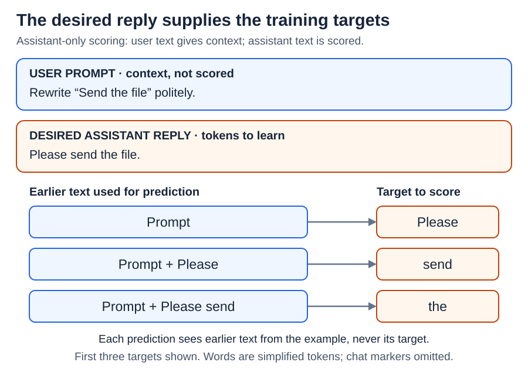
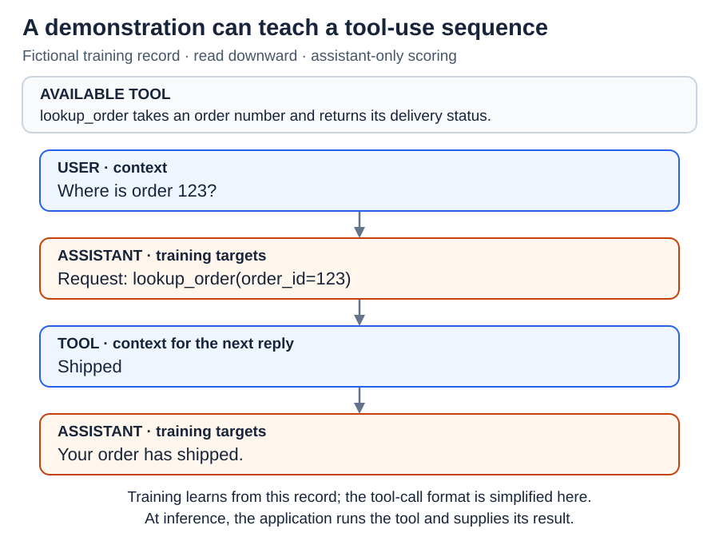

# Supervised fine-tuning: learning to act as an assistant

[Back to Artificial Intelligence](../Readme.md#content)

**Supervised fine-tuning (SFT) further trains a model on examples of desired responses. It changes the model's learned numerical settings, or weights, to make it better at responding in those ways.**

Start with an example, then see how the same approach can teach tool use.

## A demonstration shows what to do

Pretraining gives the model broad practice predicting text. Assistant SFT focuses that practice on selected requests and good responses. For example:

- **User:** Rewrite “Send the file” politely.
- **Desired assistant:** Please send the file.

This pair is a **demonstration**: an example to learn from. “Supervised” means training has a supplied target answer. It does not mean a person watches and corrects every live conversation.

A **chat template** converts messages into one token sequence, adding markers for roles such as user and assistant and for message boundaries. A **token** is a piece of text: a word, part of a word, or punctuation. The markers tell the model who is speaking; exact formats vary by model.

## Learning still uses next-token prediction

The desired response supplies the next-token targets. In this simplified diagram, each word and the full stop is one token. Every row uses the recorded earlier text, not the model's previous guesses.

The model assigns chances to possible next tokens. When the target is `Please`, giving it a higher chance earns a smaller **loss**, meaning a penalty score. Training combines these penalties and adjusts trainable weights to try to reduce them. Repeat over many demonstrations, and the model can learn patterns for answering new requests.

In an **assistant-only loss** setup, only assistant tokens count toward the penalty. User messages remain visible as earlier context. A **loss mask** selects which tokens are scored; it does not hide the prompt. Other SFT setups score more of the sequence, so assistant-only scoring is a choice, not the definition of SFT.

During ordinary inference, the model generates its own response with fixed weights. Adding examples to a prompt changes the current context; SFT changes learned parameters that can be used in later conversations.

## Demonstrations can include tool use

A training example can contain tool descriptions, an assistant's tool request, the recorded tool result, and a final assistant reply. Read this fictional order lookup from top to bottom. Orange messages are the assistant behavior being taught; blue messages supply context.

The model can learn when to request a tool, how to write its arguments, and how to answer using its result. **Arguments** are inputs to a tool; here, the order number is the input.

Learning this pattern does not give the model direct access to an order database. During actual use, the application must execute the requested tool and return the result. A tool call is a model-generated request for an action.

## What changes, and what to check

SFT can improve instruction following, response style, formatting, and task performance. Instruction-tuning research has shown improvements on tasks outside the training set, so its effects can extend beyond copying a style. The model still builds on its starting abilities, and results depend on the training examples.

The target is the **chosen response**, not a built-in truth detector. Bad demonstrations can teach bad patterns. Check the trained model on requests kept out of training, including whether its answers are correct and follow the instructions. A lower training penalty alone does not prove it is a better assistant.

SFT teaches “respond like this example.” Preference training, covered next, uses judgments such as “this response is better than that one.” These are different training signals.

## Check your understanding

If user tokens do not count toward the loss, does the model ignore the user's question? **No.** It still uses the question to predict the assistant's reply; only the choice of tokens being scored has changed.

# Sources

- [Hugging Face: SFT Trainer, loss masking, and tool datasets](https://huggingface.co/docs/trl/sft_trainer)
- [Hugging Face: Chat templates](https://huggingface.co/docs/transformers/chat_templating)
- [Hugging Face: Tool use](https://huggingface.co/docs/transformers/chat_extras)
- [Ouyang et al.: Demonstrations, SFT, and preference training](https://arxiv.org/html/2203.02155v1)
- [Wei et al.: Finetuned Language Models Are Zero-Shot Learners](https://arxiv.org/abs/2109.01652)
