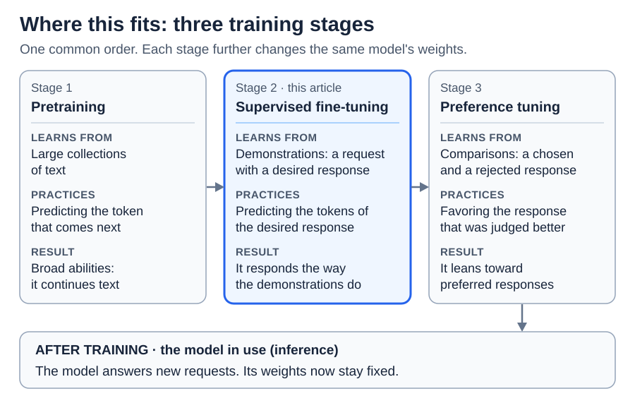
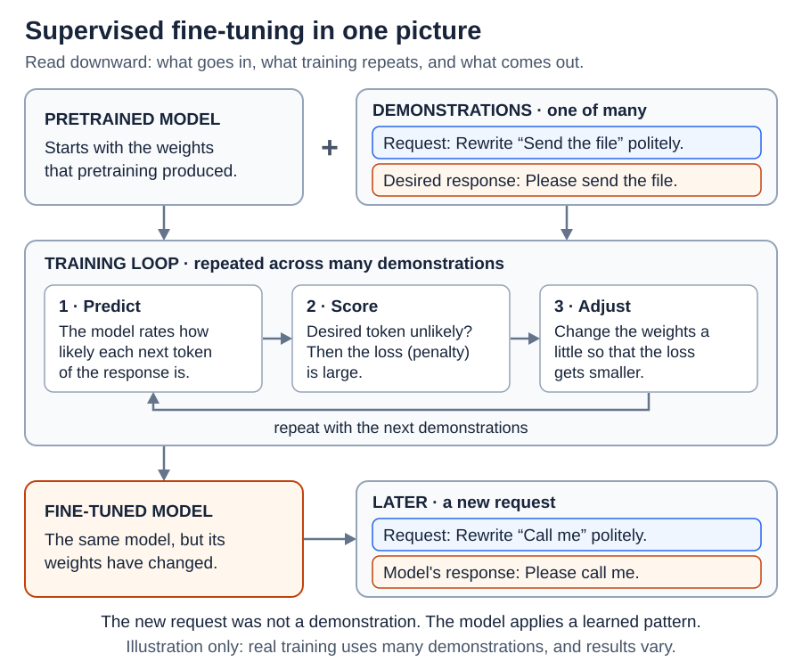
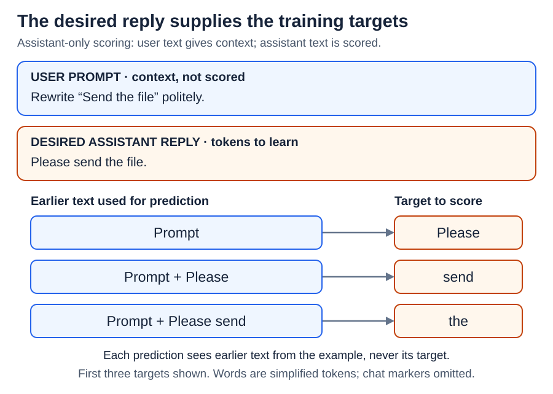
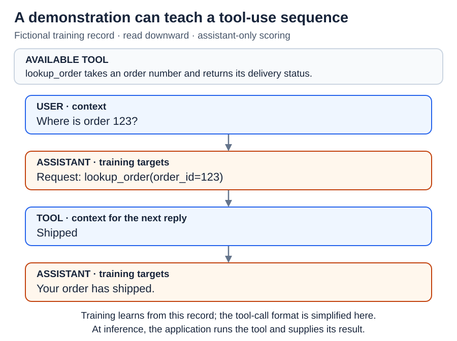

# Training: Supervised fine-tuning

[Back to Artificial Intelligence](../Readme.md#content)

**Supervised fine-tuning (SFT) further trains a model on examples of desired responses. It changes the model's learned numerical settings, or weights, so that it responds in those ways in later conversations.**

Start with where SFT sits among the training stages, then see the whole process, then zoom in on one example.

## Where this fits

Pretraining teaches a model to continue text, one **token** at a time. A token is a piece of text: a word, part of a word, or punctuation. That goal is different from following a request, so later stages train the same weights further. See [Pretraining - learning from next-token prediction](../Pretraining/Readme.md).

Read the three stages from left to right. The stage marked “this article” is SFT. Compare the rows: the stages differ in what they learn from and what they practice. This order is common, not mandatory. [Preference tuning - RLHF and DPO](../Preference%20tuning/Readme.md) is the next topic.

## The whole process in one picture

A **demonstration** is an example to learn from: a request paired with a desired response. “Supervised” means every example supplies its target answer. It does not mean a person watches and corrects live conversations.

Read downward. A pretrained model and the demonstrations go in. The training loop predicts, scores, and adjusts, again and again. A **loss** is a penalty score: it is small when the model gives the desired tokens a high chance. What comes out is the same model with changed weights.

The “LATER” box shows why this matters. A request that was never a demonstration can still get a response in the demonstrated manner. Training shapes patterns in the weights. It does not build a list of answers to look up.

## Zoom in: the desired response supplies the targets

SFT keeps pretraining's exercise: predict the next token. A **chat template** first converts the messages into one token sequence, adding markers for roles such as user and assistant; exact formats vary by model.

This simplified diagram shows the same demonstration, with each word as one token. Every row predicts from the recorded earlier text, not from the model's own guesses.

In an **assistant-only loss** setup, only assistant tokens count toward the penalty. A **loss mask** selects which tokens are scored; it does not hide the user's message, which stays visible as context. Other SFT setups score more of the sequence, so this is a choice, not the definition of SFT.

## Demonstrations can include tool use

A demonstration can also contain tool descriptions, the assistant's tool request, the recorded tool result, and a final reply. Read this fictional order lookup from top to bottom. Boxes labeled “training targets” are the behavior being taught; boxes labeled “context” only supply input.

The model can learn when to request a tool, how to write its **arguments** (its inputs; here, the order number), and how to answer from the result. It does not gain access to an order database. A tool call is only a model-generated request: in actual use, the application must run the tool and return the result.

## What changes, and what to check

SFT can improve instruction following, response style, formatting, and task performance. Instruction-tuning research found improvements on task types outside the training set, so the effect goes beyond copying a style.

The target is the **chosen response**, not a truth detector: bad demonstrations teach bad patterns. Check the trained model on requests kept out of training: are its answers correct, and do they follow the instructions? A lower training loss alone does not prove a better assistant.

Adding examples to a prompt changes only the current context. SFT changes weights, which every later conversation uses.

## Check your understanding

1. Does masking user tokens in the loss hide the question from the model?

   

   
Answer

   No. It reads the question as context for the reply.

   

2. Does SFT need a new prediction task?

   

   
Answer

   No. It predicts the next token. Demonstrations change what it practices.

   

# Sources

- [Hugging Face: SFT Trainer, loss masking, and tool datasets](https://huggingface.co/docs/trl/sft_trainer)
- [Hugging Face: Chat templates](https://huggingface.co/docs/transformers/chat_templating)
- [Hugging Face: Tool use](https://huggingface.co/docs/transformers/chat_extras)
- [Ouyang et al.: Demonstrations, SFT, and preference training](https://arxiv.org/html/2203.02155v1)
- [Wei et al.: Finetuned Language Models Are Zero-Shot Learners](https://arxiv.org/abs/2109.01652)
