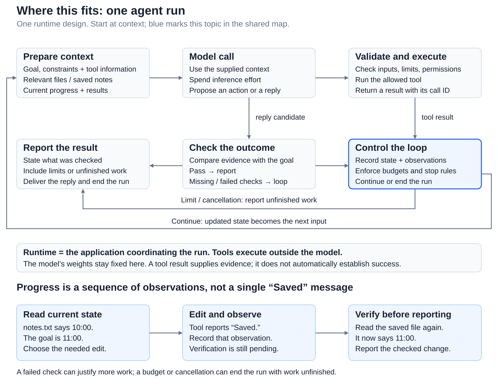
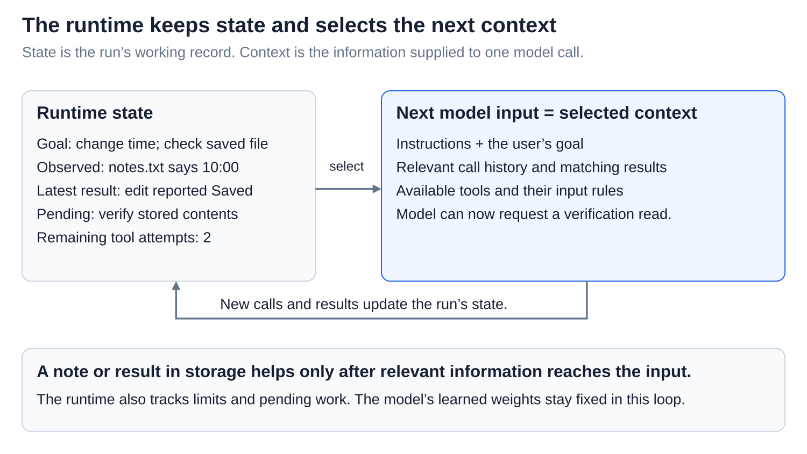
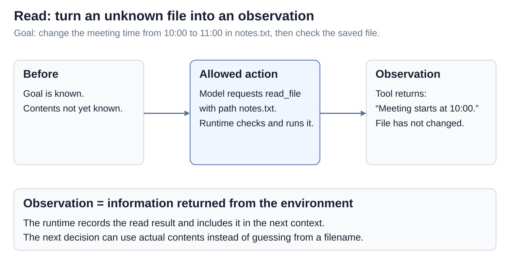
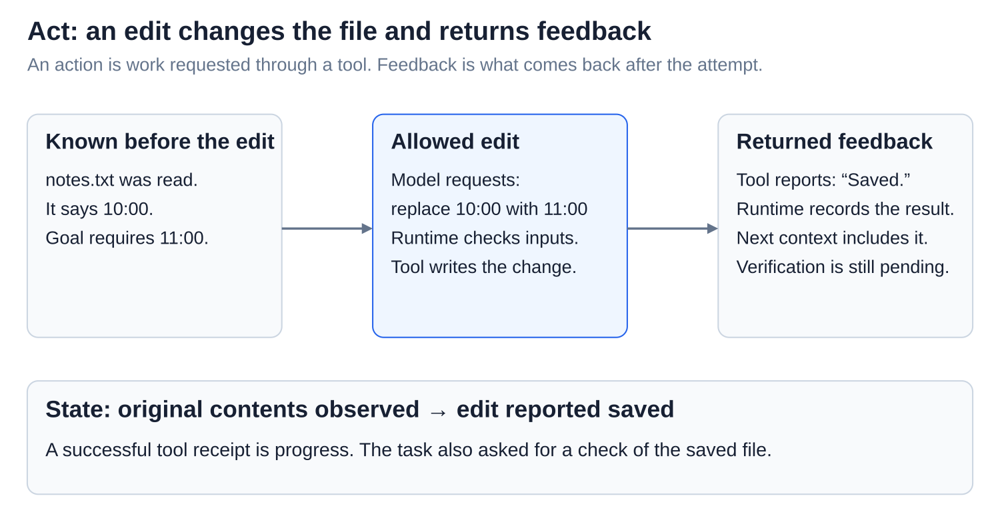
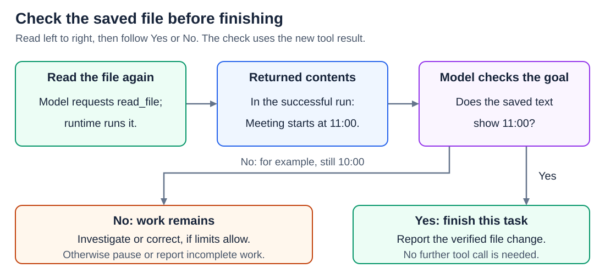
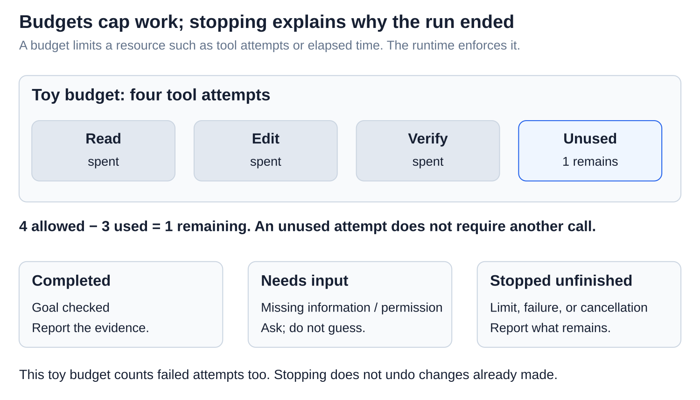
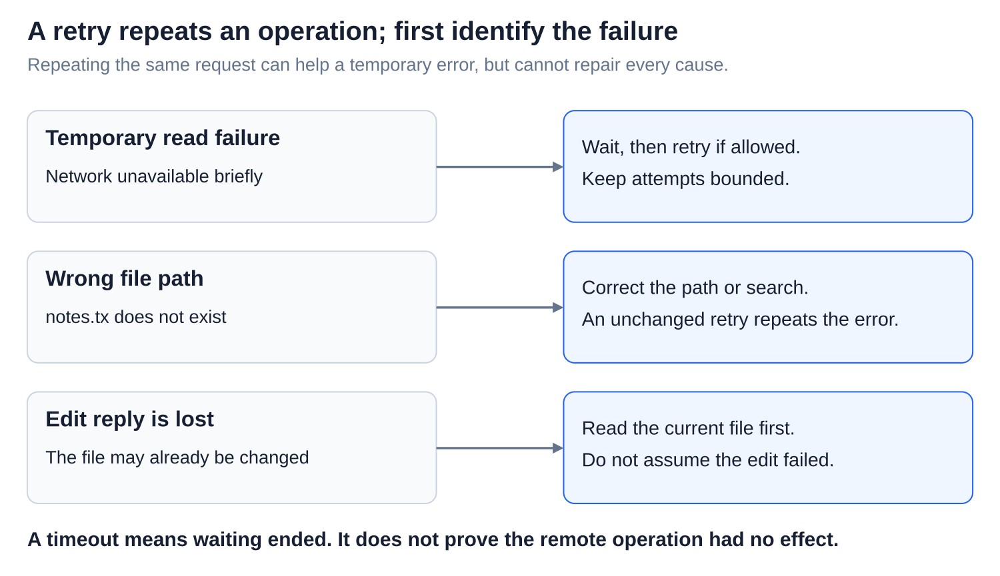
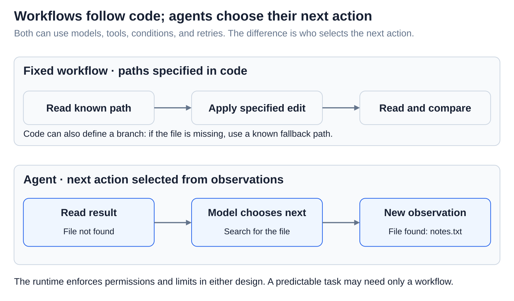

# Agents: Loop - act, observe, continue, stop

[Back to Artificial Intelligence](../Readme.md#content)

**An agent loop repeatedly asks a model what to do, runs allowed actions, and returns observations for the next decision.** The model selects actions within limits enforced by the **runtime**, the coordinating application.

## Where this fits

The shared map highlights **loop control**. Follow the arrows from context to a model call, then through tool results or an outcome check. The lower example shows how read, edit, and verification results change the next action.

## State and context

**State** is the run's working record: goal, earlier calls and results, unfinished work, and remaining limits. **Context** is the information supplied to one model call. The runtime selects it from that state and other relevant sources.

Read the state panel, then the selected input. The return arrow shows later calls and results updating state. Stored information does not automatically enter every input ([Context engineering](../Context%20engineering%20for%20long-running%20agents/Readme.md)).

Our task: **“Change the meeting time in `notes.txt` from 10:00 to 11:00, then check the saved file.”**

## Step 1 — Read the current state

The goal is known but the file's contents are not. The model requests `read_file` with `notes.txt` as input; the runtime checks and runs the tool. It returns “Meeting starts at 10:00.” This **observation** is information obtained from the environment. It enters the next context; reading has not changed the file.

## Step 2 — Act and collect feedback

An **action** is work requested through a tool. Here, the model asks to replace 10:00 with 11:00. The runtime checks the request and the tool writes the file. **Feedback** is the returned information: “Saved.” State advances to “edit reported saved,” while verification remains pending.

## Step 3 — Verify and decide

**Verification** compares evidence from the actual outcome with the goal. Another read reports the saved contents. Seeing 11:00 supports completion. Seeing 10:00 means the task remains unfinished: investigate or correct it if more work is allowed. A “Saved” receipt alone did not satisfy the requested check.

## Budgets and stopping outcomes

A **budget** caps a resource, such as tool attempts or elapsed time. The runtime must check and enforce its configured limits.

The toy budget allows four tool attempts. Read, edit, and verification use three, leaving **4 − 3 = 1**. Failed attempts count under this policy. An unused attempt does not require another call.

A run can finish successfully, need missing information or permission, or stop with work unfinished because of a limit, failure, or cancellation. Report the checked result and what remains. Stopping does not undo earlier changes.

## Retries depend on the failure

A **retry** repeats an operation. A **timeout** means the caller stopped waiting; it does not prove that the action failed.

Read the three cases. A temporary read failure may justify a bounded retry after waiting. A wrong path needs correction. A lost edit reply requires checking whether the edit happened before repeating it. Some repeated actions can create duplicates; [Reliability](../Reliability/Readme.md) explains safe repetition.

## Agent or fixed workflow?

A **fixed workflow** follows paths specified in code, including branches and retries. An **agent** lets the model choose the next action from observations, within software-defined limits.

Both designs can read, edit, and verify. Code can prescribe that sequence for a predictable task. A model-directed loop can choose a search after discovering a missing file. Neither design is automatically correct; useful observations and outcome checks still matter.

# Sources

- [Anthropic: agent-loop diagram and workflows](https://www.anthropic.com/research/building-effective-agents)
- [Strands: loop, history, limits, and stop reasons](https://strandsagents.com/latest/documentation/docs/user-guide/concepts/agents/agent-loop/)
- [Claude: tool requests and returned results](https://platform.claude.com/docs/en/agents-and-tools/tool-use/handle-tool-calls)
- [AWS: timeouts, retries, and possible completed effects](https://aws.amazon.com/builders-library/timeouts-retries-and-backoff-with-jitter/)
