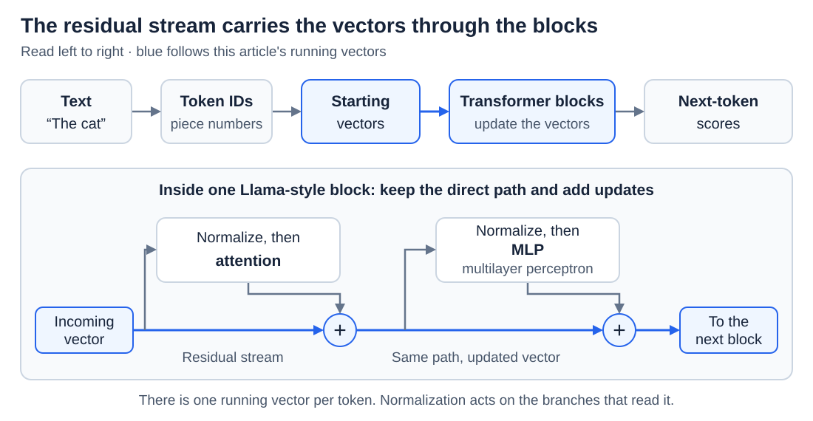
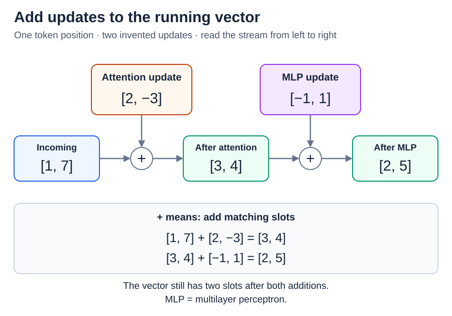
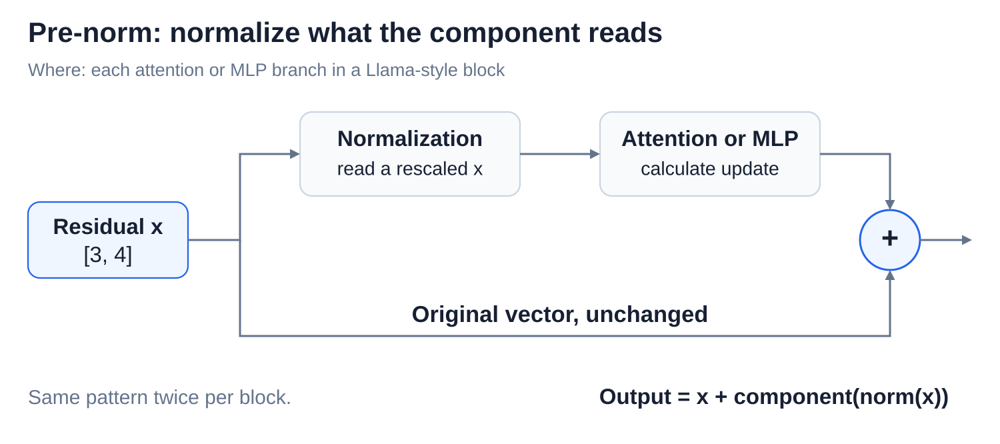

# The residual stream and normalization

[Back to Artificial Intelligence](../Readme.md#content)

**The residual stream is the running vector that carries each token's information through the model. Every attention and MLP step reads it and adds an update back. Normalization keeps the numbers at a steady scale, so those steps work reliably.**

## Where this fits

The residual stream is not one more step; it is the path that connects all the steps:

Follow the blue path: each block reads the running vector and adds updates to it.

It starts as each token's starting vector from [Embeddings and position information](../Embeddings%20and%20position%20information/Readme.md). It ends as the final vector that [The transformer forward pass](../The%20transformer%20forward%20pass/Readme.md) turns into scores. We follow a **Llama-style pre-norm** design; other designs place normalization differently.

## One running vector per token

Picture each token's vector as a shared notepad that travels through the blocks. Each component reads the notepad, works something out, and writes its result by adding it on top. The notepad keeps the same number of slots all the way through.

In the diagram, one position starts with `[1, 7]`. Attention adds its update, and then the MLP adds its own; each `+` adds matching slots, so the vector stays two numbers long. Updates can raise, lower, or cancel earlier values, so the stream is not a permanent record of everything the model has seen.

Why build a model this way? A component only has to learn a useful change, not rebuild the whole vector, and the direct path through the additions helps very deep networks train. During ordinary use, the stream's numbers change while the weights stay fixed. Because every component reads from and writes to this one stream, it is also a common place to look for what the model represents, as [Features and the linear representation hypothesis](../Features%20and%20the%20linear%20representation%20hypothesis/Readme.md) explains.

## Where normalization goes

**Normalization** rescales a vector so that its numbers stay in a steady range from block to block. This helps both training and the calculation itself stay stable. It works on one token's vector at a time and never mixes different tokens.

In **pre-norm**, normalization happens on the branch, just before a component reads the vector. Read the diagram from left to right: the incoming residual vector splits in two. The upper branch is normalized and fed to the MLP, which computes an update. The path labeled “Original vector, unchanged” carries the vector straight to the `+`, where the update is added. So the stream itself is never normalized in place; only the copy a component reads is. Attention uses the same pattern, and one final normalization prepares the last vector for scoring.

## LayerNorm and RMSNorm

Two normalization methods are common:

- **LayerNorm** first shifts the numbers so that their average is zero (**centering**), then divides them by their spread, so every vector ends up on a similar scale.
- **RMSNorm** skips the centering and only divides by the vector's typical size, its **root mean square (RMS)**. It is simpler and therefore cheaper to compute, and it is the method that Llama-style models use.

Both then multiply each slot by a learned number, and LayerNorm usually adds a learned offset as well, so the output need not average zero or have a fixed size. A tiny safety number keeps either method from dividing by zero. The scale is recalculated for every input, while the learned numbers stay fixed during use. A normalized vector is still working information, not a set of probabilities.

# Sources

- [Transformer Circuits: the residual stream](https://transformer-circuits.pub/2021/framework/index.html)
- [Meta: Llama 3 pre-norm blocks and final normalization](https://github.com/meta-llama/llama3/blob/main/llama/model.py)
- [Deep Residual Learning: why residual connections help](https://arxiv.org/abs/1512.03385)
- [PyTorch: LayerNorm](https://docs.pytorch.org/docs/2.15/generated/torch.nn.LayerNorm.html)
- [PyTorch: RMSNorm](https://docs.pytorch.org/docs/2.15/generated/torch.nn.RMSNorm.html)
- [Root Mean Square Layer Normalization](https://arxiv.org/abs/1910.07467)
