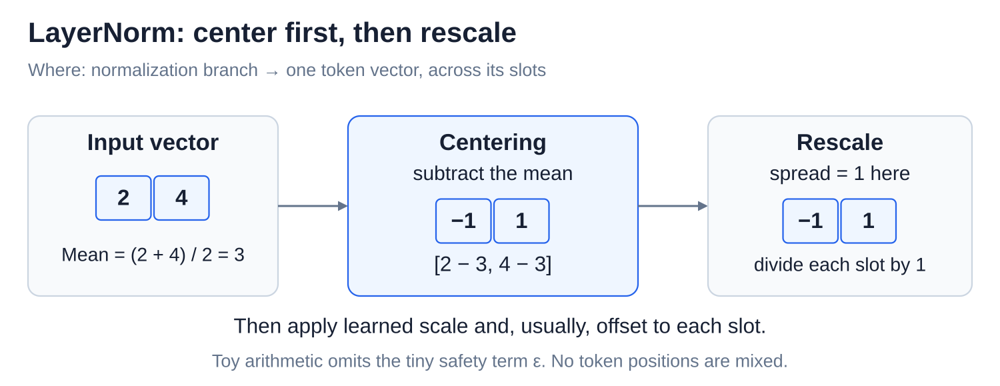
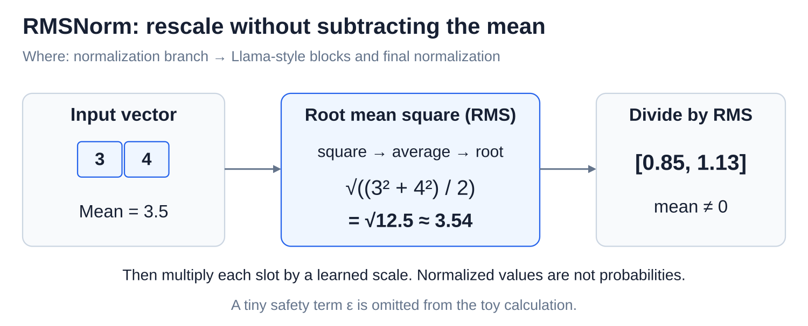

# Internals: The residual stream and normalization

[Back to Artificial Intelligence](../Readme.md#content)

**The residual stream is the running vector that carries each token's information through the model. Every attention and MLP step reads it and adds an update back. Normalization keeps the numbers at a steady scale, so those steps work reliably.**

## Where this fits

Each token, a piece of text, has a vector: a list of working numbers. Attention gathers context, while an MLP (multilayer perceptron) processes each position. Both add updates to the running vector.

The upper map highlights this shared path and its normalization branches. The lower panel follows a normalized read and an addition to the unchanged input.

## One running vector per token

The **residual stream** keeps one vector per position, with the same number of slots throughout the blocks. A **residual connection** carries that vector around a component and adds the component's update. Follow matching coordinates through each addition:

The example starts at `[1, 7]`. Attention adds `[2, −1]`, then the MLP adds `[−1, 2]`, ending at `[2, 8]`. An update can raise, lower, or cancel a value. This is not a permanent record of everything the model has seen.

The direct path helps deep networks train: a component can learn a useful change rather than rebuild the whole representation. During inference, these working vectors change while the weights remain fixed.

## Normalize the branch

**Normalization** rescales the numbers in one token's vector. **Pre-norm** means doing this before attention or the MLP reads it. Follow the fork: the lower route keeps the original vector, while the upper route computes an update from a normalized copy.

The update is added to the original vector. In this design, normalization does not replace the residual stream itself. A final normalization also prepares the last vector for vocabulary scoring.

## LayerNorm and centering

**Layer normalization (LayerNorm)** subtracts the vector's mean, then divides by its spread. Subtracting the mean is called **centering**. The middle panel shows centering; the last shows rescaling:

For `[2, 4]`, the mean is 3, so centering gives `[−1, 1]`. Their spread is 1, leaving the numbers unchanged after division. Learned scale and usually offset are then applied to each slot, so the final result need not average zero.

## RMSNorm and root mean square

**Root mean square (RMS)** measures size by squaring the values, averaging them, and taking the square root. **RMSNorm** divides by that size without centering; Llama-style models use it. Follow the three panels:

For `[3, 4]`, RMS is about 3.54, giving approximately `[0.85, 1.13]` before a learned scale is applied. Both normalization methods include a small safety term to avoid division by zero; the diagrams omit it for readable arithmetic.

Both work across the slots of one token vector, not across token positions. Neither produces probabilities.

# Sources

- [Anthropic: residual stream as a communication channel](https://transformer-circuits.pub/2021/framework/index.html)
- [Meta: Llama 3 pre-norm blocks and final normalization](https://github.com/meta-llama/llama3/blob/main/llama/model.py)
- [Deep Residual Learning: why residual connections help](https://arxiv.org/abs/1512.03385)
- [PyTorch: LayerNorm](https://docs.pytorch.org/docs/2.15/generated/torch.nn.LayerNorm.html)
- [PyTorch: RMSNorm](https://docs.pytorch.org/docs/2.15/generated/torch.nn.RMSNorm.html)
- [Root Mean Square Layer Normalization](https://arxiv.org/abs/1910.07467)
