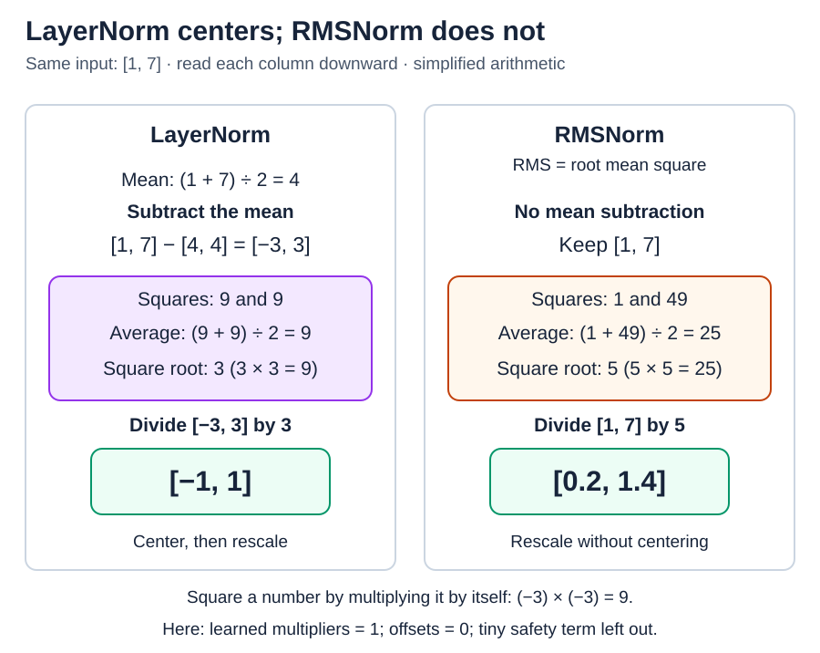

# The residual stream and normalization

[Back to Artificial Intelligence](../Readme.md#content)

**The residual stream carries running information through a transformer. Components read it and add updates; normalization adjusts the values those components use.** We will follow an update, locate normalization, then compare LayerNorm with RMSNorm.

We use a **Llama-style pre-norm transformer** as our baseline. Other designs place normalization differently.

## One running vector per token position

A **vector** is an ordered list of numbers. Each token position has its own **residual vector**, which keeps the same number of slots as it passes through the blocks. These vectors together form the residual stream.

**Attention** brings information from allowed positions. An **MLP (multilayer perceptron)** processes each position's vector separately. Each produces an update that is added to the stream.

For one position, start with the invented vector `[1, 7]`. An attention update `[2, −3]` gives `[3, 4]`: `1 + 2 = 3`, and `7 − 3 = 4`. A later MLP update `[-1, 1]` gives `[2, 5]`.

A **residual connection** carries the incoming vector directly into this addition. Adding matching slots does not append new slots. Updates can increase, decrease, or cancel earlier values; the stream is not a permanent record of everything seen.

This direct route lets a component learn an update instead of having to recreate the entire incoming vector. Residual connections also help deep networks train. During ordinary inference, the working vectors change while learned weights stay fixed.

## Where normalization goes

In **pre-norm**, normalization happens before attention or the MLP on the branch that computes an update. The original residual vector travels along the side path. The update is added to that original vector, not to the normalized version.

After the attention addition, the MLP branch reads a normalized version of the updated stream. After all blocks, a final normalization precedes the vocabulary-scoring projection. The diagram isolates one MLP branch so the two paths are easy to see.

**Normalization** controls numerical scale, helping computation and training stay stable. Here it calculates statistics across the slots of **one token's vector**, separately at each position. It does not average different tokens together.

## LayerNorm and RMSNorm

Both methods divide by a measure of size. **LayerNorm also subtracts the mean**; **RMSNorm does not**. The **mean** is the average: add the numbers, then divide by how many there are.

Use `[1, 7]` for both examples. To keep the arithmetic simple, use learned multipliers of 1, offsets of 0, and temporarily ignore the tiny safety term described below.

### LayerNorm: center, then scale

The mean is `(1 + 7) ÷ 2 = 4`. Subtract 4 from both slots to get `[-3, 3]`. This **centers** the numbers around zero.

Find their **standard deviation**, a measure of spread: square the centered numbers, average them, then take the square root. Squaring means multiplying a number by itself: `(-3) × (-3) = 9` and `3 × 3 = 9`. Their average is 9. Its square root is 3, because `3 × 3 = 9`.

Divide `[-3, 3]` by 3 to get **`[-1, 1]`**.

### RMSNorm: scale without centering

**RMS** means **root mean square**. Square the original numbers: `1 × 1 = 1`, and `7 × 7 = 49`. Their mean is `(1 + 49) ÷ 2 = 25`. Its square root is 5, because `5 × 5 = 25`.

Divide `[1, 7]` by 5 to get **`[0.2, 1.4]`**. The average need not be zero. RMSNorm is the normalization used in our Llama-style example.

## What the simplified math leaves out

Real implementations add a tiny positive number, **epsilon**, inside the square root so the divisor cannot be zero. Both methods then apply learned multipliers, one per coordinate; LayerNorm typically also adds learned offsets. A **coordinate** is a slot; an **offset** is a number added after scaling.

The mean and size measure are recalculated from the current input. The learned multipliers and offsets remain fixed during inference. After those learned adjustments, the output need not retain a mean of zero or a particular scale. These vectors are working information, not probabilities.

# Sources

- [Transformer Circuits: the residual stream](https://transformer-circuits.pub/2021/framework/index.html)
- [Meta: Llama 3 pre-norm blocks and final normalization](https://github.com/meta-llama/llama3/blob/main/llama/model.py)
- [Deep Residual Learning: why residual connections help](https://arxiv.org/abs/1512.03385)
- [PyTorch: LayerNorm](https://docs.pytorch.org/docs/2.15/generated/torch.nn.LayerNorm.html)
- [PyTorch: RMSNorm](https://docs.pytorch.org/docs/2.15/generated/torch.nn.RMSNorm.html)
- [Root Mean Square Layer Normalization](https://arxiv.org/abs/1910.07467)
