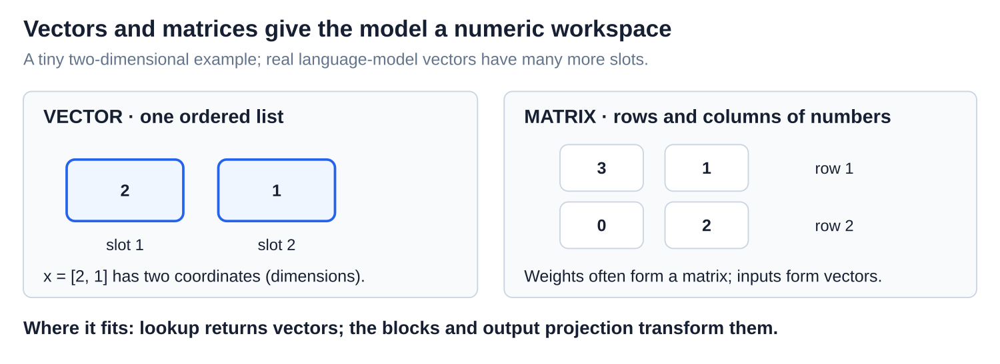
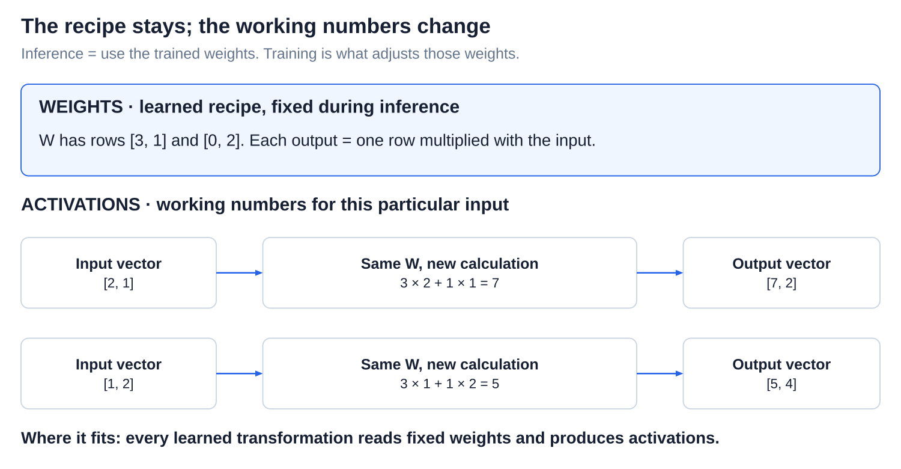
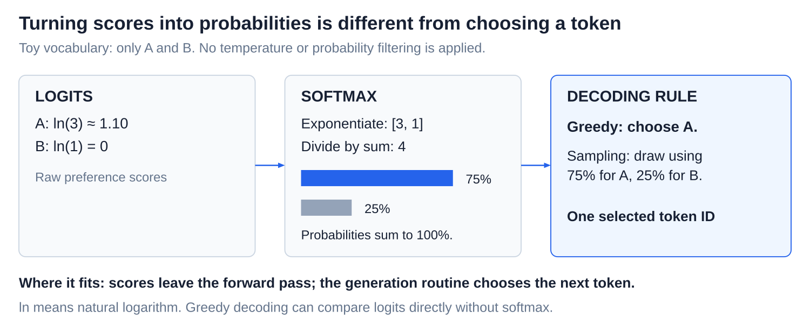

# Internals: The transformer forward pass

[Back to Artificial Intelligence](../Readme.md#content)

**A forward pass is one run of the model: token IDs go in, and a score for every possible next token comes out.** It uses the model's learned weights without changing them, and it does not choose the next token by itself.

## Where this fits

A tokenizer first turns text pieces into numeric IDs. The model looks up vectors, updates them through repeated blocks, and produces vocabulary scores. A separate decoding rule chooses a token. We follow a Llama-style model built to continue text.

The upper map highlights this model computation. The lower panel follows one run from IDs to scores.

## Two kinds of numbers

A **vector** is an ordered list of numbers, such as `[2, 1]`. Each slot is a **coordinate**, or dimension. A **matrix** arranges numbers in rows and columns.

**Weights** are numbers learned during training. **Activations** are working numbers for the current input. The two runs below use the same weight matrix but produce different activations.

## Step 1 — Look up a vector for each token

An **embedding table** holds one learned vector per token ID. The toy IDs for `The cat`, 12 and 87, select two rows. These are the starting vectors; context changes them later. Real vectors are much longer: LLaMA 7B uses 4,096 numbers per token.

## Step 2 — Refine the vectors through repeated blocks

A **transformer block** is a repeated unit, with its own weights in each copy. Read downward. Each block does two jobs:

- **Attention** lets each position gather information from other positions. A **causal mask** allows only the current and earlier positions: `cat` can look at `The`, but `The` cannot look ahead at `cat`. Position information enters here, so the model can use word order.
- An **MLP (multilayer perceptron)** then works on each position's vector separately, transforming the information it already holds.

Before each job, **normalization** keeps the numbers at a stable scale. The side paths labeled “Carry unchanged” bring the incoming vectors to the `+` circles, where each job's result is added. So each job only supplies an update, and the running vectors that pass from block to block are called the **residual stream**.

After the last block, there is still one vector per position, but each now carries information from its context.

## Step 3 — Turn the last vector into scores

To continue `The cat`, use the vector at the **last position**, `cat`. After final normalization, an **output projection** multiplies this vector by learned matrix rows to score every vocabulary token. The diagram works through two rows: `sat` scores 7 and `ran` scores 2.

These raw scores are called **logits**. They are not probabilities: they can be negative and need not add up to 1. A high score favors a token; it is not a measure of factual truth.

## How this becomes a reply

**Softmax** converts scores to probabilities totaling 100%. A **decoding rule** selects one ID: greedy decoding chooses the highest score, while sampling draws using the probabilities. Greedy selection can compare logits directly.

Append the selected ID and repeat. [Decoding and sampling](../Decoding%20and%20sampling/Readme.md) explains selection; [Prefill and the KV cache](../Prefill%20and%20KV%20cache/Readme.md) explains how saved calculations avoid repeating work.

Check your understanding: after one forward pass, what changed? **Only the working values.** The weights change only during training.

# Sources

- [LLaMA: architecture and model sizes, §2.2 and Table 2](https://arxiv.org/html/2302.13971v1)
- [Meta: Llama 3 model implementation](https://github.com/meta-llama/llama3/blob/main/llama/model.py)
- [Transformer Circuits: residual stream and attention](https://transformer-circuits.pub/2021/framework/index.html)
- [Google: Transformer architecture and attention figures](https://arxiv.org/abs/1706.03762)
- PyTorch: [Embedding](https://docs.pytorch.org/docs/2.15/generated/torch.nn.Embedding.html), [Linear](https://docs.pytorch.org/docs/2.15/generated/torch.nn.Linear.html), [Softmax](https://docs.pytorch.org/docs/2.15/generated/torch.nn.Softmax.html).
- [Hugging Face: generation strategies](https://huggingface.co/docs/transformers/en/generation_strategies)
