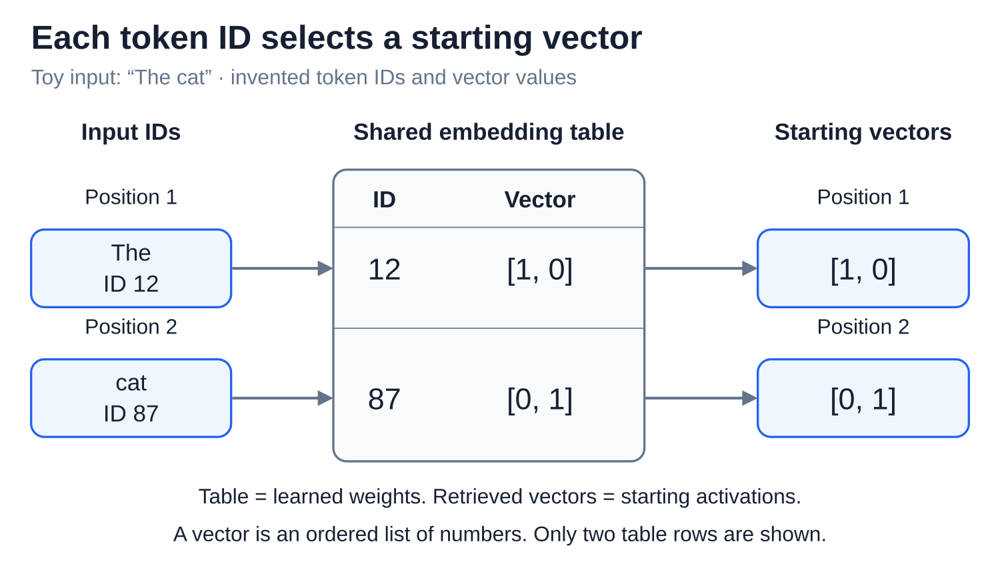
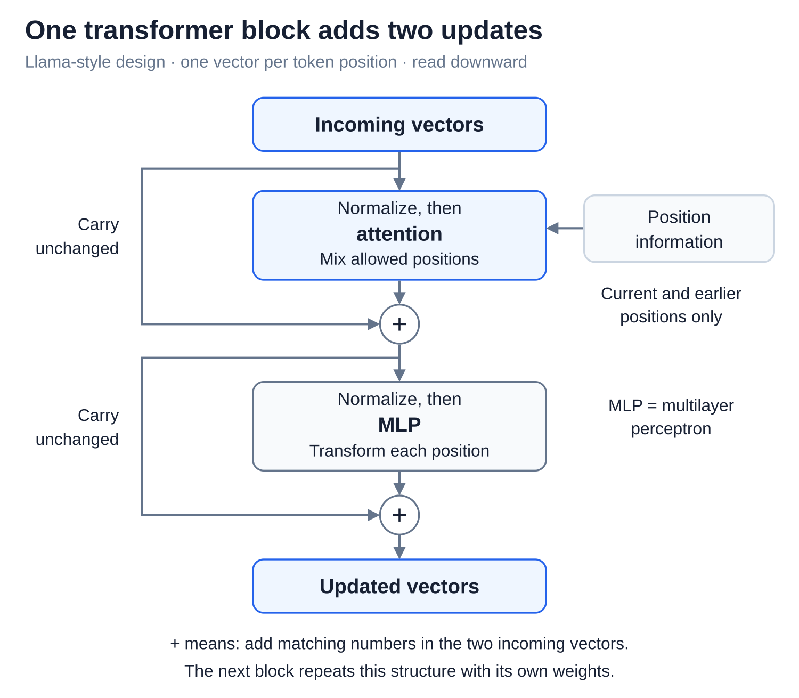
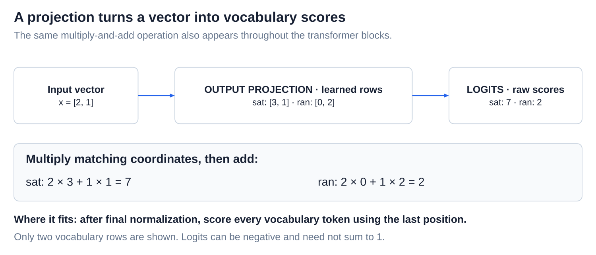

# The transformer forward pass

[Back to Artificial Intelligence](../Readme.md#content)

**A forward pass turns token IDs into scores for possible next tokens, using current weights.** It looks up vectors, updates them through transformer blocks, then calculates scores. The pass itself does not train the model or choose a token.

We will follow a **Llama-style decoder-only transformer**: a model built to continue a sequence. Other transformers arrange some components differently.

## The numbers we follow

A **vector** is an ordered list of numbers, such as `[2, 1]`. A **matrix** is a grid of numbers. A learned matrix can transform a vector by multiplying matching numbers and adding the results; we will try this below.

**Weights** are numbers learned during training. **Activations** are working values calculated for the current input. Keep these separate: new activations do not mean new weights.

## Step 1 — Look up a vector for each token

Suppose our toy tokenizer turns `The cat` into IDs `12, 87`. These are labels, not measurements: ID 87 does not mean “more cat” than ID 12.

The **embedding table** stores a learned vector for each token ID. Looking up both IDs gives two starting vectors, one per position. The same ID always selects the same row in this table; later computation makes its representation depend on context.

These two-number vectors are invented. Real models use much longer ones.

## Step 2 — Update the vectors through repeated blocks

A **transformer block** is a repeated bundle of operations. In this design, it applies attention, adds its update, applies an MLP, then adds that update. Each block has its own learned weights.

**Attention** lets a position combine information from other allowed positions. A **causal mask** blocks access to later positions: `cat` can use `The` and itself; `The` cannot use `cat`. Position information is used inside attention in this design, helping it account for token order.

An **MLP (multilayer perceptron)** is a small neural network that transforms each position's vector separately. It uses the same weights at every position within that block. It mixes numbers and applies nonlinear rules—rules more flexible than a single fixed multiply-and-add recipe. Attention moves information between positions; the MLP processes information within each position.

Before attention and before the MLP, **normalization** adjusts the input vector's scale. The side path carries the incoming vector unchanged to an addition. This **residual connection** adds the operation's update to that vector, matching number to number: `[2, 1] + [1, −1] = [3, 0]`. Add the first pair, then the second pair.

The running vectors form the **residual stream**. After all blocks, there is still one vector per position, now carrying information shaped by the allowed context.

## Step 3 — Turn the final vector into token scores

After the last block, a final normalization adjusts the vectors' scale. To continue `The cat`, we use the vector at the **last position**, `cat`. It can contain information about both tokens.

The **output projection** is a learned matrix that turns this vector into one score per vocabulary token. Suppose the normalized vector is `[2, 1]`. Using two invented rows of that matrix:

- `sat`: weights `[3, 1]` give `2 × 3 + 1 × 1 = 7`.
- `ran`: weights `[0, 2]` give `2 × 0 + 1 × 2 = 2`.

Multiply matching pairs, then add. The real calculation scores the whole vocabulary; we show only two entries.

These raw scores are **logits**. They can be negative and need not add up to 1. A higher score favors that token; it is not a measure of factual truth.

## How this becomes a reply

**Softmax** converts logits into probabilities that add up to 100%. A **decoding rule** then selects a token—for example, choosing the highest score or sampling using probabilities. The selected token is appended, and another pass supplies scores for the following token. Cached calculations can save repeated work.

Check your understanding: after one pass, what changed? **The working values.** Updating the weights requires additional training steps.

# Sources

- [LLaMA: architecture, §2.2](https://arxiv.org/html/2302.13971v1)
- [Meta: Llama 3 model implementation](https://github.com/meta-llama/llama3/blob/main/llama/model.py)
- [Transformer Circuits: residual stream and attention](https://transformer-circuits.pub/2021/framework/index.html)
- PyTorch: [Embedding](https://docs.pytorch.org/docs/2.15/generated/torch.nn.Embedding.html), [Linear](https://docs.pytorch.org/docs/2.15/generated/torch.nn.Linear.html), [Softmax](https://docs.pytorch.org/docs/2.15/generated/torch.nn.Softmax.html).
- [Hugging Face: generation strategies](https://huggingface.co/docs/transformers/en/generation_strategies)
