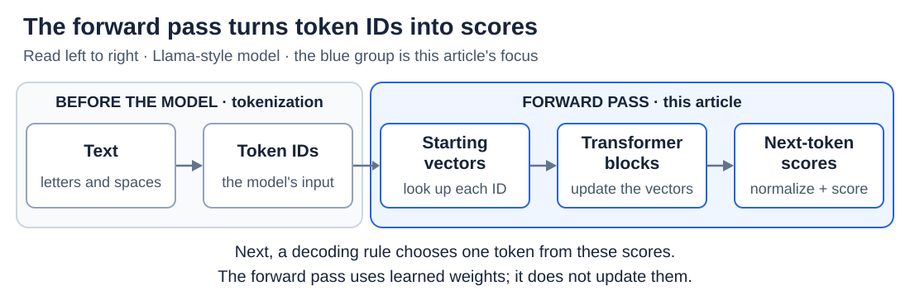

# Internals: The transformer forward pass

[Back to Artificial Intelligence](../Readme.md#content)

**A forward pass is one run of the model: token IDs go in, and a score for every possible next token comes out.** It uses the model's learned weights without changing them, and it does not choose the next token by itself.

## Where this fits

[Tokens and tokenization](../Tokens%20and%20tokenization/Readme.md) has already turned the text into token IDs. The forward pass is everything between those IDs and the next-token scores:

Read left to right. The blue group covers the forward pass, from looking up vectors to producing scores.

To write a reply, the model repeats this run once for every new token. This article gives the whole route; the next articles zoom in on its parts: [Embeddings and position information](../Embeddings%20and%20position%20information/Readme.md), [Attention: queries, keys, values, and heads](../Attention/Readme.md), [The residual stream and normalization](../The%20residual%20stream%20and%20normalization/Readme.md), and [MLPs, nonlinearities, and mixture of experts](../MLPs%20and%20mixture%20of%20experts/Readme.md).

We follow a **Llama-style decoder-only transformer**, a design built to continue text. Other transformers arrange some parts differently.

## Two kinds of numbers

A **vector** is a list of numbers, such as `[2, 1]`; the model represents each token as one. **Weights** are numbers learned during training and stored in the model. **Activations** are working numbers calculated for the current input. A forward pass creates new activations but leaves the weights alone, so running the model does not teach it anything.

## Step 1 — Look up a vector for each token

The model keeps an **embedding table** with one learned vector for each token ID. In the diagram, the toy input `The cat` has IDs 12 and 87, and each ID selects its row of the table. That row becomes the token's starting vector. The same ID always starts with the same vector; context changes it later. Real vectors are much longer: the 7-billion-parameter LLaMA model uses 4,096 numbers per token.

## Step 2 — Refine the vectors through repeated blocks

A **transformer block** is a unit that is stacked many times, 32 times in that LLaMA model, each copy with its own weights. Read the diagram from top to bottom. Each block does two jobs:

- **Attention** lets each position gather information from other positions. A **causal mask** allows only the current and earlier positions: `cat` can look at `The`, but `The` cannot look ahead at `cat`. Position information enters here, so the model can use word order.
- An **MLP (multilayer perceptron)** then works on each position's vector separately, transforming the information it already holds.

Before each job, **normalization** keeps the numbers at a stable scale. The side paths labeled “Carry unchanged” bring the incoming vectors to the `+` circles, where each job's result is added. So each job only supplies an update, and the running vectors that pass from block to block are called the **residual stream**.

After the last block, there is still one vector per position, but each now carries information from its context.

## Step 3 — Turn the last vector into scores

To continue `The cat`, the model uses the vector at the **last position**, `cat`, which has gathered information from both tokens. After a final normalization, a learned **output projection** compares this vector with a learned row for each vocabulary token and gives each token a score. The table in the diagram shows two of them: `sat` scores 7 and `ran` scores 2, so `sat` is favored. A real model scores its whole vocabulary at once.

These raw scores are called **logits**. They are not probabilities: they can be negative and need not add up to 1. A high score favors a token; it is not a measure of factual truth.

## How this becomes a reply

**Softmax** turns the logits into probabilities that add up to 100%. A **decoding rule** then picks one token, for example the most likely one or a random draw weighted by the probabilities; [From logits to text: decoding and sampling](../Decoding%20and%20sampling/Readme.md) covers this. The chosen token is added to the input, and another forward pass scores the next one. Saved results from earlier passes avoid repeating work, as [Prefill, decoding, and the KV cache](../Prefill%20and%20KV%20cache/Readme.md) explains.

Check your understanding: after one forward pass, what changed? **Only the working values.** The weights change only during training.

# Sources

- [LLaMA: architecture and model sizes, §2.2 and Table 2](https://arxiv.org/html/2302.13971v1)
- [Meta: Llama 3 model implementation](https://github.com/meta-llama/llama3/blob/main/llama/model.py)
- [Transformer Circuits: residual stream and attention](https://transformer-circuits.pub/2021/framework/index.html)
- PyTorch: [Embedding](https://docs.pytorch.org/docs/2.15/generated/torch.nn.Embedding.html), [Linear](https://docs.pytorch.org/docs/2.15/generated/torch.nn.Linear.html), [Softmax](https://docs.pytorch.org/docs/2.15/generated/torch.nn.Softmax.html).
- [Hugging Face: generation strategies](https://huggingface.co/docs/transformers/en/generation_strategies)
