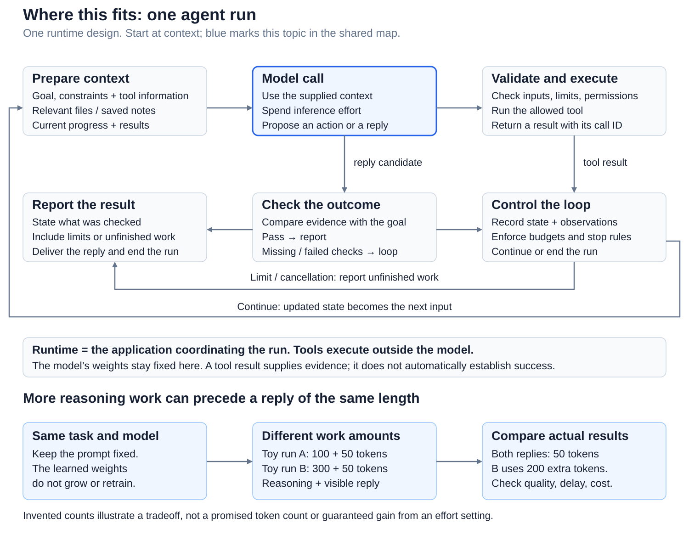
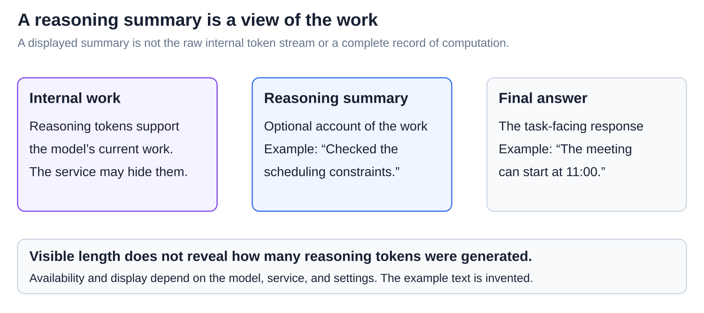
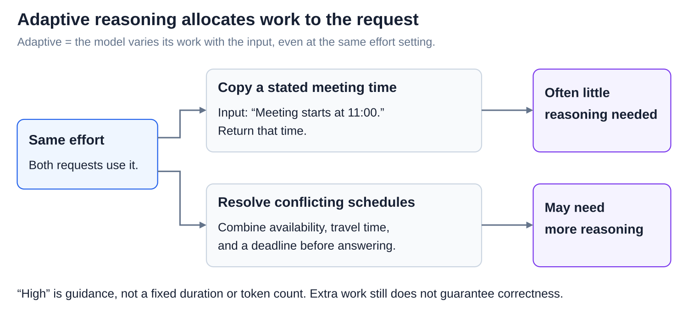
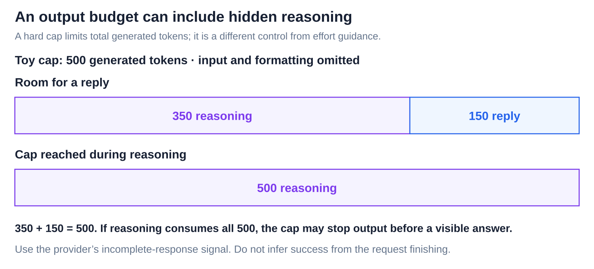
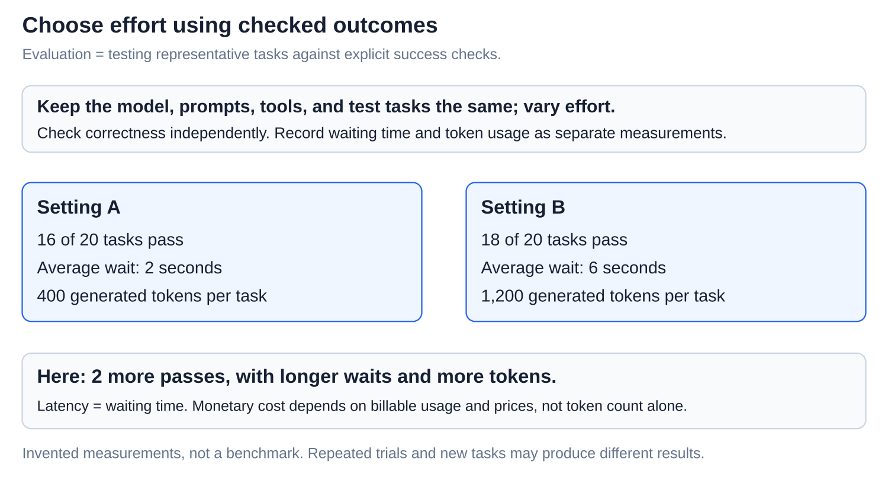

# Agents: Thinking levels

[Back to Artificial Intelligence](../Readme.md#content)

**A reasoning-effort setting guides how much work a model spends on a request. More work can help with difficult tasks, but can cost more time and tokens without guaranteeing a correct answer.**

## Where this fits

The shared map highlights **the model call**. Follow the arrows from context to a model call, then through tool results or an outcome check. The lower example separates reasoning work from the length of the visible reply.

## Effort changes work during use

**Inference-time compute** is computation spent while using the model: for example, reasoning longer, revising an attempt, or comparing candidates. **Effort** is soft guidance about that work, not one universal algorithm. **Weights**, the numbers learned in training, stay fixed during ordinary inference.

Follow input → model call → output. The **runtime**, the coordinating application, executes requested tools and enforces limits outside the model ([The agent loop](../The%20agent%20loop/Readme.md)).

## Generated work and visible text

A **token** is an encoded unit, often a word or word piece. **Reasoning tokens** support intermediate work; **reply tokens** form the visible answer. Reasoning can happen between tool calls too.

Both invented runs show 50 reply tokens. Their totals are 100 + 50 = 150 and 300 + 50 = 350, so the second generates 200 more tokens. The bars omit input and formatting tokens; they do not measure time or price.

A **reasoning summary** is a displayed account of the work, not the raw internal token stream or a complete record of computation.

The three panels separate hidden work, an optional summary, and the answer. Visible length does not reveal the amount of reasoning.

## Adaptive work and hard limits

**Adaptive reasoning** varies work with the request. Copying a stated time and resolving conflicting schedules can use different amounts at the same effort level.

An **output budget** is a hard cap on generated tokens. With reasoning models, it can include reasoning as well as visible output.

Read both bars against the same 500-token toy cap. If reasoning consumes the allowance, output may stop before a useful answer. Effort guidance and a cap serve different jobs.

## Controls are not interchangeable

**Model choice** selects learned weights and model design. **Temperature** changes the spread of next-token probabilities for sampling. **Verbosity** guides visible explanation length. Effort guides work on the request.

These effects can overlap; a provider’s effort setting can also affect reply length or tool use. Changing effort does not enlarge the model or add knowledge. [Decoding and sampling](../Decoding%20and%20sampling/Readme.md) explains temperature in detail.

## Measure the tradeoff

An **evaluation** tests representative tasks against success checks. **Latency** is waiting time. Compare checked correctness, latency, token usage, and monetary cost while holding the model and inputs fixed.

The invented comparison improves from 16 to 18 passes out of 20, with more tokens and waiting. Repeat trials; one sample does not guarantee future performance. Extra effort cannot replace missing evidence or outcome checks.

Provider examples, checked **2026-11-06**: OpenAI Responses uses `reasoning.effort`; Claude Messages uses `output_config.effort`. Supported levels and defaults vary by model. Both bill generated reasoning as output tokens, including hidden work. Equal level names do not promise equal work across providers.

# Sources

- [OpenAI: effort, reasoning tokens, summaries, and output limits](https://developers.openai.com/api/docs/guides/reasoning)
- [Claude: effort and its effects](https://platform.claude.com/docs/en/build-with-claude/effort)
- [Claude: adaptive thinking, caps, and billing](https://platform.claude.com/docs/en/build-with-claude/thinking-steering-and-cost)
- [Claude: thinking summaries](https://platform.claude.com/docs/en/build-with-claude/thinking)
- [Snell et al.: allocating inference-time computation](https://arxiv.org/html/2408.03314v1)
- [Hugging Face: temperature and generation settings](https://huggingface.co/docs/transformers/en/main_classes/text_generation)
