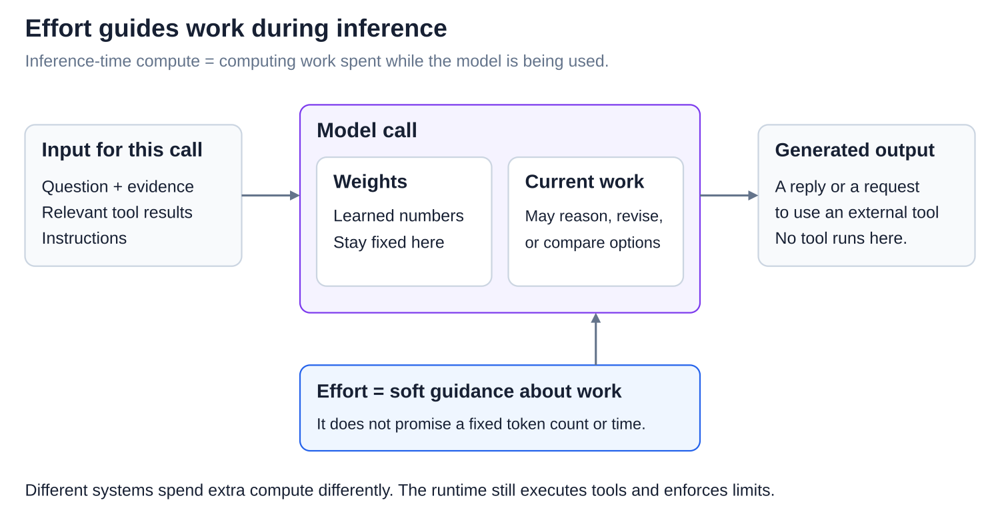
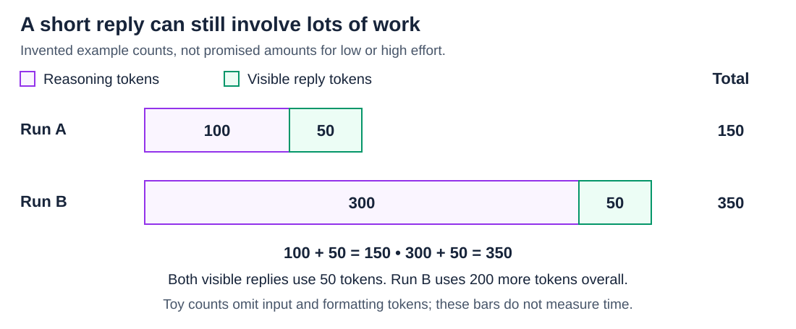
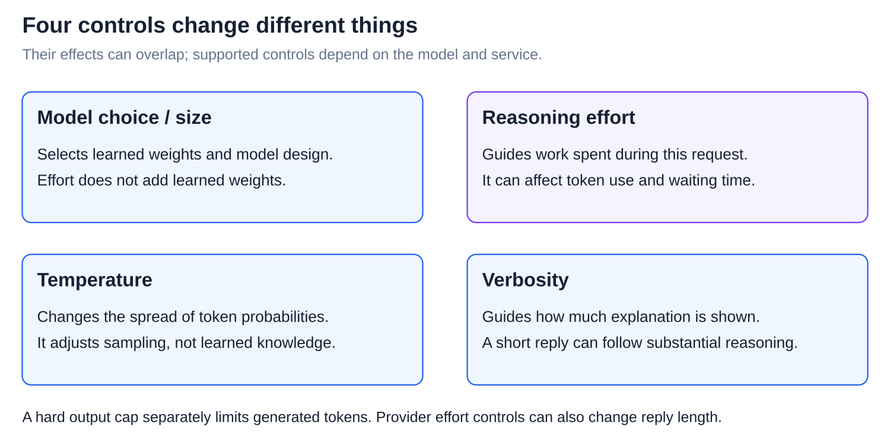

# Agents: Thinking levels

[Back to Artificial Intelligence](../Readme.md#content)

**A reasoning-effort setting guides how much work a model spends solving a request. Higher effort can help with harder tasks, often at the cost of more waiting and more tokens. It does not guarantee a correct answer.**

## Where this fits

[The agent loop](../The%20agent%20loop/Readme.md) repeatedly calls a model and runs tools. Effort affects work inside those model calls. The **runtime**, the application code coordinating the loop, still runs tools and enforces the task's limits.

Read left to right. The model receives the current **context**, its input information, plus an effort setting. It produces an answer or a tool request. Raising effort does not enlarge the model or change its **weights**, the numerical settings learned in training.

**Inference-time compute** means computing work spent during use. It can include longer reasoning, revising an attempt, or generating several candidates and checking them. An effort setting is one way to influence that work; it does not specify one universal algorithm.

## What “thinking” means here

A **token** is a piece of text. **Reasoning tokens** are generated for intermediate work, such as considering an approach or checking a result, rather than forming the final reply. Reasoning can also happen between tool calls.

The interface may hide this work or show a summary. A displayed summary is not a complete record of the model's internal computation. A short answer can therefore follow substantial reasoning, while a long answer can mostly be explanation.

**Adaptive reasoning** means the model adjusts its work to the request. At the same effort level, copying a meeting time from a note may take little reasoning, while resolving a schedule with conflicting constraints may take more. A level such as `high` is guidance, not an exact promise of seconds or tokens.

## Short replies can still involve lots of work

These are invented counts for two runs, not measurements or promised counts for particular effort levels. Purple shows reasoning; green shows the visible reply.

Run A uses **100 reasoning tokens + 50 reply tokens = 150 tokens**. Run B uses **300 + 50 = 350**. Just add the two piles. Both replies have 50 tokens, but B generates 200 more tokens overall. This toy count leaves out input and formatting tokens.

OpenAI and Claude bill reasoning tokens as output tokens, even when that reasoning is hidden. More reasoning can increase **latency**, the time you wait, and cost. Token counts alone do not give an exact time or price: the model, service, and other work matter too.

An output-token cap can include reasoning as well as the visible reply. If reasoning uses up the allowance, the response may end before a useful answer appears. Effort guidance and a hard cap serve different purposes.

## Four controls with different jobs

The diagram separates what each control is intended to change. They are not necessarily independent: a provider's effort control can also affect reply length or tool use.

## Provider settings, checked 2026-11-05

- **OpenAI Responses:** `reasoning.effort` supports model-dependent levels, such as `low`, `medium`, and `high`. Supported values and defaults vary by model.
- **Claude Messages:** `output_config.effort` guides token spending across thinking, reply text, and tool calls. With adaptive thinking, the model decides when and how deeply to reason.

The same level name does not mean the same amount of work across models or providers. Check the available controls in the chosen model's documentation.

## Choose effort by results

Compare settings on representative tasks while keeping the model and prompt the same. Check correctness, waiting time, and token usage. Use higher effort when the improvement justifies its cost. Extra work cannot guarantee success or replace missing evidence, useful tools, and checking the result.

# Sources

- [OpenAI: reasoning effort, tokens, and output limits](https://developers.openai.com/api/docs/guides/reasoning)
- [Claude: effort and its effects](https://platform.claude.com/docs/en/build-with-claude/effort)
- [Claude: adaptive reasoning](https://platform.claude.com/docs/en/build-with-claude/thinking-steering-and-cost)
- [Claude: thinking output and billing](https://platform.claude.com/docs/en/build-with-claude/thinking)
- [OpenAI: temperature and verbosity](https://developers.openai.com/api/reference/resources/chat/subresources/completions/methods/create)
- [Snell et al.: allocating inference-time computation](https://arxiv.org/html/2408.03314v1)
