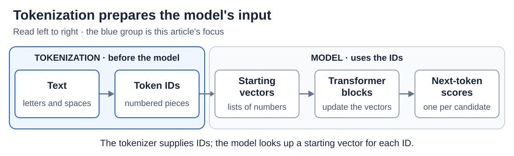

# Tokens and tokenization

[Back to Artificial Intelligence](../Readme.md#content)

**Tokenization turns text into a list of numbered pieces called tokens. A language model never sees letters or words directly; it sees only this list of token IDs.** A token is often a whole common word or a piece of a rarer one, so a token is not the same as a word or a letter.

## Where this fits

A model can only calculate with numbers, so text must become numbers first. Tokenization is that first step, and it happens before the model runs:

Read left to right. The blue group shows tokenization; the gray group shows what the model does next.

[The transformer forward pass](../The%20transformer%20forward%20pass/Readme.md) follows what the model does with the IDs. When the model replies, the same tokenizer turns the chosen IDs back into text.

## Pieces, vocabulary, and IDs

A **tokenizer** is the program that splits text into pieces and looks up a number for each one. Its **vocabulary** is the fixed list of pieces it knows, each with an ID. Pieces can be whole words, parts of words, punctuation, spaces, or smaller units of text.

Read the diagram from top to bottom. The text `two cats!` becomes four pieces, each piece gets an ID, and **decoding** turns the IDs back into the same text. `[space]` stands for one real space, which here belongs to the piece `[space]cat`. The pieces and IDs are invented; a real tokenizer may split this text differently.

Two points often surprise beginners:

- An ID is only a label. ID 17 is not “bigger” or “more important” than ID 8.
- IDs belong to one tokenizer. Another tokenizer may split the same text differently and give the same piece a different ID, so a model must always be used with its own tokenizer.

## How a tokenizer chooses its pieces

The vocabulary is learned once, from a large sample of text, separately from training the model's weights. The most popular method, **byte-pair encoding (BPE)**, starts from single characters and repeatedly glues together the neighboring pair that appears most often. As a result, common words end up as single tokens, while rare words are built from several smaller pieces.

The diagram shows one round on a tiny dataset where `hug` appears three times and `pug` twice. The pair `u` + `g` occurs in both words, so it is the most frequent pair, and BPE adds `ug` to the vocabulary. Later rounds can glue `ug` to other pieces, so tokens can grow into whole words.

Once learned, the rules are frozen: using the tokenizer only applies them, and it does not learn new pieces from your messages. **Unigram** and **WordPiece** are other methods with the same goal.

## Bytes: a safety net for any text

Computers store text as **bytes**, small units with 256 possible values, and one character can take several bytes. **Byte-level BPE** starts from all 256 byte values, so it can encode any text, even characters it never saw, without an “unknown” token. The price is that a token boundary can fall inside a character, so one token may not show a complete character by itself.

Pieces are chosen by frequency, not by grammar, so a “subword” is not necessarily a meaningful part of a word.

## Special tokens mark structure

Some vocabulary entries are not ordinary text. **Special tokens** mark things such as the end of a text or the border between chat messages. A **chat template** wraps each message with role markers before tokenization, so the model can tell user and assistant messages apart inside one long token list. Their exact names and format depend on the model, and they count toward the token total too.

## Why tokens matter in practice

- **Context limits** are counted in tokens, not words. In a toy model where the input and the reply share 1,000 tokens, a 700-token input leaves 300 for the reply.
- **Languages differ:** the same message can need more tokens in one language than in another. More tokens use more context and can cost more where a service charges per token.
- **Spelling is hidden:** the model sees `cats` as two pieces, not four letters, so a spelling task has to recover the letters inside each piece.
- **Small changes count:** a space, a punctuation mark, or a capital letter can change the split. Count with the model's own tokenizer rather than guessing.

## Check your understanding

If two models receive the same sentence, must they receive the same token IDs or token count? **No.** Their tokenizers may use different vocabularies and splitting rules.

# Sources

- [Hugging Face: Tokenizers, IDs, and special tokens](https://huggingface.co/docs/transformers/main_classes/tokenizer)
- [Hugging Face: BPE training and tokenization](https://huggingface.co/learn/llm-course/en/chapter6/5)
- [Hugging Face: Subword and byte-level algorithms](https://huggingface.co/docs/transformers/tokenizer_summary)
- [Unicode: UTF encodings and bytes](https://www.unicode.org/faq/utf_bom.html)
- [Hugging Face: Chat templates](https://huggingface.co/docs/transformers/chat_templating)
- [Petrov et al.: Tokenization differences across languages](https://arxiv.org/abs/2305.15425)
