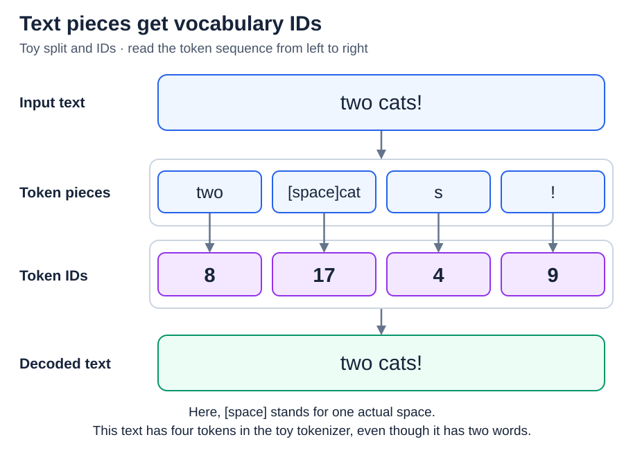
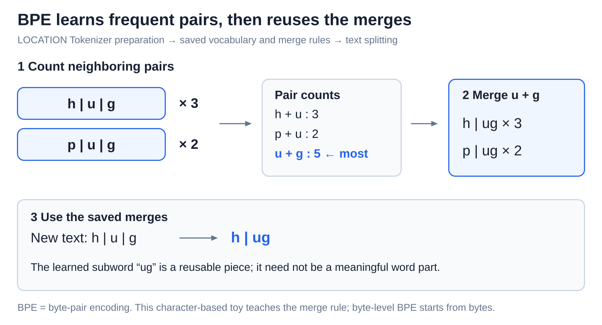

# Tokens and tokenization

[Back to Artificial Intelligence](../Readme.md#content)

**Tokenization turns text into a sequence of pieces called tokens, each represented by an integer token ID. A token is not necessarily a word or a letter.**

Start with the mapping, then see how a tokenizer learns useful pieces and why token boundaries matter.

## Pieces, vocabulary, and IDs

A **tokenizer** applies rules for splitting and encoding text. Its **vocabulary** lists the available tokens and their IDs. Tokens can represent whole words, word parts, punctuation, spaces, or smaller units of text.

In this toy example, `two cats!` becomes four tokens. `[space]` in the diagram stands for one actual space. The pieces and IDs are invented for teaching; a real tokenizer may split this text differently.

* The ID `17` is a label, not a measure of importance.
* **Encoding** produces the ID sequence.
* **Decoding** converts IDs back into text.
* Use the model's own tokenizer: the same ID can mean something different in another vocabulary.

## How byte-pair encoding builds pieces

**Byte-pair encoding (BPE)** is a common tokenization method. During tokenizer training, it starts with small units and repeatedly merges the most frequent allowed neighboring pair into a new token. A pair can contain previously merged pieces, so tokens can grow longer than two letters.

In the tiny dataset below, `hug` appears three times and `pug` twice. The pair `u` + `g` appears in both words: **3 + 2 = 5 appearances**. That is more than either other pair, so the tokenizer learns to merge it into `ug`.

More rounds build more pieces until a stopping target is reached. In real tokenizers, text may first be split into chunks, and merges respect those boundaries. **Unigram** and **WordPiece** are other subword methods; not every tokenizer uses BPE.

Learning these rules is separate from training the language model's weights. During ordinary BPE use, the tokenizer applies its saved merge rules in their learned priority order. It does not learn a new vocabulary from each chat message.

## Bytes are smaller than many characters

A **byte** is a small unit of computer data with 256 possible values. A character can take one or several bytes to encode.

**Byte-level BPE** starts from all 256 byte values and merges byte sequences. This lets it represent text containing unfamiliar characters without needing an “unknown character” token. A token boundary can fall inside a character's bytes, so one token may not display as a complete character by itself.

“Subword” therefore does not mean “meaningful word part.” Token boundaries are chosen by the tokenizer's rules, not by a grammar teacher.

## Special tokens mark structure

Some vocabulary entries have special roles, such as marking the end of text or a message boundary. A **chat template** formats messages and may add role markers before tokenization. These markers let the model distinguish user and assistant messages within one token sequence.

Their names and exact format depend on the model. Chat formatting contributes to token counts too; counting only the visible words can miss it.

## Why the boundaries matter

- **Context limits:** a text context budget counts tokens, not words. In a toy shared budget of 1,000 tokens, 700 input tokens leave 300 for output: subtract the 700 already used. Actual model limits vary.
- **Languages:** translations of the same content can use different numbers of tokens. More pieces use more context space and can cost more in services that charge per token.
- **Spelling:** the word `cats` spans two tokens here but has four letters. Counting tokens is not counting letters; spelling tasks must work with the letters inside the pieces.
- **Exact text:** spaces, punctuation, and capitalization can change the split. Measure with the intended tokenizer instead of assuming a fixed number of words per token.

Tokenization chooses the model's input units. The next article follows what the transformer does with their IDs.

## Check your understanding

If two models receive the same sentence, must they receive the same token IDs or token count? **No.** Their tokenizers may use different vocabularies and splitting rules.

# Sources

- [Hugging Face: Tokenizers, IDs, and special tokens](https://huggingface.co/docs/transformers/main_classes/tokenizer)
- [Hugging Face: BPE training and tokenization](https://huggingface.co/learn/llm-course/en/chapter6/5)
- [Hugging Face: Subword and byte-level algorithms](https://huggingface.co/docs/transformers/tokenizer_summary)
- [Unicode: UTF encodings and bytes](https://www.unicode.org/faq/utf_bom.html)
- [Hugging Face: Chat templates](https://huggingface.co/docs/transformers/chat_templating)
- [Petrov et al.: Tokenization differences across languages](https://arxiv.org/abs/2305.15425)
