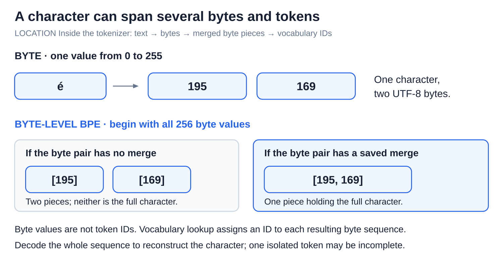
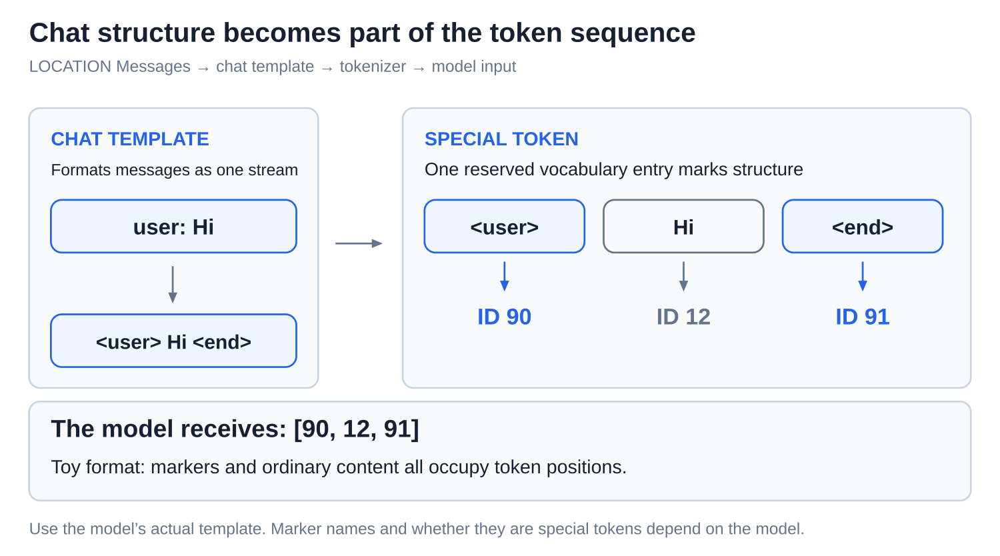
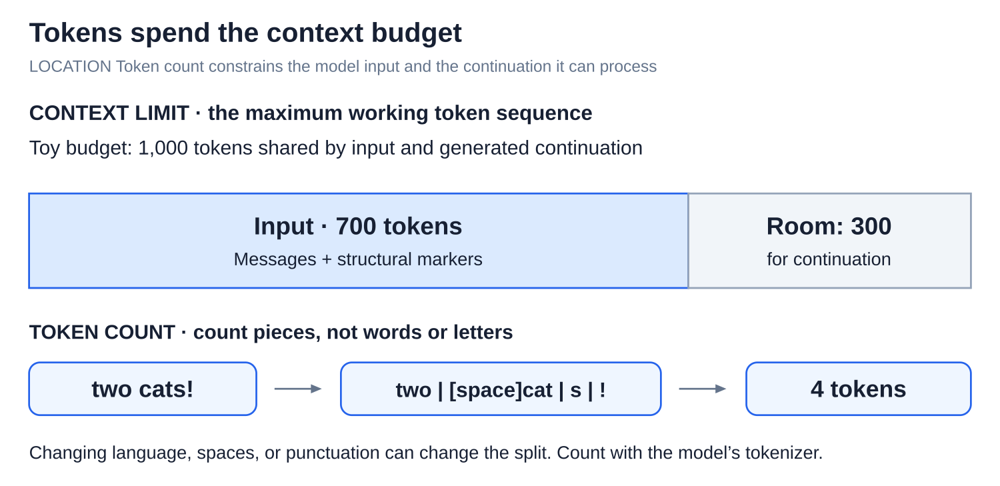

# Internals: Tokens and tokenization

[Back to Artificial Intelligence](../Readme.md#content)

**Tokenization turns text into an ordered list of token IDs.** A **token** is one piece of text: a word, part of a word, punctuation, or even part of a character. The model receives numeric IDs, not visible letters.

## Where this fits

Tokenization happens before the model runs: text becomes numeric IDs that the model can use. The [transformer forward pass](../The%20transformer%20forward%20pass/Readme.md) then turns those IDs into next-token scores.

The upper map highlights the tokenizer within the text-to-output flow. The lower panel follows one text through its pieces and IDs.

## Tokenizer, vocabulary, IDs, and decoding

A **tokenizer** splits text and assigns IDs. Its **vocabulary** is the table of known pieces and their numbers. A **token ID** is a label, not a size or importance score. **Decoding** looks up pieces from IDs and joins them back into text. Each term has its own panel below.

Follow the invented split of `two cats!`: `two`, `[space]cat`, `s`, `!` become `[8, 17, 4, 9]`. `[space]` means one actual space. A real tokenizer can split this differently. IDs belong to one vocabulary, so use the model's own tokenizer.

## BPE learns reusable pieces

**Byte-pair encoding (BPE)** learns frequent neighboring pairs from training text and merges them into larger pieces. A **subword** is a reusable piece smaller than a word; it need not be a meaningful grammatical part.

In the toy corpus, `hug` occurs three times and `pug` twice. The pair `u` + `g` occurs five times, more than either competing pair, so it becomes `ug`. Later rounds can build larger pieces. This character-based example isolates the merge rule. Tokenizer training learns the vocabulary and merge order; using it applies saved rules without learning from your message.

## Bytes and byte-level BPE

A **byte** stores one of 256 values. A character can occupy several bytes. **Byte-level BPE** starts from all 256 byte values, then learns merges, so every byte sequence has a representation without an unknown-piece fallback.

The character `é` uses two bytes in UTF-8, a standard text encoding. Depending on learned merges, it can span token pieces. Byte values are not token IDs. Decode the full sequence: one isolated token may hold only part of a character.

## Chat templates and special tokens

A **chat template** formats messages into one text stream, marking roles and message boundaries. A **special token** is a reserved vocabulary entry used for structure, such as an end marker. Model-specific templates determine which markers to use.

In this toy, two structural markers and `Hi` make three tokens. Real marker names and formats differ; role text is not necessarily one special token.

## Context limits and token counts

The **context limit** bounds the token sequence the model can work with. A **token count** measures pieces, not words or letters. The diagram uses a toy shared input-and-output allowance.

With a 1,000-token allowance, 700 input tokens leave 300 for the continuation. Different languages and small changes in spaces or punctuation can change the split. Count with the actual tokenizer instead of guessing from word count. Because pieces can hide several letters, spelling tasks require recovering letters inside them.

Check: must two models receive identical IDs for the same sentence? **No.** Their tokenizers can use different pieces and labels.

# Sources

- [Hugging Face: Tokenizers, IDs, and special tokens](https://huggingface.co/docs/transformers/main_classes/tokenizer)
- [Hugging Face: BPE training and tokenization](https://huggingface.co/learn/llm-course/en/chapter6/5)
- [Hugging Face: Subword and byte-level algorithms](https://huggingface.co/docs/transformers/tokenizer_summary)
- [Unicode: UTF encodings and bytes](https://www.unicode.org/faq/utf_bom.html)
- [Hugging Face: Chat templates](https://huggingface.co/docs/transformers/chat_templating)
- [Petrov et al.: Tokenization differences across languages](https://arxiv.org/abs/2305.15425)
- [Meta: Llama 3 implementation behind the shared model map](https://github.com/meta-llama/llama3/blob/main/llama/model.py)
