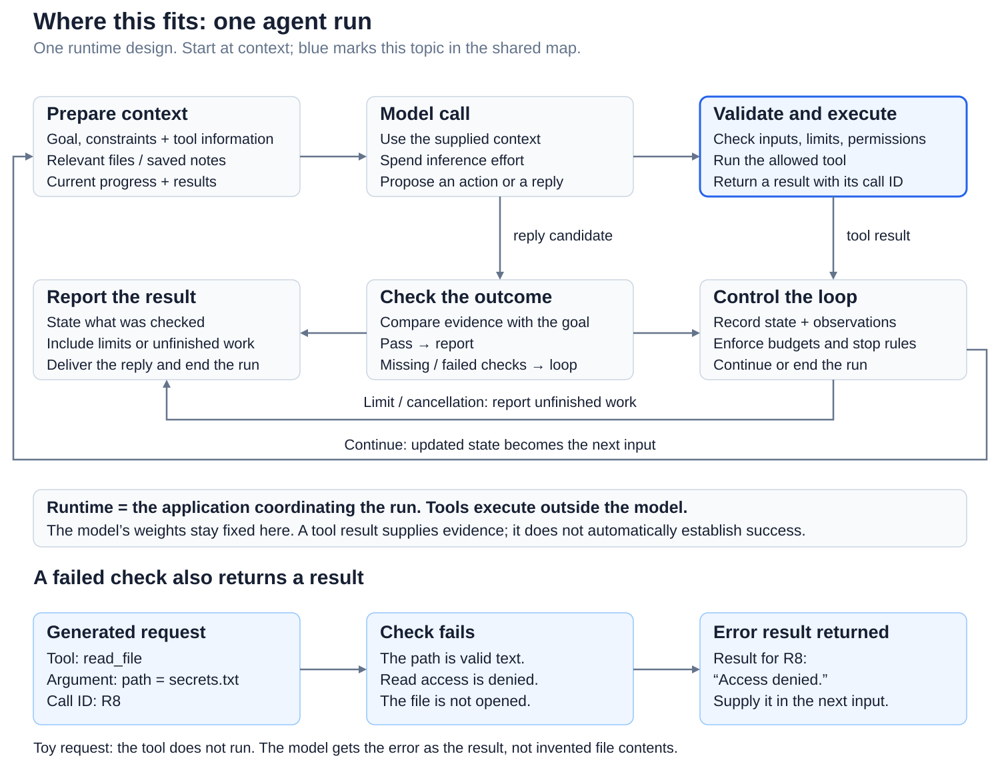
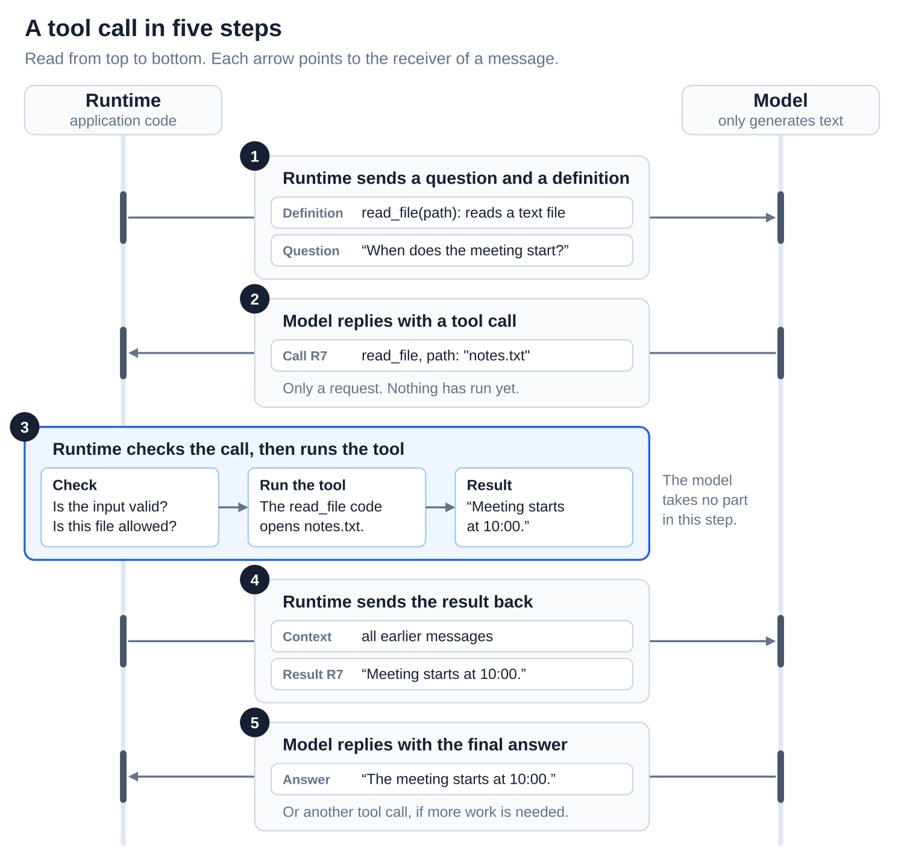
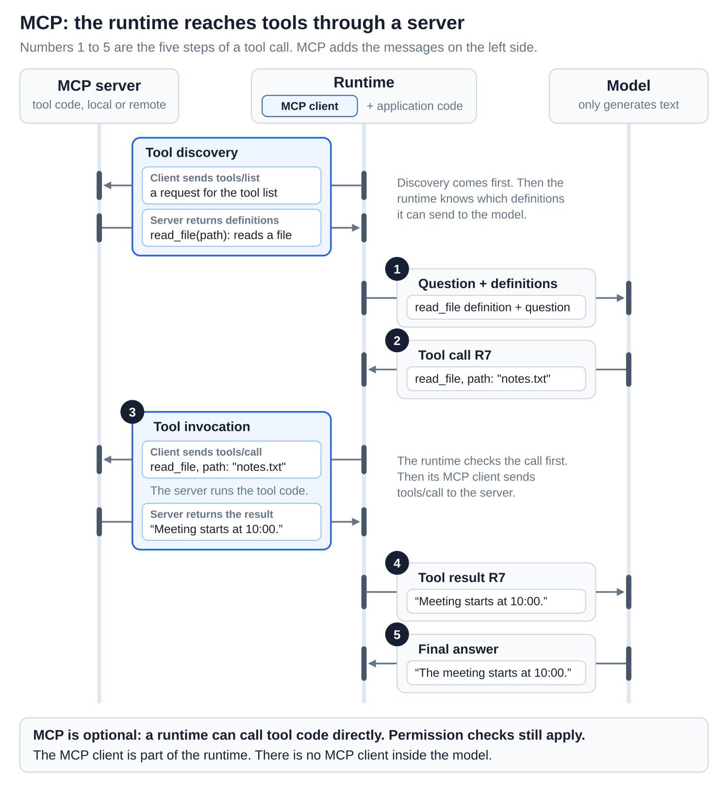

# Agents: Tool calls from model output to execution

[Back to Artificial Intelligence](../Readme.md#content)

**A tool call is a model-generated request, not an executed action.**

Software checks the request, invokes real functionality, and returns the result. Follow a lookup of the meeting time in `notes.txt`.

## Where this fits

In the shared map, the highlighted box “Validate and execute” is this topic. Follow the arrows from context to a model call, then through tool results or an outcome check. The lower example previews a request that a check stops: the tool does not run, and the error comes back as the result.

## One tool call in five steps

A **tool** is callable functionality, such as reading a file. The **runtime** is the application code that talks to the model and runs tools. The model only generates text, so the two take turns.

Read the five numbered steps from top to bottom. Each arrow points to the receiver.

1. **The runtime sends a question and a tool definition.** A **tool definition** gives a tool's name, description, and input rules. It tells the model that `read_file` exists. It does not hand over file contents or run any code.
2. **The model replies with a tool call.** The call names the tool and supplies **arguments**, the values for this one invocation: the path `notes.txt`. It also carries a **call identifier (call ID)**, here `R7`. Nothing has run yet.
3. **The runtime checks the call, then runs the tool.** **Validation** asks whether the arguments follow the input rules. **Authorization** asks whether reading this file is permitted. Only then does real code open the file. The model takes no part in this step.
4. **The runtime sends the result back.** The **result** carries the same call ID, so the model can match it to its request. It joins the earlier messages in the next model input, or **context**.
5. **The model answers** from the returned text, or requests another tool.

Three rules keep this safe:

- Enforce the checks in software. An instruction to the model is not an access control.
- If a check or the tool fails, return the error, such as “access denied” or “file not found,” as the result. Never invent file contents. The lower example in the map shows this case.
- When several calls are open, match results by call ID, not by arrival order.

Field names and message formats differ between model providers.

## Where MCP fits

**Model Context Protocol (MCP)** defines communication rules that connect applications to tools and other context sources. MCP calls the application the **host**; here, that is the runtime. Its **client** component talks to a **server**, the program that holds the tool code.

Read from top to bottom. The numbers 1 to 5 are the same five steps, and MCP adds the two exchanges on the left side. **Tool discovery** comes first: the client asks what is available (`tools/list`), and the runtime passes the returned definitions to the model in step 1. **Tool invocation** replaces the direct call in step 3: after the runtime's checks, the client sends `tools/call` with the arguments, and the server runs the tool. Nothing changes on the model's side. A server may run locally or remotely. MCP is optional: direct tool integrations also work, and both need permission checks.

[The agent loop](../The%20agent%20loop/Readme.md) explains how repeated exchanges pursue a goal. [Reliability](../Reliability/Readme.md) separates tool receipts from verified outcomes.

# Sources

- [OpenAI: function-calling concepts and sequence diagram](https://developers.openai.com/api/docs/guides/function-calling)
- [Claude: tool definitions and schemas](https://platform.claude.com/docs/en/agents-and-tools/tool-use/define-tools)
- [Claude: matching tool results and errors](https://platform.claude.com/docs/en/agents-and-tools/tool-use/handle-tool-calls)
- [MCP: host, client, and server](https://modelcontextprotocol.io/docs/learn/architecture)
- [MCP: discovery, invocation, and access checks](https://modelcontextprotocol.io/specification/2026-07-28/server/tools)
