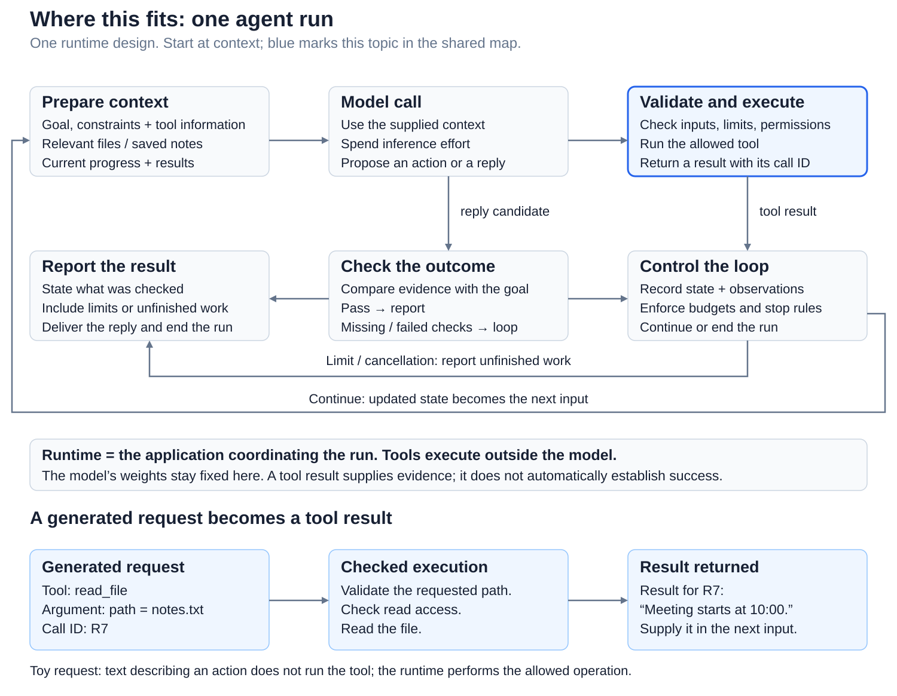
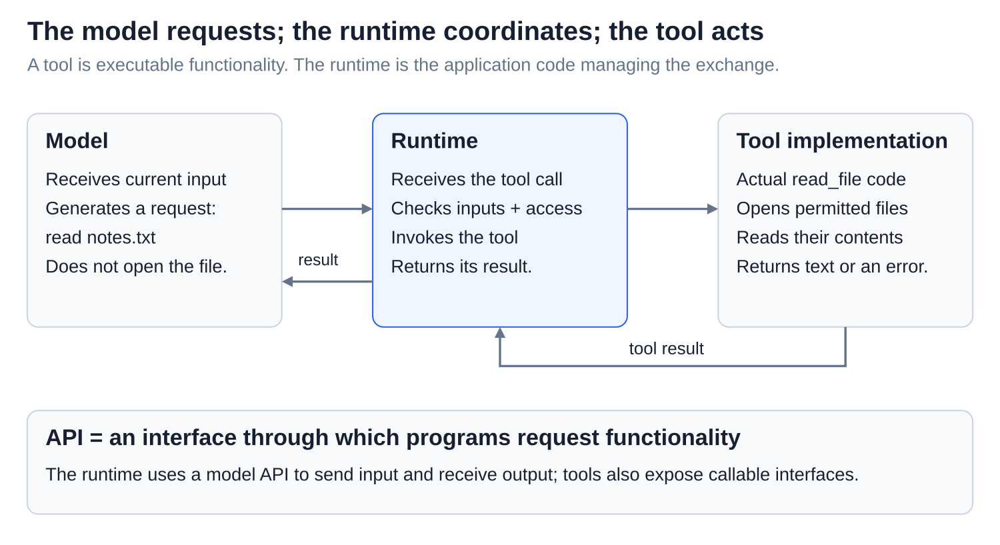
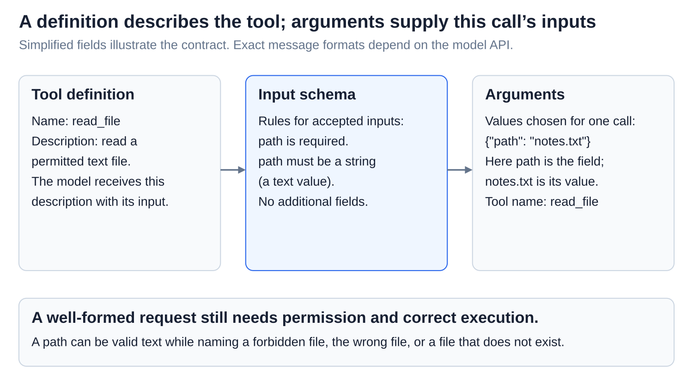
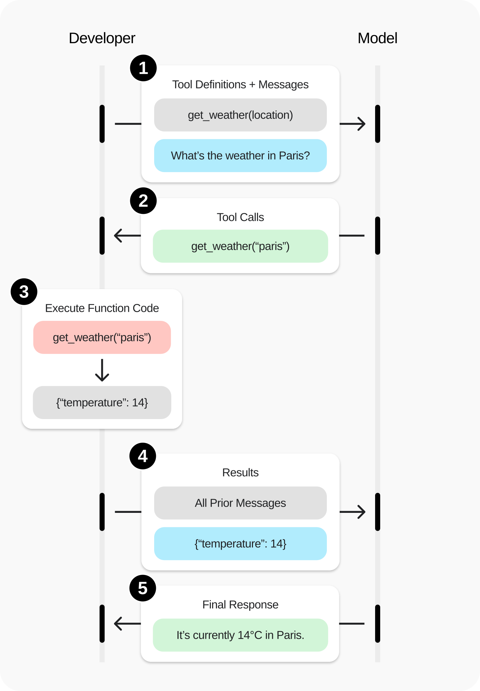
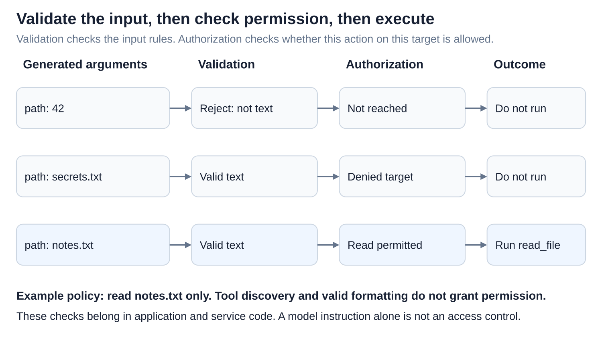
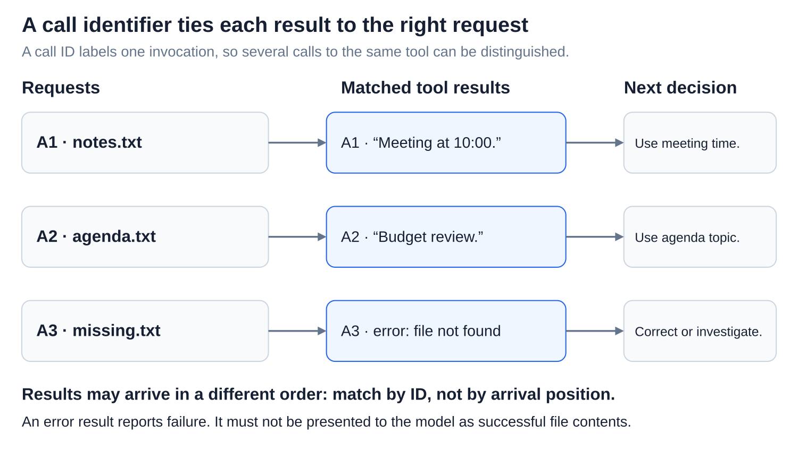
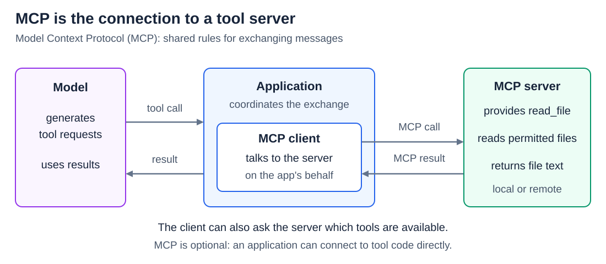

# Agents: Tool calls from model output to execution

[Back to Artificial Intelligence](../Readme.md#content)

**A tool call is a model-generated request, not an executed action.** Software checks the request, invokes real functionality, and returns the result. Follow a lookup of the meeting time in `notes.txt`.

## Where this fits

The shared map highlights **tool execution**. Follow the arrows from context to a model call, then through tool results or an outcome check. The lower example follows a request through checked execution to a matching result.

## Model, runtime, tool, and API

A **tool** is callable functionality, such as reading a file. The **runtime** is the application code coordinating model calls, checks, and tool execution. An **application programming interface (API)** lets programs request functionality from each other.

Read the participants from left to right, then follow results back. The model generates the request; executable code reads the file. Tools can run locally or on a remote service. The example uses an application-run file tool.

## Definitions and arguments

A **tool definition** gives a name, description, and input rules. An **input schema** specifies those rules: required fields and allowed value types. Here, `read_file` requires a `path` containing text, called a **string**.

**Arguments** are the values supplied for one invocation: `{"path": "notes.txt"}` chooses a file. The definition describes what can be called; the arguments specify what this call asks for. Sending a definition does not give the model the file's contents or execute the code.

## Follow a complete exchange

Follow the five stages. The runtime supplies the question and definition. The model requests `read_file` for `notes.txt`. After checks, the tool reads the file. Its **result**, “Meeting starts at 10:00,” is included in a later model input, or **context**. The model can now answer using the returned evidence or request more work.

## Validation and authorization are separate

**Validation** checks whether inputs satisfy the rules. **Authorization** checks whether this operation on this target is permitted.

Read the rows: `42` fails the text rule; `secrets.txt` is text but is forbidden by the example policy; `notes.txt` passes both checks. A valid, allowed request can still name a missing file or fail during execution. Enforce checks in software; a model instruction is not an access control.

## Match the result to its request

A **call identifier (call ID)** labels one tool invocation. The returned result must identify the request it answers, especially when several calls use the same tool.

Match by ID, not arrival order. A failure should return an error result, such as “file not found,” so the model can correct the request or investigate. Do not turn a failed read into invented file contents. Field names and message formats differ between model APIs.

## Where MCP fits

**Model Context Protocol (MCP)** defines communication rules connecting applications to tools and other context sources. The **host** is the application; its **client** component talks to a **server**, the program exposing those capabilities.

Follow the upper request and result arrows, then the two lower panels. **Tool discovery** asks what is available (`tools/list`); **invocation** requests a particular tool with arguments (`tools/call`). The host supplies relevant definitions and results to the model. A server may run locally or remotely. MCP is optional: direct tool integrations also work, and both need permission checks.

[The agent loop](../The%20agent%20loop/Readme.md) explains how repeated exchanges pursue a goal. [Reliability](../Reliability/Readme.md) separates tool receipts from verified outcomes.

# Sources

- [OpenAI: function-calling concepts and sequence diagram](https://developers.openai.com/api/docs/guides/function-calling)
- [Claude: tool definitions and schemas](https://platform.claude.com/docs/en/agents-and-tools/tool-use/define-tools)
- [Claude: matching tool results and errors](https://platform.claude.com/docs/en/agents-and-tools/tool-use/handle-tool-calls)
- [MCP: host, client, and server](https://modelcontextprotocol.io/docs/learn/architecture)
- [MCP: discovery, invocation, and access checks](https://modelcontextprotocol.io/specification/2026-07-28/server/tools)
