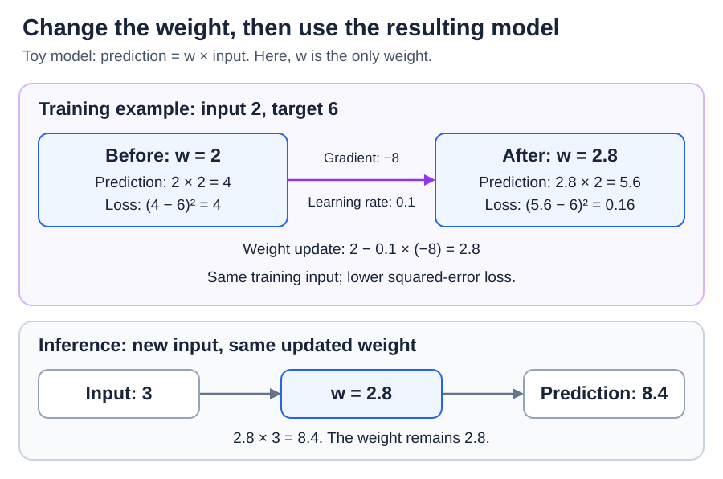
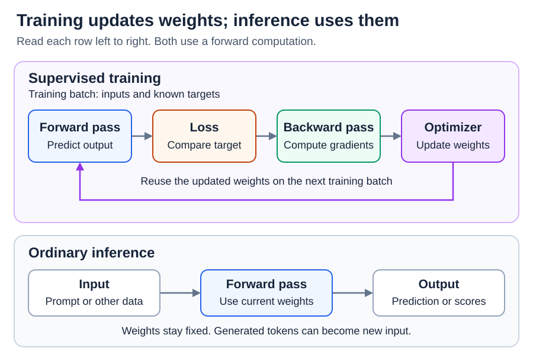

# Training: Training vs. Inference

<sub>[Back to Artificial Intelligence](../Readme.md#content)</sub>

**Training changes a model's saved numerical settings to help it make better predictions.**

**Inference uses those settings to produce an answer.**

Think of a model as a calculating machine with adjustable knobs. The knobs are numbers called **parameters**, often called **weights**. Training adjusts them using feedback. During ordinary inference, their values stay fixed.

Let's use a very small machine so we can see every calculation.

## What does “toy model” mean?

**A toy model is a deliberately simple example made to explain an idea.** “Toy” does not name a special AI technique. It means we have removed most of the complexity so the important idea is easy to see.

Our machine has one knob, named `w`, and follows this rule:

```text
prediction = w × input
```

The **input** is the number we give the machine. The **prediction** is the answer it produces. The **weight** `w` is the number we can adjust.

For example, with `w = 2`, input `2` produces `4`. With `w = 3`, the same input produces `6`.

**We choose the multiplication rule. Training adjusts the value of `w`.** A language model uses a much more complicated calculation with many weights, but this small example lets us watch one weight change.

## Where does the correct answer come from?

For this example, we provide a training pair: **input `2`, expected answer `6`**. That expected answer is called the **target**. It comes from the training example; the machine does not already know how to produce it.

We choose `w = 2` as the starting setting. The first attempt is therefore:

```text
Prediction:   2 × 2 = 4
Target:       6
Error:        4 − 6 = −2
```

The minus sign tells us the prediction is too low. We need a way to score this mistake so the training program can compare different weight settings. That score is called the **loss**. A lower loss means a better result according to the scoring rule we chose.

## Why square the error?

For our example, we choose **squared error** as the loss:

```text
loss = (prediction − target)²
     = (4 − 6)²
     = (−2) × (−2)
     = 4
```

The little `²` means “multiply this number by itself.” **The answer is wrong by 2; its squared-error score is 4.** Those are different quantities.

Here are several possible predictions for the same target, `6`:

| Prediction | Error: prediction − 6 | Squared-error score |
| --- | --- | --- |
| `4` | `−2` | `4` |
| `6` | `0` | `0` |
| `8` | `+2` | `4` |
| `10` | `+4` | `16` |

Squaring is useful because:

- **Mistakes in either direction count.** Being 2 too low and 2 too high both score `4`. If we simply averaged signed errors, `−2` and `+2` would cancel, hiding the mistakes.
- **Bigger misses receive more weight.** Doubling the size of a miss from `2` to `4` makes its score four times as large: `4` becomes `16`.
- **It gives a smooth curve.** This lets us calculate which way to adjust the weight to reduce the score.

**Training does not require squared error.** Absolute error, which ignores the minus sign without squaring, is another option. Squared error gives unusually large mistakes more influence, which is not always desirable. We choose the scoring rule to suit the task.

With several examples, averaging their squared-error scores gives **mean squared error (MSE)**. Here we have only one example, so its squared error and its mean squared error are equal.

## How does the weight improve?

With input `2`, increasing `w` increases the prediction. Our prediction, `4`, is below the target, `6`, so increasing `w` a little helps. For example, `w = 2.1` gives `4.2`, which is closer to `6`.

A training program needs a general way to choose an adjustment, including when there are many weights. A **gradient** tells it how the loss would change if it nudged a weight. With one weight, the gradient is just one number: the slope of the loss at the current setting.

### Where does the gradient of −8 come from?

For this particular multiplication model and squared-error loss, the gradient formula is:

```text
gradient = 2 × (prediction − target) × input
         = 2 × (4 − 6) × 2
         = −8
```

The first `2` comes from differentiating the square; the last `2` is our input. **Differentiating** means calculating a slope. We multiply by the input because nudging `w` changes the prediction by `input` times that amount. The negative sign says that a small increase in `w` lowers the loss.

You can check the direction with arithmetic. Increase `w` slightly from `2` to `2.01`: the prediction becomes `4.02`, and the loss becomes `(4.02 − 6)² = 3.9204`. The score has fallen from `4`.

You can also check the size of the gradient. The loss changed by `3.9204 − 4 = −0.0796` when the weight increased by `0.01`. Dividing gives `−0.0796 ÷ 0.01 = −7.96`, close to `−8`. With even smaller increases, this ratio gets closer to `−8`. That is what the gradient measures: how quickly the loss changes as we nudge the weight.

### How far should the knob turn?

An **optimizer** is the algorithm that adjusts the weights. Our simple optimizer uses **gradient descent**: move a little in the direction that lowers the loss. The **learning rate** controls the size of that move. We choose `0.1` for this example:

```text
new weight = old weight − learning rate × gradient
           = 2 − 0.1 × (−8)
           = 2 + 0.8
           = 2.8
```

Subtracting a negative number makes the weight increase. Now the machine produces `2.8 × 2 = 5.6`. That is closer to `6`, and the new loss is `(5.6 − 6)² = 0.16`.

The diagram shows this adjustment at the top and the use of the adjusted machine at the bottom.



One adjustment has helped, but it has not finished the job. For this pair, `w = 3` would give the exact target. Repeating the calculation with the updated weight and learning rate `0.1` takes this example closer to `3`. A learning rate that is too large can jump past a good setting and make things worse.

We could solve this tiny problem directly with `6 ÷ 2 = 3`. We use gradual adjustments to demonstrate the method used for much more complicated models.

## What happens during inference?

**Usually, we do not provide the correct answer during inference. We provide the input, and the model predicts an answer using its current weights.**

Suppose we pause training after the first adjustment and keep `w = 2.8`. Give the machine a new input, `3`:

```text
prediction = 2.8 × 3 = 8.4
weight afterward = 2.8
```

That is **inference**. The machine calculates an answer using its saved weight. It does not need a target to produce the prediction, and producing it does not change `w`.

The machine has calculated `8.4`; it has not checked that `8.4` is correct. It simply applied its current rule.

Compare the three activities in our example:

- **Training:** “Here is an input and its expected answer. Adjust your weight to improve.”
- **Inference:** “Here is an input. Use your current weight to answer.”
- **Evaluation:** “Let's compare your prediction with an expected answer.” Checking alone does not change the weight.

**Producing an answer and checking that it is correct are separate things.** This is why a model's prediction can be wrong. Doing well on our single training pair also does not prove that the model will work well on other inputs.

## How the pieces fit together

Computing a prediction is called a **forward pass**. Both training and inference do this. Our example uses **supervised training**, meaning the training examples include targets to compare predictions against.

In the training method above, we also calculate the loss, work out the gradients, and adjust the weights. In neural networks, **backpropagation** calculates those gradients by working backward through the calculations. The optimizer then uses them to update the weights. Training repeats this work, often using groups of examples called **batches**.

Read each row from left to right. The purple return arrow shows that training reuses the changed weights for another attempt. The inference row has no weight-update loop.



## How does this work for a language model?

A language model processes **tokens**: pieces of text, such as words or parts of words. In next-token training, text provides the targets. For example, in a training sentence beginning “The cat sat on the mat,” the text after “The cat sat on the” supplies the next-token target.

The model produces probabilities for possible next tokens. A common scoring rule is **cross-entropy loss**: assigning a low probability to the token actually found in the training text receives a larger penalty. This task uses a different score from our squared-error example, but training still uses the score to calculate gradients and adjust weights.

During ordinary generation, the model uses its existing weights to predict possible next tokens. A selection rule chooses one, adds it to the text, and the process repeats until generation stops. **Generating another token does not itself train the model.**

The text available to the model is its **context**. Changing your prompt or adding a tool result changes that context, so the model can produce a different answer while keeping the same weights. Intermediate values calculated inside the model, called **activations**, can change too.

Using examples in a prompt to guide an answer is called **in-context learning**. **Fine-tuning**, by contrast, is additional training that updates trainable parameters.

## Check your understanding

- The machine changes `w` from `2` to `2.8` using feedback: **training**.
- It uses `w = 2.8` to calculate `2.8 × 3`: **inference**.
- We check that prediction against a target without changing `w`: **evaluation**.

The key question is: **Are we adjusting the model's saved settings, or using the settings it already has?**

# Sources

- [Google Machine Learning Crash Course: Linear regression — Loss](https://developers.google.com/machine-learning/crash-course/linear-regression/loss)
- [Google Machine Learning Crash Course: Linear regression — Gradient descent](https://developers.google.com/machine-learning/crash-course/linear-regression/gradient-descent)
- [PyTorch: Optimizing Model Parameters](https://docs.pytorch.org/tutorials/beginner/basics/optimization_tutorial.html)
- [PyTorch: Automatic Differentiation](https://docs.pytorch.org/tutorials/beginner/basics/autogradqs_tutorial.html)
- [Hugging Face: Training a causal language model from scratch](https://huggingface.co/learn/llm-course/chapter7/6)
- [Hugging Face: Text generation](https://huggingface.co/docs/transformers/llm_tutorial)
- [Brown et al.: Language Models are Few-Shot Learners](https://arxiv.org/abs/2005.14165)
