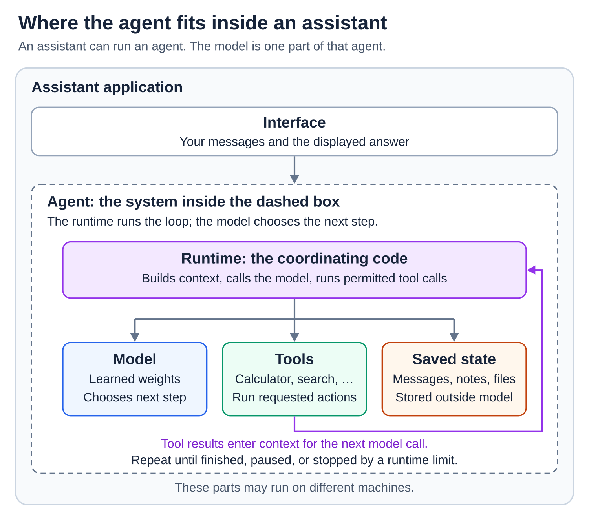
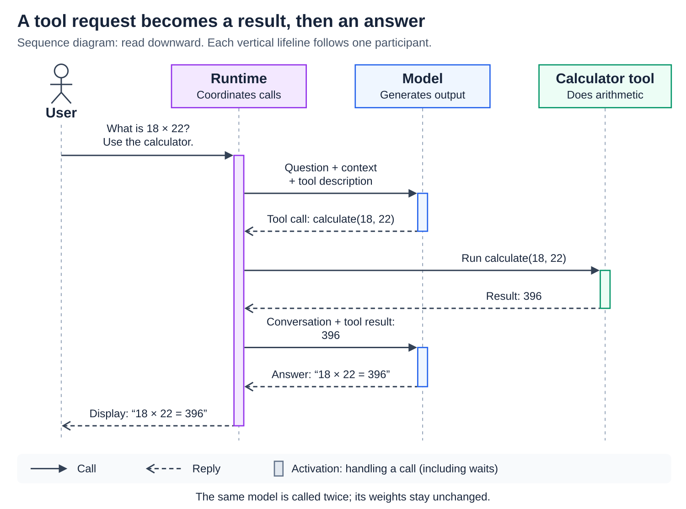

# Training. Model, assistant, and agent

[Back to Artificial Intelligence](../Readme.md#content)

**The assistant is the application you talk to. The model generates its replies. An agent lets the model choose a next action, see the result, and decide how to continue toward a goal.**

Suppose you type “What is 18 × 22? Use the calculator.” You see one answer in the chat. Behind that answer, the model can request a calculation, a calculator can do the arithmetic, and the application can pass the result back. Following that request shows who does what and what the model can remember on the next turn.

1. [When does an assistant use an agent?](#1-when-does-an-assistant-use-an-agent)
2. [What does the model see on each call?](#2-what-does-the-model-see-on-each-call)
3. [Who does the arithmetic?](#3-who-does-the-arithmetic)
4. [Where does information go between turns?](#4-where-does-information-go-between-turns)

## 1. When does an assistant use an agent?

Here, **assistant** means the application that receives your message and shows you the answer. Its **language model** is the part that generates a reply from the input it receives. A reply can be text for you or a request for the application to take an action.

To recognize an **agent**, ask who chooses the next action. Consider two ways a coding assistant could handle a failed test.

1. **Fixed workflow.** The application always runs the tests, asks the model to summarize the output, then stops. The developer chose that sequence in advance.
2. **Agent.** The user asks the assistant to fix the failure. After reading the test output, the model can choose to inspect a source file, suggest an edit, or ask the user for missing information. The result of one action helps it choose the next.

Both designs can use the same model and tools. An assistant can offer either design through the same chat window. An agent can also run in the background without a chat window.

## 2. What does the model see on each call?

A **model call** happens when the application gives the model input and asks it to generate output. The code that coordinates this work is the **runtime**. It assembles the **context**, the information available to the model for that particular call. Running the trained model on that input is called **inference**.

In the map, start at the interface where your message arrives, then follow it to the runtime. The dashed box encloses the agent in this example. Follow the arrow labeled “Tool results enter context for the next model call” back to the runtime.

For the calculator question, the first call includes your message and a description of the calculator the application makes available. The context can also include instructions and selected earlier messages. A **tool** is a program or service that can perform an action. A **tool call** is the model’s request to use it. The runtime checks whether the request is allowed, arranges for the tool to run, and makes its result available for the next model call. These parts can run on different machines.

## 3. Who does the arithmetic?

Read the diagram from top to bottom. Each column follows one participant. Look at the first two dashed arrows returning to the runtime. The model sends a *request* on one arrow, and the calculator sends a *number* on the other.

1. **The user asks.** The runtime sends “What is 18 × 22? Use the calculator” and the tool description to the model.
2. **The model requests the tool.** Its first reply is `calculate(18, 22)`. This names the tool and supplies its two inputs. At this point the calculator has yet to run.
3. **The calculator returns a result.** The runtime invokes the calculator with those inputs and receives `396`.
4. **The model answers.** The runtime calls the same model again, this time including the tool result. The model writes “18 × 22 = 396,” and the assistant displays it.

So the calculator does the arithmetic, the runtime runs it, and the model only asks for it.

If the calculator returns an error, the next call can include that error. The model can use it to correct the request or explain why the calculation failed. The loop can end with an answer, pause for the user, or stop when the runtime reaches a limit such as a maximum number of calls. To check a claim about an action, look for a tool result from that run that supports the claim.

## 4. Where does information go between turns?

Suppose your next message is “Double that.” To know what *that* refers to, the model needs the earlier result. Three places hold different kinds of information.

| Place | What it holds | What happens in this example |
| --- | --- | --- |
| **Model weights** | Numbers learned during training that shape how the model responds. | Both calls use the same weights. Receiving `396` during a chat leaves them unchanged. |
| **Current context** | The information supplied on this call. | Including the earlier result lets the model use `396` when it reads “Double that.” |
| **Saved state** | Information the application keeps outside the model, such as chat history, notes, or files. | The runtime can retrieve the earlier result from history and put it into the current context. |

A long chat may contain more text than the model can take in at once. The application can select recent messages, summarize older ones, or retrieve a relevant record. An answer can therefore remain in saved history even when the model cannot see it on the current call. The same distinction explains how an assistant can use your name next week if the application saves it and supplies it again.

## Check your understanding

1. Two assistants use the same model and test runner. One always runs the tests and summarizes them. The other can inspect a file or run another test depending on what failed. Which one is acting as an agent, and what tells you?

   

   
Answer

   The second assistant is acting as an agent because the model uses the failure to choose its next action. The first follows a sequence fixed by its developer. Both can display their answers in chat.

   

2. The first model call includes a description of a calculator. Why is that enough to request a calculation, and what must happen before the model can use the calculator’s result?

   

   
Answer

   The description tells the model which tool it can request and what inputs to supply. The runtime must arrange for the calculator to run and include its returned value in the context of a later model call.

   

3. A coding assistant says “the tests passed.” Its first model reply requested a test run. What would you check before trusting the final answer?

   

   
Answer

   Check the test runner’s output for that specific run. It should show that the requested tests ran and passed. A request to run tests establishes only what the model asked for, just as a calculator request alone does not establish the answer.

   

4. Yesterday’s chat contains `396`. Today you open a new chat and type “Double that.” How could the assistant know which number you mean, and what should it do if the number is missing?

   

   
Answer

   The application could retrieve the earlier exchange and include it in the current context. The model could then use the number without any change to its weights. If the model receives no information identifying the number, the assistant should ask which number to double.

   

# Sources

- [Brown et al. — Language Models are Few-Shot Learners](https://arxiv.org/abs/2005.14165)
- [Anthropic — Building effective agents](https://www.anthropic.com/research/building-effective-agents)
- [Anthropic — Tool use with Claude](https://platform.claude.com/docs/en/agents-and-tools/tool-use/overview)
- [OpenAI — Function calling](https://developers.openai.com/api/docs/guides/function-calling)
- [Anthropic — Effective context engineering for AI agents](https://www.anthropic.com/research/effective-context-engineering-for-ai-agents)
