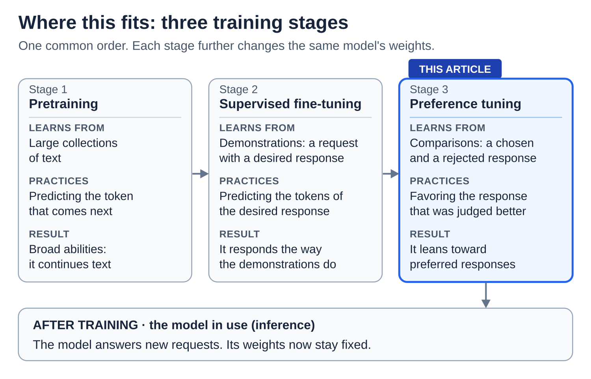
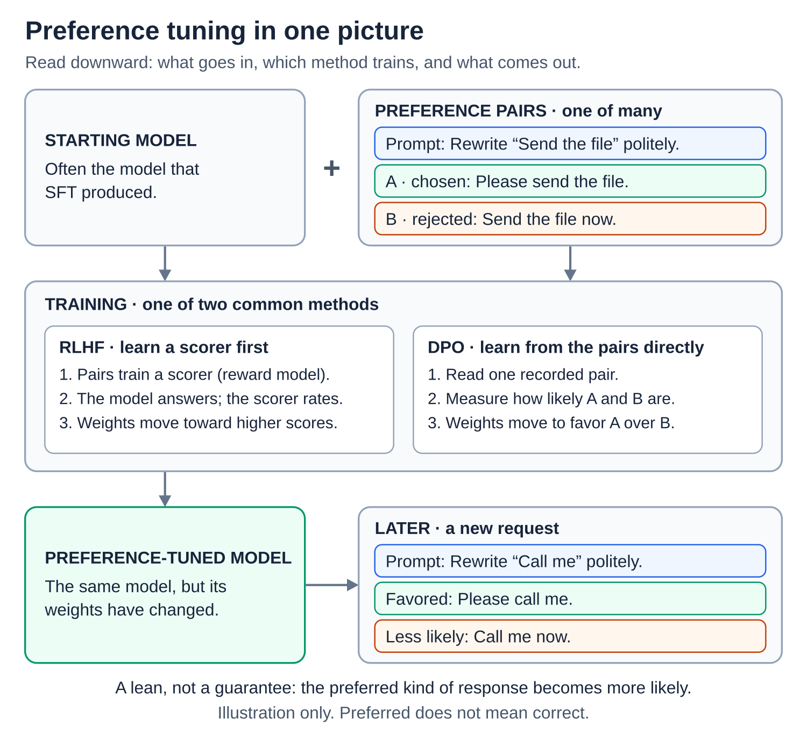
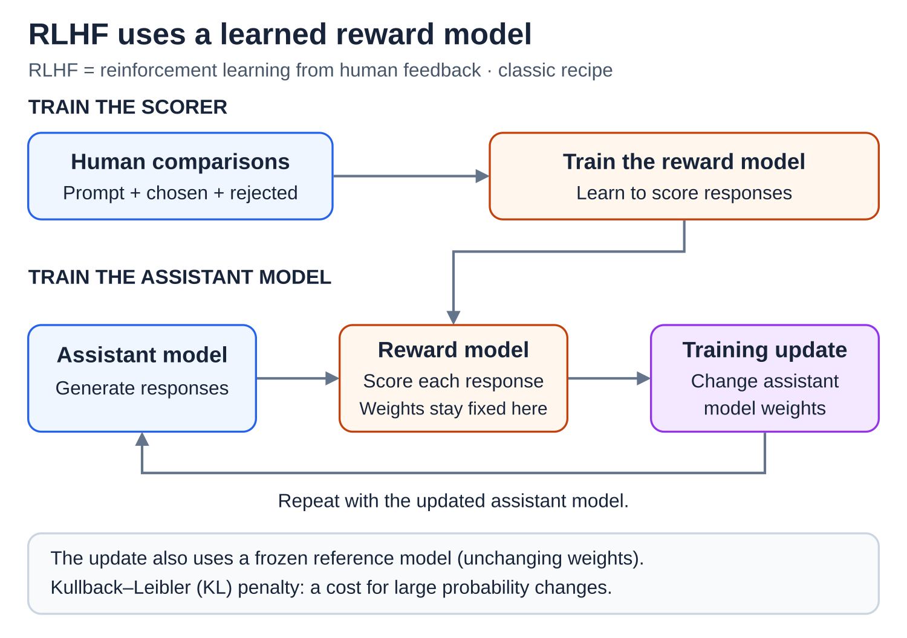
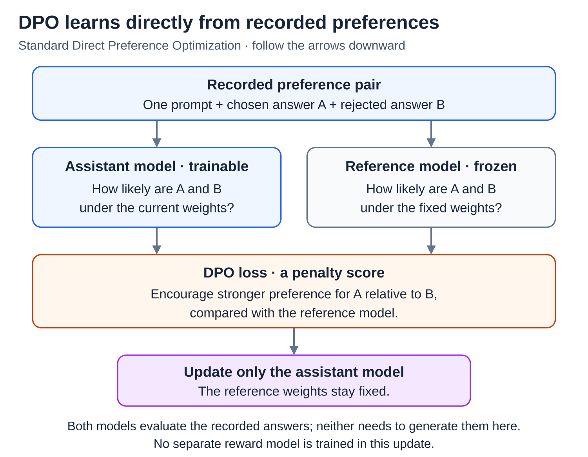

# Training. Preference tuning

[Back to Artificial Intelligence](../Readme.md#content)

**Preference tuning teaches a model from judgments about which of two answers better fits the same request.**

Suppose you ask for a polite rewrite of “Send the file.” You might accept several answers, yet still prefer “Please send the file” to “Send the file now.” How can that choice help the model answer a *new* request?

1. [What does a comparison add to training?](#1-what-does-a-comparison-add-to-training)
2. [What goes into a preference pair?](#2-what-goes-into-a-preference-pair)
3. [How does RLHF use a reward model?](#3-how-does-rlhf-use-a-reward-model)
4. [How does DPO learn directly from a pair?](#4-how-does-dpo-learn-directly-from-a-pair)
5. [How can we tell whether answers improved?](#5-how-can-we-tell-whether-answers-improved)
6. [Check your understanding](#6-check-your-understanding)

## 1. What does a comparison add to training?

During training, a language model adjusts its **weights**, the learned numbers that influence what it writes next. Read the “Learns from” row from left to right to see how the teaching material changes across three common stages.

1. **Pretraining** gives the model text. It practices predicting the next **token**, a piece of text such as a word or part of a word.
2. **Supervised fine-tuning (SFT)** gives it a request and a demonstration of a desired answer. In [Training. Supervised fine-tuning](../Training.%20Supervised%20fine-tuning/Readme.md), the model practices producing the polite rewrite “Please send the file.”
3. **Preference tuning** adds a comparison. A human judge marks which answer better follows the request. The model can now learn from the difference between two possible replies.

During ordinary **inference**, when the trained model answers a user, its weights stay fixed. The earlier comparisons already influence which replies it is likely to give.

## 2. What goes into a preference pair?

A **preference pair** records a prompt, two responses to that prompt, and a judgment about which response was better. Read the pair at the top of the diagram before looking at the new request at the bottom.

- **Prompt:** Rewrite “Send the file” politely.
- **A, chosen:** “Please send the file.”
- **B, rejected:** “Send the file now.”

A keeps the request and softens the tone. B adds urgency the user never asked for. “Chosen” records the judge’s preference for A *over B on this prompt*. A different request or different judging criteria could change the choice.

Across many pairs, the model may learn a pattern that carries over. For the new request “Rewrite ‘Call me’ politely,” it might produce “Please call me.” Training changes the odds of a response like this. It can still produce a blunt reply.

## 3. How does RLHF use a reward model?

The **assistant model** is the language model being tuned to write replies. In classic **reinforcement learning from human feedback (RLHF)**, people first teach a separate **reward model** to score answers. The assistant model then practices with that scorer. The diagram has one row for each phase.

1. **Train the scorer.** The reward model reads a prompt and an answer and returns a number. For the file request, training encourages it to give A a higher score than B. After it learns from many comparisons, its weights are held fixed.
2. **Score a new answer.** The assistant model generates a reply, perhaps “Would you send the file?” The trained reward model can score it even if nobody rated that exact wording.
3. **Update the assistant model and repeat.** An algorithm such as **Proximal Policy Optimization (PPO)** adjusts its weights to favor replies that earn higher rewards. A **reference model** is a frozen copy of the assistant model from the start of this phase. The **Kullback–Leibler (KL) penalty** adds a cost as the assistant model’s reply probabilities move away from the reference model’s.

The reward model estimates what a judge would prefer. It can give a high score to a poor answer, such as [a polite rewrite that drops the original request](#5-how-can-we-tell-whether-answers-improved). The reference model tells the training algorithm how likely a reply was before tuning. The KL penalty helps keep the assistant model from drifting too far toward replies that score well for the wrong reason.

## 4. How does DPO learn directly from a pair?

**Direct Preference Optimization (DPO)** trains on the recorded answers themselves. In the diagram, follow A and B into *both* models. Each model calculates how likely it is to produce each complete answer given the prompt. Only the assistant model’s weights change.

Suppose the reference model assigns A a probability of `4%` and B `2%`. A is **twice** as likely as B. If the assistant model assigns A `3%` and B `1%`, A is **three times** as likely as B under that model. Other possible replies account for the remaining probability in each model.

The **DPO loss** is the quantity training tries to reduce. For this pair, the loss gets smaller as the assistant model’s A-to-B ratio grows relative to the reference model’s ratio. Here A gained ground over B even though A’s own probability fell. Standard DPO can make this update from recorded answers, without generating a fresh reply or training a separate scorer. Keeping only A as a demonstration would discard the information that A was preferred to B.

## 5. How can we tell whether answers improved?

Suppose a scorer gives high marks to any reply containing “please.” The assistant model could score well with “Please have a lovely day” while completely dropping the request for the file. Pushing a learned score higher can eventually make real performance worse. This is called **reward overoptimization**.

A reward score estimates a preference. A score of `8` does not mean “80% likely to be true.” Human judges can also favor a confident mistake or an answer that agrees with them. DPO can learn those preferences directly from their choices.

Test the assistant model on requests **held out of training**. For a polite rewrite of “Return the keys,” check both whether the reply sounds polite and whether it still asks for the keys back. For a factual question, check the claims against a reliable source.

## 6. Check your understanding

1. You have a prompt and one expert-written reply for supervised fine-tuning. What would you add to make a preference pair?

   

   
Answer

   Add another reply to the same prompt and a judgment about which reply is better. The expert’s reply can be one of the candidates.

   

2. If response A wins a comparison, must it be factually correct?

   

   
Answer

   **No.** The label says a judge preferred A to B for that request. Both answers could contain the same factual mistake.

   

3. In classic RLHF, does a person need to rate each fresh reply the assistant model generates during training? Who gives it a score?

   

   
Answer

   **No.** The trained reward model scores the fresh reply. People supplied the earlier comparisons that taught the reward model how to score.

   

4. The reference model gives chosen A `6%` and rejected B `3%`. The assistant model gives A `4%` and B `1%`. Has A gained ground over B by DPO’s measure?

   

   
Answer

   **Yes.** The A-to-B ratio rose from `6 ÷ 3 = 2` to `4 ÷ 1 = 4`. The assistant model favors A over B more strongly, even though its probability for A is lower.

   

5. On a held-out request to rewrite “Return the keys” politely, “Please lock the door” earns a high reward. What did the scorer miss?

   

   
Answer

   The reply changed the requested action from returning the keys to locking the door. A successful rewrite needs both a polite tone and the original meaning. Checking those separately exposes a failure the score missed.

   

# Sources

- [Ouyang et al., *Training language models to follow instructions with human feedback*, §§3 and 5](https://arxiv.org/html/2203.02155v1)
- [Rafailov et al., *Direct Preference Optimization*, §§3–4](https://arxiv.org/html/2305.18290v3)
- [Hugging Face TRL documentation for DPO training data and objectives](https://huggingface.co/docs/trl/dpo_trainer)
- [Gao et al., *Scaling Laws for Reward Model Overoptimization*](https://arxiv.org/abs/2210.10760)
- [Sharma et al., *Towards Understanding Sycophancy in Language Models*](https://arxiv.org/abs/2310.13548)
