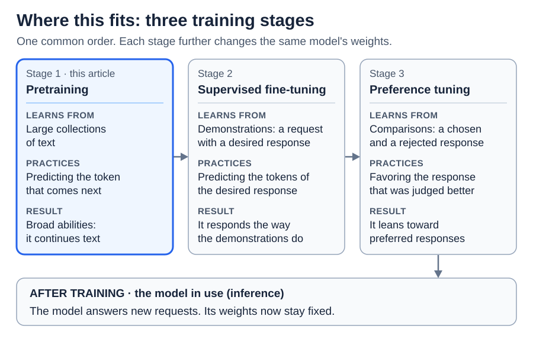
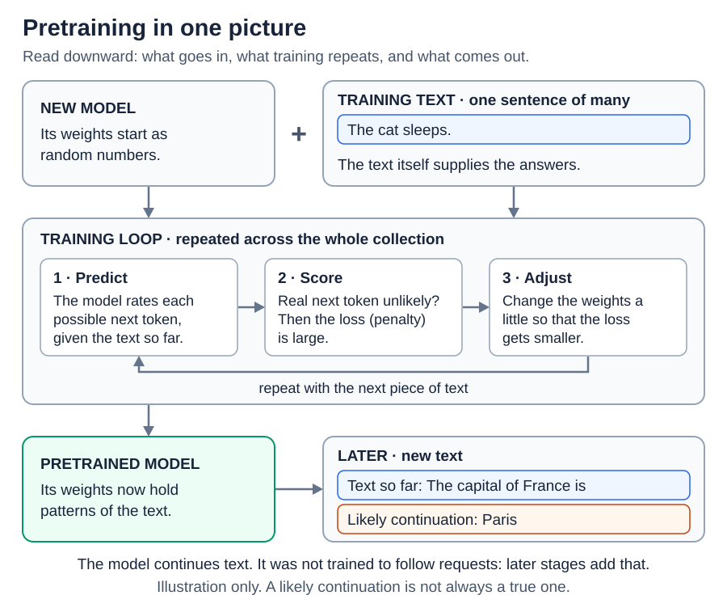
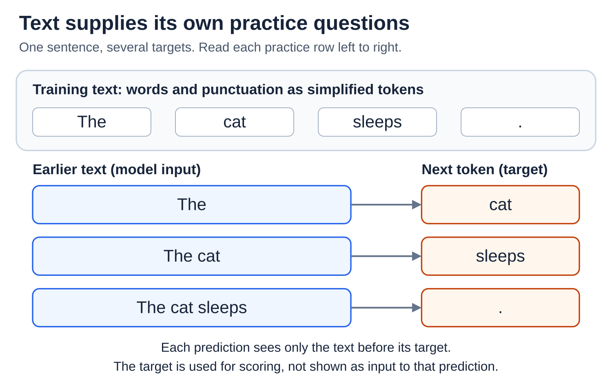
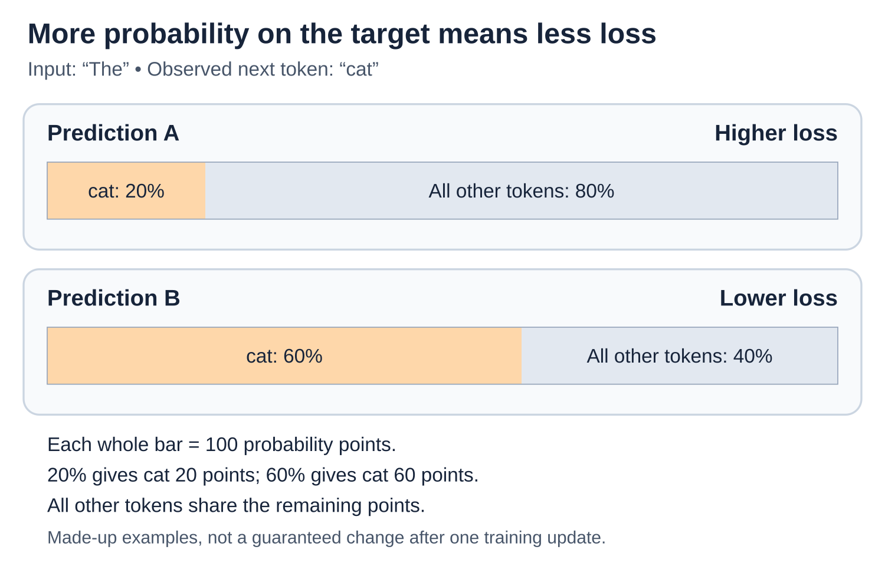

# Training. Pretraining

[Back to Artificial Intelligence](../Readme.md#content)

**In next-token pretraining, a language model learns from ordinary text by trying to predict what comes next.**

Its **weights** are the numbers that shape those predictions. Training adjusts them so the model gets better at anticipating the text it sees.

Take the sentence “The cat sleeps.” Cover everything after “The.” You might guess “cat,” “dog,” or “sun.” The original sentence gives the model a way to score its prediction. Follow that one sentence through training to see how the same exercise can teach patterns that carry over to new text.

1. [What does pretraining give a model?](#1-what-does-pretraining-give-a-model)
2. [What changes during a training update?](#2-what-changes-during-a-training-update)
3. [How does one sentence supply several targets?](#3-how-does-one-sentence-supply-several-targets)
4. [How is a next-token prediction scored?](#4-how-is-a-next-token-prediction-scored)
5. [How can prediction teach skills that carry over?](#5-how-can-prediction-teach-skills-that-carry-over)
6. [Why does the training material matter?](#6-why-does-the-training-material-matter)
7. [Check your understanding](#7-check-your-understanding)

## 1. What does pretraining give a model?

Pretraining produces a **base model** that can continue text. The unit it predicts is a **token**, which can represent a word, part of a word, or a punctuation mark. Read the diagram from left to right and compare what each stage learns from.

1. **Pretraining** uses passages of text. A model can learn to continue “The capital of France is” with “Paris.” For a sense of scale, the Qwen3 models were pretrained on about 36 trillion tokens across 119 languages and dialects.
2. **Supervised fine-tuning** uses demonstrations of desired replies. A request such as “Name the capital of France in one word” paired with “Paris” shows the model how to follow the requested format.
3. **Preference tuning** uses judgments about which of two replies better fits a request. Those judgments can further shape how the model responds.

These stages can build on one another. The first teaches patterns that make a continuation likely. Later stages can teach the base model to use those abilities as an assistant.

## 2. What changes during a training update?

When training a model from scratch, many of its weights start as random numbers. Follow “The cat sleeps.” from the top of the diagram through the three actions in the middle.

1. **Predict.** Given “The,” the model assigns a probability to every possible next token in its **vocabulary**, the set of tokens it can use.
2. **Score.** The training text supplies the **target**, the token that actually came next. Here it is `cat`. The less probability the model assigned to `cat`, the larger the penalty, called the **loss**.
3. **Adjust.** Training combines losses from many token positions. **Backpropagation** calculates how small changes in the weights would affect that loss. An **optimizer** uses those calculations to update the weights.

The updated weights carry over to the next batch of text. At **inference** time, the model uses those learned weights to generate a reply. The weights stay fixed throughout an ordinary chat. [Training. Training vs. Inference](../Training.%20Training%20vs.%20Inference/Readme.md) follows one weight from a training update to a prediction on a new input.

## 3. How does one sentence supply several targets?

For this example, treat each word and the final period as one token. Real tokenizers can split the same sentence differently. Read each row from left to right. Each row moves the boundary between the text available to the model and the token it must predict.

1. After `The`, the target is `cat`.
2. After `The cat`, the target is `sleeps`.
3. After `The cat sleeps`, the target is `.`.

Notice how `cat` changes roles. In the first row it is the answer used for scoring. In the second row it is already part of the input. A **transformer** is a model design that lets each token draw on information from other tokens. During next-token training, it can compute the predictions for all three positions together. A **causal mask** limits each position to the current and earlier tokens, so the prediction after `The` cannot peek at `cat` or `sleeps`.

This is **self-supervised learning**. People choose and prepare the training text, and the text itself supplies a target at each of these positions.

## 4. How is a next-token prediction scored?

The possible next tokens share a total probability of `100%`. In the diagram, both predictions see `The` and are scored against the same target, `cat`. Compare the part of each bar assigned to that one token.

Prediction A gives `cat` **20%** and leaves **80%** for all other tokens together. Prediction B gives `cat` **60%** and leaves **40%** for the others. **B has the lower loss** because it assigned more probability to the observed token.

The usual loss for this exercise is called **cross-entropy**. It uses the probability assigned to the target, so the model can receive a better score even when its top guess stays the same. Training can score both predictions directly from their probabilities without drawing a token from either one. The bars illustrate two possible predictions for this example.

## 5. How can prediction teach skills that carry over?

Compare “The cat sleeps” with “The cats sleep.” To predict the verb, it helps to pick up the link between the noun and the verb ending. The same pattern can help with a new sentence such as “The rabbits sleep.” Applying a learned pattern to a new example is **generalization**. Pretrained models have also used patterns learned from text to translate, answer questions, and solve some arithmetic problems.

A model can also reproduce a passage it saw during training, sometimes word for word. That is **memorization**. To test whether a pattern carries over, use fresh examples kept out of training and check for near-duplicates of the training passages.

A likely continuation can still be false. In a story where the moon is made of glass, `glass` may be precisely the word the model should predict. The loss measures how well it predicts the passage. Establishing whether a claim is true requires other evidence.

## 6. Why does the training material matter?

Every passage supplies practice. Choosing which passages to include changes what the model has the opportunity to learn.

- **Mixture.** A collection with more code gives the model more practice predicting code. The Qwen3 team increased the share of science, mathematics, and coding material in its second pretraining stage.
- **Quality.** A clean sentence gives the model a different target from a broken copy full of scanning errors. Filtering the collection changes which of those examples contribute to training.
- **Repetition.** If one paragraph appears on a thousand copied pages, its wording gets a thousand chances to influence training. Removing duplicates can reduce verbatim repetition. Keeping overlapping passages out of the test set also makes it easier to judge generalization.

**Continued pretraining** means starting from existing weights and training them further on more material, such as a collection of repair manuals. Pasting one manual into a chat gives the model information it can use for that conversation. Training on the manuals updates the weights used for future predictions.

## 7. Check your understanding

1. A base model completes “The capital of France is …” correctly. Which later training stage could show it how to answer a request in exactly one word?

   

   
Answer

   **Supervised fine-tuning.** A demonstration pairs the request with the one-word reply “Paris.” It gives the model practice following that format.

   

2. A training passage and a chat prompt both contain “The cat sleeps.” Which operation changes the model’s weights?

   

   
Answer

   **The optimizer’s update during training.** It uses information from the loss to change the weights. In an ordinary chat, the words change the input used to predict the next token.

   

3. In `The cat sleeps.`, why is `cat` the target after `The`, and when may the model use `cat` as input?

   

   
Answer

   **The recorded sentence has `cat` in that position.** Other sentences could continue differently. The model may use `cat` when predicting `sleeps`, because by then `cat` is part of the earlier text.

   

4. Two predictions both rank `dog` first. One gives `cat` a probability of `10%` and the other gives it `30%`. The recorded next token is `cat`. Which prediction has the lower loss?

   

   
Answer

   **The prediction that gives `cat` 30%.** Cross-entropy rewards the higher probability on the observed token even though both predictions ranked another token first.

   

5. A model completes a sentence that appears word for word in its training data. Does that show it can use the same grammar pattern in a new sentence?

   

   
Answer

   **No.** It could have memorized that sentence. Try the same grammar pattern with different nouns and verbs in examples kept out of training.

   

6. A repair manual appears on a thousand copied pages. One copy lands in the test set. How would you prepare the collection for training and evaluation?

   

   
Answer

   **Remove the duplicates and test on different manuals.** This limits how often the model practices one passage and lets you measure how well it handles unfamiliar material.

   

# Sources

- [Hugging Face, *How do Transformers work?*](https://huggingface.co/learn/llm-course/chapter1/4)
- [Hugging Face, *Causal language modeling*](https://huggingface.co/docs/transformers/tasks/language_modeling)
- [PyTorch, *Optimizing Model Parameters*](https://docs.pytorch.org/tutorials/beginner/basics/optimization_tutorial.html)
- [PyTorch, *CrossEntropyLoss*](https://docs.pytorch.org/docs/2.15/generated/torch.nn.CrossEntropyLoss.html)
- [Ouyang et al., *Training language models to follow instructions with human feedback*](https://arxiv.org/abs/2203.02155)
- [Brown et al., *Language Models are Few-Shot Learners*](https://arxiv.org/abs/2005.14165)
- [Qwen Team, *Qwen3 Technical Report*, §3](https://arxiv.org/html/2505.09388v1)
- [Lee et al., *Deduplicating Training Data Makes Language Models Better*](https://arxiv.org/abs/2107.06499)
- [Gururangan et al., *Don’t Stop Pretraining*](https://arxiv.org/abs/2004.10964)
