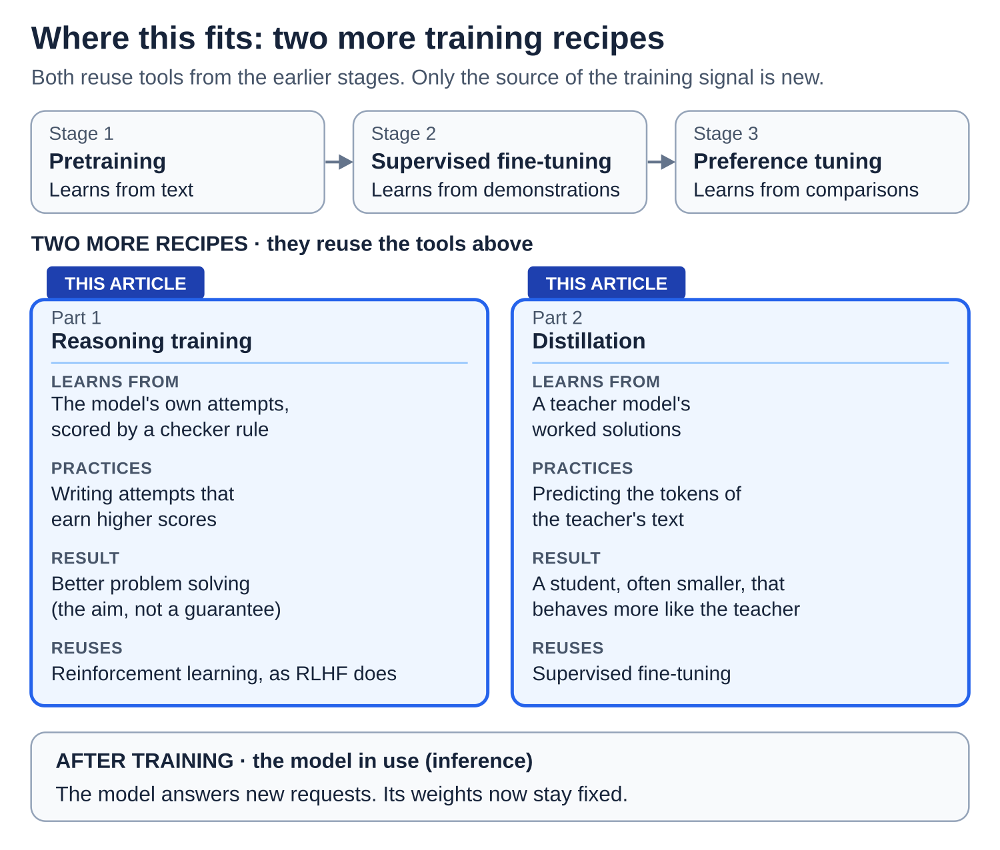
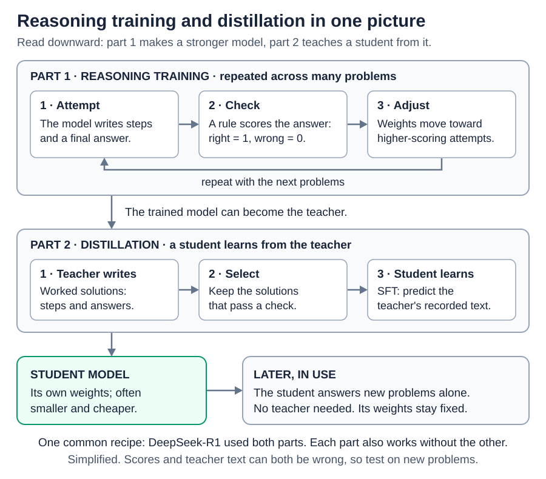
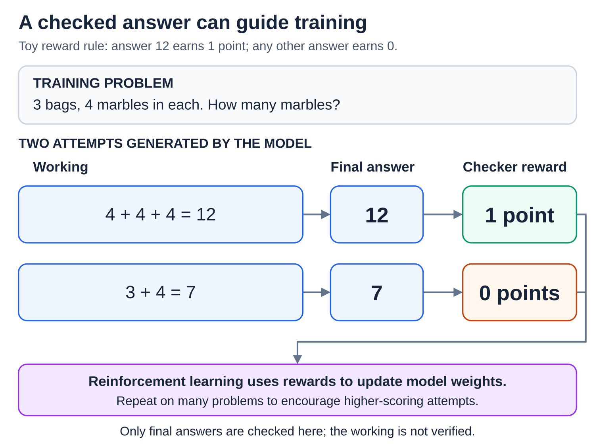

# Training. Reasoning training and distillation

[Back to Artificial Intelligence](../Readme.md#content)

**One way to train a model to solve problems is to let it try, score its answers, and use those scores to improve future attempts. In distillation, a second model learns from outputs produced by a teacher model.**

Suppose a problem asks, “Three bags hold four marbles each. How many marbles are there?” A checker can give a point for the answer `12`. A teacher can also write a worked example showing *why* the answer is `12`. The point and the worked example give a learner different information.

1. [What can a model learn from?](#1-what-can-a-model-learn-from)
2. [How can a trained model become a teacher?](#2-how-can-a-trained-model-become-a-teacher)
3. [What does the marble checker actually verify?](#3-what-does-the-marble-checker-actually-verify)
4. [What does the student learn from the teacher?](#4-what-does-the-student-learn-from-the-teacher)
5. [What changes when a model tries again?](#5-what-changes-when-a-model-tries-again)
6. [How do you tell whether the student learned a useful method?](#6-how-do-you-tell-whether-the-student-learned-a-useful-method)
7. [Check your understanding](#7-check-your-understanding)

## 1. What can a model learn from?

A model’s **weights** are the numbers it learns during training. They influence which pieces of text it is likely to write next. A **training signal** is the information used to adjust those weights. Read the diagram from left to right across the top, then compare the “Learns from” entries in the boxes marked “This article · part 1” and “This article · part 2.”

During **pretraining**, a language model learns by predicting the next piece of text. **Supervised fine-tuning (SFT)** gives it examples of desired responses, like the polite rewrite in [Training. Supervised fine-tuning](../Training.%20Supervised%20fine-tuning/Readme.md). **Preference tuning** can use judgments about which of two responses people prefer, as in [Training. Preference tuning](../Training.%20Preference%20tuning/Readme.md).

For the marble problem, we can give the model a way to practice even if nobody has written a worked solution. The model makes attempts, and a rule gives each one a **reward**, a numerical score. **Reinforcement learning (RL)** uses those rewards to adjust the model’s weights so that attempts like the higher-scoring ones become more likely. This is one approach to reasoning training. Reinforcement learning from human feedback (RLHF) also uses rewards, but draws on human judgments.

## 2. How can a trained model become a teacher?

In the top half of the diagram, one model writes a series of steps and a final answer. That whole attempt is a **reasoning trajectory**. The written intermediate steps are often called a **chain of thought**. Follow the arrow into the lower half to see how a second model can learn from a completed attempt.

1. **Train the problem solver.** It generates attempts on many problems, a checker scores them, and RL uses the scores to update its weights.
2. **Collect examples.** The trained model now plays the **teacher**. It writes worked solutions. The training team selects examples to keep, such as “Three groups of four give `4 + 4 + 4 = 12`.”
3. **Train the student.** A separate model, the **student**, receives the problem and learns to produce the selected solution. Its own weights change. Later, it can answer a new problem on its own.

The two methods can be used separately. If a teacher already produces suitable examples, student training can begin there. DeepSeek combined the ideas in its R1 project. Its training included rule-based rewards for math and code, and the team used supervised fine-tuning on selected examples to train smaller Qwen and Llama models.

## 3. What does the marble checker actually verify?

A **verifiable reward** comes from a check you can run, such as comparing the final number with a known answer or running tests on a program. The reward rule in this diagram reads only the final number. Cover the “Checker reward” column and predict the score for each row.

The first attempt counts three groups of four and ends in `12`, so it earns **1 point**. The second adds the number of bags to the number of marbles per bag and ends in `7`, so it earns **0 points**. These points tell the training algorithm how each attempt scored. They say nothing about how confident the model was.

Now imagine a third attempt that says, “There are two bags of six. Final answer: 12.” It earns the full point despite misreading the problem. This is **outcome supervision** because the feedback concerns the final result. **Process supervision** gives feedback on the intermediate steps and could flag the very first claim about the bags.

## 4. What does the student learn from the teacher?

In **output-based distillation**, the teacher’s recorded response supplies a target for the student. A **token** is a piece of text, such as a word, part of a word, or a digit. Given the problem and the solution so far, the student predicts the next token. Training compares its prediction with the recorded token and adjusts the student’s weights to make that token more likely.

Take the teacher’s solution, “Three groups of four give `4 + 4 + 4 = 12`.” After `4 + 4 +`, the student practices predicting the third `4`. A student given only the final answer `12` never sees how to count the three groups in this example. A worked solution can teach that pattern, and a mistake in the teacher’s text can become a pattern too.

Other forms of distillation ask the student to match the **probabilities** a teacher assigns to possible outputs. That supplies information even about options the teacher did not select. In both cases, the teacher supplies targets for learning. The student develops its own weights and can be smaller and cheaper to run.

## 5. What changes when a model tries again?

Suppose the student now gets a new problem about **five** bags with four marbles each. It first answers `9`, then checks whether adding five and four really counts the marbles. It revises its answer to `20`. This is **inference**, using a trained model to answer a request. **Inference-time compute** is the work spent on that request. It can include generating intermediate steps, revising an answer, or trying several solutions and selecting one.

| What happens? | What changes? |
| --- | --- |
| RL uses rewards from practice problems. | The problem solver’s weights change, affecting future attempts. |
| SFT uses the teacher’s worked solutions. | The student’s weights change, affecting future predictions. |
| The trained student revises its answer from `9` to `20` during ordinary inference. | The answer to this request changes. The weights stay fixed. |

Training can make checking or revising more useful. During inference, extra attempts can help if they catch an error. Repeating the same mistake in a longer answer still gives the wrong total.

## 6. How do you tell whether the student learned a useful method?

Ask it to solve **held-out problems**, ones kept out of training. If it has seen “three bags of four” many times, answering `12` leaves open how it got there. Try “Six trays hold four cups each” and “Twenty-four cups fill six equal trays. How many cups are on each tray?” The first calls for multiplication (`24`), the second for division (`4`). Together they test whether the student uses the meaning of the question to pick an operation.

Check the work as well as the answers when the method matters. A filter that keeps every teacher solution ending in `12` would keep the mistaken “two bags of six” example. Likewise, a program that passes a few tests can still fail on inputs those tests missed.

A written explanation can leave out what influenced the answer. In one experiment, researchers arranged the options in every worked example in the prompt so that the correct answer was `(A)`. On a new question, the model could then choose `(A)` and give a plausible explanation that never mentioned the pattern. To test the effect, keep the new question fixed and vary where the correct answers appear in the examples.

## 7. Check your understanding

1. You have thousands of arithmetic problems with known answers but no worked solutions. How could those answers supply a training signal for reinforcement learning?

   

   
Answer

   Let the model attempt each problem and use a rule to score its final answer against the known answer. RL can use those scores to make higher-scoring attempts more likely.

   

2. A teacher already writes good worked solutions. Must you train it again with RL before you can use it to train a student?

   

   
Answer

   No. You can collect and select solutions from the existing teacher, then use them as supervised examples for the student. The student updates its own weights and can later answer independently.

   

3. For three bags of four, one attempt ends in `7`. Another says “two bags of six” and ends in `12`. How does the marble checker score them? What kind of feedback could flag the misread problem?

   

   
Answer

   The checker gives 0 points for `7` and 1 point for `12`. It checks only the final number. Process supervision could flag the second attempt’s incorrect claim about the bags.

   

4. A teacher writes one worked solution. In a different setup, it supplies probabilities for several possible next tokens. What does the student try to match in each setup?

   

   
Answer

   With the worked solution, the student learns to predict the next token the teacher actually wrote. With probabilities, it learns how the teacher spreads likelihood across the alternatives, including tokens the teacher never wrote.

   

5. A student trains on the teacher’s examples. Later it tries three answers to a new problem and picks one. During which activity do its weights change?

   

   
Answer

   Its weights change during training on the examples. Trying three answers and choosing one during ordinary inference spends extra computation on that request with the same weights.

   

6. A student answers every training question about bags correctly. What new question would help you test whether it can choose the right operation, and what would you check?

   

   
Answer

   Try a held-out question that reverses the task, such as “Twenty marbles fill five equal bags. How many are in each?” Check that the answer is four and that the stated method divides the total by the number of bags. That tests whether the student can do more than repeat a familiar multiplication.

   

# Sources

- [Ouyang et al., training from demonstrations and human preferences](https://arxiv.org/abs/2203.02155)
- [DeepSeek-R1, rule-based rewards and distillation into smaller models](https://arxiv.org/html/2501.12948v1)
- [Hinton et al., distillation using teacher probabilities](https://arxiv.org/abs/1503.02531)
- [Hsieh et al., training smaller models with teachers’ explanations](https://arxiv.org/abs/2305.02301)
- [Lightman et al., outcome and process supervision](https://arxiv.org/abs/2305.20050)
- [Snell et al., computation spent revising and selecting answers at inference](https://arxiv.org/html/2408.03314v1)
- [Turpin et al., when written explanations omit influences on an answer](https://arxiv.org/abs/2305.04388)
