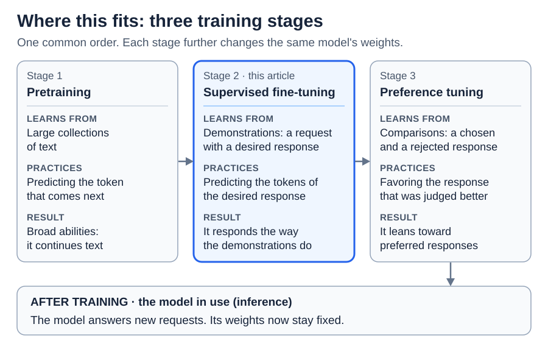
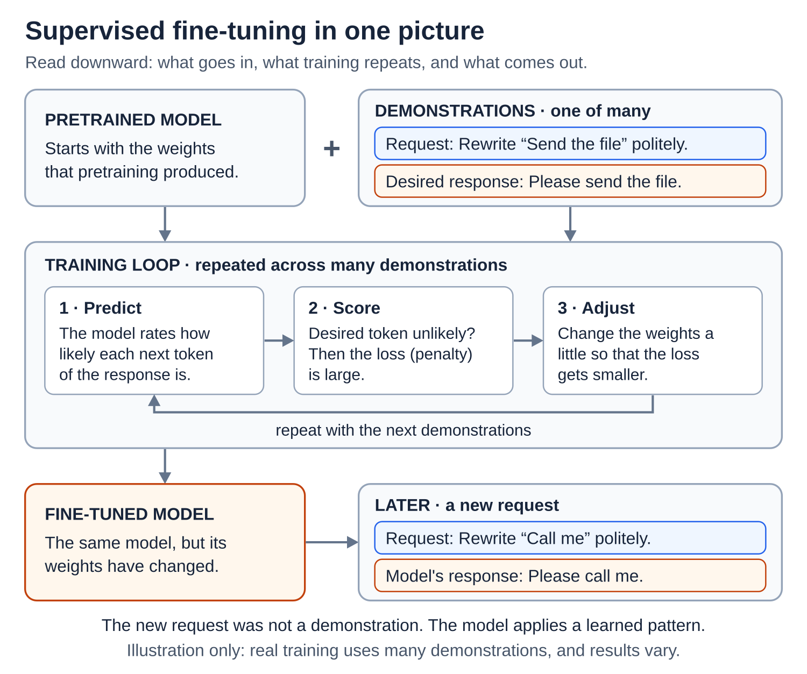
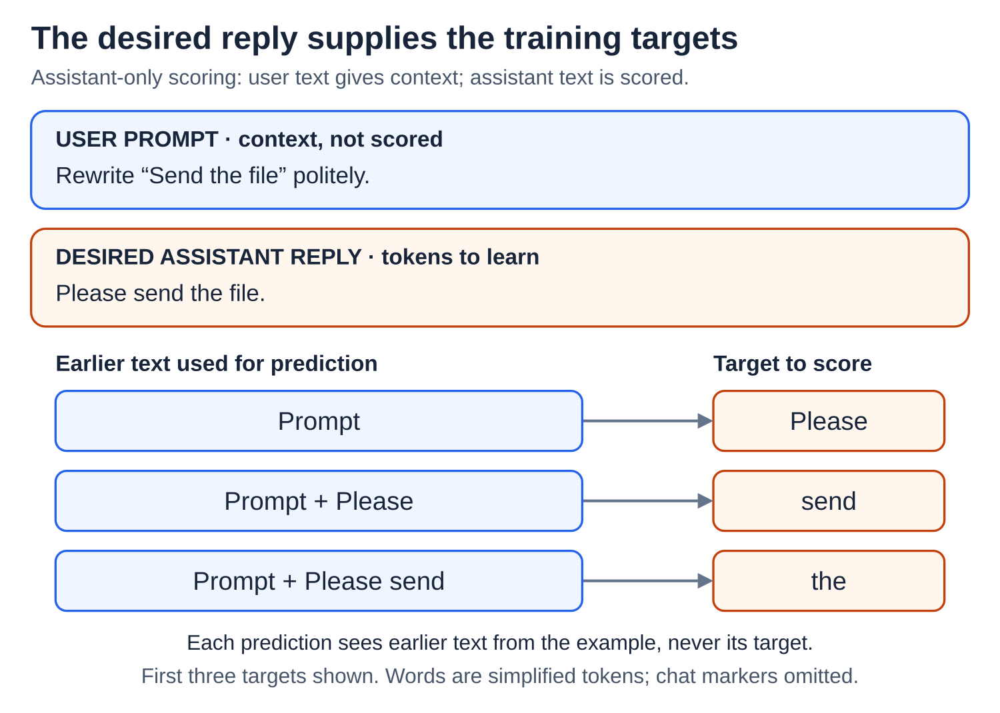
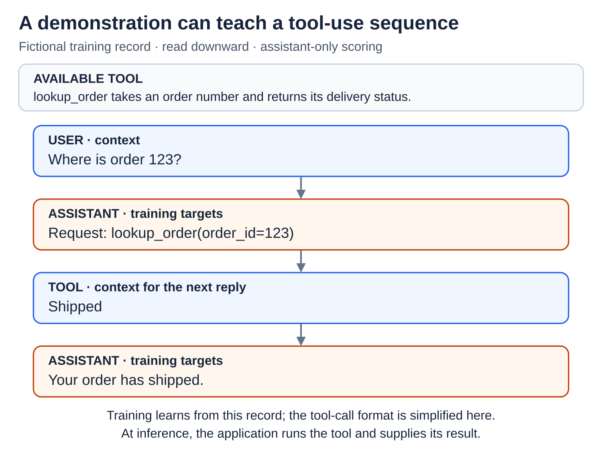

# Training. Supervised fine-tuning

[Back to Artificial Intelligence](../Readme.md#content)

**Supervised fine-tuning (SFT) teaches a model that already knows how to continue text to respond in a desired way.**

For example, pair the request “Rewrite ‘Send the file’ politely” with the reply “Please send the file.” This pair is a **demonstration**. Across many demonstrations, training adjusts the model’s **weights**, the numbers that determine how likely it considers each possible next piece of text. A new request can then get a polite rewrite even if the model never saw that exact request during training.

1. [Where does SFT fit in training?](#1-where-does-sft-fit-in-training)
2. [How does a demonstration change the model?](#2-how-does-a-demonstration-change-the-model)
3. [What does the model see, and which tokens count toward the loss?](#3-what-does-the-model-see-and-which-tokens-count-toward-the-loss)
4. [How does a demonstration teach tool use?](#4-how-does-a-demonstration-teach-tool-use)
5. [How can we tell whether SFT helped?](#5-how-can-we-tell-whether-sft-helped)

## 1. Where does SFT fit in training?

The three columns show a common training sequence. Read the “learns from” row across to see what each stage adds.

1. **Pretraining** uses large collections of text. The model practices predicting the next **token**, a piece of text such as a word, part of a word, or punctuation. For a worked example using a single sentence, see [Training. Pretraining](../Training.%20Pretraining/Readme.md).
2. **Supervised fine-tuning** keeps the next-token exercise. Each demonstration supplies a request and a desired reply, so the model practices writing the kind of answer the user asked for. The supplied reply is what makes the training *supervised*.
3. **Preference tuning** can follow SFT. For the same request, someone judges which of two replies is better. [Training. Preference tuning](../Training.%20Preference%20tuning/Readme.md) shows how that comparison can make replies like the preferred one more likely.

## 2. How does a demonstration change the model?

In the top-right box, the desired reply begins with “Please.” Follow that word through the training loop in the middle of the diagram.

1. **Predict.** Given the request, the model assigns a probability to each possible first token of the reply. Suppose it gives “Please” a 10% chance.
2. **Score.** The training program measures **loss**, a penalty based on the probability of the recorded token. A 10% chance for “Please” incurs a larger penalty than an 80% chance would. The same rule applies to the rest of the reply.
3. **Adjust.** The training program makes a small change to the weights to reduce the loss across the examples it is training on. Repeating this across many requests can make polite phrasing more likely on new ones.

In the bottom-right box, the user asks for a polite rewrite of “Call me.” The model might now generate “Please call me.” Using the trained model to answer a request is called **inference**. During inference its weights stay fixed.

## 3. What does the model see, and which tokens count toward the loss?

A **chat template** puts messages into the format the model expects. The `user` role marks the user’s message. The `assistant` role marks the message the model is learning to write, even when a person wrote the demonstration. The formatted chat becomes one sequence of tokens. The diagram leaves out the role markers and treats each word as one token so you can follow the first three predictions.

Read the second row. The model sees the request and the recorded word “Please.” The next word in the recorded reply, “send,” is the **target**. Training scores the probability the model assigns to that word. Even if the model favored a different word, the next row uses “Please send” because those are the words in the demonstration.

With **assistant-only loss**, the model reads the whole request as context, but only tokens from messages marked `assistant` count toward the loss. A **loss mask** marks which positions to score. Other SFT setups can score the user’s tokens too.

## 4. How does a demonstration teach tool use?

A **tool** is a function the application can run when the model requests it. In this fictional conversation, the available tool takes an order number and returns the order’s status. Read down the diagram and look for the two messages the model must learn to write.

1. **Request the lookup.** The user asks “Where is order 123?” The demonstrated assistant message is `lookup_order(order_id=123)`. The order number is the tool’s **argument**, the input that tells it which order to look up.
2. **Answer from the result.** The recorded tool result is `Shipped`. Given that result, the demonstrated assistant reply is “Your order has shipped.”

With assistant-only loss, both assistant messages are training targets. The user’s question and the tool’s result supply context. In a live chat, the application must run the requested lookup and return the current status before the model can report it.

## 5. How can we tell whether SFT helped?

SFT can change how well a model follows instructions, including its tone, formatting, and accuracy on a task. In the FLAN study, researchers fine-tuned a model on instructions for many kinds of tasks. It then outperformed the original model on several task types left out of fine-tuning, even when the prompt gave no worked example.

Putting examples in a prompt can also guide an answer. Those examples work while they are part of the model’s input. Fine-tuning changes weights that carry over to later conversations.

A lower training loss means the recorded replies became more likely on average. A mistaken reply can become more likely too. To check whether training helped, give the original and fine-tuned models the same requests **held out of training** and judge their answers against the task.

For example, ask both models to rewrite “Return the key by noon” politely. “Please return the key when you can” sounds polite but loses the deadline. “Could you please return the key by noon?” satisfies both requirements. Checking tone *and* meaning lets you recognize a good rewrite even when its wording differs from your example.

## Check your understanding

1. You have a request and one example of a good reply. How could you use them for SFT? What extra information would you collect for preference tuning?

   

   
Answer

   Use the pair as a demonstration. The model practices predicting the tokens of the example reply given the request. For preference tuning, collect another reply to the same request and a judgment of which reply is better.

   

2. The recorded reply starts with “Please.” One model gives that token a 10% chance and another gives it an 80% chance. Which receives the larger penalty for this token, and what does training change?

   

   
Answer

   The model that gives “Please” a 10% chance receives the larger penalty. Training adjusts weights to make the recorded tokens more likely across the demonstrations. Those weights also influence how the model answers a new request.

   

3. In “Please send the file,” the model favors “share” after “Please.” Under assistant-only loss, what text does it use to predict “the,” and which token is scored at that position?

   

   
Answer

   It reads the user’s request and the recorded words “Please send.” The user’s request is still visible even though its tokens are excluded from the loss. At this position the score depends on the probability assigned to “the.”

   

4. For a new order, the model requests `lookup_order(order_id=456)`. What has it learned to do, and where should its answer about delivery status come from?

   

   
Answer

   It has learned to select the lookup tool and supply the order number. The application runs the lookup and returns the result. If that result says “Processing,” the model should report “Processing,” even though the training example said “Shipped.”

   

5. Training loss fell. On a new request, the fine-tuned model rewrites “Send both invoices” as “Could you send me an invoice?” How would you judge this answer and test whether tuning helped overall?

   

   
Answer

   The reply sounds polite but changes the quantity from two invoices to one. Compare the original and fine-tuned models on several held-out requests, checking each rewrite for both politeness and preservation of meaning. Training loss alone measures how well the model predicted its training replies.

   

# Sources

- [Hugging Face — SFT Trainer, loss masking, and tool datasets](https://huggingface.co/docs/trl/sft_trainer)
- [Hugging Face — Chat templates](https://huggingface.co/docs/transformers/chat_templating)
- [Hugging Face — Tool use](https://huggingface.co/docs/transformers/chat_extras)
- [Ouyang et al. — Training language models to follow instructions with human feedback](https://arxiv.org/html/2203.02155v1)
- [Wei et al. — Finetuned Language Models Are Zero-Shot Learners](https://arxiv.org/abs/2109.01652)
- [Brown et al. — Language Models are Few-Shot Learners](https://arxiv.org/abs/2005.14165)
