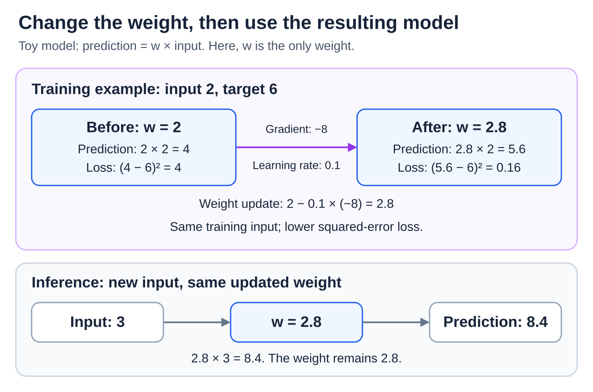
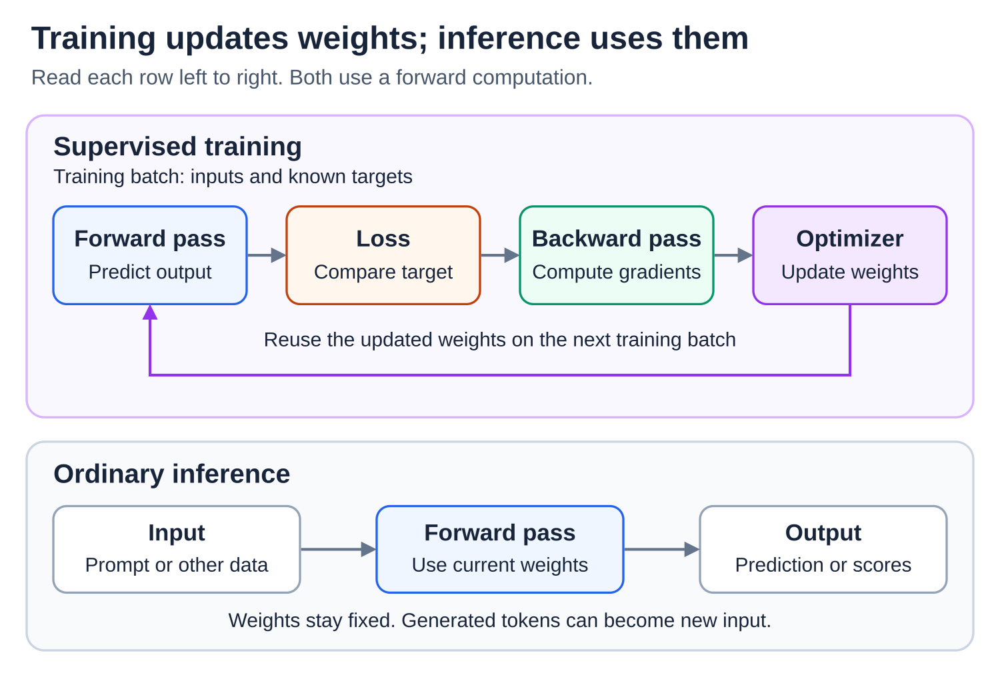

# Training. Training vs. Inference

<sub>[Back to Artificial Intelligence](../Readme.md#content)</sub>

**Training uses feedback to adjust a model’s numerical settings, called weights. Inference uses the current weights to make a prediction.** A third activity, **evaluation**, checks how well a prediction turned out.

Suppose two identical notebooks cost 6 coins. A model predicts 4. Follow what happens when we use the receipt to improve the model, then ask it for the price of three notebooks.

1. [What is a weight?](#1-what-is-a-weight)
2. [Where does the target come from?](#2-where-does-the-target-come-from)
3. [Why square the error?](#3-why-square-the-error)
4. [How does training improve the weight?](#4-how-does-training-improve-the-weight)
5. [What happens when we ask for a new prediction?](#5-what-happens-when-we-ask-for-a-new-prediction)
6. [What do the forward pass, backward pass, and optimizer do?](#6-what-do-the-forward-pass-backward-pass-and-optimizer-do)
7. [What changes when a language model answers?](#7-what-changes-when-a-language-model-answers)
8. [Check your understanding](#8-check-your-understanding)

## 1. What is a weight?

A **toy model** is a deliberately small example. Ours assumes a fixed price per notebook and no extra fees. We choose the multiplication rule and let the model learn one number, `w`, its estimate of the price per notebook.

```text
predicted total = w × number of notebooks
```

The **input** is the number of notebooks. The **prediction** is the total price the model calculates. The **weight** is the number the model carries from one calculation to the next. A weight is a **parameter**, a numerical setting that training can adjust.

Try holding the input steady. With two notebooks and `w = 2`, the prediction is 4 coins. With the same two notebooks and `w = 3`, it is 6 coins. Changing the weight changes how the model handles future purchases, too.

## 2. Where does the target come from?

The receipt gives us one **training example**. Its input is 2 notebooks and its **target**, the answer we want the model to predict, is 6 coins. The model gets the notebook count to make its prediction. The training program uses the receipt total to check it. Learning from examples with targets is called **supervised training**.

Start with `w = 2`. Subtract the target from the prediction to get the **signed error**.

```text
prediction = 2 × 2 = 4 coins
target     = 6 coins
error      = 4 − 6 = −2 coins
```

The minus sign tells us the estimate is too low. Its size tells us by how much. We have measured the mistake. The weight is still `2`.

## 3. Why square the error?

A **loss** is the score that training tries to make smaller. This example uses **squared error**. Squaring a number means multiplying it by itself, so the loss on our receipt is `(4 − 6)² = (−2) × (−2) = 4`. The prediction missed by **2 coins** and earned a **loss of 4**.

| Prediction | Signed error | Squared error |
| --- | --- | --- |
| `4` | `−2` | `4` |
| `6` | `0` | `0` |
| `8` | `+2` | `4` |
| `10` | `+4` | `16` |

Compare the first and third rows. An underestimate and an overestimate of the same size both count. If we averaged their signed errors, they would cancel. Now compare the last two rows. Doubling the miss from 2 to 4 makes the loss four times as large.

Across several receipts, averaging the individual squared errors gives the **mean squared error (MSE)**. Squared error gives a smooth curve whose slope we can use to improve the weight. Another possible loss, **absolute error**, simply uses the size of each miss and gives large misses less influence than squared error does.

## 4. How does training improve the weight?

At `w = 2`, the predicted total is too low. Since our input is positive, increasing the price per notebook a little will bring the total closer to 6. Follow the top half of the diagram from the first prediction to the revised one. Both use the same receipt.



### Which direction helps?

The **gradient** tells us how sensitive the loss is to a small change in each weight. With one weight, the gradient is a single number, the slope of the loss curve at the current weight. For our multiplication rule and squared error, the slope works out to

```text
gradient = 2 × (prediction − target) × input
         = 2 × (4 − 6) × 2
         = −8
```

The first factor of 2 comes from taking the slope of a square. The last factor is the input. With two notebooks, nudging the estimated unit price by `0.01` changes the predicted total by `0.02`.

You can check the slope with arithmetic. At `w = 2.01`, the prediction is `4.02` and the loss is `3.9204`. The loss changed by `−0.0796` for a weight increase of `0.01`. Their ratio is `−7.96`, close to `−8`. The negative sign tells us that a small increase in the weight lowers the loss here.

### How large an update should we make?

The **optimizer** is the algorithm that changes the weight. Our optimizer uses **gradient descent**. It subtracts the gradient multiplied by a **learning rate**, a number that controls the step size. Choose `0.1` for this example.

```text
new weight = old weight − learning rate × gradient
           = 2 − 0.1 × (−8)
           = 2.8
```

Subtracting a negative number raises the weight. On the same two notebooks, the new prediction is `2.8 × 2 = 5.6` and the loss falls to `(5.6 − 6)² = 0.16`. We could solve this tiny example exactly by dividing `6 ÷ 2 = 3`. Repeating the updates with this learning rate also moves the weight toward 3. A much larger learning rate can overshoot and increase the loss.

## 5. What happens when we ask for a new prediction?

Pause training at `w = 2.8`. A customer now asks for the price of **three** notebooks. Follow the bottom panel of the [one-weight diagram in section 4](#4-how-does-training-improve-the-weight), labeled “Inference: new input, same updated weight.” The notebook count changes from two to three, and the calculation uses the weight we just learned.

```text
prediction = 2.8 × 3 = 8.4 coins
```

That calculation is **inference**. It uses the current estimate of the unit price. The weight is still `2.8` afterward.

Now suppose the customer shows us a receipt for 9 coins. Comparing `8.4` with `9` is **evaluation**. We can report that the estimate was 0.6 coins too low and leave the model as it is. If we use the discrepancy to update the weight, we have taken a training step. Checking fresh receipts helps us see whether a weight that worked on one purchase also works on others.

## 6. What do the forward pass, backward pass, and optimizer do?

Read both rows of the diagram from left to right. They share the same first calculation. Follow the return arrow in the training row to see which values carry over to the next group of examples.



1. **Forward pass.** The model uses its current weights to calculate a prediction from an input. In our first training example, this produced `4`. Multiplying by `2.8` to answer the customer in section 5 was also a forward pass.
2. **Loss calculation.** In supervised training, the program compares the predictions with their targets. It often combines losses across a **batch**, a group of examples processed together.
3. **Backward pass.** **Backpropagation** works backward through the calculations to find the gradients. In our example, it tells the optimizer that the slope is `−8`.
4. **Optimizer step.** The optimizer uses the gradients to update the weights. The next training batch uses those updated values.

Ordinary inference needs the forward calculation to produce an answer. An evaluator can also use that answer to calculate a loss. The step that changes what the model has learned is the optimizer update.

## 7. What changes when a language model answers?

A language model predicts **tokens**, pieces of text such as a word or part of a word. Suppose `mat` is one token in the training sentence “The cat sat on the mat.” After “The cat sat on the,” the text supplies `mat` as the target. The model assigns probabilities to possible next tokens. A common loss, **cross-entropy**, gives a smaller penalty when the model assigns more probability to the observed token. Training uses that loss to adjust many weights.

During **generation**, the model gets a prompt, such as “The cat sat on the.” It computes next-token probabilities, a selection rule picks a token, and that token joins the input for the next prediction. Repeating this process can produce a whole reply with the same weights.

The text available for a prediction is its **context**. Suppose you add “Answer in French” or supply a tool result. The input changes, so the intermediate numbers computed from it, called **activations**, can change as well. The model can now produce a different answer with its existing weights. Giving examples in the prompt to guide the reply is **in-context learning**. Updating trainable parameters through additional training is **fine-tuning**.

## 8. Check your understanding

1. A model with `w = 2` quotes 4 coins for two notebooks and 6 coins for three. What changed between the two quotes?

   <details>
   <summary>Answer</summary>

   **The input changed.** The customer asked for three notebooks on the second call. The model used the same estimated price of 2 coins per notebook for both quotes.

   </details>

2. The model predicts 4 coins for two notebooks. The receipt says 6. Which value is the target, and what does the error of `−2` tell us?

   <details>
   <summary>Answer</summary>

   **The target is 6 coins**, the observed total on the receipt. The prediction is 2 coins too low because `4 − 6 = −2`.

   </details>

3. Two predictions miss their targets by `−2` and `+2`. What is their mean squared error?

   <details>
   <summary>Answer</summary>

   **4.** Each error squares to 4, so their average is `(4 + 4) ÷ 2 = 4`. The signs show opposite directions, but both predictions missed.

   </details>

4. Feedback moves `w` from `2` to `2.8`. Which activity is this, and why did a negative gradient make the weight go up?

   <details>
   <summary>Answer</summary>

   **Training.** Gradient descent subtracts the learning rate times the gradient. Here that means subtracting `−0.8`, which raises the weight by `0.8` and brings the prediction closer to the target.

   </details>

5. A model uses `w = 2.8` to quote a price for three notebooks. Someone later compares the quote with a receipt and leaves the weight fixed. What are these two activities?

   <details>
   <summary>Answer</summary>

   **Inference, then evaluation.** Multiplying `2.8 × 3` produces the quote of 8.4 coins. Comparing that quote with the receipt checks its accuracy.

   </details>

6. A training program finishes the forward and backward passes, then stops before the optimizer step. Have its weights changed?

   <details>
   <summary>Answer</summary>

   **No.** The forward pass produced predictions and the backward pass calculated gradients. The optimizer still has to apply an update.

   </details>

7. You put two French translations in a prompt, and the model translates a third phrase in the same style. Does that show the model was fine-tuned?

   <details>
   <summary>Answer</summary>

   **No.** The translations can guide the reply through in-context learning. They change the input and the activations for this request. Fine-tuning would require a training update to the model’s parameters.

   </details>

# Sources

- [Google Machine Learning Crash Course, *Linear regression: Loss*](https://developers.google.com/machine-learning/crash-course/linear-regression/loss)
- [Google Machine Learning Crash Course, *Linear regression: Gradient descent*](https://developers.google.com/machine-learning/crash-course/linear-regression/gradient-descent)
- [PyTorch, *Optimizing Model Parameters*](https://docs.pytorch.org/tutorials/beginner/basics/optimization_tutorial.html)
- [PyTorch, *Automatic Differentiation with Autograd*](https://docs.pytorch.org/tutorials/beginner/basics/autogradqs_tutorial.html)
- [Hugging Face, *Training a causal language model from scratch*](https://huggingface.co/learn/llm-course/chapter7/6)
- [Hugging Face, *Text generation*](https://huggingface.co/docs/transformers/llm_tutorial)
- [Hugging Face, *Fine-tuning*](https://huggingface.co/docs/transformers/training)
- [Brown et al., *Language Models are Few-Shot Learners*](https://arxiv.org/abs/2005.14165)
