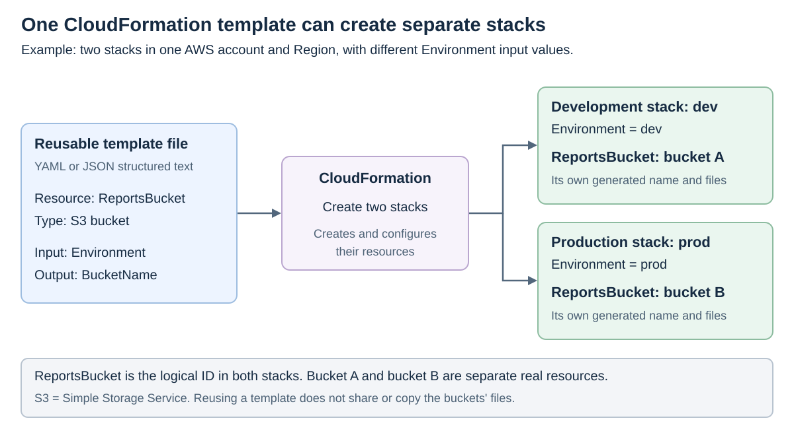
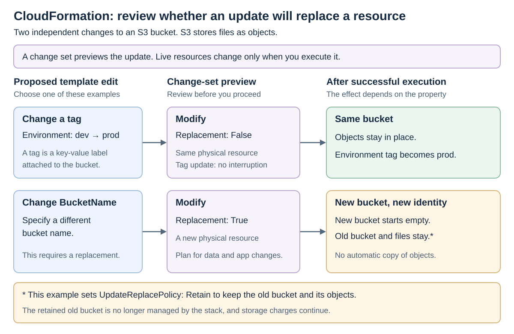

# AWS CloudFormation

<sub>[Back to AWS](../Readme.md#content)</sub>

**AWS CloudFormation creates and manages infrastructure from a template: a text file that describes the resources you want and their settings.** Instead of repeatedly creating a bucket, server, and network by hand, you describe them in a file and ask CloudFormation to build them.

This is **infrastructure as code (IaC)**. You can keep the file in version control, review changes with your team, and reuse it for another environment. The important ideas are the difference between a template and a live stack, how updates affect resources, and how to protect data when resources are removed or replaced.

## A template describes resources; a stack manages them

A **resource** is something in your Amazon Web Services (AWS) account, such as a storage bucket or a virtual server. To **provision** a resource means to create it and apply its settings.

A **template** describes the desired resources using **YAML** (YAML Ain't Markup Language) or **JSON** (JavaScript Object Notation). Both are text formats for structured data. You describe the result you want; CloudFormation makes the service calls needed to create or update it.

A **stack** is a collection of resources that CloudFormation manages together. The stack keeps track of which real resources correspond to the definitions in its template. Creating a stack creates resources; updating it applies changes; deleting it removes resources according to their deletion policies.

You can use the same template to create separate stacks. The diagram uses an Amazon Simple Storage Service (**S3**) bucket, a container for stored files, to show the difference between reusing a definition and sharing a live resource.



In this example, the development stack and production stack each get their own bucket. Updating one stack does not automatically update the other. The buckets also have separate contents: reusing a template does not copy application data.

## A small template you can read

The example below defines one bucket with public access blocked. It accepts an environment label, attaches that label as a tag, and returns the created bucket's name. A **tag** is a key–value label attached to a resource.

It also explicitly retains the bucket when the stack is deleted or the bucket is replaced. Those two policies are explained below. The example defines infrastructure; it does not upload any report files.

```yaml
Description: A report bucket for one environment

Parameters:
  Environment:
    Type: String
    Default: dev
    AllowedValues: [dev, prod]

Resources:
  ReportsBucket:
    Type: AWS::S3::Bucket
    DeletionPolicy: Retain
    UpdateReplacePolicy: Retain
    Properties:
      PublicAccessBlockConfiguration:
        BlockPublicAcls: true
        IgnorePublicAcls: true
        BlockPublicPolicy: true
        RestrictPublicBuckets: true
      Tags:
        - Key: Environment
          Value: !Ref Environment

Outputs:
  BucketName:
    Description: Name of the bucket created for this stack
    Value: !Ref ReportsBucket
```

The three main sections are:

| Section | Purpose in this template |
| --- | --- |
| `Parameters` | Inputs supplied when creating or updating the stack. `Environment` accepts `dev` or `prod`. |
| `Resources` | Resources CloudFormation manages. This is the only required template section. |
| `Outputs` | Useful values returned by the stack, such as a created resource's name. |

`ReportsBucket` is a **logical ID**: the name used to refer to this resource inside the template. It is not the bucket's actual name in S3. The actual resource identifier is its **physical ID**. Because this template omits `BucketName`, CloudFormation generates a unique bucket name.

`!Ref` asks CloudFormation for a value. `!Ref Environment` returns the chosen input value. For an S3 bucket, `!Ref ReportsBucket` returns its actual bucket name. The result of `Ref` on other resource types depends on that type's documentation.

The four public-access settings keep public permissions blocked for this bucket. They do not grant your application permission to read or write it; the application still needs suitable access permissions.

The `Environment` parameter only changes a tag here. Setting it to `prod` does not automatically add backups, monitoring, or other production settings. Templates do exactly what their resource definitions specify.

## How CloudFormation connects resources

In a larger template, one resource can refer to another. For example, a bucket access policy can use `!Ref ReportsBucket` to identify the bucket it belongs to. CloudFormation uses resource references to infer dependencies, so it creates the bucket before the policy that needs it.

Independent resources can be created in parallel. If a dependency is not expressed through a resource reference, you can declare it explicitly with **`DependsOn`**. The order of resource definitions in the text is not a deployment sequence.

CloudFormation also needs permission to act. By default, it uses a temporary session based on your credentials. You can instead provide a **service role**, an AWS Identity and Access Management (**IAM**) role that grants CloudFormation specific permissions for stack operations. Limit that role to the actions and resources it needs, and control who can operate the stack through it.

## A change set shows what an update will do

To change an existing stack, submit a revised template, different parameter values, or both. You do not need to delete and recreate the whole stack.

A **change set** previews the proposed changes before you execute them. It identifies resources to add, modify, or remove and whether an update requires replacement. Creating or reviewing the change set does not apply those resource changes. **Execution is the point at which CloudFormation starts changing the live resources.**

Different properties of the same resource can have very different effects. Read each row below as a separate proposed update to an S3 bucket. Both examples assume successful execution; the replacement example explicitly retains the old bucket.



CloudFormation documents three update behaviors:

| Behavior | Meaning |
| --- | --- |
| **No interruption** | Changes the existing resource without replacing its physical identity or interrupting its operation. Updating S3 bucket tags is an example. |
| **Some interruption** | Keeps the resource but may interrupt its operation while changing it. Check the specific property's documentation. |
| **Replacement** | Creates a different physical resource to take the old one's place. Changing the S3 `BucketName` property requires replacement. |

Replacement usually creates the new resource first, updates dependent references, and then handles the old resource according to its replacement policy. **Changing `BucketName` does not rename the existing bucket or move its files.** Plan any data transfer and application changes separately.

Review the property's **Update requires** entry in the resource reference and inspect the change set. A one-line template edit can still require a new resource.

CloudFormation runs pre-deployment validation by default for stack creation, stack updates, and change-set creation. It can catch common problems such as invalid properties or resource name conflicts. Change-set creation includes additional checks, such as service quota warnings. These checks reduce avoidable failures; they do not guarantee that execution will succeed or that the application will work correctly.

## Deletion and replacement use different policies

The sample has two `Retain` settings because they cover different situations:

| Setting | When it applies | Effect of `Retain` |
| --- | --- | --- |
| `DeletionPolicy` | You delete the stack, or remove the resource definition during a stack update | Keeps that resource and its contents |
| `UpdateReplacePolicy` | A property update replaces the resource | Keeps the **old** physical resource and its contents |

After retention takes effect, the retained resource is outside that stack's management. You must manage or remove it separately, and applicable storage or other resource charges continue. In the replacement example, the stack manages the new bucket while the retained old bucket still holds its original files.

Without an explicit policy, deletion is the usual behavior, although some database resources default to taking a snapshot. S3 also requires a bucket to be empty before it can be deleted. Do not rely on a deletion failure as your data-protection plan.

`Retain` keeps a resource; it is not a separate backup. It does not prevent someone with permission from changing or deleting data through the underlying service. Choose backup and recovery arrangements according to the data you need to protect.

## A failed update is not a database transaction

With the usual rollback behavior, CloudFormation tries to undo a failed stack update and return to the previous stable configuration. You can also choose to preserve successfully provisioned resources so that you can investigate and retry a failed operation.

Rollback itself can fail. For example, a resource needed for recovery may have been deleted outside CloudFormation. A stack in **`UPDATE_ROLLBACK_FAILED`** needs investigation and recovery before another normal update can proceed. Read the stack's events to find the failing resource and reason.

Rollback concerns resource configuration. It does not undo every application write, recover every deleted file, or guarantee that users saw no interruption. Keep application data recovery separate from infrastructure rollback.

## Drift means the live settings no longer match

**Drift** is a difference between a resource's expected configuration and its actual configuration. For example, the template may specify an `Environment=dev` tag while someone changes that same tag to `prod` directly in S3.

**Drift detection** reports supported differences. It does not itself repair them, and it is not a check of every possible setting: support varies by resource type, and ordinary drift detection checks properties explicitly specified in the template or parameters.

Traditional change sets compare the proposed template with the previous deployed template. **Drift-aware change sets** also inspect live resource settings. For supported resources and properties, they let you review and then apply changes that bring those settings into line with the desired template. You can instead update the template to adopt a deliberate manual change.

This is an operation you choose to run, not a promise that every manual change is continuously reversed. Drift-aware updates also have limitations, including special handling for AWS-managed properties and unsupported resource types. Review the actual proposed changes before execution, especially after an emergency manual fix.

## Reuse across accounts and Regions

A stack is created in an AWS account and Region. **CloudFormation StackSets** coordinate separate stacks across the target accounts and Regions you select, using a common template with optional parameter differences.

This helps distribute a standard infrastructure definition. It does not make resources in different accounts or Regions share their data. Check service availability, permissions, quotas, and region-specific inputs when reusing a template.

## Where the template comes from

You can write templates in a text editor. The CloudFormation console's **Template studio** also shows editable template text beside a diagram. The diagram follows the text; you change resources by editing the template, not by dragging items around the diagram. Saving an edited file does not by itself update a running stack.

The **AWS Cloud Development Kit (CDK)** lets you define infrastructure using a programming language, such as TypeScript, Python, or Java. It generates CloudFormation templates and deploys through CloudFormation. The same ideas about stacks, replacement, and retention still matter when CDK produces the template for you.

CloudFormation makes infrastructure repeatable and reviewable. A tested template is still subject to permissions, quotas, service behavior, and the values supplied at deployment time. Review the proposed changes and plan for the effect on real resources and data.

# Sources

- [What is AWS CloudFormation?](https://docs.aws.amazon.com/AWSCloudFormation/latest/UserGuide/Welcome.html)
- [CloudFormation concepts and workflow](https://docs.aws.amazon.com/AWSCloudFormation/latest/UserGuide/cloudformation-overview.html)
- [Template sections](https://docs.aws.amazon.com/AWSCloudFormation/latest/UserGuide/template-anatomy.html)
- [Resources, logical IDs, and physical IDs](https://docs.aws.amazon.com/AWSCloudFormation/latest/UserGuide/resources-section-structure.html)
- [S3 bucket properties and return values](https://docs.aws.amazon.com/AWSCloudFormation/latest/TemplateReference/aws-resource-s3-bucket.html)
- [S3 public-access block configuration](https://docs.aws.amazon.com/AWSCloudFormation/latest/TemplateReference/aws-properties-s3-bucket-publicaccessblockconfiguration.html)
- [Resource references and explicit dependencies](https://docs.aws.amazon.com/AWSCloudFormation/latest/TemplateReference/aws-attribute-dependson.html)
- [CloudFormation service roles](https://docs.aws.amazon.com/AWSCloudFormation/latest/UserGuide/using-iam-servicerole.html)
- [Updating stacks with change sets](https://docs.aws.amazon.com/AWSCloudFormation/latest/UserGuide/using-cfn-updating-stacks-changesets.html)
- [Resource update behaviors](https://docs.aws.amazon.com/AWSCloudFormation/latest/UserGuide/using-cfn-updating-stacks-update-behaviors.html)
- [Pre-deployment validation](https://docs.aws.amazon.com/AWSCloudFormation/latest/UserGuide/validate-stack-deployments.html)
- [DeletionPolicy](https://docs.aws.amazon.com/AWSCloudFormation/latest/TemplateReference/aws-attribute-deletionpolicy.html)
- [UpdateReplacePolicy](https://docs.aws.amazon.com/AWSCloudFormation/latest/TemplateReference/aws-attribute-updatereplacepolicy.html)
- [Handling stack operation failures](https://docs.aws.amazon.com/AWSCloudFormation/latest/UserGuide/stack-failure-options.html)
- [Recovering from a failed rollback](https://docs.aws.amazon.com/AWSCloudFormation/latest/UserGuide/using-cfn-updating-stacks-continueupdaterollback.html)
- [Drift detection and its limitations](https://docs.aws.amazon.com/AWSCloudFormation/latest/UserGuide/using-cfn-stack-drift.html)
- [Drift-aware change sets](https://docs.aws.amazon.com/AWSCloudFormation/latest/UserGuide/drift-aware-change-sets.html)
- [StackSets concepts](https://docs.aws.amazon.com/AWSCloudFormation/latest/UserGuide/stacksets-concepts.html)
- [Template studio](https://docs.aws.amazon.com/AWSCloudFormation/latest/UserGuide/template-studio.html)
- [AWS CDK and CloudFormation](https://docs.aws.amazon.com/cdk/v2/guide/home.html)
