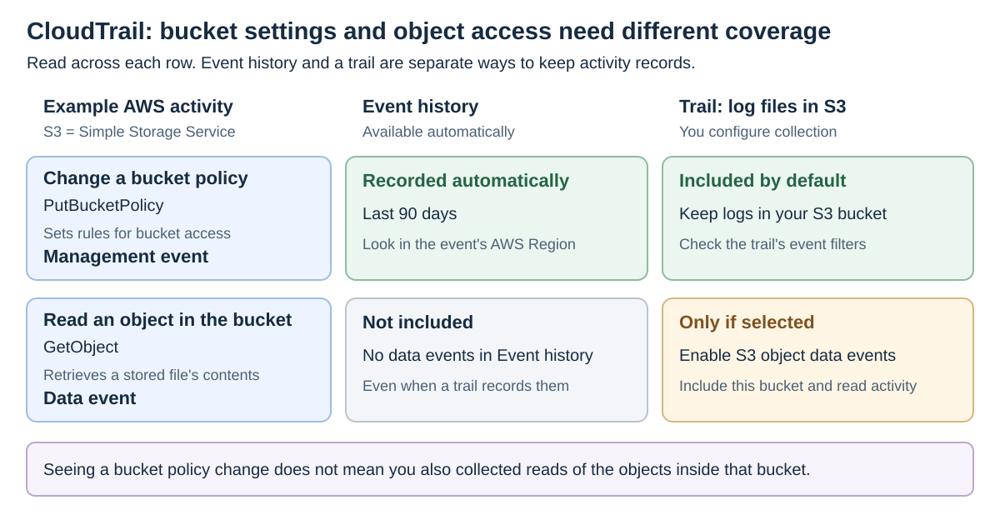
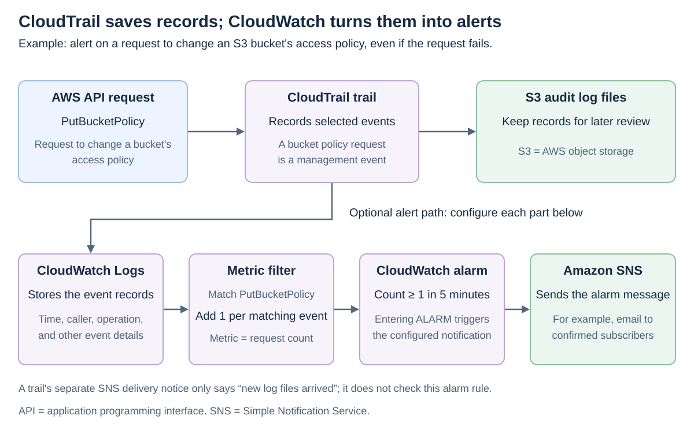

# AWS CloudTrail

<sub>[Back to AWS](../Readme.md#content)</sub>

**AWS CloudTrail records activity in your Amazon Web Services (AWS) account so you can investigate which identity made a request, what it requested, and when it happened.** It helps answer questions such as “Who changed this bucket's permissions?” and “Which role tried to delete this resource?”

The key is to collect the right events before you need them. The automatic history covers recent management activity. A configured **trail** delivers selected events to storage for longer retention and further analysis. This article explains that difference, how to read a record, and how to turn relevant activity into an alert.

## What CloudTrail records

An **application programming interface (API)** is a way for software to ask a service to do something. For example, an application can call the Amazon Simple Storage Service (S3) API to read an object, which is a file stored in a bucket. Actions through the AWS console, command line, and software libraries can produce CloudTrail events. AWS services can also act on your behalf.

An **event** is one activity record. A **trail** is the configuration that selects events and delivers log files to an S3 bucket. The trail is not the bucket itself.

The two event categories you will encounter most often are:

| Category | What it describes | Example | Included in a new trail by default? |
| --- | --- | --- | --- |
| **Management events** | Managing resources and their settings | `PutBucketPolicy` changes an S3 bucket's access policy | Yes; you can change the filters |
| **Data events** | Using data or performing operations within a resource | `GetObject` reads an S3 object; `DeleteObject` deletes one | No; explicitly select the resources and activity to record |

Management events also include some activity that is not an API call, such as console sign-ins. A management event is not necessarily a change: read operations that inspect resource configuration can be management events too.

CloudTrail also offers two optional categories. **Network activity events** record supported AWS API calls through a **Virtual Private Cloud (VPC) endpoint**, a private connection to an AWS service. They are not a packet capture. **Insights events** flag unusual API call or error rates compared with normal activity. Insights can analyze management events and, on trails, data events. Both optional categories need configuration and have additional charges.

## Event history and a trail keep different records

CloudTrail's **Event history** is available automatically. It lets you view, search, and download the last **90 days of management events for one account in one Region**. It does not require a trail or an S3 bucket. For a regional action, look in the Region where it happened.

A **trail** gives you ongoing delivery of the events you select to S3. You decide how long to keep those files through your storage and retention settings. The comparison below shows why a bucket policy change can appear in Event history even when an object read does not.



Event history does not display data, network activity, or Insights events. Creating a trail that records S3 object reads does not make those reads appear in Event history. Read the trail's stored records instead.

The two are independent: stopping a trail or changing its filters does not turn off Event history. Conversely, having Event history does not mean you have a permanent archive.

For example, suppose you need to investigate who downloaded `reports/payroll.csv`. Recording bucket management events is insufficient. You need data-event collection that includes reads of that object. **An event selector** is a rule that decides which events a trail keeps. You can limit data events to relevant resources and operations to reduce volume and cost. Selecting those events now cannot reconstruct earlier activity that you never collected.

## How to read an event

CloudTrail uses **JavaScript Object Notation (JSON)**, a text format made of named fields and values. You do not need to understand every field to begin an investigation.

This fictional, shortened event shows a denied attempt to change a bucket policy. Real records contain additional fields.

```json
{
  "eventTime": "2026-11-16T10:15:00Z",
  "eventSource": "s3.amazonaws.com",
  "eventName": "PutBucketPolicy",
  "awsRegion": "eu-west-2",
  "userIdentity": {
    "type": "AssumedRole",
    "arn": "arn:aws:sts::123456789012:assumed-role/DeploymentRole/build-42"
  },
  "requestParameters": {
    "bucketName": "example-reports"
  },
  "errorCode": "AccessDenied",
  "eventCategory": "Management"
}
```

Read it as: “At 10:15 UTC, a session using `DeploymentRole` asked S3 in London to set the policy on `example-reports`. S3 denied the request.” **UTC** means Coordinated Universal Time; the `Z` suffix marks that time zone.

| Field | Question it helps answer |
| --- | --- |
| `eventTime` | When did the request finish? |
| `eventSource` and `eventName` | Which service and operation were requested? |
| `awsRegion` | Which Region is recorded for the request? |
| `userIdentity` | Which identity and credentials made it? |
| `requestParameters` | What resource or settings were supplied? |
| `errorCode` / `errorMessage` | Did the service report a failure? Some services place error details elsewhere in the record. |

An **assumed role** is a session using temporary permissions from an AWS Identity and Access Management (IAM) role. The **Amazon Resource Name (ARN)** identifies the role session. Here, `DeploymentRole` is the role and `build-42` is the session name.

The event shows a request, so its operation name alone does not prove that the change succeeded. Also, a credential or session identity is not proof of which human used it. For a shared role or automated deployment, use session details and related authentication records to trace the activity further.

## Keep logs and alert on relevant activity

A trail writes compressed JSON log files to an S3 bucket. You can use a new bucket or an existing bucket with the required permissions. A separate bucket is often convenient, but CloudTrail does not require a newly created, dedicated bucket.

You can also configure the trail to send events to **CloudWatch Logs**, a service that stores and searches log events. The diagram shows one way to alert on bucket policy requests while keeping the audit files in S3.



In this example, a **metric filter** matches `PutBucketPolicy` events and adds `1` to a metric for each match. A **metric** is a number measured over time. A **CloudWatch alarm** checks the sum and enters its alarm state when at least one matching event arrives in a five-minute period. Its configured action sends a notification through **Amazon Simple Notification Service (SNS)** to subscribers.

Filtering only on the operation name also counts failed attempts. That can be useful, but the notification should say that a policy request occurred. Check error details before describing it as a successful change. An alarm notification reports a state change; it is not automatically a separate message for every later matching request.

CloudTrail has another optional SNS setting: **log-file delivery notifications**. These announce that new files reached S3. They do not inspect the events for suspicious activity and do not replace the filter and alarm in this example.

CloudTrail typically delivers trail logs after an average of about five minutes, but this is not a guaranteed deadline. Records may arrive out of order, and occasional duplicates can occur. Use the event time when building a timeline, and account for duplicate `eventID` values when counting records. This logging path should not be treated as an immediate blocking control for a harmful request.

## Cover the right Regions and accounts

A **multi-Region trail** records selected events across all Regions enabled in the account. AWS recommends it for broad coverage, and trails created in the console are multi-Region. A single-Region trail can be created through the AWS Command Line Interface (CLI) or API.

Enabling an additional opt-in Region extends a multi-Region trail to that Region, but propagation and log delivery take time. **Multi-Region does not mean multi-account.**

An **organization trail** uses AWS Organizations to collect selected events from the organization's management account and member accounts. New member accounts are included automatically, and member accounts cannot disable or edit that organization trail. Check Region activation as well: if its home Region is an opt-in Region, member accounts must enable that Region to send activity to the trail.

Event history remains an account-and-Region view. An organization trail does not turn that page into a combined search of every account.

## Protect the records you will rely on

Three controls solve different problems:

| Control | What it does |
| --- | --- |
| **Access and retention settings** | Control who can read or delete stored logs and how long you retain them |
| **Encryption** | Protect stored log contents; AWS Key Management Service (KMS) lets you control access through a KMS key |
| **Log file integrity validation** | Lets you detect whether delivered log files were changed or deleted |

CloudTrail log files are encrypted in S3. The current trail-creation console enables server-side encryption with KMS by default. If you disable that choice, CloudTrail uses server-side encryption with S3-managed keys. KMS is an encryption option with key permissions, not a second layer added to otherwise unencrypted logs.

When you enable integrity validation, CloudTrail delivers signed **digest files** containing hashes of the log files. A hash is a fingerprint of file contents. You then run validation with the AWS CLI or another implementation to check the files against those digests.

**Enabling digest delivery does not automatically run validation, and integrity validation does not prevent deletion.** Restrict access to the log bucket, protect the key if you use KMS, and set retention for the period you actually need.

## Costs and query options

Event history has no CloudTrail charge. CloudTrail also delivers the first copy of ongoing management events to S3 without a CloudTrail event-delivery charge, but S3 storage still costs money. Additional management-event copies, data events, network activity events, and Insights can add CloudTrail charges. CloudWatch Logs, alarms, notifications, and queries can add their own service charges.

For investigation beyond Event history, **Amazon Athena** can query trail files stored in S3 using **Structured Query Language (SQL)**. You can also search events delivered to CloudWatch Logs. Choose the collection and retention settings before relying on either query path.

**CloudTrail Lake**, a managed store for audit events and SQL queries, **closed to new customers on May 31, 2026**. Existing customers can continue using it. This restriction applies to Lake; CloudTrail trails remain available. Do not assume a new account can start using Lake just because an older tutorial includes it.

## CloudTrail and CloudWatch together

Use **CloudTrail** to investigate AWS activity: “Which role requested a bucket policy change?” Use **CloudWatch** to monitor and investigate system behavior: “Did requests start failing?” CloudTrail events can be sent to CloudWatch Logs, so these tools can work together.

For the bucket example, first establish whether the policy request succeeded. Then use application logs and metrics to investigate its effect. If you also need to know which objects were read, make sure the relevant S3 data events were being collected.

# Sources

- [AWS CloudTrail overview](https://docs.aws.amazon.com/awscloudtrail/latest/userguide/cloudtrail-user-guide.html)
- [CloudTrail Event history and its limitations](https://docs.aws.amazon.com/awscloudtrail/latest/userguide/view-cloudtrail-events.html)
- [Understanding CloudTrail event categories](https://docs.aws.amazon.com/awscloudtrail/latest/userguide/cloudtrail-events.html)
- [Amazon S3 CloudTrail events](https://docs.aws.amazon.com/AmazonS3/latest/userguide/cloudtrail-logging-s3-info.html)
- [Logging and filtering data events](https://docs.aws.amazon.com/awscloudtrail/latest/userguide/logging-data-events-with-cloudtrail.html)
- [CloudTrail Insights for management and data events](https://docs.aws.amazon.com/awscloudtrail/latest/userguide/logging-insights-events-with-cloudtrail.html)
- [CloudTrail event record fields](https://docs.aws.amazon.com/awscloudtrail/latest/userguide/cloudtrail-event-reference-record-contents.html)
- [CloudTrail identity and role-session fields](https://docs.aws.amazon.com/awscloudtrail/latest/userguide/cloudtrail-event-reference-user-identity.html)
- [Creating a trail: storage, encryption, and optional integrations](https://docs.aws.amazon.com/awscloudtrail/latest/userguide/cloudtrail-create-a-trail-using-the-console-first-time.html)
- [Log delivery timing, file format, and duplicate events](https://docs.aws.amazon.com/awscloudtrail/latest/userguide/get-and-view-cloudtrail-log-files.html)
- [CloudWatch alarms for CloudTrail events](https://docs.aws.amazon.com/awscloudtrail/latest/userguide/cloudwatch-alarms-for-cloudtrail.html)
- [CloudWatch alarm behavior and actions](https://docs.aws.amazon.com/AmazonCloudWatch/latest/monitoring/CloudWatch_Alarms.html)
- [CloudTrail log-file delivery notifications](https://docs.aws.amazon.com/awscloudtrail/latest/userguide/configure-sns-notifications-for-cloudtrail.html)
- [Multi-Region trails and opt-in Regions](https://docs.aws.amazon.com/awscloudtrail/latest/userguide/cloudtrail-multi-region-trails.html)
- [Organization trails](https://docs.aws.amazon.com/awscloudtrail/latest/userguide/creating-trail-organization.html)
- [CloudTrail log file integrity validation](https://docs.aws.amazon.com/awscloudtrail/latest/userguide/cloudtrail-log-file-validation-intro.html)
- [Encrypting CloudTrail files with KMS keys](https://docs.aws.amazon.com/awscloudtrail/latest/userguide/encrypting-cloudtrail-log-files-with-aws-kms.html)
- [AWS CloudTrail pricing](https://aws.amazon.com/cloudtrail/pricing/)
- [Querying CloudTrail logs with Amazon Athena](https://docs.aws.amazon.com/athena/latest/ug/cloudtrail-logs.html)
- [CloudTrail Lake availability change](https://docs.aws.amazon.com/awscloudtrail/latest/userguide/cloudtrail-lake-service-availability-change.html)
