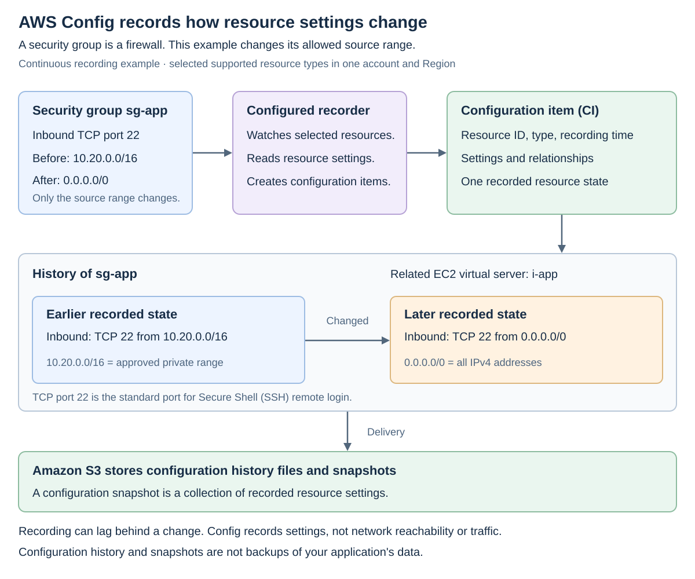
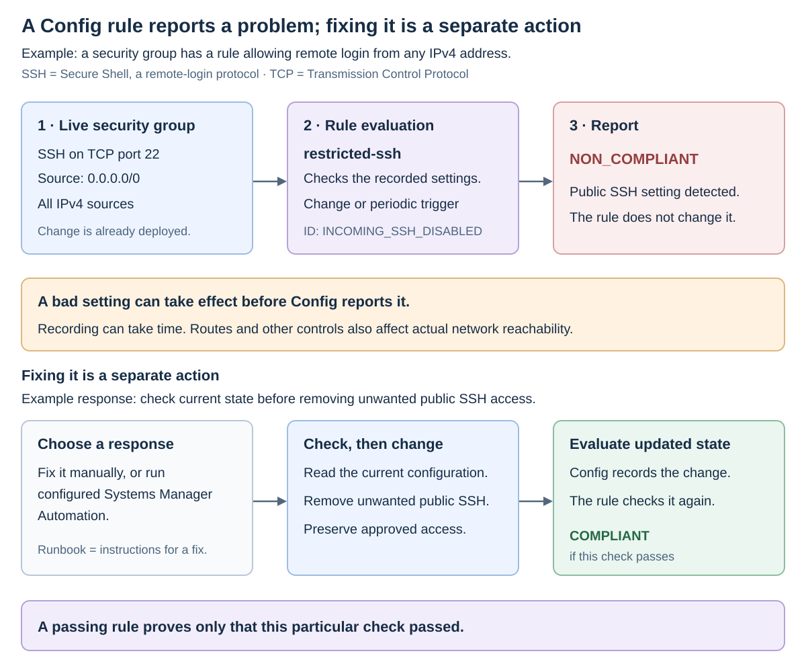

# AWS Config

[Back to AWS](../Readme.md#content)

**AWS Config records how supported AWS resources are configured, how they relate to one another, and how their settings change. Config rules can then check those settings against your requirements.** Recording, checking, and fixing are separate jobs.

Suppose someone changes a server's security group to allow remote login from any IPv4 address. Config can keep the before-and-after settings and report that the new configuration fails a rule. The rule itself does not undo the change.

This article explains the records Config keeps, how rule evaluation works, and how remediation and a central view fit around them.

## What does Config record?

An **AWS resource** is something you manage in AWS, such as an Amazon Elastic Compute Cloud (EC2) virtual server, a security group, or an Amazon Simple Storage Service (S3) bucket. Its **configuration** is its settings and metadata. For example, a security group's configuration includes its traffic rules.

A **configuration recorder** captures the supported resource types within its configured scope. With a customer-managed recorder, you select the resource types and recording frequency. Config discovers their settings and relationships, such as which security group is associated with which instance.

A **configuration item (CI)** is a record of one resource's configuration at a particular time. It can include the resource ID and type, recording time, settings, and relationships.

In this example, the recorder captures two versions of the same security group. Follow the top row into the history below it. The association with `i-app` helps you identify a related virtual server that might be affected.

A **configuration history** is the sequence of recorded items for a resource. A **configuration snapshot** collects the configurations of the resources being recorded. These describe infrastructure settings; they are not backups of the files or database rows stored by your application.

History starts when recording begins for the resource. Config does not reconstruct changes from before it was recording. It also does not provide complete configuration history for unsupported or excluded resource types.

### Storage and notifications

The **delivery channel** controls where Config sends configuration data. Config delivers history files and configuration snapshots to an Amazon S3 bucket. You can also configure an Amazon Simple Notification Service (SNS) topic for notifications.

You can inspect a resource's timeline in Config without manually opening those files. Protect the stored history and give Config the permissions it needs to record resources and deliver data.

## Continuous and daily recording answer different questions

| Recording mode | What it captures | When the distinction matters |
|---|---|---|
| **Continuous** | Configuration changes as they occur. Recording is best effort and can be delayed. | You need a detailed history of changes, such as a security-group rule being opened and later closed. |
| **Daily** | The latest state over a 24-hour period, recorded only if it differs from the previous recorded item. | You need a less detailed history and can accept missing intermediate states. |

For example, a setting might become unsafe and then return to its previous value during a day. Daily recording can omit that temporary state. It should not be treated as a complete record of every change.

**Recording frequency and rule-evaluation frequency are separate settings.** A periodic rule runs on its evaluation schedule; selecting daily recording does not simply mean every rule runs once a day.

## Config rules check a condition

A **Config rule** describes a check you want to apply, such as whether incoming SSH access is restricted. **Compliance**, in this context, means passing that particular check.

The main results are `COMPLIANT` and `NON_COMPLIANT`: the resource passes or fails the rule's conditions. A passing result is not proof that the whole application is secure or that every requirement has been met.

You can use three forms of rule:

- **AWS managed rule:** a predefined check from AWS, with parameters where supported.
- **Custom Lambda rule:** your evaluation code runs in AWS Lambda.
- **Custom Policy rule:** you write conditions in **Guard**, a language for expressing configuration checks. This does not require writing a Lambda function.

Rules also have a **scope**, which identifies the resource types or other matching criteria to evaluate. Check the rule's documentation for its supported resources, parameters, Regions, and triggers.

### When does a rule run?

Depending on the rule, evaluations run after a relevant configuration change, periodically, or both. A **periodic** evaluation runs on a schedule. A rule with both trigger types can detect changes and repeat the check later.

There are also two evaluation modes:

| Mode | What is checked |
|---|---|
| **Detective** | The configuration of resources that have already been deployed. |
| **Proactive** | Proposed resource properties supplied for evaluation before deployment, for supported rules and resource types. |

Proactive evaluation returns a result. It does not create the resource, prevent deployment, or fix a failure. Your deployment process must use the result to decide whether to continue.

## Example: a security group allows public SSH

A **security group** controls allowed network traffic for associated resources. **SSH (Secure Shell)** is commonly used for remote login on **TCP (Transmission Control Protocol) port 22**. The source range `0.0.0.0/0` means all IPv4 addresses; `::/0` means all IPv6 addresses.

The AWS managed rule named `restricted-ssh` has the identifier `INCOMING_SSH_DISABLED`. It checks whether incoming SSH is restricted rather than allowed from either of those all-address ranges. Its triggers include both configuration changes and periodic evaluations.

In the diagram, the deployed group allows TCP port 22 from `0.0.0.0/0`. Config reports `NON_COMPLIANT`. The lower row shows a separate, chosen response that removes the unwanted access and lets Config evaluate the changed settings.

This is a configuration check, not a network connection test. A public SSH rule is undesirable in this example, but whether a particular server is reachable also depends on routes, addressing, and other controls.

Likewise, passing `restricted-ssh` means the rule's condition passes. It does not inspect every possible administrative port or prove that the instance has no other security problems.

## Remediation changes the resource

**Remediation** means taking corrective action. You can fix a resource yourself, or separately configure Config remediation through **AWS Systems Manager Automation**.

An Automation **runbook** contains the instructions for an action. You select an appropriate managed or custom runbook, supply its parameters and permissions, and choose manual or automatic remediation where supported. Adding a Config rule alone does not configure this response.

For the SSH example, the intended action is to remove unwanted public SSH access while preserving approved access. A suitable response should read the current configuration before changing it.

That check matters because automatic remediation can use an older compliance snapshot. It can start even after someone has already corrected the resource. Design the action so that repeating it is safe and it leaves an already-correct resource alone. This is a practical consequence of acting on results that may be out of date.

After a correction, check the updated configuration, the remediation execution result, and the later rule result. A failed automation or a result still waiting for reevaluation should not be mistaken for a completed fix.

## Config, CloudTrail, and CloudWatch complement one another

| Service | Main question | Example |
|---|---|---|
| **AWS Config** | What were the resource's settings, and do they pass the selected checks? | The security group changed from a restricted range to `0.0.0.0/0`. |
| **AWS CloudTrail** | Which identity made a recorded request, and when? | A particular role called the operation that changed the security group. |
| **Amazon CloudWatch** | How is the application behaving? | Error rates, latency, logs, or alarms changed around the same time. |

CloudTrail event details can help explain a configuration change found in Config. CloudWatch helps investigate its operational effect. Config history by itself is not a substitute for either kind of evidence.

## Cover the accounts, Regions, and resources you intend to monitor

Config recording is configured by **AWS account and Region**. Enabling it in one Region does not automatically create full coverage across every account and Region.

Global resource types have special recording rules. Some are recorded only in a designated home Region; older global AWS Identity and Access Management (IAM) resource types have their own supported-Region restrictions. Check the recording documentation rather than blindly recording the same global resources everywhere.

An **aggregator** collects existing configuration and compliance data from selected accounts and Regions, including through AWS Organizations integration. It gives you a central, **read-only view**. It does not enable recording in the source accounts, deploy rules there, or fix their resources. Configure source coverage and access separately.

A **conformance pack** bundles Config rules and remediation actions so they can be deployed together, typically from a YAML template—a text file describing the checks and actions. Use a pack to distribute a consistent set of checks. Use an aggregator to view collected results. These solve different problems.

## Keep the setup deliberate

Start with the resource types and checks that answer a concrete need. For the example here, that means recording security-group configuration and enabling the SSH check in the relevant accounts and Regions.

Review recording frequency, rule scope, permissions, and notification destinations. Assign someone to act on failures, and test any automated correction on a small scope before expanding it.

Config charges depend on recorded configuration items and rule or conformance-pack evaluations. Related services, such as S3, SNS, Lambda, and Automation, can also add charges when used. Frequent resource creation and deletion can generate substantial recording activity, so choose coverage with both visibility and cost in mind.

Related articles: [CloudTrail](../AWS%20CloudTrail/Readme.md), [CloudWatch](../Amazon%20CloudWatch/Readme.md), [AWS Organizations](../AWS%20Organizations/Readme.md), and [the Shared Responsibility Model](../AWS%20Shared%20Responsibility%20Model/Readme.md).

# Sources

- [AWS: What is AWS Config?](https://docs.aws.amazon.com/config/latest/developerguide/WhatIsConfig.html)
- [AWS: How AWS Config works](https://docs.aws.amazon.com/config/latest/developerguide/how-does-config-work.html)
- [AWS: Config terminology and concepts](https://docs.aws.amazon.com/config/latest/developerguide/config-concepts.html)
- [AWS: Recording resources, frequency, and global-resource rules](https://docs.aws.amazon.com/config/latest/developerguide/select-resources.html)
- [AWS: Evaluating resources with Config rules](https://docs.aws.amazon.com/config/latest/developerguide/evaluate-config.html)
- [AWS: Rule components, triggers, and evaluation modes](https://docs.aws.amazon.com/config/latest/developerguide/evaluate-config_components.html)
- [AWS: Custom Lambda and Guard policy rules](https://docs.aws.amazon.com/config/latest/developerguide/evaluate-config_develop-rules.html)
- [AWS: restricted-ssh rule](https://docs.aws.amazon.com/config/latest/developerguide/restricted-ssh.html)
- [AWS: Remediating noncompliant resources](https://docs.aws.amazon.com/config/latest/developerguide/remediation.html)
- [AWS: Automatic remediation and stale compliance results](https://docs.aws.amazon.com/config/latest/developerguide/setup-autoremediation.html)
- [AWS: Service integrations, including CloudTrail](https://docs.aws.amazon.com/config/latest/developerguide/service-integrations.html)
- [AWS: What is Amazon CloudWatch?](https://docs.aws.amazon.com/AmazonCloudWatch/latest/monitoring/WhatIsCloudWatch.html)
- [AWS: Multi-account, multi-Region aggregation](https://docs.aws.amazon.com/config/latest/developerguide/aggregate-data.html)
- [AWS: Conformance packs](https://docs.aws.amazon.com/config/latest/developerguide/conformance-packs.html)
- [AWS: Config pricing](https://aws.amazon.com/config/pricing/)
