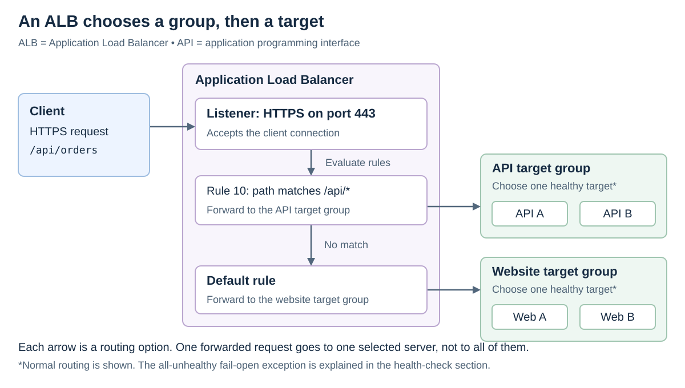
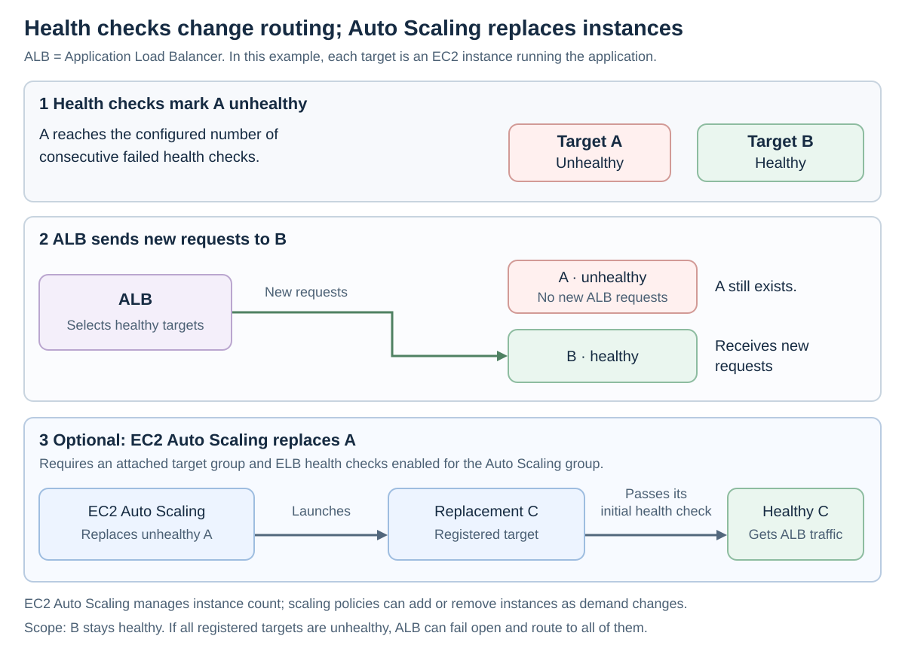
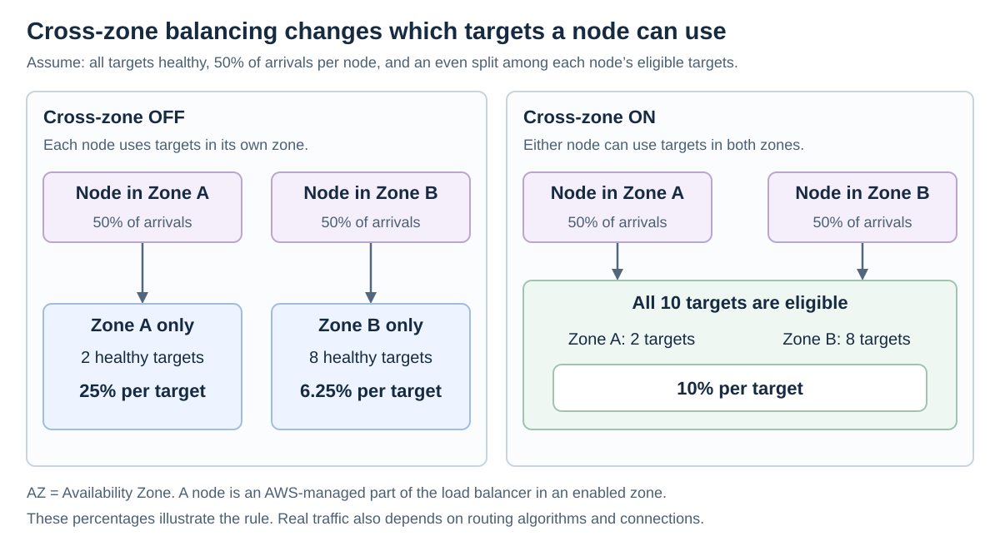

# AWS Elastic Load Balancing (ELB)

[Back to AWS](../Readme.md#content)

**Elastic Load Balancing (ELB) is the AWS service that distributes incoming traffic among application targets, such as EC2 servers.** Clients use one entry point while the servers behind it can be added, removed, or replaced. Health checks help the load balancer avoid targets that cannot serve requests.

Imagine an online shop running on several [EC2 instances](../Amazon%20EC2/Readme.md). Customers use the shop's address instead of choosing a server. The load balancer receives their traffic and selects a target. This article follows that example using an **Application Load Balancer (ALB)**, then explains the other types, failure handling, and scaling.

## Understand the four main parts

Web applications use **Hypertext Transfer Protocol (HTTP)** for requests and responses. **HTTPS** protects HTTP traffic using **Transport Layer Security (TLS)**. A **port**, such as `443`, identifies where a network service accepts connections.

| Part | What it does | Shop example |
| --- | --- | --- |
| **Listener** | Accepts traffic using a configured protocol and port. | Accept HTTPS connections on port `443`. |
| **Rule** | Matches a request and chooses an action. | Send paths matching `/api/*` to the order service. |
| **Target group** | Defines a collection of registered destinations and how to reach and health-check them. | The servers running the order service. |
| **Target** | Handles the forwarded request. | One particular EC2 instance and application port. |

An **application programming interface (API)** is how software calls another application's operations. Here, `/api/orders` is an example request path for the shop's order service.

Read the diagram from left to right. The listener accepts the connection. Rules select a target group, then the ALB selects one target from that group. The arrows show possible routes, not copies of the same request sent to every server.

ALB rules run from the lowest priority number to the highest. The first matching rule handles the request; the **default rule** handles requests that match no earlier rule. In this example:

| Request | Matching rule | Destination |
| --- | --- | --- |
| `/api/orders` | Priority `10`: path `/api/*` | API target group |
| `/products` | Default rule | Website target group |

ALB can also match a host name, request header, method, or other supported condition. A rule can forward a request, redirect the client, or return a fixed response. This example uses forwarding.

A target group is a configuration object, not another server in the request path. For an ALB, its target type can be an instance, an IP address, or a Lambda function. **IP** means Internet Protocol. Choose one target type per group. Container services can register the appropriate instance-and-port or IP targets; “container” is not a separate ALB target type.

For instance and IP targets, the target group's protocol and port describe the connection from the ALB to the application. A target can override the group's default port when it is registered. The public listener might accept HTTPS on `443` while the application listens on `8080`.

## Put a public entry point in front of private servers

A load balancer's **scheme** determines how clients reach it:

- **Internet-facing:** clients can connect over the internet, subject to network rules.
- **Internal:** clients need network access to its private addresses, such as through the application's [VPC](../Amazon%20VPC/Readme.md).

For a typical internet-facing ALB deployment, place its nodes in public subnets and the EC2 application servers in private subnets. A **node** is an AWS-managed part of the load balancer in an enabled **Availability Zone (AZ)**. With ordinary Regional AZ subnets, an ALB requires subnets in at least two different AZs. Put application capacity in multiple AZs as well; creating the load balancer does not create those servers.

**The EC2 targets do not need public IP addresses to receive traffic from the ALB.** The ALB reaches them using their private addresses. A network address translation (NAT) gateway is not required for this incoming request path; the application might separately need NAT or a VPC endpoint to make outbound calls.

Use the ALB's **security group**, its network access rules, to allow the intended client traffic. Allow the ALB to reach the targets on their application and health-check ports. In the targets' security group, use the ALB's security group as the allowed source. This lets the load balancer reach the application without opening its port directly to everyone. Subnet routes and network access control lists must also permit the traffic.

## HTTPS has two separate connections

With an ALB HTTPS listener, **TLS termination** means that the client's encrypted connection ends at the load balancer. The ALB decrypts the request so it can inspect fields such as the path.

The listener needs a server certificate and a **security policy** specifying the supported TLS protocols and encryption settings. **AWS Certificate Manager (ACM)** can provide and manage the certificate.

The ALB then makes a separate connection to the target. An HTTP target group uses HTTP for that connection; an HTTPS target group establishes a separate TLS connection. **HTTPS between the browser and ALB does not automatically encrypt the ALB-to-target connection.** Choose both parts deliberately.

If the target must decrypt the original TLS traffic itself, a **Network Load Balancer** with a TCP listener can pass it through. **Transmission Control Protocol (TCP)** carries connections without requiring the load balancer to read the HTTP request inside them.

## Health checks detect trouble; Auto Scaling replaces instances

An ALB health check periodically asks a target to respond, for example by requesting `/health`. You configure the protocol, port, path, accepted response codes, interval, and failure threshold. Make that endpoint reflect whether the application can serve its intended work.

Suppose server A stops responding while server B remains healthy. After the configured number of failed checks, the ALB normally stops sending new requests to A and uses healthy targets such as B. Detection takes time. A failed request is not automatically rescued just because another server exists.

**ELB does not repair or replace the EC2 instance.** That is a separate job. An **EC2 Auto Scaling group** maintains and changes a collection of EC2 instances. When connected to the target group, it registers new instances and deregisters instances it removes.

The diagram separates these responsibilities. The replacement behavior shown requires the Auto Scaling group to use ELB health checks; attaching a target group alone does not enable that health-check option.

If you enable ELB health checks for the Auto Scaling group, it can replace instances the load balancer reports as unhealthy. A replacement joins the target group and must pass its initial load-balancer health check before receiving normal traffic.

A scaling policy can also increase the group's instance count as demand grows. **ELB scales its own load-balancing capacity; Auto Scaling changes the number of application instances.** A target group does not independently create capacity. If two services need independent scaling, give each its own capacity management.

### When every target fails

“Never sends traffic to unhealthy targets” is too strong. **If every registered target in an ALB target group is unhealthy, the ALB fails open:** it attempts to route requests to those targets anyway. This can help when a health check is failing even though some real requests could still work. It cannot make a broken application healthy.

Advanced target-group settings can also trigger this routing fallback when the healthy count or percentage falls below a configured threshold. The diagram assumes normal health settings and that B remains healthy.

### Removing a server for maintenance

**Deregistration** removes a target from the group. The ALB stops sending it new requests and allows time for requests already in progress to finish. This waiting period is the **deregistration delay**; the target is shown as `draining`. Stopping the application too early can still interrupt requests.

## Spread traffic across Availability Zones

**Cross-zone load balancing** controls which zones a load balancer node can select targets from:

- **Off:** a node uses targets in its own AZ.
- **On:** a node can use targets across all enabled AZs.

The diagram keeps the target counts fixed: two targets in Zone A and eight in Zone B. It assumes half the incoming traffic reaches each node and that each node divides its traffic evenly among eligible targets. Under those assumptions, turning cross-zone balancing on prevents the smaller zone's targets from taking a much larger share.

These percentages are an illustration, not a general traffic guarantee. Connection patterns, target health, and routing settings affect the actual split.

For an ALB, cross-zone balancing is enabled at the load-balancer level, but you can disable it for a target group. For Network and Gateway Load Balancers, it is disabled by default. Inspect the relevant settings instead of assuming all ELB types behave alike.

## Choose the load balancer for the traffic

ELB is the service name, not one universal kind of load balancer. **User Datagram Protocol (UDP)** carries network datagrams; **QUIC** is a transport protocol built on UDP. These matter when the application needs something other than ordinary HTTP routing.

| Type | What it understands or forwards | A suitable use |
| --- | --- | --- |
| **Application Load Balancer (ALB)** | HTTP requests and their application fields, such as host and path. Often called layer 7. | Websites and HTTP APIs with request-based routing. |
| **Network Load Balancer (NLB)** | Transport traffic, including TCP, TLS, UDP, and QUIC. Often called layer 4. | Network services, TLS pass-through, or applications needing static IP addresses per enabled AZ. |
| **Gateway Load Balancer (GWLB)** | IP traffic sent through virtual network appliances. Operates at the network layer, layer 3. | Fleets of firewalls or traffic-inspection appliances. |
| **Classic Load Balancer (CLB)** | The previous generation, with basic connection or HTTP load balancing. | Existing deployments being maintained or migrated. AWS recommends a current-generation type. |

The layer numbers describe how much of the network message the device interprets: network addresses, transport connections, or application requests.

NLB does not provide ALB's host/path routing. It does support weighted target groups and, for dual-stack load balancers, rules that distinguish IPv4 from IPv6 source traffic. **Dual-stack** means supporting both IP versions. Saying “NLB has no listener rules” is outdated.

ALB, NLB, and GWLB use target groups. Classic registers instances directly. Their supported target types, listeners, health checks, and settings are not interchangeable.

## DNS, sessions, and security still matter

Clients normally reach the load balancer through its **Domain Name System (DNS)** name. DNS translates that name into network addresses. AWS manages the load balancer's addresses, so use the name rather than hard-coding an ALB node's IP. Amazon Route 53 can connect your domain name to the load balancer.

DNS responses can be cached. Health-based routing does not make DNS caching disappear. DNS chooses the entry address; the load balancer then selects a target for the received traffic.

By default, ordinary ALB request routing does not promise that every request from a user goes to the same server. **Sticky sessions** can keep a client's requests on a selected target using cookies. They do not copy session data to another server. If the application keeps login or shopping-cart state only on one server, losing that server can still lose access to that state. Plan how the application stores shared state.

A load balancer also does not make the application immune to attacks. **AWS Web Application Firewall (AWS WAF)** can filter web requests at an ALB. Protection differs by load-balancer type and listener: for example, an NLB can forward UDP traffic on a configured UDP listener to its targets. “ELB blocks all UDP attacks” is not a valid general rule.

## Use the right evidence when troubleshooting

For an ALB, start with its listener rules, target health and reason codes, and network access to both application and health-check ports. A server that works when called directly may still fail a differently configured health check.

| Tool | Question it helps answer |
| --- | --- |
| **CloudWatch metrics and alarms** | Are target health, response time, or error counts getting worse? |
| **Access logs** | Which client request arrived, where was it sent, and what response or timing was recorded? |
| **CloudTrail** | Who changed or called the AWS load-balancer management API, and when? |

ALB access logging must be configured. Traditional access logs go to S3; newer CloudWatch Logs integration offers additional delivery options. Access logs are delivered on a best-effort basis, so do not treat them as a perfect count of every request. CloudTrail records management activity rather than customers' individual website requests.

## Check your understanding

- **Does a request go to every server in a target group?** No. An ordinary forwarded request goes to one selected target.
- **Does a healthy ALB guarantee a working application?** No. The targets, network path, and application dependencies must work too.
- **Does a failed health check immediately create a replacement server?** No. Detection uses thresholds, and replacement needs a separately configured mechanism such as EC2 Auto Scaling.
- **Does public HTTPS mean the targets need public addresses?** No. A public ALB can reach private EC2 targets, with a separately configured HTTP or HTTPS connection.

# Sources

- [AWS — What is Elastic Load Balancing?](https://docs.aws.amazon.com/elasticloadbalancing/latest/userguide/what-is-load-balancing.html)
- [AWS — ALB components and the original component diagram](https://docs.aws.amazon.com/elasticloadbalancing/latest/application/introduction.html)
- [AWS — ALB listeners](https://docs.aws.amazon.com/elasticloadbalancing/latest/application/load-balancer-listeners.html)
- [AWS — ALB listener rules and priorities](https://docs.aws.amazon.com/elasticloadbalancing/latest/application/listener-rules.html)
- [AWS — ALB target types, port overrides, and health-based routing fallback](https://docs.aws.amazon.com/elasticloadbalancing/latest/application/load-balancer-target-groups.html)
- [AWS — ALB subnets, zones, and DNS names](https://docs.aws.amazon.com/elasticloadbalancing/latest/application/application-load-balancers.html)
- [AWS — ALB security groups](https://docs.aws.amazon.com/elasticloadbalancing/latest/application/load-balancer-update-security-groups.html)
- [AWS — HTTPS listeners, certificates, and TLS pass-through](https://docs.aws.amazon.com/elasticloadbalancing/latest/application/create-https-listener.html)
- [AWS — TLS security policies](https://docs.aws.amazon.com/elasticloadbalancing/latest/application/describe-ssl-policies.html)
- [AWS — ALB health checks, thresholds, and fail-open behavior](https://docs.aws.amazon.com/elasticloadbalancing/latest/application/target-group-health-checks.html)
- [AWS — Load balancing and EC2 Auto Scaling integration](https://docs.aws.amazon.com/autoscaling/ec2/userguide/autoscaling-load-balancer.html)
- [AWS — Auto Scaling health checks and instance replacement](https://docs.aws.amazon.com/autoscaling/ec2/userguide/health-checks-overview.html)
- [AWS — ALB deregistration, routing algorithms, cross-zone settings, and sticky sessions](https://docs.aws.amazon.com/elasticloadbalancing/latest/application/edit-target-group-attributes.html)
- [AWS — Cross-zone diagrams, DNS routing, and load-balancer schemes](https://docs.aws.amazon.com/elasticloadbalancing/latest/userguide/how-elastic-load-balancing-works.html)
- [AWS — Network Load Balancers, connection routing, and static addresses](https://docs.aws.amazon.com/elasticloadbalancing/latest/network/introduction.html)
- [AWS — Current NLB protocols, weighted target groups, and listener rules](https://docs.aws.amazon.com/elasticloadbalancing/latest/network/load-balancer-listeners.html)
- [AWS — Gateway Load Balancers](https://docs.aws.amazon.com/elasticloadbalancing/latest/gateway/introduction.html)
- [AWS — Load-balancer differences in DDoS protection](https://docs.aws.amazon.com/whitepapers/latest/aws-best-practices-ddos-resiliency/elastic-load-balancing-bp6.html)
- [AWS — CloudWatch metrics for ALB](https://docs.aws.amazon.com/elasticloadbalancing/latest/application/load-balancer-cloudwatch-metrics.html)
- [AWS — ALB access logs](https://docs.aws.amazon.com/elasticloadbalancing/latest/application/load-balancer-access-logs.html)
- [AWS — CloudTrail management events for ELB](https://docs.aws.amazon.com/elasticloadbalancing/latest/userguide/cloudtrail-logs.html)
