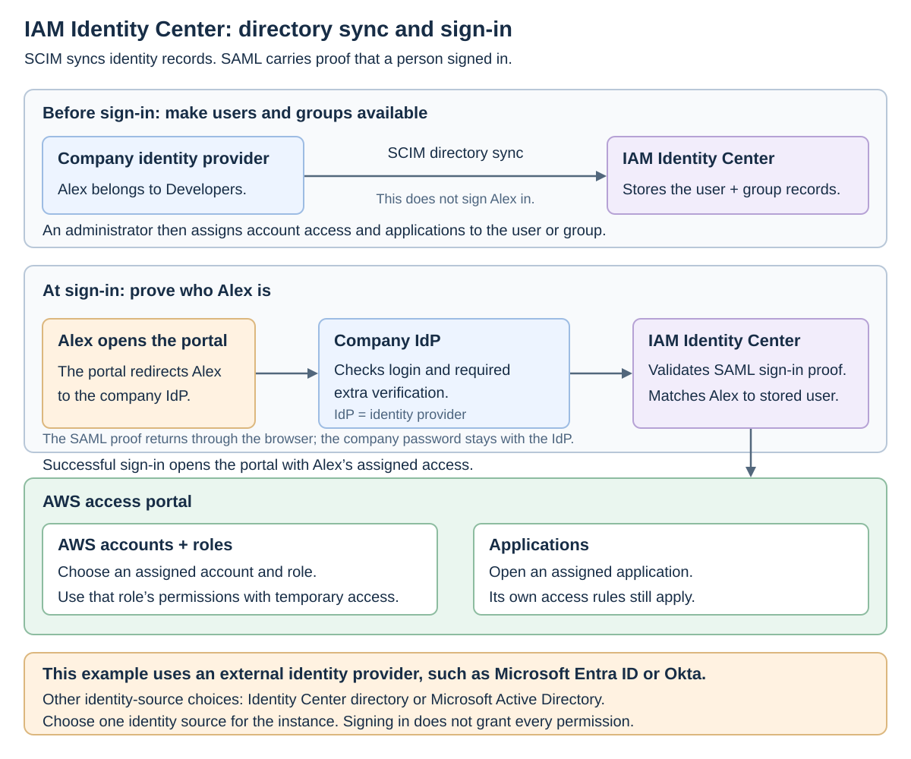
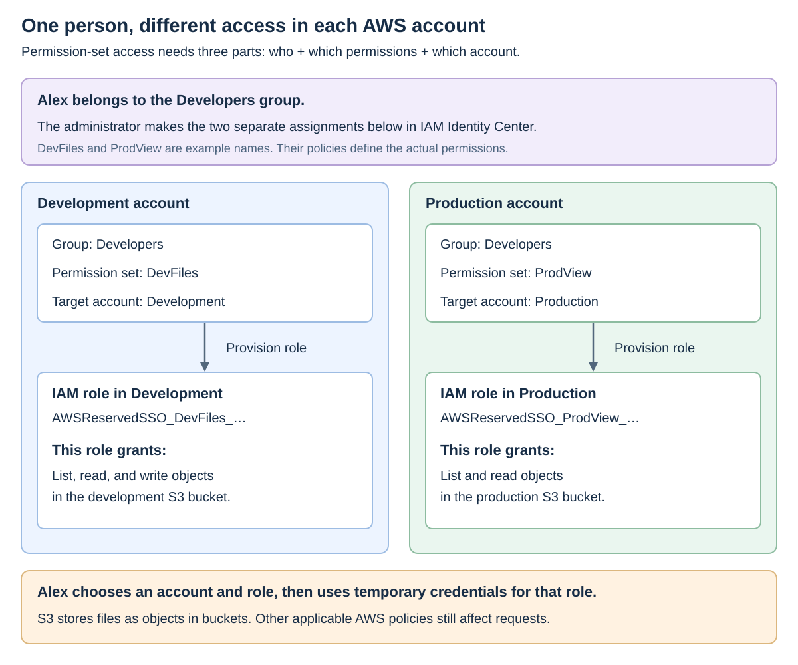

# AWS IAM Identity Center

[Back to AWS](../Readme.md#content)

**AWS IAM Identity Center gives employees and other workforce users a central way to sign in and reach their assigned AWS accounts and applications.** Administrators decide who gets access and what that access allows.

Imagine Alex works with two AWS accounts: Development and Production. Alex should be able to upload test files in Development but only read files in Production. Identity Center can provide one sign-in experience while keeping those permissions separate.

This article explains where identities come from, how permission sets become account access, and what happens when Alex signs in. IAM Identity Center was previously called **AWS Single Sign-On (AWS SSO)**; some commands still use `sso`.

## Which problem does it solve?

**Authentication** checks who a person is. **Authorization** decides what that person may do. A successful sign-in does not automatically grant access to every account or resource.

These related services have different main jobs:

| Service | Main job | Example |
|---|---|---|
| **AWS Identity and Access Management (IAM)** | Defines AWS identities, roles, and policies used to control access to AWS resources. | A role's policy allows reading a particular storage bucket. |
| **IAM Identity Center** | Connects workforce identities to assigned AWS accounts and business applications. | Alex signs in and chooses a Development role. |
| **Amazon Cognito** | Provides identity features for your web or mobile application. | Customers sign in to your shopping app. It can also support enterprise users. |

Identity Center uses IAM roles for AWS account access. It does not replace IAM policy evaluation or serve as the login system for every application you build.

## Where do users and groups come from?

An **identity source** is where you manage the people and groups that Identity Center uses. A **group** is a collection of people, such as `Developers`, to whom you can assign access together.

Choose an identity source for the organization instance:

- **Identity Center directory:** create and manage users and groups directly in Identity Center.
- **External identity provider (IdP):** connect a company sign-in service such as Microsoft Entra ID or Okta.
- **Microsoft Active Directory (AD):** connect a supported on-premises or AWS managed Microsoft AD directory.

You do not need to create a separate IAM user for Alex in every AWS account.

### External sign-in and directory synchronization are different jobs

With an external IdP, two protocols commonly work together:

| Protocol | What it does here |
|---|---|
| **Security Assertion Markup Language (SAML) 2.0** | Carries the external provider's sign-in proof so Identity Center can recognize the authenticated person. |
| **System for Cross-domain Identity Management (SCIM)** | Provisions and updates user records, groups, and group memberships in Identity Center. |

**Provisioning** means creating or updating the records a service needs. The users and groups must exist in Identity Center before you assign them account or application access. Configure SCIM synchronization, or use supported manual provisioning. SAML sign-in alone does not copy the directory.

The diagram separates directory synchronization from Alex's later sign-in. It assumes an external provider and an organization instance with account access configured.

**Multi-factor authentication (MFA)** requires more than one kind of proof, such as a password and a security key. For an external IdP, configure MFA at that provider. Identity Center's own MFA settings apply to users of its built-in directory; they do not enforce MFA at an external provider.

## How permission sets become AWS account access

A **permission set** is a reusable template containing IAM policies and settings for an AWS account session. A policy states allowed or denied actions and the resources to which they apply. An **IAM role** is an identity that an authorized person or service can assume temporarily to use its permissions.

For the permission-set approach, an account assignment joins three things:

**A user or group + a permission set + a target AWS account.**

Creating a permission set alone gives Alex no account access. When you assign it, Identity Center creates and manages a corresponding IAM role in the target account and applies the specified policies. These generated role names start with `AWSReservedSSO_`.

The example uses **Amazon Simple Storage Service (S3)** buckets to hold files, called **objects** in S3. The administrator makes two assignments for the same `Developers` group. `DevFiles` and `ProdView` are example permission-set names, not predefined AWS policies. Read each column from the assignment down to the resulting role.

The policies are scoped to the appropriate bucket: `DevFiles` allows listing, reading, and writing development objects; `ProdView` allows listing and reading production objects. Assume no other policies add or restrict access in this example.

When Alex chooses Production with `ProdView`, that role does not grant uploads. Signing in with the same company identity does not carry the Development role's permissions into Production.

You can reuse a permission set across several accounts. Identity Center provisions a separate role in each assigned account. You can also assign more than one permission set to a person in the same account; the person chooses which role to use for the session.

### Other AWS controls still apply

The permission-set name is just a label; its policies determine what it grants. Names such as `ReadOnly` or `Admin` do not create permissions by themselves.

AWS evaluates each resource request against the applicable policies. Resource policies, permissions boundaries, and AWS Organizations **service control policies (SCPs)** can affect the result. An applicable explicit deny overrides an allow. Giving someone an administrative permission set does not bypass those controls.

### Another option: assign existing IAM roles

Permission sets are useful when you want Identity Center to create and maintain roles centrally. AWS also provides **IAM account access manager**, which assigns existing IAM roles to Identity Center users and groups. It can be used alongside permission sets or independently.

That option has its own account access portal and command-line workflow. The diagrams and sign-in example here focus on permission sets.

## What Alex does after signing in

The **AWS access portal** shows the accounts, roles, and applications assigned to Alex. For account access, Alex chooses an account and an available role. Identity Center then obtains a temporary IAM role session for the AWS Management Console or command line.

**Temporary credentials** expire. Alex does not need a permanent IAM access key for this workflow.

With the **AWS Command Line Interface (AWS CLI)**, `aws configure sso` sets up a profile for the selected account and role. Later, `aws sso login --profile dev-files` signs in using a profile named `dev-files`, if you created it with that name. The CLI handles obtaining temporary credentials for that profile.

The Region used to reach Identity Center and the default Region in which the CLI calls services are separate settings. Signing in through one Region does not, by itself, restrict the role to resources in that Region.

Application access is assigned separately. A permission set for an AWS account is not how you grant permissions inside every business application; supported applications have their own integrations and authorization settings.

## Organization instance or account instance?

An **instance** here means a deployment of Identity Center, not a virtual server.

| Instance type | Where it is enabled | What to use it for |
|---|---|---|
| **Organization instance** | The management account of AWS Organizations. | Central access to AWS accounts and applications across the organization. This is the type used in this article's examples. |
| **Account instance** | A member account or a standalone account. | Isolated access to supported applications in that account and Region. It does **not** provide AWS account access through permission sets. |

Use an organization instance for the Development/Production example, with permission sets enabled. An account instance is not a smaller version of that multi-account setup.

### Identity Center can be replicated to additional Regions

An organization instance has a primary Region and can be replicated to supported additional Regions. This can preserve access using already-provisioned permissions during a disruption in the primary Region.

Replication has prerequisites. It supports an external IdP or the Identity Center directory, but not Microsoft AD as the identity source. It also requires a customer managed multi-Region **AWS Key Management Service (KMS)** key and compatible applications. External providers need support for multiple sign-in response endpoints to obtain the full benefits. Check the supported Regions and integration requirements before enabling it.

These are Regions serving the identity system. They are separate from the Regions where Alex's workloads run.

## Removing access and checking activity

Manage group membership and assignments as people join, change jobs, or leave. With an external IdP, a group change must reach Identity Center through synchronization before Identity Center can use it.

**Ending a portal session is not the same as ending an already-issued IAM role session.** Existing role sessions can continue until their configured expiry, even after sign-out or removal of an assignment. For permission sets, that duration can be up to 12 hours. Plan urgent access removal using AWS's session-revocation guidance rather than assuming that signing someone out cancels every credential.

AWS CloudTrail records Identity Center administration and sign-in events. Use these records to investigate access changes and authentication activity; use the relevant service's audit events to investigate actions taken on resources.

The key relationship to remember is **who + which permissions + which account**. One sign-in can lead to several carefully limited choices; it does not mean one unrestricted set of permissions everywhere.

# Sources

- [AWS: What is IAM Identity Center?](https://docs.aws.amazon.com/singlesignon/latest/userguide/what-is.html)
- [AWS: Manage your identity source](https://docs.aws.amazon.com/singlesignon/latest/userguide/manage-your-identity-source.html)
- [AWS: External identity providers and provisioning](https://docs.aws.amazon.com/singlesignon/latest/userguide/manage-your-identity-source-idp.html)
- [AWS: SAML and SCIM identity federation](https://docs.aws.amazon.com/singlesignon/latest/userguide/other-idps.html)
- [AWS: MFA for Identity Center directory users](https://docs.aws.amazon.com/singlesignon/latest/userguide/enable-mfa.html)
- [AWS: Manage AWS accounts with permission sets](https://docs.aws.amazon.com/singlesignon/latest/userguide/permissionsetsconcept.html)
- [AWS: IAM roles created by Identity Center](https://docs.aws.amazon.com/singlesignon/latest/userguide/identity-center-and-iam-roles.html)
- [AWS: IAM roles and temporary credentials](https://docs.aws.amazon.com/IAM/latest/UserGuide/id_roles.html)
- [AWS: Amazon S3 buckets and objects](https://docs.aws.amazon.com/AmazonS3/latest/userguide/Welcome.html)
- [AWS: IAM policy evaluation logic](https://docs.aws.amazon.com/IAM/latest/UserGuide/reference_policies_evaluation-logic.html)
- [AWS: IAM account access manager](https://docs.aws.amazon.com/IAM/latest/UserGuide/account-access-manager.html)
- [AWS: Configure IAM Identity Center authentication with the AWS CLI](https://docs.aws.amazon.com/cli/latest/userguide/cli-configure-sso.html)
- [AWS: Organization and account instances](https://docs.aws.amazon.com/singlesignon/latest/userguide/identity-center-instances.html)
- [AWS: Using Identity Center across multiple Regions](https://docs.aws.amazon.com/singlesignon/latest/userguide/multi-region-iam-identity-center.html)
- [AWS: Understanding authentication sessions](https://docs.aws.amazon.com/singlesignon/latest/userguide/authconcept.html)
- [AWS: Revoke user access](https://docs.aws.amazon.com/singlesignon/latest/userguide/revoke-user-permissions.html)
- [AWS: Logging Identity Center activity with CloudTrail](https://docs.aws.amazon.com/singlesignon/latest/userguide/logging-using-cloudtrail.html)
- [AWS: What is Amazon Cognito?](https://docs.aws.amazon.com/cognito/latest/developerguide/what-is-amazon-cognito.html)
- [AWS Prescriptive Guidance: Authentication and authorization diagram](https://docs.aws.amazon.com/prescriptive-guidance/latest/designing-control-tower-landing-zone/authentication.html)
