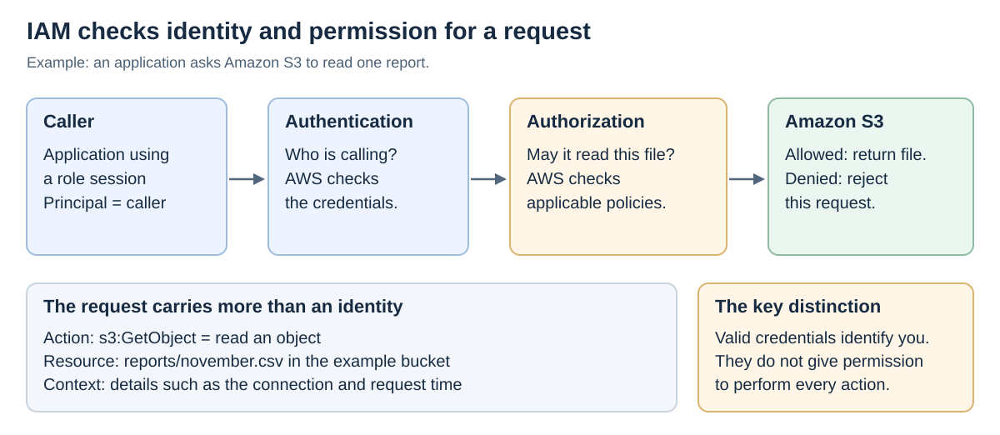
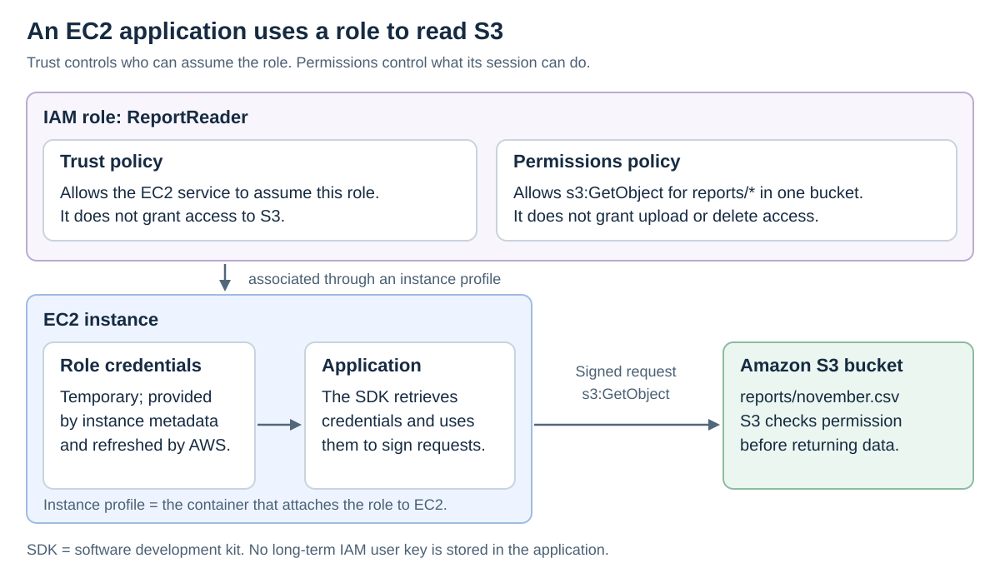
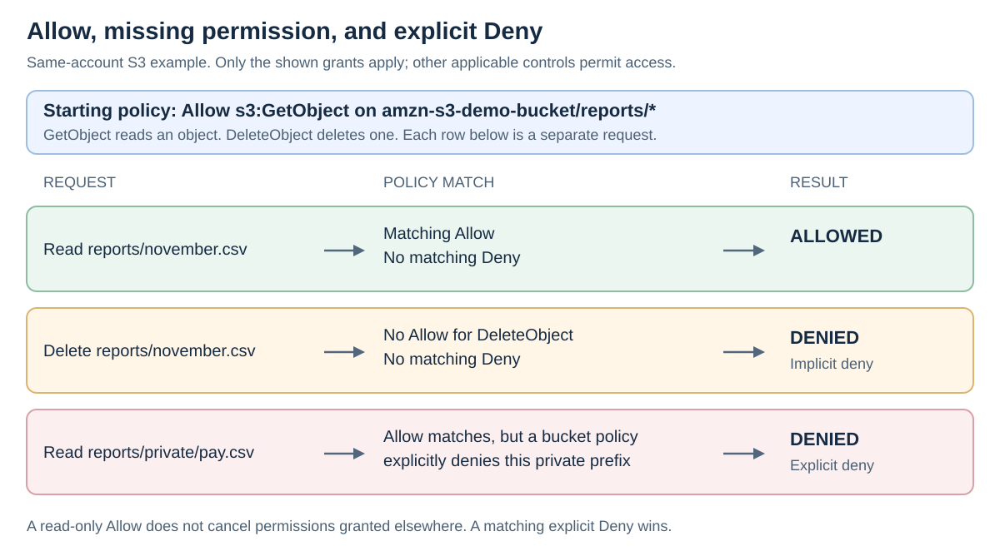

# AWS Identity and Access Management (IAM)

<sub>[Back to AWS](../Readme.md#content)</sub>

**AWS Identity and Access Management (IAM) controls who can do what with AWS resources.** It helps AWS identify the caller and decide whether a particular request is allowed. Being able to sign in does not mean you can read every file, start every server, or change every setting.

Imagine an application on [Amazon EC2](../Amazon%20EC2/Readme.md) that reads reports from [Amazon S3](../Amazon%20S3/Readme.md). It needs permission to read those reports. It does not need permission to delete them or manage the whole AWS account. This article uses that example to explain identities, roles, policies, and access decisions.

## Identity and permission are different questions

**Authentication** answers “Who is making this request?” AWS checks the caller's credentials, such as credentials for a signed application request. A **principal** is the caller whose access is being evaluated, such as an IAM user or an assumed-role session.

**Authorization** answers “May this caller perform this action on this resource?” An **action** is an operation, such as reading a file. A **resource** is the thing it acts on, such as an S3 object. A **policy** is a document containing access rules.

Read the diagram from left to right. AWS establishes the caller's identity, then evaluates permissions for the specific request. This is a conceptual decision flow; IAM is not a network proxy that carries the file between the application and S3.



The same permission model applies whether a request comes from the AWS Management Console, the **command-line interface (CLI)**, or application code. Changing the tool does not bypass authorization. A console screen can make several requests, so opening that screen may require more permissions than one direct operation.

## Users, groups, roles, and root

These names refer to different things:

| Term | What it means | What to remember |
| --- | --- | --- |
| IAM user | An identity created in one AWS account for a person or workload. | It can have long-term credentials, such as access keys. Use it when the preferred temporary-access approaches do not fit. |
| IAM user group | A collection of IAM users that share permissions. | You cannot sign in as a group. It can contain users, but not roles or other groups. |
| IAM role | An identity that an authorized person, application, or service can temporarily assume. | The role has no permanent password or access keys. Assuming it creates a session with temporary credentials. |
| AWS account root user | The special account identity with broad account access. | Reserve it for tasks that require root access. It is different from an IAM user or role with administrator permissions. |

For **people**, AWS recommends federated access with temporary credentials. **Federation** means using a trusted identity system to sign in to AWS, rather than giving each person a separate IAM user with long-term credentials. **AWS IAM Identity Center** provides centralized access to AWS accounts and applications, using its own directory or a connected identity provider.

For **applications**, use IAM roles where supported. EC2 and Lambda can provide role credentials to the code they run. Keep the application's role focused on that application's needs.

Require **multi-factor authentication (MFA)** for human access: an additional authentication factor protects sign-in beyond a password alone. Protect root access, and use an everyday identity for ordinary work.

## Where policies live

Most IAM policies are written in **JavaScript Object Notation (JSON)**, a text format for structured data. Two policy types are especially useful to understand first:

| Policy type | Attached to | Example |
| --- | --- | --- |
| Identity-based policy | An IAM user, group, or role. | The `ReportReader` role may read objects under `reports/` in one bucket. |
| Resource-based policy | A resource that supports this policy type. | An S3 bucket policy permits a named role to read the bucket's objects. |

An identity-based policy gets its caller from the identity it is attached to. A resource-based policy normally names the caller in its `Principal` element. **A role's trust policy is also a resource-based policy:** its resource is the role, and it controls who can assume that role.

For identity-based policies, **managed** means a separate policy that can be attached to several identities. AWS maintains AWS managed policies; you maintain customer managed policies. An **inline policy** belongs directly to one identity. This is a choice about how to maintain the policy, not a different meaning of `Allow` or `Deny`.

## Read a small policy

Suppose `ReportReader` should read existing reports whose object names start with `reports/` in a general purpose S3 bucket. That shared beginning is called a **prefix**. An **Amazon Resource Name (ARN)** identifies a resource in a policy.

Attach this identity-based permissions policy to the role. The bucket name is an example; replace it with your actual bucket name when adapting the policy.

```json
{
  "Version": "2012-10-17",
  "Statement": [
    {
      "Sid": "ReadReports",
      "Effect": "Allow",
      "Action": "s3:GetObject",
      "Resource": "arn:aws:s3:::amzn-s3-demo-bucket/reports/*"
    }
  ]
}
```

Read it as: **“Allow the identity holding this policy to read objects whose names begin with `reports/` in this bucket.”**

| Element | Meaning here |
| --- | --- |
| `Version` | The policy language version. `2012-10-17` remains the current value; it is not the date you created the policy. |
| `Statement` | The collection of permission statements. This policy has one. |
| `Sid` | An optional name that helps humans identify a statement. |
| `Effect` | `Allow` grants permission; `Deny` explicitly blocks matching requests. |
| `Action` | `s3:GetObject` means retrieve an object. It does not mean every S3 operation. |
| `Resource` | The objects the statement covers. The final `*` matches the remainder of their names. |

An optional `Condition` can further restrict when a statement applies, for example according to a request's source address or transport security. There is no `Principal` here because the policy is attached to an identity.

This policy grants **object reads**, not bucket listing, uploading, or deletion. Listing object names uses `s3:ListBucket` on the bucket ARN, `arn:aws:s3:::amzn-s3-demo-bucket`, without the object suffix. Reading an object encrypted with **AWS Key Management Service (AWS KMS)** can also require permissions for its encryption key.

Crucially, **this small Allow is not a ceiling on all of the role's permissions**. If another applicable policy grants deletion, this policy does not cancel that grant.

## How the application uses a role

The EC2 example has two separate permission questions:

- The role's **trust policy** allows the EC2 service to assume `ReportReader`.
- The role's **permissions policy** allows the resulting role session to read the specified S3 reports.

An **instance profile** is the container used to associate the role with an EC2 instance. The application obtains temporary role credentials through the instance's metadata service. A supported **software development kit (SDK)** can retrieve and refresh those credentials automatically, then use them to sign S3 requests.

The diagram separates configuration at the top from the application's request below. The application calls S3 with role credentials; it does not borrow the developer's personal permissions.



**AWS Security Token Service (AWS STS)** issues temporary security credentials. These expire; getting a new set requires continued authorization. The role itself remains until it is deleted. “Temporary” describes the credentials and session, not the lifetime of the role.

When a person assumes a role, requests made with that role's credentials use the role session's permissions. They do not automatically combine the person's original permissions with the role's permissions.

Roles also support access between AWS accounts. In a typical cross-account `AssumeRole` setup, the caller needs permission to assume the target role, and the target role's trust policy must trust the caller. The role's permissions then control what its session can do. Trusting another account does not automatically authorize every user in that account.

## Why an Allow can still produce “Access denied”

For ordinary IAM users and role sessions, the starting point is **implicit deny**: without a permission grant that applies, the request is denied. **Explicit deny** means a matching policy statement says `"Effect": "Deny"`. A matching explicit deny takes precedence over an allow.

The diagram shows three separate requests in one account. Assume the shown policy grants are the only ones, the objects exist, and other applicable controls permit the operations. In the last row, a bucket policy explicitly denies reading the `reports/private/` prefix, so the broader read permission cannot authorize that request.



Real requests may involve additional limits:

| Control | What it does |
| --- | --- |
| Permissions boundary | Limits what identity-based policies can grant to a user or role. It does not grant permission by itself. |
| Session policy | Can narrow the permissions available to a particular temporary session. It does not add permissions. |
| AWS Organizations policies | **Service control policies (SCPs)** limit permissions for identities in member accounts. **Resource control policies (RCPs)** limit access to supported resources in member accounts. Neither grants access by itself. |

These limits explain why attaching an Allow may not be enough. The precise evaluation also depends on who receives a resource-based grant: a user, a role, and a role session can be treated differently. Do not treat the table as a complete formula for every AWS request.

For ordinary same-account S3 access, a suitable identity-based or resource-based grant can provide permission, subject to applicable controls. **Direct cross-account access to an S3 resource requires authorization on both sides:** the caller's account and the resource owner's account. That is separate from assuming a role in the resource owner's account.

## Use the smallest permission that does the job

**Least privilege** means granting only the actions, resources, and conditions needed for the task. For this application, reading one reports prefix is a better match than granting access to all S3 actions on all buckets.

Use temporary credentials where possible, keep credentials out of source code, and remove unused access. If a system genuinely requires long-term keys, protect them and update or replace them when needed. A broad AWS managed policy can be a starting point, but it may contain much more access than the application needs.

If a request fails, identify the actual caller, requested action, and target resource before changing policies. Check for a missing grant, a matching deny, unmet conditions, or an applicable limit. Also check whether the operation needs another service's permission, such as permission to use a KMS key. IAM changes can take time to propagate, so verify a recent change before depending on it.

## Tools for reviewing access

**IAM Access Analyzer** can check policies and identify supported resources shared publicly or across account boundaries. Use it to find unintended access and improve policies; a working request alone does not prove the permissions are appropriately narrow.

An **IAM credential report** summarizes IAM-managed credential status, such as passwords, access keys, and MFA. It helps find credentials that need attention, but it is not a complete inventory of every credential or every federated person's access.

If you use IAM users with passwords, the account's **IAM password policy** controls those passwords. It does not control root's password or IAM user access keys. An expired console password therefore does not disable an active access key.

## Check your understanding

1. The app can sign requests. Can it delete a report?

   <details>
   <summary>Answer</summary>

   Only if its effective permissions allow deletion. Valid credentials alone are not enough.

   </details>

2. The role trusts EC2. Can the app now read S3?

   <details>
   <summary>Answer</summary>

   Trust enables role assumption; the session still needs permission for the S3 action and resource.

   </details>

3. One policy allows reading, but the bucket explicitly denies this read. What happens?

   <details>
   <summary>Answer</summary>

   The request is denied.

   </details>

4. The temporary credentials expire. Is the role deleted?

   <details>
   <summary>Answer</summary>

   No. The role persists, and an authorized caller can obtain a new session.

   </details>

# Sources

- [AWS — What is IAM?](https://docs.aws.amazon.com/IAM/latest/UserGuide/introduction.html)
- [AWS — How IAM works, including the request-flow diagram](https://docs.aws.amazon.com/IAM/latest/UserGuide/intro-structure.html)
- [AWS — IAM security best practices](https://docs.aws.amazon.com/IAM/latest/UserGuide/best-practices.html)
- [AWS — IAM users](https://docs.aws.amazon.com/IAM/latest/UserGuide/id_users.html)
- [AWS — IAM user groups](https://docs.aws.amazon.com/IAM/latest/UserGuide/id_groups.html)
- [AWS — IAM roles, trust policies, and role sessions](https://docs.aws.amazon.com/IAM/latest/UserGuide/id_roles.html)
- [AWS — AWS account root user](https://docs.aws.amazon.com/IAM/latest/UserGuide/id_root-user.html)
- [AWS — Policies and permissions](https://docs.aws.amazon.com/IAM/latest/UserGuide/access_policies.html)
- [AWS — JSON policy element reference](https://docs.aws.amazon.com/IAM/latest/UserGuide/reference_policies_elements.html)
- [AWS — Policy language Version](https://docs.aws.amazon.com/IAM/latest/UserGuide/reference_policies_elements_version.html)
- [AWS — Principal element](https://docs.aws.amazon.com/IAM/latest/UserGuide/reference_policies_elements_principal.html)
- [AWS — Condition element](https://docs.aws.amazon.com/IAM/latest/UserGuide/reference_policies_elements_condition.html)
- [AWS — S3 identity-based policy examples](https://docs.aws.amazon.com/AmazonS3/latest/userguide/example-policies-s3.html)
- [AWS — GetObject permissions](https://docs.aws.amazon.com/AmazonS3/latest/API/API_GetObject.html)
- [AWS — EC2 applications using IAM roles, including the EC2-to-S3 diagram](https://docs.aws.amazon.com/IAM/latest/UserGuide/id_roles_use_switch-role-ec2.html)
- [AWS — Temporary security credentials](https://docs.aws.amazon.com/IAM/latest/UserGuide/id_credentials_temp.html)
- [AWS — Policy evaluation logic](https://docs.aws.amazon.com/IAM/latest/UserGuide/reference_policies_evaluation-logic.html)
- [AWS — IAM credential reports](https://docs.aws.amazon.com/IAM/latest/UserGuide/id_credentials_getting-report.html)
- [AWS — IAM account password policy](https://docs.aws.amazon.com/IAM/latest/UserGuide/id_credentials_passwords_account-policy.html)
