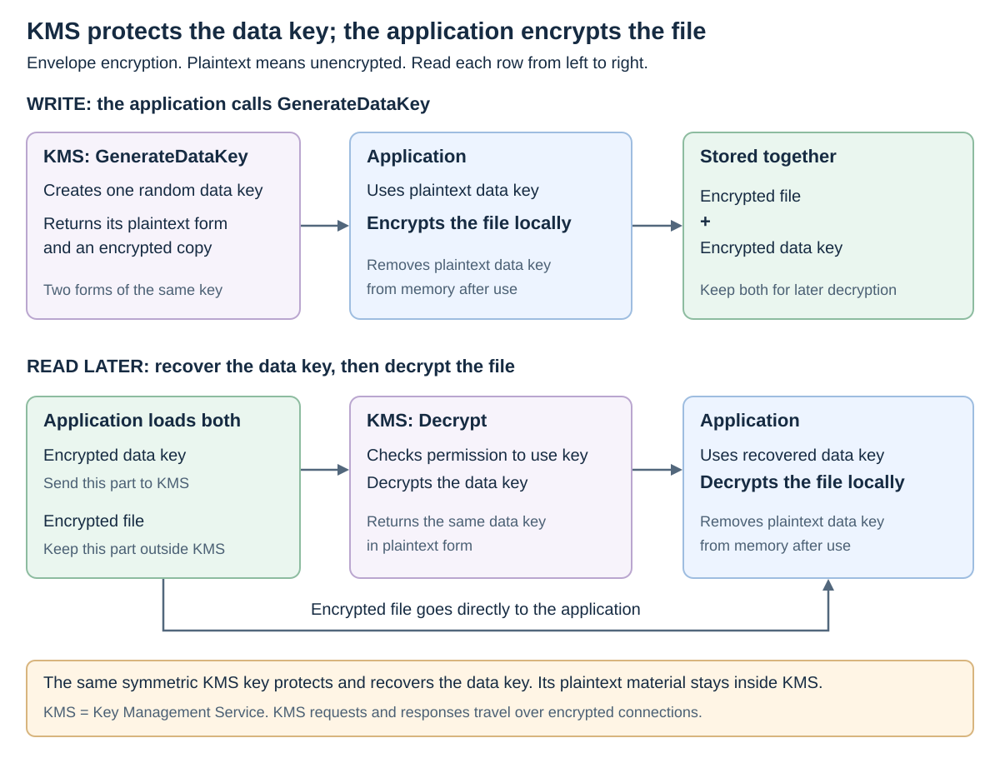
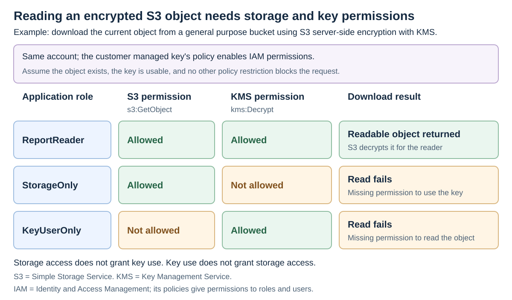

# AWS Key Management Service (KMS)

[Back to AWS](../Readme.md#content)

**AWS Key Management Service (KMS) protects cryptographic keys and controls who can use them.** For a large file, the usual design is to encrypt the file with a **data key**, then protect that data key with a **KMS key**. This separates storage of the encrypted file from permission to recover its readable contents.

The main ideas are the two kinds of key, how encryption and decryption fit together, and how permissions and key lifecycle affect access to your data.

## The KMS key and the data key do different jobs

**Plaintext** is readable data. **Ciphertext** is its encrypted form. An encryption key is a value an algorithm needs to encrypt or decrypt data. It is not simply the name of a key or a password you type.

| Item | Its job | Where it is used |
| --- | --- | --- |
| **KMS key** | Controls access to cryptographic operations and, in this example, encrypts or decrypts data keys | Inside KMS |
| **Data key** | Encrypts and decrypts the actual file | In the application or AWS service handling the file |

For an ordinary symmetric encryption key generated by KMS, the secret KMS key material is not returned to your application. You ask the service to perform an operation with it. A **symmetric** key uses the same secret for encryption and decryption.

A KMS key is also a managed resource with an identifier, permissions, and a lifecycle. An **alias**, such as `alias/reports`, is a friendly name pointing to a KMS key. Knowing its identifier or alias does not reveal its secret material or grant permission to use it.

Direct KMS `Encrypt` calls with a symmetric encryption key accept at most **4,096 bytes (4 KiB)** of plaintext. To protect a large report, use the data-key pattern below. The file itself does not need to pass through KMS.

## Envelope encryption protects a key with another key

**Envelope encryption** means encrypting data with a data key, then encrypting that data key with another key. The diagram shows a custom application's write and read paths. The encrypted file and encrypted data key stay together in storage.

When writing the file, the application calls **`GenerateDataKey`** using a chosen symmetric KMS key. KMS generates a random data key and returns two forms of that **same** key: a plaintext copy for immediate use and an encrypted copy for storage. These responses travel over an encrypted connection.

The application uses the plaintext data key to encrypt the file locally. It stores the encrypted file with the encrypted data key and removes the plaintext data key from memory as soon as it is no longer needed. The encrypted data key is safe to store beside the file because using it still requires decryption permission and access to the protecting KMS key.

When reading the file later, the application sends the encrypted **data key** to KMS in a **`Decrypt`** request. If authorized, it receives the plaintext data key, uses that key to decrypt the file locally, and removes the plaintext key from memory after use. KMS is decrypting the small key; the application is decrypting the large file.

KMS does not keep a catalog of your data keys or store your encrypted files. Your application must preserve the encrypted data key and any required encryption metadata. For application encryption, the **AWS Encryption Software Development Kit (SDK)** can handle the envelope-encryption packaging instead of making you assemble it yourself.

## AWS services can perform that work for you

With **server-side encryption using KMS keys (SSE-KMS)**, Amazon Simple Storage Service (**S3**) performs the data-key work on your behalf. You upload an object, which is a stored file, and S3 encrypts it before storage. On an authorized download, S3 decrypts it and returns the readable contents. Your application does not normally receive the data key in this flow.

The KMS key for S3 SSE-KMS must be in the bucket's AWS Region. S3 also offers **Bucket Keys**, an optional extra key layer that reduces requests to KMS. This means the simple envelope model should not be read as a guarantee of one KMS call for every object operation.

Encryption in storage and encryption on the network solve different problems. Use **Transport Layer Security (TLS)** for the connection. A file encrypted by S3 is not automatically returned to an authorized reader as stored ciphertext; S3's decryption is part of serving that request.

## Reading an encrypted object needs two kinds of permission

Permission to read an S3 object does not automatically include permission to use its KMS key. For an ordinary download of the current object version from a general purpose bucket, the relevant permissions are **`s3:GetObject`** on the object and **`kms:Decrypt`** on the key.

The example below uses roles in the same account and a customer managed KMS key whose key policy enables permissions from AWS Identity and Access Management (**IAM**) policies. It assumes the object exists, the key is usable, and no other policy restriction blocks access.

`ReportReader` can download the readable report because both permissions are allowed. `StorageOnly` cannot decrypt it. `KeyUserOnly` can use the key but cannot read this S3 object. Encryption therefore adds a separate access decision; it does not replace the storage service's permissions.

A normal SSE-KMS upload needs S3 write permission and `kms:GenerateDataKey`. A **multipart upload**, which sends a large object in separate parts, also needs `kms:Decrypt`.

### How KMS decides who may use a key

A **key policy** is a permissions document attached to the KMS key. An **IAM policy** gives permissions to an identity such as an application role. The key policy is central to KMS authorization: an IAM allow alone has no effect unless the key policy enables that IAM-based access.

That is the pattern shown in the diagram, but it is not the only pattern. In the same account, a key policy can grant access directly to a user or role. **Grants** provide another way to allow specific operations on one key and are often used by integrated AWS services. Explicit denies and other applicable restrictions still matter.

A grant can allow access but cannot deny it. Permission to create grants is powerful; it is not automatically safer than changing a policy. Limit who can delegate key use and which operations they can delegate.

For policy-based access from a different AWS account, the key owner must allow the external account or identity, and an IAM policy in the caller's account must allow the operation. To share S3 SSE-KMS data across accounts, use a customer managed key and configure both the S3 and KMS permissions.

Managing a key and using it to decrypt data are separate permissions. A key administrator is not automatically a data reader, although an administrator who can change permissions may be able to grant additional access. Plan that separation deliberately.

## Who owns and controls the key?

Ownership is different from the cryptographic type of a key.

| Category | Where the key lives | Your control and visibility |
| --- | --- | --- |
| **Customer managed key** | Your AWS account | You manage its policy, lifecycle, and supported rotation settings; you can audit use |
| **AWS managed key** | Your AWS account, for an integrated service | You can view it and audit use, but AWS controls its policy and lifecycle; an example alias is `aws/s3` |
| **AWS owned key** | An account managed by the AWS service | The service manages it; you cannot view its individual key policy or audit its use as your own KMS key |

The available choices depend on the AWS service. Customer managed keys provide more control and have key-storage and usage charges. AWS managed keys have no monthly key fee, but usage fees can apply. AWS owned keys have no direct KMS charges to you.

## Rotation keeps the key usable for old data

**Key material** is the cryptographic secret associated with a KMS key. Automatic rotation creates new key material while preserving the key's logical identity, permissions, and aliases. KMS uses the new material for new encryption operations and keeps earlier material so it can decrypt older ciphertext.

For eligible **customer managed symmetric encryption keys with KMS-generated material**, automatic rotation is optional and initially disabled. When enabled, the period can be **90–2,560 days**; the default is **365 days**. AWS managed keys rotate annually under AWS control.

On-demand rotation is also available for supported symmetric keys, including keys with imported material. Rotation support depends on the key type and where its material comes from; asymmetric keys, message-authentication keys, and keys in custom key stores do not use the same automatic-rotation mechanism.

**Rotating a KMS key does not re-encrypt existing files or replace their data keys.** For example, a report written before rotation still uses its original data key. KMS can recover that key using the appropriate older KMS key material. Rotation alone does not repair a leaked plaintext data key.

Changing an alias to point at a different KMS key is another operation entirely. It changes what future requests using that alias select. It does not move old ciphertext to the new key; keep the old protecting key available while old data still depends on it.

## Disabling and deleting a key can stop recovery

Disabling a customer managed key prevents new KMS cryptographic operations using it. You can re-enable it. Scheduling deletion also makes the key unusable for those operations, but deletion has a mandatory **7–30-day waiting period**, with **30 days** as the default.

You can cancel deletion during that period. The key then remains **Disabled** until you explicitly enable it again. Once a normal single-Region symmetric KMS key is permanently deleted, KMS cannot recover ciphertext protected by it. Keeping the encrypted report and encrypted data key is not enough if the key needed to unwrap that data key is gone.

There is an important timing limit: disabling a KMS key does not erase plaintext data keys already held by applications or services. They may continue working until they need KMS again. For example, an attached encrypted Amazon Elastic Block Store (EBS) volume, a virtual disk, can keep using a data key already loaded in hardware, while a later attachment requiring KMS decryption can fail.

Keep track of key dependencies, including older backups. KMS cannot tell you the complete number of files or backups that still need a particular key.

## Regions, context, and audit records

KMS keys are regional resources. **Multi-Region keys** are a related set of keys with matching key material and key IDs in selected Regions. They can support decryption in another Region, but you manage their policies, grants, aliases, and enabled state separately. They do not replicate your application data. Integrated services may still treat them like independent regional keys, so check the service's behavior.

An **encryption context** is a set of non-secret labels cryptographically bound to a symmetric encryption operation. For example, an application might use `purpose=reports`. If it supplied that context when encrypting, it must supply the same context when decrypting. Context can also be used in permission conditions.

Do not put passwords or personal data in the context: it is not encrypted and can appear in **AWS CloudTrail** logs. CloudTrail records KMS requests such as `GenerateDataKey`, `Decrypt`, and policy changes. It omits sensitive cryptographic payloads from those records. Check the trail's settings because KMS events can be excluded.

## KMS also supports other cryptographic work

The envelope example uses symmetric encryption, but KMS is not limited to that:

- **Asymmetric keys** have a public and private part. For asymmetric encryption, the public key encrypts and the private key decrypts. Signing uses the private key to create a signature and the public key to verify it. Supported operations depend on the chosen key type and usage.
- **Hash-based Message Authentication Code (HMAC) keys** generate and verify authentication tags. These help detect changes to a message and show that it was produced by someone able to use the same secret key; they do not encrypt the message.

KMS can also support shared-secret operations with suitable key types. Choose the type for the actual job. For storage integrations such as S3 SSE-KMS, use a symmetric encryption KMS key; use TLS separately to protect the network connection.

# Sources

- [AWS KMS overview](https://docs.aws.amazon.com/kms/latest/developerguide/overview.html)
- [KMS key ownership and lifecycle](https://docs.aws.amazon.com/kms/latest/developerguide/concepts.html)
- [Data keys and envelope encryption](https://docs.aws.amazon.com/kms/latest/developerguide/data-keys.html)
- [GenerateDataKey operation](https://docs.aws.amazon.com/kms/latest/APIReference/API_GenerateDataKey.html)
- [Decrypt operation](https://docs.aws.amazon.com/kms/latest/APIReference/API_Decrypt.html)
- [Encrypt operation and input limits](https://docs.aws.amazon.com/kms/latest/APIReference/API_Encrypt.html)
- [AWS Encryption SDK](https://docs.aws.amazon.com/encryption-sdk/latest/developer-guide/introduction.html)
- [KMS aliases](https://docs.aws.amazon.com/kms/latest/developerguide/kms-alias.html)
- [S3 server-side encryption with KMS](https://docs.aws.amazon.com/AmazonS3/latest/userguide/UsingKMSEncryption.html)
- [S3 GetObject permissions](https://docs.aws.amazon.com/AmazonS3/latest/API/API_GetObject.html)
- [Required permissions for general purpose S3 buckets](https://docs.aws.amazon.com/AmazonS3/latest/userguide/using-with-s3-policy-actions.html)
- [KMS key policies](https://docs.aws.amazon.com/kms/latest/developerguide/key-policies.html)
- [Default key policies and administrator permissions](https://docs.aws.amazon.com/kms/latest/developerguide/key-policy-default.html)
- [KMS grants](https://docs.aws.amazon.com/kms/latest/developerguide/grants.html)
- [Cross-account key permissions](https://docs.aws.amazon.com/kms/latest/developerguide/key-policy-modifying-external-accounts.html)
- [Key rotation behavior](https://docs.aws.amazon.com/kms/latest/developerguide/rotate-keys.html)
- [Automatic rotation settings](https://docs.aws.amazon.com/kms/latest/developerguide/rotating-keys-enable.html)
- [Deleting KMS keys](https://docs.aws.amazon.com/kms/latest/developerguide/deleting-keys.html)
- [Canceling deletion leaves the key disabled](https://docs.aws.amazon.com/kms/latest/APIReference/API_CancelKeyDeletion.html)
- [Effects of an unusable KMS key on data keys](https://docs.aws.amazon.com/kms/latest/developerguide/unusable-kms-keys.html)
- [Multi-Region keys](https://docs.aws.amazon.com/kms/latest/developerguide/multi-region-keys-overview.html)
- [Encryption context](https://docs.aws.amazon.com/kms/latest/developerguide/encrypt_context.html)
- [KMS audit records in CloudTrail](https://docs.aws.amazon.com/kms/latest/developerguide/logging-using-cloudtrail.html)
- [Asymmetric KMS keys](https://docs.aws.amazon.com/kms/latest/developerguide/symmetric-asymmetric.html)
- [HMAC keys](https://docs.aws.amazon.com/kms/latest/developerguide/hmac.html)
