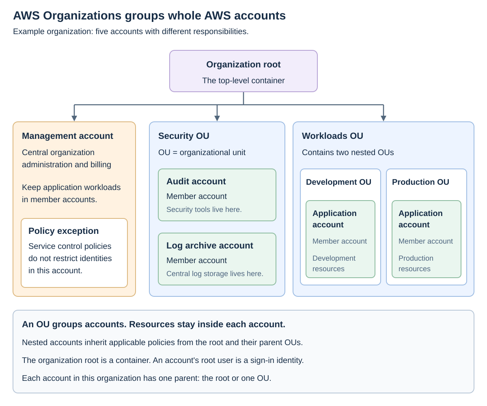
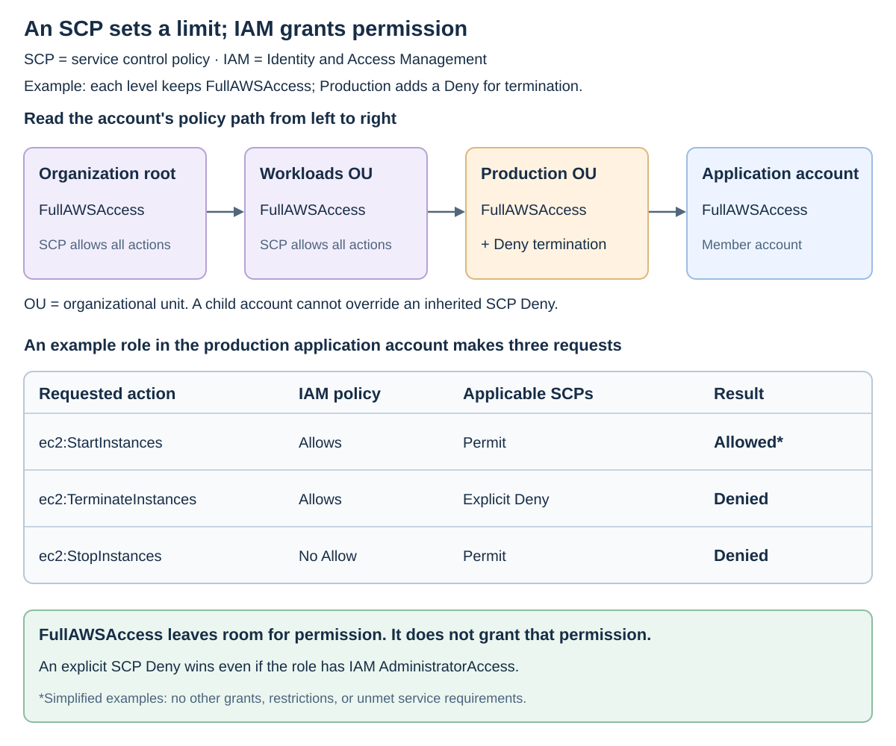

# AWS Organizations

<sub>[Back to AWS](../Readme.md#content)</sub>

**AWS Organizations lets you manage several AWS accounts together while keeping each account separate.** You can create or invite accounts, group them, apply common policies, and combine their billing.

For example, a company can keep production, development, security tools, and log storage in different accounts. Organizations provides the structure for managing them. This article explains that structure, how permission limits work, and how billing and shared administration fit in.

## Why use more than one account?

An **AWS account** is a container for resources and a boundary for permissions and costs. It is different from an individual user: one account can contain many identities, servers, and databases.

Separating development from production makes it easier to give developers freedom without giving them the same access to production. Separate security and log-storage accounts can have their own access rules. Account-level cost reports also make it easier to see which environment incurred a charge.

Joining an organization does not merge accounts or make their resources available to everyone. Access between accounts still needs the appropriate roles, resource permissions, or explicit resource sharing.

## The account hierarchy

An organization has one management account and one top-level root container. Its other accounts are **member accounts**.

An **organizational unit (OU)** groups accounts that need similar controls. An OU can contain accounts and other OUs. Each account has one parent in the hierarchy: the root or an OU. A member account can belong to only one organization at a time.

In this example, the green boxes are separate member accounts. The larger blue boxes group them. Follow the nested boxes to see that the production application account belongs to Production, which belongs to Workloads.



The **organization root** is a container in this tree. An **account's root user** is that account's highly privileged sign-in identity. They are different things.

Group accounts by the controls they need, rather than copying your company's reporting chart. Production and development often need different policies even when the same team owns both. Resources remain in their accounts; moving an account to another OU changes which inherited policies apply to it.

The management account is shown directly under the root as an example. It can also be placed in an OU; its special role does not depend on its position in the tree.

## The management account and delegated administrators

The **management account** creates the organization and manages its accounts, policies, and integrations. It can create new member accounts or invite existing accounts to join.

Use this account for work that requires it, and keep application workloads in member accounts. Limit who can administer it. One important reason is that service control policies, explained below, do not restrict identities in the management account.

A **delegated administrator** is a member account given permission to administer a supported service or selected organization policies. For example, a security account can administer an integrated security service across the organization. Delegation does not make it a second management account, and it remains subject to the policies that apply to member accounts.

For day-to-day human access, AWS IAM Identity Center can centrally assign people access to AWS accounts and applications. Organizations itself does not replace that sign-in and permission system.

## All features includes consolidated billing

Organizations has two feature sets:

| Feature set | What it provides |
|---|---|
| **All features** | Consolidated billing, organization policies, and advanced integrations with supported AWS services. This is the default and recommended option. |
| **Consolidated billing only** | Shared billing without the advanced governance features, such as service control policies. |

A billing-only organization can upgrade to all features. The standard upgrade requires approval from invited member accounts. Once all features is enabled, the organization cannot switch back to billing-only mode.

## SCPs limit permission; they do not grant it

A **service control policy (SCP)** sets a limit on what identities in member accounts may do. It does not give a person or application permission to do anything.

**AWS Identity and Access Management (IAM)** policies provide the actual permissions. A role is an identity that a person or service can assume to obtain permissions. An SCP can then restrict those permissions. Even an IAM role with `AdministratorAccess` cannot override an applicable SCP denial.

Imagine a role in the production application account. Its IAM policy allows starting and terminating Amazon Elastic Compute Cloud (EC2) instances, but the Production OU has an SCP that denies termination. The diagram compares that conflict with a request that has no IAM grant at all. It assumes no other grants, restrictions, or unmet service requirements.



The important distinction is between **“the organization permits this action”** and **“this role has permission to perform it.”** Both matter.

### How SCPs combine down the tree

For an action to pass the SCP checks:

- An applicable SCP must allow it at **every level** on the direct path: root, each parent OU, and the account itself.
- An explicit `Deny` at **any** of those levels blocks it. A child account cannot override a parent's denial.
- If several SCPs are attached at the same level, their allows combine. A narrow allow-list does not narrow access while `FullAWSAccess` still allows everything at that level.

`FullAWSAccess` is an AWS managed SCP that permits all actions at the SCP layer. It grants no IAM permissions. Keeping it in place and adding specific deny policies is one way to set limits.

Removing the only SCP allow at a level without replacing it can block all actions subject to SCPs below that level. Test policy changes in a small set of accounts before applying them broadly.

### A small policy example

This SCP denies the `ec2:TerminateInstances` action. In the diagram, it is attached to the Production OU **alongside** `FullAWSAccess`; the other levels also retain their allow policies.

```json
{
  "Version": "2012-10-17",
  "Statement": [
    {
      "Sid": "DenyInstanceTermination",
      "Effect": "Deny",
      "Action": "ec2:TerminateInstances",
      "Resource": "*"
    }
  ]
}
```

`Action` identifies the operation being blocked. `Resource: "*"` applies that denial to all resources covered by that action. This is a narrow teaching example, not a complete set of production controls: it does not block every way of stopping or changing an application.

Existing policies matter too. Organizations created through the AWS console after **July 10, 2026** automatically receive a root SCP denying member accounts the `organizations:LeaveOrganization` and `account:CloseAccount` actions. Older organizations and those created through other interfaces do not automatically receive that control.

### Where an SCP applies

SCPs restrict identities in **member accounts**, including member-account root users and delegated administrators, subject to documented exceptions. They do not restrict identities in the **management account** or **service-linked roles**—special roles used by AWS services to perform their supported tasks.

An SCP on an account also does not control an outside identity merely because that identity accesses a resource in the account. For example, an outside user allowed by a bucket policy is not automatically constrained by the bucket owner's SCP.

## Other organization policies have different jobs

SCPs are one policy type, not the whole governance system.

| Policy type | Main purpose |
|---|---|
| **Service control policy (SCP)** | Limits permissions for identities in member accounts. |
| **Resource control policy (RCP)** | Limits access to supported resources in member accounts, including access by outside identities. |
| **Tag policy** | Standardizes resource tags, such as approved tag keys and values. |
| **Backup policy** | Centrally defines backup plans for resources across accounts. |
| **Declarative service policy** | Sets supported service configurations, such as organization-wide EC2 settings. |

Like SCPs, RCPs **do not grant access**. They add limits and apply only to supported services and resources. They do not affect resources in the management account.

Do not apply SCP rules to every policy type. Tag, backup, and other declarative policies can affect the management account, and their inheritance rules differ from SCP permission evaluation.

## Consolidated billing keeps costs together

Normally, the management account pays the organization's combined charges. You can still view costs by member account. “One bill” is a useful shorthand, but accounts with different AWS sellers of record can produce separate bills.

Combined eligible usage can qualify for volume discounts. Reserved Instance and Savings Plans discounts can also be shared, depending on the organization's sharing settings. Sharing can be limited to selected accounts or groups; unused discounts are not always spread across every account.

The bill does not automatically follow your OU hierarchy. Use the account breakdown and cost-allocation tools to organize cost reporting.

Organizations itself has **no additional service charge**. The resources and services used by the accounts still have their normal charges.

There is also an optional **billing transfer** feature: another organization's management account can manage and pay the consolidated bill. This does not merge the organizations or combine their discount calculations into one organization.

## How related services use the organization

Organizations gives other services a way to work across a known set of accounts. **Trusted access** authorizes a supported AWS service to perform its documented organization-wide tasks. Enable an integration through that service when possible, so its required setup also runs.

| Service | What it adds |
|---|---|
| **IAM Identity Center** | Central access for employees to their assigned accounts and applications. |
| **AWS Control Tower** | Sets up and governs a *landing zone*: an organized environment of accounts, shared foundations, and controls. It builds on Organizations. |
| **AWS Resource Access Manager (RAM)** | Explicitly shares supported resources with accounts, OUs, or the organization. |
| **AWS CloudTrail** | Can collect selected activity across accounts through an organization trail. |

Creating an organization does not automatically set up all of these services. Each integration has its own configuration and permissions.

For example, you can configure RAM to share a supported resource with the Production OU. This uses the group as the sharing target; simply placing accounts in that OU does not share all their resources.

For the underlying permission model, continue with [AWS IAM](../AWS%20IAM/Readme.md). For organization-wide activity records, see [AWS CloudTrail](../AWS%20CloudTrail/Readme.md).

# Sources

- [AWS Organizations overview](https://docs.aws.amazon.com/organizations/latest/userguide/orgs_introduction.html)
- [Organization structure and terminology](https://docs.aws.amazon.com/organizations/latest/userguide/orgs_getting-started_concepts.html)
- [Managing organizational units](https://docs.aws.amazon.com/organizations/latest/userguide/orgs_manage_ous.html)
- [Recommended OU structure and controls](https://docs.aws.amazon.com/organizations/latest/userguide/orgs_manage_ous_best_practices.html)
- [Management-account practices and delegation](https://docs.aws.amazon.com/organizations/latest/userguide/orgs_best-practices_mgmt-acct.html)
- [Delegating organization policy management](https://docs.aws.amazon.com/organizations/latest/userguide/orgs_delegate_policies.html)
- [Accessing member accounts through an IAM role](https://docs.aws.amazon.com/organizations/latest/userguide/orgs_manage_accounts_access-cross-account-role.html)
- [All features and consolidated-billing-only mode](https://docs.aws.amazon.com/organizations/latest/userguide/orgs_manage_org_support-all-features.html)
- [SCP behavior and exceptions](https://docs.aws.amazon.com/organizations/latest/userguide/orgs_manage_policies_scps.html)
- [SCP inheritance and evaluation](https://docs.aws.amazon.com/organizations/latest/userguide/orgs_manage_policies_scps_evaluation.html)
- [SCP policy syntax](https://docs.aws.amazon.com/organizations/latest/userguide/orgs_manage_policies_scps_syntax.html)
- [IAM policy evaluation](https://docs.aws.amazon.com/IAM/latest/UserGuide/reference_policies_evaluation-logic.html)
- [Default organization security controls](https://docs.aws.amazon.com/organizations/latest/userguide/orgs_security_default_controls.html)
- [Resource control policies](https://docs.aws.amazon.com/organizations/latest/userguide/orgs_manage_policies_rcps.html)
- [Organization policy categories](https://docs.aws.amazon.com/organizations/latest/userguide/orgs_manage_policies.html)
- [Consolidated billing](https://docs.aws.amazon.com/awsaccountbilling/latest/aboutv2/consolidated-billing.html)
- [Reserved Instance and Savings Plans discount sharing](https://docs.aws.amazon.com/awsaccountbilling/latest/aboutv2/ri-turn-off.html)
- [Organizations pricing and cost allocation](https://docs.aws.amazon.com/organizations/latest/userguide/pricing.html)
- [Billing transfer between organizations](https://docs.aws.amazon.com/awsaccountbilling/latest/aboutv2/orgs_transfer_billing.html)
- [Trusted access and service integrations](https://docs.aws.amazon.com/organizations/latest/userguide/orgs_integrate_services.html)
- [IAM Identity Center](https://docs.aws.amazon.com/singlesignon/latest/userguide/what-is.html)
- [AWS Control Tower](https://docs.aws.amazon.com/controltower/latest/userguide/what-is-control-tower.html)
- [AWS Resource Access Manager](https://docs.aws.amazon.com/ram/latest/userguide/what-is.html)
