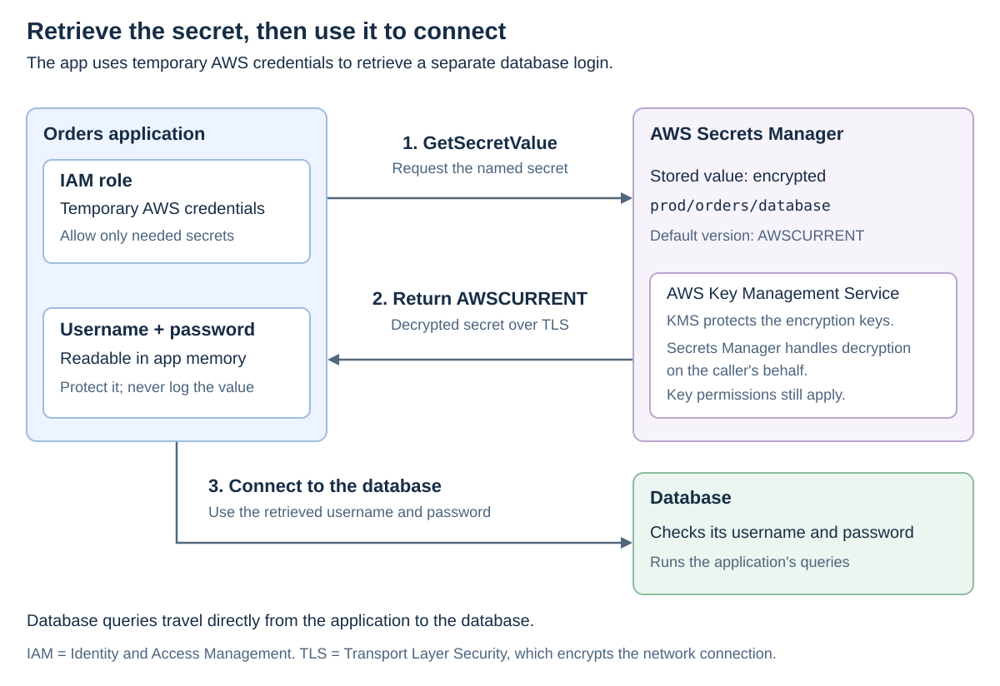
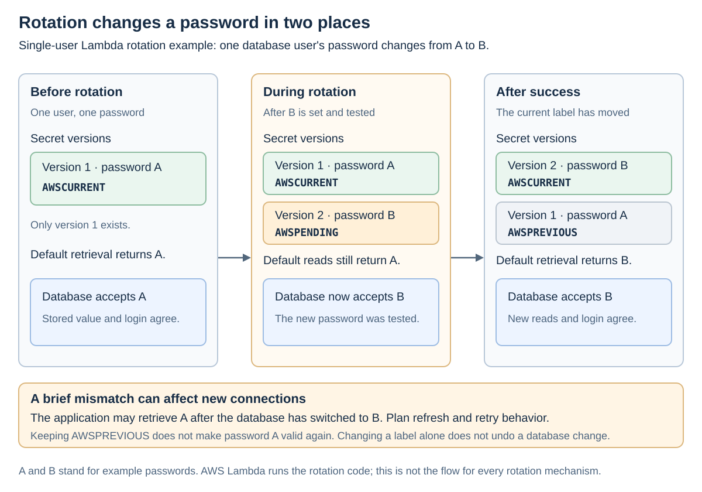

# AWS Secrets Manager

[Back to AWS](../Readme.md#content)

**AWS Secrets Manager stores sensitive values, controls who can retrieve them, and can rotate credentials for supported services or through custom rotation code.** An application can fetch its database password when it needs it instead of embedding that password in source code or a container image.

For an orders application, three things must agree: the password stored in Secrets Manager, the password accepted by the database, and the password the application uses. Understanding those three places explains both retrieval and rotation.

## What a secret contains

A **secret** is a named AWS resource. Its **secret value** is the sensitive information inside it, such as a database password, an application programming interface (**API**) key, or an access token. An API is the interface through which software requests work from another service.

A value can be text or binary data. Related text values can be stored together using **JavaScript Object Notation (JSON)**, a format containing named fields. For example, a database secret can hold `username`, `password`, `host`, and `port` fields. Supported rotation templates expect particular fields and formats.

| Part | Example | Purpose |
| --- | --- | --- |
| **Name** | `prod/orders/database` | Identifies the secret the application should request |
| **Value** | The orders database username, password, and connection details | Supplies the credentials the application needs |
| **Version** | A particular stored value with its own identifier | Keeps a new credential separate while it is being prepared |
| **Staging label** | `AWSCURRENT` | Marks which version should normally be returned |

Changing a secret value creates a new version. A label is a movable marker on a version. Unless you request a specific version or label, `GetSecretValue` returns the version marked **`AWSCURRENT`**.

Names, descriptions, and tags are metadata; they are not encrypted as part of the secret value. Keep passwords and other sensitive content in the value, not in those fields.

## How the application gets its password

The application uses an **AWS Identity and Access Management (IAM) role** to identify itself to AWS and obtain temporary AWS credentials. Those credentials let it request the secret. The database username and password returned by Secrets Manager are a separate set of credentials, used to connect to the database.

Read the diagram in order: request the secret, receive its value, then connect to the database. The application's database traffic does not pass through Secrets Manager.

The role needs `secretsmanager:GetSecretValue` permission for the intended secret. Scope that permission to the secrets the application needs, rather than giving every application access to all secrets. Give the database user only the database permissions the application needs as well.

**Transport Layer Security (TLS)** encrypts the connection carrying the secret. Secrets Manager returns the decrypted value to the authorized application; the application therefore has access to the usable password. Protect that value in memory, caches, logs, and debugging output. Storing it securely does not prevent application code from accidentally printing it.

For applications running on AWS, prefer their workload's IAM role over embedding long-lived AWS access keys just to fetch another password.

## How encryption and permissions work together

Secrets Manager encrypts secret values at rest using **AWS Key Management Service (KMS)**. It uses **envelope encryption**: a data key encrypts the value, and a KMS key protects that data key. During retrieval, Secrets Manager uses KMS to recover the data key and then decrypts the value.

You can use the AWS managed key **`aws/secretsmanager`** or a suitable **customer managed KMS key**, which you control. With a customer managed key, the caller also needs authorization for `kms:Decrypt` on that key. Secrets Manager uses KMS on the caller's behalf; permission to read the secret alone does not bypass the key's access controls.

### Sharing a secret with another account

Direct access from a role in another AWS account needs permissions on both sides:

- An **identity policy** gives the calling role permission to read the secret.
- A **resource policy** attached to the secret permits that role to access it.
- A **customer managed KMS key** and its permissions allow the role to decrypt the value.

The AWS managed `aws/secretsmanager` key cannot be used for this direct cross-account access. These permissions do not bypass an applicable explicit denial. Use the secret's full **Amazon Resource Name (ARN)**, AWS's resource identifier, when requesting it from another account.

## Rotation keeps the secret and its destination in sync

**Rotation** replaces a credential. For a database password, it must update both the stored secret and the password accepted by the database. Simply editing a value in Secrets Manager does not change the database password.

Rotation uses staging labels to distinguish the values involved:

| Label | Meaning |
| --- | --- |
| **`AWSCURRENT`** | The version normally returned to applications |
| **`AWSPENDING`** | A candidate version being prepared during rotation |
| **`AWSPREVIOUS`** | The version that was current before the latest change |

**AWS Lambda** runs function code without requiring you to manage a server. The diagram shows a **single-user Lambda rotation**: one database user's password changes from A to B. The middle panel highlights a brief period when the database may already accept B while ordinary secret retrieval still returns A.

In Lambda rotation, the function prepares a pending value, applies it to the database or service, and tests that it works. Only after a successful test does it move `AWSCURRENT` to the new version. The old version receives `AWSPREVIOUS`.

**A saved old version does not mean the old password still works.** Moving labels alone does not roll back the database. If rotation fails, investigate the state of both the secret and the destination before attempting recovery.

For single-user database rotation, existing open connections are not dropped, but new authentication attempts can briefly fail. Applications need an appropriate refresh and retry strategy. An **alternating-users** strategy rotates between two database users to reduce this gap; it also requires managing the second user's permissions and the credentials used to perform rotation.

### Choose the supported rotation mechanism

| Mechanism | How it works |
| --- | --- |
| **Managed rotation by an AWS service** | A supported service manages rotation, such as Amazon Relational Database Service (RDS) managing its master-user credentials; no rotation Lambda function is needed |
| **Managed external secrets** | Supported partner integrations handle rotation for credentials held by that partner, without a customer rotation Lambda function |
| **Rotation by AWS Lambda** | A function updates Secrets Manager and the target system, using an AWS template or code you maintain |

For Lambda rotation, the function needs permission and network access to both Secrets Manager and the database or external service. Turning on a schedule cannot compensate for a function that cannot reach its target.

Use an application-specific database user with limited privileges; the existence of managed rotation for an administrator password is not a reason to make the application an administrator.

## A rotated value does not instantly reach every application

**Caching** means retaining a retrieved value locally so it can be reused. AWS recommends client-side caching to reduce retrieval latency and API calls. A cache also creates a delay before an application sees a changed secret.

| How the value reaches the application | What happens after the secret changes |
| --- | --- |
| **A fresh `GetSecretValue` request** without a pinned version | Returns the version currently marked `AWSCURRENT` |
| **A local cache** | Continues using its cached value until its refresh behavior fetches a newer one |
| **Amazon Elastic Container Service (ECS) environment variable** | A running container does not receive the new value automatically; launch a new task or force a new service deployment |
| **AWS CloudFormation dynamic reference** | Updating the secret alone does not cause retrieval; CloudFormation resolves it during resource creation or a relevant resource update |

ECS runs containers; CloudFormation creates and updates AWS resources from templates. Their integrations load secrets at different times, so “stored in Secrets Manager” does not imply “always refreshed at runtime.”

Choose a cache refresh policy that fits the rotation schedule and the application's tolerance for stale credentials. If authentication fails because a cached credential is outdated, a controlled refresh and retry can help. Avoid unlimited retries, and do not log the credential while diagnosing the failure.

## Keep access reachable and observable

A **Virtual Private Cloud (VPC)** is a network you control in AWS. A Secrets Manager **interface VPC endpoint** provides a private path from that network to the service, without requiring clients to have public internet addresses. Network access and IAM permissions are separate requirements; both must allow the request.

**AWS CloudTrail** records Secrets Manager API activity, including retrieval calls. The `SecretString` and `SecretBinary` values returned by `GetSecretValue` are excluded from its CloudTrail entries. Your own application logs still need to avoid exposing them.

Monitor failed retrievals and rotation failures. A secret is useful only when the authorized application can obtain a value that the destination accepts.

## Secrets Manager, Parameter Store, and KMS

These services have different jobs:

| Service | Main job |
| --- | --- |
| **Secrets Manager** | Store and retrieve credentials, control access, and manage their rotation |
| **AWS Systems Manager Parameter Store** | Store named configuration values; `SecureString` parameters can be encrypted with KMS, but Parameter Store has no native credential-rotation mechanism |
| **KMS** | Manage cryptographic keys and perform cryptographic operations; Secrets Manager uses it to protect secret values |

For example, an application's environment name or service address can be a Parameter Store parameter. A database credential that needs managed rotation fits Secrets Manager. Rotating encryption key material in KMS does not change the password accepted by a database.

## What you pay for

Secrets Manager charges for stored secrets and API calls. Creating another version of an existing secret is not charged as creating another secret. Depending on the setup, customer managed KMS keys, rotation Lambda functions, and other supporting resources can add costs.

Caching reduces repeated retrieval calls, but it still needs a refresh plan. Check current regional pricing and any account-specific credits rather than assuming all secrets are free or that introductory credits will cover ongoing use.

# Sources

- [Secrets Manager overview and intended uses](https://docs.aws.amazon.com/secretsmanager/latest/userguide/intro.html)
- [Secret contents, versions, and staging labels](https://docs.aws.amazon.com/secretsmanager/latest/userguide/whats-in-a-secret.html)
- [GetSecretValue behavior and permissions](https://docs.aws.amazon.com/secretsmanager/latest/apireference/API_GetSecretValue.html)
- [Encryption and decryption with KMS](https://docs.aws.amazon.com/secretsmanager/latest/userguide/security-encryption.html)
- [Secrets Manager best practices](https://docs.aws.amazon.com/secretsmanager/latest/userguide/best-practices.html)
- [IAM roles and temporary credentials](https://docs.aws.amazon.com/IAM/latest/UserGuide/id_roles.html)
- [Cross-account secret access](https://docs.aws.amazon.com/secretsmanager/latest/userguide/auth-and-access_examples_cross.html)
- [Rotation mechanisms](https://docs.aws.amazon.com/secretsmanager/latest/userguide/rotating-secrets.html)
- [Managed rotation](https://docs.aws.amazon.com/secretsmanager/latest/userguide/rotate-secrets_managed.html)
- [Lambda rotation functions](https://docs.aws.amazon.com/secretsmanager/latest/userguide/rotate-secrets_lambda-functions.html)
- [Single-user and alternating-users rotation](https://docs.aws.amazon.com/secretsmanager/latest/userguide/rotation-strategy.html)
- [Client-side caching behavior](https://docs.aws.amazon.com/secretsmanager/latest/userguide/retrieving-secrets_cache-python.html)
- [Secrets in ECS environment variables](https://docs.aws.amazon.com/AmazonECS/latest/developerguide/secrets-envvar-secrets-manager.html)
- [CloudFormation dynamic references](https://docs.aws.amazon.com/AWSCloudFormation/latest/UserGuide/dynamic-references-secretsmanager.html)
- [Private access through a VPC endpoint](https://docs.aws.amazon.com/secretsmanager/latest/userguide/vpc-endpoint-overview.html)
- [CloudTrail logging for Secrets Manager](https://docs.aws.amazon.com/secretsmanager/latest/userguide/monitoring-cloudtrail.html)
- [Parameter Store and service comparison](https://docs.aws.amazon.com/systems-manager/latest/userguide/systems-manager-parameter-store.html)
- [What KMS key rotation changes](https://docs.aws.amazon.com/kms/latest/developerguide/rotate-keys.html)
- [Secrets Manager pricing](https://aws.amazon.com/secrets-manager/pricing/)
