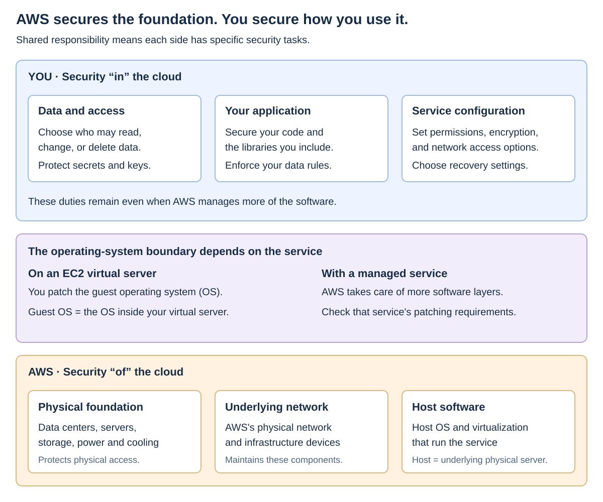
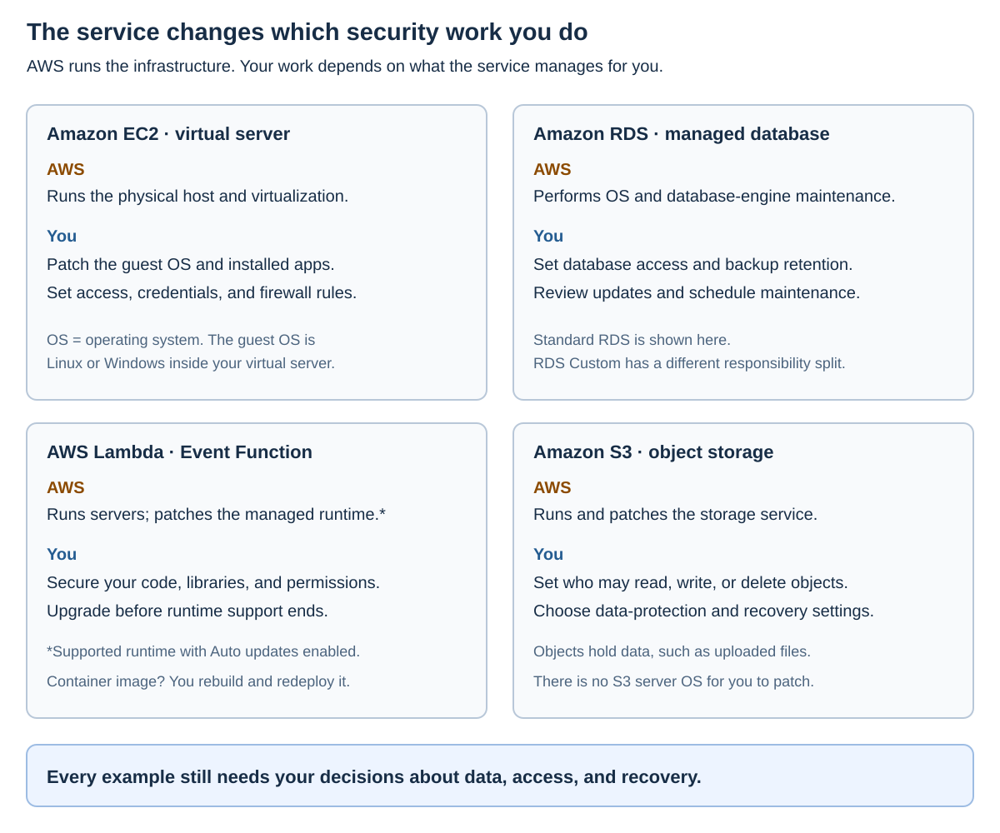

# AWS Shared Responsibility Model

[Back to AWS](../Readme.md#content)

**AWS secures the infrastructure that runs its cloud services. You secure the way you use those services, including your data, access permissions, application code, and configuration.** The exact division depends on the service and how you deploy it.

For example, you patch the operating system inside an Amazon EC2 virtual server. With Amazon S3, AWS patches the storage service; there is no S3 server for you to log into and update. In both cases, you still decide who should be allowed to access your data.

This article explains that boundary, compares four common services, and shows why managed services, encryption, and automatic backups still need decisions from you.

## Security “of” the cloud and security “in” the cloud

**Security of the cloud** is AWS's work: protecting data centers, physical servers, the underlying network, and the software that runs the cloud infrastructure.

**Security in the cloud** is your work: configuring your resources safely, granting appropriate access, protecting your data, and maintaining the software you are responsible for.

Here, **you** means the customer organization and its teams. The tasks may be divided between developers, platform engineers, and security staff, but they still need clear owners.

The diagram separates the AWS foundation from customer choices. The middle section is important: the responsibility for operating-system and platform maintenance changes with the service.

“Shared” does not mean both sides perform every task, or that the work is split equally. AWS can secure the physical network while you configure rules that expose a database. Both layers matter.

### Host software and guest software are different

An EC2 **instance** is a virtual server. Its **guest operating system (OS)** is the Linux or Windows system running inside that virtual server. You manage and patch it, along with the software you install.

AWS manages the underlying physical host and virtualization infrastructure—the machinery and software that make virtual servers possible. Patching that foundation does not automatically update your instance's guest OS or application libraries.

A **security group** is a firewall for supported AWS resources. AWS operates the mechanism; you choose its rules, such as which network sources may connect to your instance. Using an AWS-provided control does not remove responsibility for its configuration.

## The boundary moves with the service

A **managed service** means AWS operates some of the components you would otherwise run yourself. The service's documentation defines which components and which customer settings remain.

Compare the orange **AWS** work with the blue **You** work in each example below. The amount of server maintenance changes, but each example still needs appropriate permissions and data protection.

### Amazon EC2: you manage the virtual server's software

Suppose you install PostgreSQL on an EC2 instance. AWS runs the physical infrastructure. You maintain the guest OS, PostgreSQL installation, and other installed software. You also configure connection credentials, network access, and the instance's permissions.

An old database package does not become current because it runs on AWS. You can automate updates with management tools, but your team must configure that automation and verify the result.

### Amazon RDS: AWS maintains the database platform

With standard **Amazon Relational Database Service (RDS)**, AWS operates the database infrastructure and performs OS and database-engine maintenance. A **database engine** is the database software, such as PostgreSQL or MySQL.

You still control database users, allowed connections, application queries, and relevant settings. You review available updates, choose maintenance settings, and plan compatible upgrades. Some maintenance is optional; required updates cannot always be postponed indefinitely. “Managed” therefore does not mean every update happens without your participation.

RDS can perform automated backups, but you choose a suitable **retention period**, meaning how long those backups remain available. For an RDS DB instance, setting retention to zero disables automated backups. Set the intended value explicitly rather than assuming every creation method has the same default.

This example describes standard RDS. **RDS Custom** gives customers more control over the underlying environment and has a different responsibility split.

### AWS Lambda: less server work, continued code ownership

Consider a **Lambda Event Function** using a supported AWS managed runtime. A **runtime** is the environment that runs your code, such as the language runtime and supporting components.

AWS operates the servers. With the default **Auto** runtime-update mode, Lambda also applies managed-runtime updates. You still update your function code and its libraries, configure permissions, and move to a supported runtime before the old one loses support. A patched runtime does not repair a vulnerable library bundled with your code.

Container-image deployments have a different update path: AWS publishes updates to its base images, but **you must rebuild and redeploy your function's image** to use them. You also maintain any other components you include. Custom runtimes and nondefault update modes change your maintenance work too.

### Amazon S3: AWS runs storage; you control access to data

**Amazon Simple Storage Service (S3)** stores data as **objects**, such as uploaded files, inside **buckets**. AWS runs and patches the storage platform. You manage the data, its permissions, encryption choices, and relevant monitoring settings.

For example, you decide whether a document is public, private to one application, or available to another account. **AWS Identity and Access Management (IAM)** policies and S3 access policies express those permissions. S3 enforces the applicable rules; it cannot decide your organization's intended audience for each document.

## Encryption and access control solve different problems

S3 automatically applies server-side encryption to new object uploads. This protects stored data, but **encryption does not mean only the right people can read it**. When S3-managed encryption is used, S3 decrypts an object as part of an authorized read.

Imagine an invoice bucket whose effective access settings permit public reads. The invoices can be encrypted at rest and still be readable by unintended people. The problem is the permission configuration, not the absence of encryption.

New S3 buckets do not allow public access by default. **S3 Block Public Access** helps prevent public permissions from taking effect. Keep appropriate public-access protections enabled and review the policies that grant access. The invoice example assumes those protections have been relaxed enough to permit the public read.

You also choose encryption options and key-access permissions to match your needs. The default encryption change applied to new uploads; it did not retroactively encrypt every old, unencrypted object.

## Shared controls operate at different layers

A **control** is a measure used to reduce risk, such as installing patches or limiting access. Some controls are inherited from AWS, while others require work on both sides.

| Control | AWS's part | Your part |
|---|---|---|
| Physical security | Protects AWS facilities and physical equipment. | Uses the service without managing access to those facilities. |
| Patch management | Patches infrastructure and service components it operates. | Updates customer-managed software and participates in service maintenance where required. |
| Configuration | Configures the underlying cloud infrastructure. | Configures your resources, permissions, applications, and exposed network paths. |
| Staff training | Trains AWS staff. | Trains your own staff to use the environment safely. |

This is why “AWS handles patching” is incomplete. First identify the component: an EC2 guest OS, an RDS database engine, your own library, or S3's storage platform. Then check the service's maintenance rules.

## Recovery and compliance still need customer work

A backup feature provides a way to recover data. Your team must decide what to protect, how long to retain it, and how much downtime or data loss is acceptable.

Test restoration. Check that the recovered data is usable and that recovery finishes within the time your application can tolerate. The existence of a backup does not prove that the whole application can recover successfully.

AWS provides security and compliance documentation for the parts it operates. Your organization still needs to evaluate its own configuration and use of the services against its requirements. An AWS control cannot demonstrate that your application grants the correct permissions or that your staff follow the required process.

## Apply the model to one resource at a time

For each service you use, identify:

- **Data and access:** What is stored, and who may read, change, or delete it?
- **Software ownership:** Which OS, runtime, packages, and application code must your team maintain?
- **Configuration:** Which permissions, network rules, encryption settings, and monitoring options must you set?
- **Maintenance and recovery:** Which updates need action, what is backed up, and has restoration been tested?

Record the owner for each task and check the service documentation when the deployment changes. Moving a database from EC2 to RDS changes maintenance responsibilities; it does not decide who should be allowed to query the data.

Related articles: [EC2](../Amazon%20EC2/Readme.md), [RDS](../Amazon%20RDS/Readme.md), [Lambda](../AWS%20Lambda/Readme.md), [S3](../Amazon%20S3/Readme.md), and [IAM](../AWS%20IAM/Readme.md).

# Sources

- [AWS: Shared Responsibility Model](https://aws.amazon.com/compliance/shared-responsibility-model/)
- [AWS Risk and Compliance: Shared responsibility model](https://docs.aws.amazon.com/whitepapers/latest/aws-risk-and-compliance/shared-responsibility-model.html)
- [AWS Well-Architected Security Pillar: Shared responsibility and managed-service patching](https://docs.aws.amazon.com/wellarchitected/latest/security-pillar/shared-responsibility.html)
- [AWS: Security in Amazon EC2](https://docs.aws.amazon.com/AWSEC2/latest/UserGuide/ec2-security.html)
- [AWS: Amazon RDS responsibilities](https://docs.aws.amazon.com/AmazonRDS/latest/UserGuide/Welcome.html)
- [AWS: Security in Amazon RDS](https://docs.aws.amazon.com/AmazonRDS/latest/UserGuide/UsingWithRDS.html)
- [AWS: Maintaining an RDS DB instance](https://docs.aws.amazon.com/AmazonRDS/latest/UserGuide/USER_UpgradeDBInstance.Maintenance.html)
- [AWS: RDS backup retention](https://docs.aws.amazon.com/AmazonRDS/latest/UserGuide/USER_WorkingWithAutomatedBackups.BackupRetention.html)
- [AWS: RDS Custom and its responsibility model](https://docs.aws.amazon.com/AmazonRDS/latest/UserGuide/rds-custom.html)
- [AWS: Lambda runtime-management responsibilities](https://docs.aws.amazon.com/lambda/latest/dg/runtime-management-shared.html)
- [AWS: Lambda Event Function runtimes and support policy](https://docs.aws.amazon.com/lambda/latest/dg/lambda-runtimes.html)
- [AWS: Security in Amazon S3](https://docs.aws.amazon.com/AmazonS3/latest/userguide/security.html)
- [AWS: S3 default encryption](https://docs.aws.amazon.com/AmazonS3/latest/userguide/default-encryption-faq.html)
- [AWS: S3 Block Public Access](https://docs.aws.amazon.com/AmazonS3/latest/userguide/access-control-block-public-access.html)
- [AWS Well-Architected: Test recovery to verify backups and processes](https://docs.aws.amazon.com/wellarchitected/latest/framework/rel_backing_up_data_periodic_recovery_testing_data.html)
