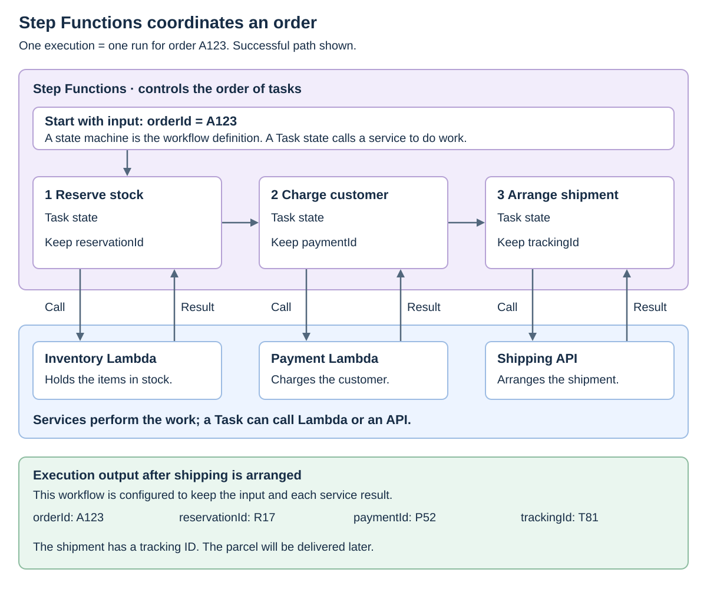
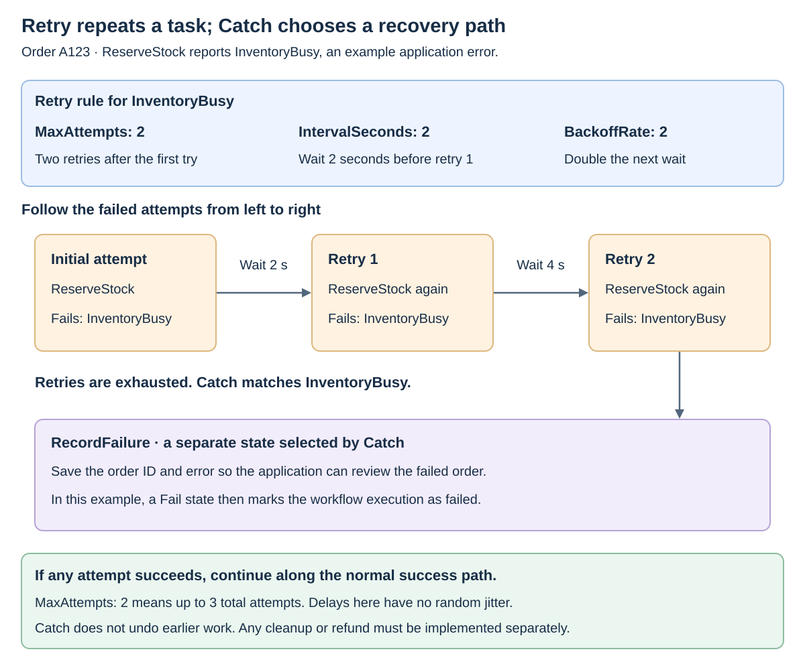

# AWS Step Functions

<sub>[Back to AWS](../Readme.md#content)</sub>

**AWS Step Functions coordinates a series of tasks into a workflow.** You describe the order of the work, the decisions to make, and what should happen when something fails. Step Functions follows that plan; services such as Lambda perform the work.

Think of an online order: reserve stock, charge the customer, then arrange delivery. This article follows that example, explains the workflow types, and shows how retries and recovery work.

## A workflow definition and one run of it

Three terms make the service easier to understand:

- A **state machine** is the workflow definition: the reusable plan.
- A **state** is one step in that plan. A **Task state** asks a service or worker to do something.
- An **execution** is one run of the plan, with its own input and progress. Processing order `A123` is one execution; processing order `A124` is another.

In this example, Step Functions controls the sequence. The inventory and payment Lambda functions do the business work, and a shipping application programming interface (**API**) arranges shipment. Read across the Task states, then follow each call down to the service that performs it.



The last step returns a tracking identifier. That means shipment has been arranged; it does not mean the parcel has arrived. A workflow's completion means whatever its definition says it means.

You do not need a Lambda function for every task. Step Functions can call many AWS service APIs directly. Use a function when you need your own code between those calls.

## The building blocks of a workflow

Some states do work; others control what happens next.

| State | What it does | Order example |
|---|---|---|
| `Task` | Calls a service or worker. | Reserve stock. |
| `Choice` | Selects a branch using a condition. | Send a high-value order for review. |
| `Wait` | Pauses until a time or for a duration. | Wait before checking a status again. |
| `Parallel` | Runs separate branches concurrently. | Check an address and assess fraud risk. |
| `Map` | Runs the same processing steps for multiple items. | Check each item in the order. |
| `Pass` | Passes or reshapes data without calling a worker. | Prepare the next task's input. |
| `Succeed` / `Fail` | Ends the run successfully or with a failure. | Finish the order or mark it as failed. |

`Parallel` describes different branches. `Map` repeats processing for a collection of items.

## How the definition and data fit together

The definition uses **Amazon States Language (ASL)**, written in JavaScript Object Notation (**JSON**). It names the states and describes their connections. `StartAt` names the first state; `Next` usually names the following state; `End: true` can mark a final state. Workflow Studio provides a visual editor for the definition.

Executions can receive JSON input and produce JSON output. For example, an order run might begin with:

```json
{
  "orderId": "A123",
  "customerId": "C42"
}
```

The workflow chooses which data each service receives and which results later states keep. In the diagram, it deliberately keeps the order identifier and adds reservation, payment, and tracking identifiers.

**Results are not automatically merged with all earlier data.** For example, in a JSONPath Task state, omitting `ResultPath` normally replaces the input with the task result. Setting `"ResultPath": "$.reservation"` can instead place the result under `reservation` while retaining the other input fields.

You will encounter two data-processing languages inside ASL:

- **JSONPath** selects data by paths such as `$.orderId`. It uses fields such as `Parameters` and `ResultPath`.
- **JSONata** selects and transforms data using expressions. It uses fields such as `Arguments` and `Output`.

AWS recommends JSONata for new workflows. If the top-level `QueryLanguage` is omitted, the default is JSONPath. A state uses one language at a time, so examples using the two sets of fields cannot simply be mixed.

## Standard and Express workflows

Choose the workflow type when creating the state machine. You cannot change that type later. Express has two ways to run: asynchronous and synchronous.

| Property | Standard | Asynchronous Express | Synchronous Express |
|---|---|---|---|
| Maximum execution duration | 1 year | 5 minutes | 5 minutes |
| Execution semantics | Exactly once, subject to configured task retries | At least once | At most once |
| Caller behavior | Starts the run and checks its result separately | Starts the run without waiting for its result | Waits for the workflow result |
| Execution history | Stored by Step Functions for 90 days after completion | Configure CloudWatch Logs | Configure CloudWatch Logs |
| Main billing units | State transitions | Executions, duration, and memory | Executions, duration, and memory |

**At least once** means a run may repeat. **At most once** means the service does not automatically repeat the run, but completion is not guaranteed.

Standard suits long business processes and workflows that need callbacks. Express suits short, high-volume processing when its execution behavior fits the application.

Express history relies on CloudWatch Logs. Log delivery is best effort, so do not treat it as a guaranteed complete audit trail. If you need a reliable business record, make saving that record part of the application.

For synchronous Express, the `StartSyncExecution` API response can have HTTP status `200` even when the workflow failed. Check the response's `status`, `error`, and `cause`, rather than treating successful delivery of the response as successful completion of the work.

### Exactly once does not make every payment safe to repeat

Standard's execution guarantee does not prevent you from configuring a retry or starting a separate execution for the same order.

Suppose the payment service charges the customer, but its response is lost. Repeating the call could charge the customer again unless the payment service recognizes the request.

An **idempotent operation** has the same intended effect when repeated. Give the payment operation a stable identifier, such as `A123-payment`, and have the service record and reuse its result for that identifier. The same protection matters for inventory reservations and other business changes.

Standard's `StartExecution` API also has a narrower form of duplicate protection: the same execution name and input return the original response while that execution is still running. This is not permanent deduplication of business requests. Express `StartExecution` calls are not idempotent.

## What does a Task wait for?

A service integration determines how a Task calls another service. Its **integration pattern** determines when the Task can continue.

| Pattern | When the Task continues | Availability |
|---|---|---|
| Request Response | When the service API responds. That response may only confirm that a job was submitted. | Standard and Express |
| Run a job, `.sync` | When a supported service's job finishes, such as an AWS Batch job. | Standard, for supported integrations |
| Callback, `.waitForTaskToken` | When an external worker returns a task token using `SendTaskSuccess` or `SendTaskFailure`. | Standard, for supported integrations |

A **task token** identifies the waiting task. For human approval, the workflow can send a token to an approval application. After the person decides, the application sends the callback. Set timeouts so a missing response does not leave the run waiting indefinitely.

**Synchronous Express and `.sync` mean different things.** Synchronous Express makes the caller wait for the whole workflow. The `.sync` pattern makes a Task wait for a service job. Express supports neither `.sync` nor `.waitForTaskToken`.

## Retry first, then choose a recovery path

`Retry` repeats a failed state when the error matches a rule. `Catch` sends a matching error to another state when there is no applicable retry left. Without suitable handling, an error can fail the execution.

Here, `ReserveStock` returns `InventoryBusy`, a made-up application error. The example allows two retries with increasing waits. All three attempts fail, so the workflow records the failure and ends as failed.



The following is a **fragment of a JSONPath Task state's definition**, not a complete deployable workflow. The surrounding definition must include the task resource and a state named `RecordFailure`.

```json
{
  "Retry": [
    {
      "ErrorEquals": ["InventoryBusy"],
      "IntervalSeconds": 2,
      "MaxAttempts": 2,
      "BackoffRate": 2
    }
  ],
  "Catch": [
    {
      "ErrorEquals": ["InventoryBusy"],
      "ResultPath": "$.error",
      "Next": "RecordFailure"
    }
  ]
}
```

`MaxAttempts: 2` means **two retries after the initial attempt**, for at most three attempts. The waits are 2 seconds and then 4 seconds, measured after the preceding failure. If an attempt succeeds, the task follows its normal success path. The example does not enable randomized delays, called *jitter*.

The catcher keeps the input and adds the error under `error`. That lets `RecordFailure` receive both the order identifier and the reason for failure. This rule handles only `InventoryBusy`; other errors need their own handling.

Retries and catchers are available on `Task`, `Parallel`, and `Map` states. Even the broad `States.ALL` matcher has exceptions, including `States.Runtime` and `States.DataLimitExceeded`. The latter can be caught or retried by explicitly naming it.

### Recovery does not automatically undo earlier work

If stock was reserved and payment is declined, the application may need to release the reservation. If a payment succeeded before a later failure, it may need a refund. These are **compensating actions**: new operations that counteract earlier business changes.

You must implement those actions and decide when they are appropriate. `Catch` only selects the next state; it does not roll back changes across services. Cleanup and refunds can also fail, so their outcomes need to be recorded and handled.

## Practical boundaries

- **Give the workflow permission to act.** Its AWS Identity and Access Management (IAM) execution role needs permission to call the resources it uses, such as the specific Lambda functions.
- **Set meaningful timeouts.** A task or the whole workflow should not wait longer than the business process allows. For callback tasks, heartbeats can help detect a worker that has stopped responding.
- **Keep large files outside the workflow data.** Task, state, and execution input or output are limited to 256 KiB. Store large documents in Amazon S3 and pass a reference so the worker can read them.
- **Design the business result explicitly.** Finishing a recovery branch successfully does not mean an order was fulfilled. Choose whether the workflow should end in failure or return an explicit outcome such as `rejected`.

Use Step Functions when the sequence, decisions, waits, and recovery rules are an important part of your application. For a single small operation, calling a function directly may be enough. Related lessons cover [Lambda](../AWS%20Lambda/Readme.md), [SQS](../Amazon%20SQS/Readme.md), and [EventBridge](../Amazon%20EventBridge/Readme.md).

# Sources

- [AWS Step Functions overview](https://docs.aws.amazon.com/step-functions/latest/dg/welcome.html)
- [State machines, states, and executions](https://docs.aws.amazon.com/step-functions/latest/dg/concepts-statemachines.html)
- [Workflow state types](https://docs.aws.amazon.com/step-functions/latest/dg/workflow-states.html)
- [Amazon States Language](https://docs.aws.amazon.com/step-functions/latest/dg/concepts-amazon-states-language.html)
- [Amazon States Language specification: data processing and error handling](https://states-language.net/spec.html)
- [JSONPath ResultPath and preserving input](https://docs.aws.amazon.com/step-functions/latest/dg/input-output-resultpath.html)
- [JSONata and the QueryLanguage setting](https://docs.aws.amazon.com/step-functions/latest/dg/transforming-data.html)
- [Choosing Standard or Express workflows](https://docs.aws.amazon.com/step-functions/latest/dg/choosing-workflow-type.html)
- [CloudWatch Logs and delivery guarantees](https://docs.aws.amazon.com/step-functions/latest/dg/cw-logs.html)
- [StartExecution API and idempotency](https://docs.aws.amazon.com/step-functions/latest/apireference/API_StartExecution.html)
- [StartSyncExecution API and response status](https://docs.aws.amazon.com/step-functions/latest/apireference/API_StartSyncExecution.html)
- [Service integration patterns](https://docs.aws.amazon.com/step-functions/latest/dg/connect-to-resource.html)
- [Error handling, retry rules, and catchers](https://docs.aws.amazon.com/step-functions/latest/dg/concepts-error-handling.html)
- [Saga orchestration, compensation, and idempotency](https://docs.aws.amazon.com/prescriptive-guidance/latest/cloud-design-patterns/saga-orchestration.html)
- [IAM roles for state machines](https://docs.aws.amazon.com/step-functions/latest/dg/procedure-create-iam-role.html)
- [Step Functions service quotas](https://docs.aws.amazon.com/step-functions/latest/dg/service-quotas.html)
- [Best practices: timeouts and large payloads](https://docs.aws.amazon.com/step-functions/latest/dg/sfn-best-practices.html)
