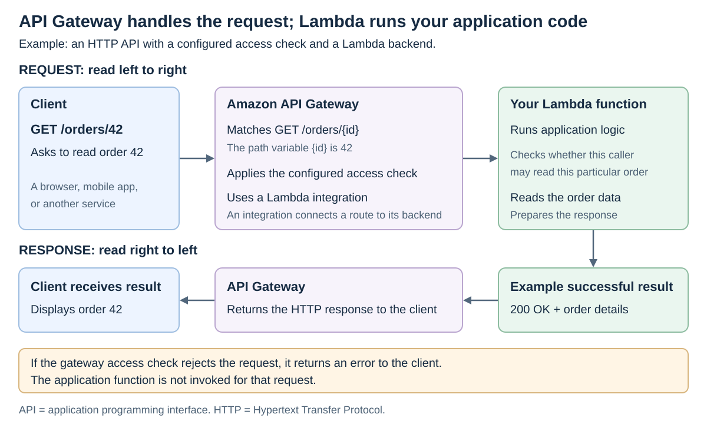
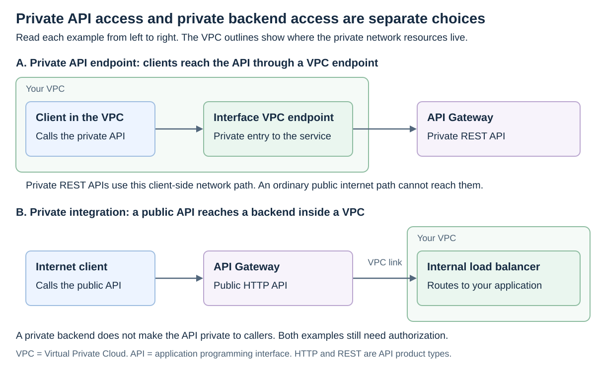

# Amazon API Gateway

[Back to AWS](../Readme.md#content)

**Amazon API Gateway gives clients a managed entry point to your application's backend.** It receives requests, applies the access and traffic rules you configure, and sends accepted requests to a Lambda function, an HTTP service, or another supported AWS service. Your backend still does the application's work.

Start with how a request reaches the backend, then learn which API type to choose. The main decisions are how callers get access, how you publish changes, and whether the client-facing endpoint or the backend connection needs to be private.

## Where API Gateway fits

An **application programming interface (API)** is a way for software to request data or actions from other software. A shopping app might ask for an order with `GET /orders/42`. **GET** is a method in the **Hypertext Transfer Protocol (HTTP)** that requests a resource; `/orders/42` is the path identifying that order.

The **client** is the browser, mobile app, or other program making the request. The **backend** is the code or service that handles it. API Gateway sits between them and exposes an **endpoint**, the address clients call.

In an HTTP API, a **route** combines a method and a path pattern. For example, `GET /orders/{id}` matches `GET /orders/42`, with `id` equal to `42`. An **integration** connects that route to the backend that should handle it.

The diagram shows a Lambda integration. Follow the request toward the function and the response back toward the client.

With a **Lambda proxy integration**, API Gateway turns the request into an event for the function. That event includes information such as the path, headers, body, and request context. The function returns a result, and API Gateway turns it into the HTTP response. The **payload format version** specifies how these messages are structured, so the function must use the format configured for its integration.

For the order example, the backend must still decide whether the caller may read order `42`, retrieve the record, and choose the response. Passing a gateway access check does not automatically mean the caller owns every order. API Gateway also needs permission to invoke the function; the function needs its own permissions for any AWS resources it uses.

## Choose the API type by the features you need

API Gateway has three API products. **HTTP API** and **REST API** are product names: both handle HTTP requests and can implement a RESTful API. **REST**, short for Representational State Transfer, is an approach to designing APIs around resources. The names do not mean that an HTTP API cannot be RESTful.

| API type | A good starting point when you need… |
| --- | --- |
| **HTTP API** | A straightforward request-and-response API for Lambda or an HTTP backend, with fewer management features and lower pricing |
| **REST API** | Features such as usage plans, per-client throttling, request validation, built-in response caching, direct AWS Web Application Firewall (WAF) integration, or a private API endpoint |
| **WebSocket API** | A persistent connection over which the client and server can both send messages, such as a live chat |

Both HTTP and REST APIs support custom domains, AWS Identity and Access Management (**IAM**) authorization, and Lambda authorizers. HTTP APIs also have a built-in **JSON Web Token (JWT)** authorizer. A JWT carries signed claims, such as who issued it, who it is intended for, and when it expires.

Choose from the features your application actually needs. A REST API is not automatically more secure, and an HTTP API is not simply a newer version with every REST API feature.

## Authorization decides whether a request may proceed

**Authentication** establishes who the caller is. **Authorization** decides what that caller may do. Choose and configure the mechanism appropriate to each protected route or method.

| Mechanism | What it does |
| --- | --- |
| **IAM authorization** | Uses signed AWS requests and IAM permissions; useful for callers using AWS credentials |
| **HTTP API JWT authorizer** | Validates a token from a configured issuer, its intended audience and time-related claims, and any required route scopes |
| **REST API Cognito user pool authorizer** | Uses tokens from an Amazon Cognito user pool, a service that manages application users |
| **Lambda authorizer** | Runs your custom access-checking code in a Lambda function |

For a JWT-protected order route, the client first obtains a token from an identity provider. It then sends the token with its API request. API Gateway validates it; it does not perform the user's login itself. A **scope** is a named permission in a token, such as `orders:read`. When route scopes are configured, the token must contain at least one of them. The backend can use validated claims for more specific decisions, such as checking the order's owner.

Lambda authorizers are separate from the function that handles the order. Their response format depends on the API type:

- **REST APIs** support `TOKEN` authorizers, which read a token, and `REQUEST` authorizers, which can read several request values. They return an IAM policy allowing or denying access.
- **HTTP APIs** support authorizer payload formats `1.0` and `2.0`. Format `1.0` returns an IAM policy. Format `2.0` can return a policy or, with simple responses enabled, an `isAuthorized` true/false result.

Authorizer-result caching can reuse an earlier decision. The request values chosen as its **cache key** determine which requests share that decision. Choose those values and the returned permissions carefully; a decision intended for one route must not accidentally allow access to others.

### API keys identify usage-plan clients

For REST APIs, a **usage plan** groups deployed stages and sets target request rates and quotas for clients identified by API keys. A rate concerns requests over time; a quota concerns the total requests over a longer period.

**Do not use an API key as your authentication or authorization mechanism.** Use IAM, an appropriate token authorizer, or a Lambda authorizer to protect the API. An API key can help track a customer's usage while an authorizer decides whether a request is allowed.

Usage-plan throttles and quotas are **best effort**, not exact cutoffs. A client can exceed them, so they are not spending caps. HTTP APIs do not provide REST API usage plans, although HTTP APIs do support stage and route throttling.

## A stage points to the API configuration clients can call

A **deployment** is a snapshot of API configuration. A **stage**, such as `test` or `prod`, is a named reference to a deployment. You can use different stages to test a change before exposing it through the production stage.

For REST APIs, changes to routes, methods, or integrations need a new deployment to take effect. HTTP APIs can use manual deployments or **automatic deployment**, which releases API changes to that stage as you make them.

An HTTP API can also have a **`$default` stage**, served at the base API address without a stage name in the path. A `$default` **route** is different: it catches requests that do not match a more specific route.

**Stage variables** are configuration values associated with a stage. For example, an integration can use one backend address for `test` and another for `prod`. Merely naming a stage `test` does not give it a separate database or isolate its permissions; you must configure those resources. Stage variables are not intended for passwords or other secrets.

## Private access has two different meanings

An Amazon **Virtual Private Cloud (VPC)** is your isolated network in AWS. With API Gateway, distinguish the connection **into the API** from the connection **from the API to its backend**.

The top row shows a private client-facing API. The bottom row shows a public API reaching a private backend. These are separate examples; the bottom API does not become private just because its backend is private.

A **private API endpoint** is available for **REST APIs**. Callers reach it through an **interface VPC endpoint**, a private network entry point for an AWS service. Connected on-premises networks can also reach it through the VPC. Configure the API resource policy and other access controls; a private network path is not a substitute for authorization.

A **private integration** connects API Gateway to a backend inside a VPC through a **VPC link**. For example, a public HTTP API can forward requests to an internal Application Load Balancer (**ALB**), which distributes them to application servers. Both HTTP and REST APIs support private integrations. Current VPC links V2 support both API types; REST private integrations are not limited to Network Load Balancers.

For the public side, REST APIs offer **Regional** and **edge-optimized** endpoints. Edge-optimized endpoints use a service-managed CloudFront distribution to bring the connection closer to geographically spread clients; the API itself remains regional. HTTP APIs have Regional endpoints. You can also place your own CloudFront distribution in front of a Regional API. A Regional endpoint is not restricted to callers in that Region.

## WebSocket APIs keep a client connection open

With a WebSocket API, the persistent connection is between the client and API Gateway. Incoming messages select a route and invoke its backend integration. A Lambda function does not stay running for the whole connection.

For example, a chat app can send a message with an `action` field set to `sendMessage`. A configured route-selection rule reads that field and chooses the matching integration. The backend can send messages to connected clients through API Gateway's **`@connections` API**.

The built-in routes are **`$connect`** while opening a connection, **`$disconnect`** after it closes, and **`$default`** for messages without a matching custom route. Delivery of the `$disconnect` event is best effort. A WebSocket Lambda authorizer runs on `$connect`, not on every subsequent message. Your application must enforce any message-level permissions it needs.

Connections can close, so clients need a reconnection plan. Choose WebSocket because the application needs two-way messaging, rather than simply because its backend uses Lambda.

## Traffic, caching, and browser access

**Throttling** helps protect a backend from too many requests. A rate target controls sustained traffic; a burst allowance accommodates a short spike. API Gateway can return **`429 Too Many Requests`** when it throttles a request. HTTP API limits exist at the account-and-Region level as well as for stages and routes. These throttles are best effort. Managed scaling does not remove service quotas or backend capacity limits.

**Response caching** can avoid repeating backend work. REST APIs offer an optional, paid cache for a specific stage. On a cache hit, API Gateway can return a stored response without calling the backend. The **time to live (TTL)** controls how long a response may be reused. When stage method caching is enabled, `GET` methods are cached by default.

A **cache key** identifies which requests can share a response. Include the values that change the answer. For example, different product IDs must not accidentally share one cached product response. Be especially careful with user-specific data. This response cache is separate from authorizer-result caching and from CloudFront caching; HTTP APIs do not have the same built-in response cache.

**Cross-Origin Resource Sharing (CORS)** controls whether browser code can read responses from another origin, such as a different domain. For example, a page at `shop.example.com` may call an API at `api.example.com`. HTTP APIs can manage CORS response headers and browser preflight requests, which check whether certain cross-origin requests are allowed. CORS does not authenticate a caller and does not stop non-browser programs from calling a reachable endpoint.

Use **Amazon CloudWatch** metrics and configured access logs to see traffic, failures, and latency. If a call fails, check the layer responsible: route selection, authorization, throttling, integration permissions, or the backend itself. A working gateway cannot make a failing backend return the right result.

# Sources

- [API Gateway overview and architecture](https://docs.aws.amazon.com/apigateway/latest/developerguide/welcome.html)
- [API Gateway concepts](https://docs.aws.amazon.com/apigateway/latest/developerguide/api-gateway-basic-concept.html)
- [HTTP API routes](https://docs.aws.amazon.com/apigateway/latest/developerguide/http-api-develop-routes.html)
- [Lambda proxy integrations for HTTP APIs](https://docs.aws.amazon.com/apigateway/latest/developerguide/http-api-develop-integrations-lambda.html)
- [API Gateway invocation and Lambda permissions](https://docs.aws.amazon.com/lambda/latest/dg/services-apigateway.html)
- [Lambda execution-role permissions](https://docs.aws.amazon.com/lambda/latest/dg/lambda-intro-execution-role.html)
- [Choosing between HTTP and REST APIs](https://docs.aws.amazon.com/apigateway/latest/developerguide/http-api-vs-rest.html)
- [HTTP API IAM authorization](https://docs.aws.amazon.com/apigateway/latest/developerguide/http-api-access-control-iam.html)
- [REST API Cognito authorizers](https://docs.aws.amazon.com/apigateway/latest/developerguide/apigateway-integrate-with-cognito.html)
- [HTTP API JWT authorizers](https://docs.aws.amazon.com/apigateway/latest/developerguide/http-api-jwt-authorizer.html)
- [REST API Lambda authorizers](https://docs.aws.amazon.com/apigateway/latest/developerguide/apigateway-use-lambda-authorizer.html)
- [HTTP API Lambda authorizers](https://docs.aws.amazon.com/apigateway/latest/developerguide/http-api-lambda-authorizer.html)
- [REST API usage plans and API keys](https://docs.aws.amazon.com/apigateway/latest/developerguide/api-gateway-api-usage-plans.html)
- [REST API deployments](https://docs.aws.amazon.com/apigateway/latest/developerguide/how-to-deploy-api.html)
- [HTTP API stages](https://docs.aws.amazon.com/apigateway/latest/developerguide/http-api-stages.html)
- [HTTP API stage variables](https://docs.aws.amazon.com/apigateway/latest/developerguide/http-api-stages.stage-variables.html)
- [Private REST APIs](https://docs.aws.amazon.com/apigateway/latest/developerguide/apigateway-private-apis.html)
- [HTTP API private integrations](https://docs.aws.amazon.com/apigateway/latest/developerguide/http-api-develop-integrations-private.html)
- [REST API endpoint types](https://docs.aws.amazon.com/apigateway/latest/developerguide/api-gateway-api-endpoint-types.html)
- [WebSocket API connections and routes](https://docs.aws.amazon.com/apigateway/latest/developerguide/apigateway-websocket-api-overview.html)
- [WebSocket Lambda authorizers](https://docs.aws.amazon.com/apigateway/latest/developerguide/apigateway-websocket-api-lambda-auth.html)
- [WebSocket connect and disconnect events](https://docs.aws.amazon.com/apigateway/latest/developerguide/apigateway-websocket-api-route-keys-connect-disconnect.html)
- [HTTP API throttling](https://docs.aws.amazon.com/apigateway/latest/developerguide/http-api-throttling.html)
- [REST API response caching](https://docs.aws.amazon.com/apigateway/latest/developerguide/api-gateway-caching.html)
- [HTTP API CORS](https://docs.aws.amazon.com/apigateway/latest/developerguide/http-api-cors.html)
- [Browser CORS behavior](https://developer.mozilla.org/en-US/docs/Web/HTTP/Guides/CORS)
- [HTTP API CloudWatch metrics](https://docs.aws.amazon.com/apigateway/latest/developerguide/http-api-metrics.html)
- [HTTP API access logging](https://docs.aws.amazon.com/apigateway/latest/developerguide/http-api-logging.html)
