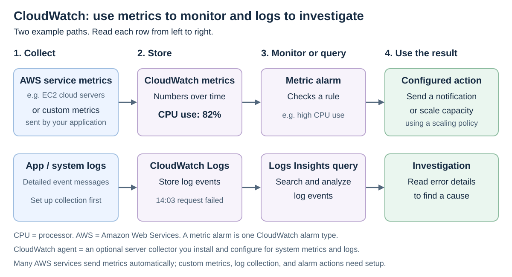
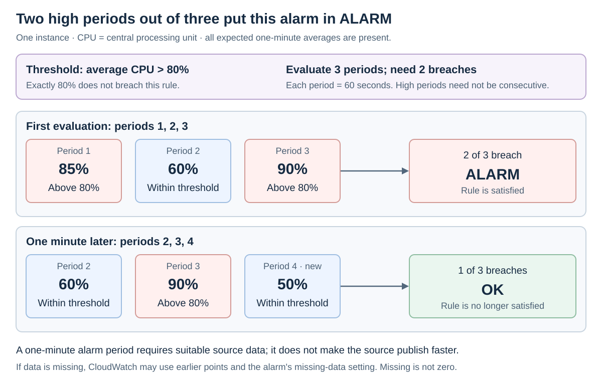

# Amazon CloudWatch

<sub>[Back to AWS](../Readme.md#content)</sub>

**Amazon CloudWatch collects monitoring data so you can see how your applications are behaving, investigate problems, and trigger configured alerts or actions.** Metrics show numerical trends; logs describe individual events. A dashboard displays the evidence, while an alarm evaluates a condition over time.

Imagine an online shop becoming slow during a sale. CloudWatch can show whether its servers are busy, help you find failed checkout requests, and notify the team. This article follows the data from collection to investigation and explains how an alarm decides when to act.

## Start with the question you need to answer

| Signal | What it contains | Shop example |
| --- | --- | --- |
| **Metric** | Numbers measured over time. | Processor use, request count, or response time. |
| **Log** | Timestamped messages describing events. | “Payment request timed out,” with a request identifier. |
| **Trace** | The path and timing of a request across instrumented components. | Time spent in checkout, the database, and the payment call. |

**Instrumentation** means adding or enabling software that emits these signals. Some AWS metrics arrive automatically. Application logs, traces, and additional measurements require the appropriate collection setup.

The diagram shows two common paths: use metrics to detect a condition, and query logs to investigate details. The arrows represent monitoring data and configured actions, not customers' checkout traffic.



A **dashboard** brings charts, log-query results, and alarm status together. Adding a chart does not create an alarm. Likewise, collecting a metric does not automatically notify anyone or change server capacity.

## Read a metric correctly

For the AWS service metrics used here, CloudWatch identifies a metric using its **namespace**, name, and **dimensions**, within an account and Region:

| Part | Meaning | Example |
| --- | --- | --- |
| **Namespace** | A container that groups related metrics. | `AWS/EC2` for Amazon Elastic Compute Cloud. |
| **Metric name** | The measurement being reported. | `CPUUtilization`. |
| **Dimension** | A name/value pair identifying which resource or category the data describes. | `InstanceId=i-0123456789abcdef0`. |

**Central processing unit (CPU) utilization** measures processor use as a percentage. Two [EC2 instances](../Amazon%20EC2/Readme.md) can both report `CPUUtilization`, but their different `InstanceId` dimensions distinguish the measurements. Check the account, Region, and dimensions before comparing charts or creating an alarm.

The chart also needs a **period**, the time interval summarized by each point, and a **statistic**, the calculation applied to that interval.

| Statistic | Meaning | A useful interpretation |
| --- | --- | --- |
| `Average` | Sum of the samples divided by their count. | Average processor use during one minute. |
| `Sum` | Total of the values in the period. | Total requests, for a metric that reports request counts. |
| `p95` | The 95th percentile. | For a supported response-time metric, about 95% of observations are at or below this value. |

An average can hide a slow minority of requests. A percentile can help reveal that experience. Choose the statistic that answers your question; summing CPU percentages does not tell you the average processor load.

CloudWatch also supports **OpenTelemetry**, an open standard for collecting metrics, logs, and traces. Its metric model uses labels rather than the namespace-and-dimensions model above. The examples in this article use familiar AWS service metrics.

## Know what EC2 sends automatically

For the ordinary EC2 `CPUUtilization` metric, **basic monitoring provides five-minute data; detailed monitoring provides one-minute data**. This is not a universal interval for every CloudWatch metric. For example, selected detailed-monitoring categories also support `CPUUtilization10Sec`, and other metrics have their own publication intervals.

**Enabling detailed monitoring does not automatically collect the application's log files, guest operating-system memory use, or filesystem free space.** The **CloudWatch agent** can collect configured system measurements and log files from EC2 and on-premises servers. Your application can also publish custom metrics, such as the number of failed payments.

Installing the agent is only part of the setup. Configure what it collects, give it the necessary [Identity and Access Management (IAM)](../AWS%20IAM/Readme.md) permissions, and ensure it can reach the service. AWS Systems Manager can help install and manage it, but manual installation is also supported.

Choose an alarm period that fits the source data. Setting a 60-second period does not turn a five-minute source metric into one-minute measurements.

## An alarm evaluates a rule over time

A **metric alarm** evaluates a metric or a metric-math result against a condition. For example, it can watch the average CPU use of one instance with detailed monitoring enabled.

Suppose the rule is: **average CPU above 80% in at least two of the latest three one-minute periods**. Each point is a one-minute average. Read the two rows as successive evaluations: the older point drops out and a new one enters the window. All expected data is present in this example.



This is a **2-out-of-3 alarm**: `Period=60`, `EvaluationPeriods=3`, and `DatapointsToAlarm=2`. The high periods do not need to be consecutive. A single high period does not satisfy this rule.

The main metric-alarm states are:

- **`OK`:** the evaluated data does not satisfy the alarm condition.
- **`ALARM`:** the evaluated data satisfies the condition.
- **`INSUFFICIENT_DATA`:** there is not enough information to determine the state, for example just after creation or when data is unavailable.

**Missing data is not automatically zero or healthy.** Configure whether to treat it as breaching, not breaching, ignored, or missing. With the default sliding window, CloudWatch may use earlier real points from a wider range before applying that setting. A stopped data source therefore needs deliberate handling; do not assume every gap immediately produces `INSUFFICIENT_DATA`.

## Alarm state and alarm action are separate

You can configure an alarm to send a message through [Amazon Simple Notification Service (SNS)](../Amazon%20SNS/Readme.md), invoke an [EC2 Auto Scaling](../Amazon%20EC2%20Auto%20Scaling/Readme.md) policy, or perform a supported resource action. An alarm can also exist without any action.

For ordinary SNS alarm notifications, actions normally occur when the state changes. Staying in `ALARM` does not normally send a fresh notification every minute. **Auto Scaling actions are an exception:** CloudWatch continues invoking the configured action once per minute while the alarm remains in the relevant state. The scaling policy and group settings determine whether capacity actually changes.

A **composite alarm** combines other alarm states, for example “high error rate AND high response time,” to reduce unnecessary alerts. It cannot directly perform EC2 or Auto Scaling actions. CloudWatch also supports query-based approaches, including direct log alarms; one metric per alarm is not a universal restriction.

An alarm only reports the condition you defined. Low CPU does not prove checkout works: the application might be waiting for a broken payment dependency. Monitor signals that reflect the customer experience too.

## Logs explain individual failures

CloudWatch Logs organizes data into **log groups** and **log streams**. A group holds related streams with shared retention and access settings. A stream contains events from a source, such as one application process or server.

For the shop, a Standard log group named `/shop/checkout` could contain a stream for each server. The application might write this structured **JavaScript Object Notation (JSON)** log message:

```json
{"level":"ERROR","requestId":"req-42","message":"Payment provider timed out"}
```

The log event also has a timestamp. **CloudWatch Logs Insights** lets you search and analyze these events. With that JSON collected into a Standard log group, its fields can be discovered automatically. Select the group and the incident's time range, then use this Logs Insights query language example:

```text
fields @timestamp, requestId, message
| filter level = "ERROR"
| sort @timestamp desc
| limit 20
```

It returns the latest 20 matching error events in the selected data, including the request identifier and message. The `@timestamp` field is the log event's timestamp. Logs Insights also supports other query languages; this example uses its own query language, **Logs Insights QL**.

To turn arriving logs into a numerical trend, a **metric filter** can publish a metric when a pattern matches. For example, count new `ERROR` messages and graph the count. Metric filters require a Standard log group and do not calculate historical metrics from logs that arrived before the filter was created. A direct log alarm is another option: it evaluates the result of a scheduled Logs Insights query without requiring a metric filter.

Set log retention intentionally and query only the groups and time range you need. Logs Insights charges depend on data scanned. Agent collection, custom metrics, storage, and alarms can also have charges; monitoring is not uniformly free.

**CloudWatch Logs does not automatically send all logs to S3 every 15 minutes.** An export to [Amazon S3](../Amazon%20S3/Readme.md) is a separately configured operation, and data can take up to 12 hours to become available for export. AWS recommends subscriptions rather than recurring export tasks for continuous log archiving.

## Monitor across accounts and Regions

AWS service metrics are regional, but you can show metrics from multiple Regions and accounts on one dashboard. With the required permissions, **cross-account observability** lets a monitoring account use telemetry shared by source accounts within the same Region.

Separately, configured **centralization** can copy logs and supported metrics across accounts and Regions for analysis and alarms at a destination. Supported telemetry and setup requirements differ between these features. Viewing remote data and copying data are different operations; neither happens simply because you created a dashboard.

## CloudWatch, CloudTrail, and EventBridge answer different questions

| Service | Main question | Shop example |
| --- | --- | --- |
| **CloudWatch** | How is the system behaving, and what evidence explains a problem? | CPU rose, checkout slowed, and logs show payment timeouts. |
| **CloudTrail** | Who or what performed an AWS action, and when? | Identify the identity that changed a resource's configuration. |
| **EventBridge** | Where should an event be delivered so another component can react? | Route a matching application event to a function. |

The older name **CloudWatch Events** belongs to the EventBridge history. Treat event routing as a related service rather than another name for metrics or log storage. These services can work together: CloudTrail events can be delivered to CloudWatch Logs for monitoring, and EventBridge can route events to configured targets.

CloudWatch has more specialized tools as well, including Container Insights, Lambda Insights, Database Insights, application monitoring, and synthetic checks that simulate user actions. They extend the core ideas above; the old note's list of three “Insights” features is not a complete product list.

## Check your understanding

- **Does an EC2 CPU chart mean application logs are being collected?** No. Verify the log collection setup separately.
- **Does one 90% reading trigger the example alarm?** Not by itself. It needs two breaching periods out of three.
- **Does a dashboard send an alert automatically?** No. Configure an alarm and its action.
- **Does a blank chart prove there were no errors?** No. First check that the source is publishing data and that the account, Region, dimensions, and time range are correct.

# Sources

- [AWS — CloudWatch overview and current capabilities](https://docs.aws.amazon.com/AmazonCloudWatch/latest/monitoring/WhatIsCloudWatch.html)
- [AWS — Metric names, namespaces, dimensions, and periods](https://docs.aws.amazon.com/AmazonCloudWatch/latest/monitoring/cloudwatch_concepts.html)
- [AWS — Statistic definitions](https://docs.aws.amazon.com/AmazonCloudWatch/latest/monitoring/Statistics-definitions.html)
- [AWS — EC2 metrics and publication intervals](https://docs.aws.amazon.com/AWSEC2/latest/UserGuide/viewing_metrics_with_cloudwatch.html)
- [AWS — CloudWatch agent collection and installation](https://docs.aws.amazon.com/AmazonCloudWatch/latest/monitoring/Install-CloudWatch-Agent.html)
- [AWS — Agent collection configuration](https://docs.aws.amazon.com/AmazonCloudWatch/latest/monitoring/CloudWatch-Agent-Configuration-File-Details.html)
- [AWS — Alarm types and action behavior](https://docs.aws.amazon.com/AmazonCloudWatch/latest/monitoring/CloudWatch_Alarms.html)
- [AWS — Composite alarms and supported actions](https://docs.aws.amazon.com/AmazonCloudWatch/latest/monitoring/alarm-combining.html)
- [AWS — Direct log alarms and metric-filter alarms](https://docs.aws.amazon.com/AmazonCloudWatch/latest/monitoring/Alarm-On-Logs.html)
- [AWS — Alarm evaluation, states, and original evaluation diagram](https://docs.aws.amazon.com/AmazonCloudWatch/latest/monitoring/alarm-evaluation.html)
- [AWS — Missing-data handling](https://docs.aws.amazon.com/AmazonCloudWatch/latest/monitoring/alarms-and-missing-data.html)
- [AWS — CloudWatch Logs overview](https://docs.aws.amazon.com/AmazonCloudWatch/latest/logs/WhatIsCloudWatchLogs.html)
- [AWS — Log groups, streams, and retention](https://docs.aws.amazon.com/AmazonCloudWatch/latest/logs/CloudWatchLogsConcepts.html)
- [AWS — Logs Insights and query languages](https://docs.aws.amazon.com/AmazonCloudWatch/latest/logs/AnalyzingLogData.html)
- [AWS — Discovered JSON fields and event timestamps](https://docs.aws.amazon.com/AmazonCloudWatch/latest/logs/CWL_AnalyzeLogData-discoverable-fields.html)
- [AWS — Logs Insights QL syntax](https://docs.aws.amazon.com/AmazonCloudWatch/latest/logs/CWL_QuerySyntax.html)
- [AWS — Filtering log events](https://docs.aws.amazon.com/AmazonCloudWatch/latest/logs/CWL_QuerySyntax-Filter.html)
- [AWS — Metric filters and their limits](https://docs.aws.amazon.com/AmazonCloudWatch/latest/logs/MonitoringLogData.html)
- [AWS — Log exports to S3](https://docs.aws.amazon.com/AmazonCloudWatch/latest/logs/S3Export.html)
- [AWS — Monitoring across accounts and Regions](https://docs.aws.amazon.com/AmazonCloudWatch/latest/monitoring/CloudWatch-Cross-Account-Methods.html)
- [AWS — CloudTrail activity records](https://docs.aws.amazon.com/awscloudtrail/latest/userguide/cloudtrail-user-guide.html)
- [AWS — EventBridge event routing](https://docs.aws.amazon.com/eventbridge/latest/userguide/eb-what-is.html)
- [AWS — CloudWatch Events naming history](https://docs.aws.amazon.com/systems-manager/latest/userguide/monitoring-eventbridge-events.html)
