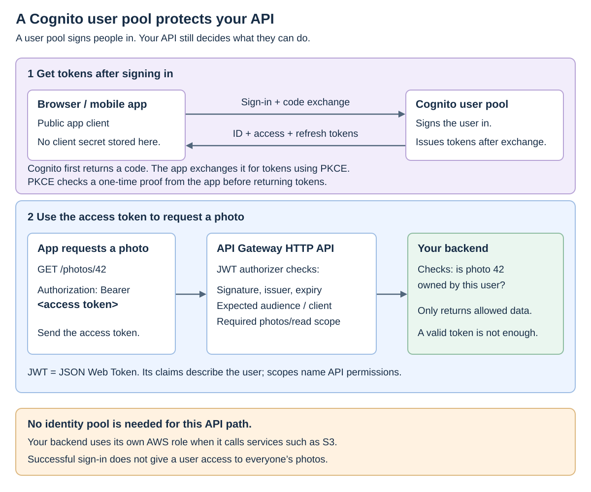
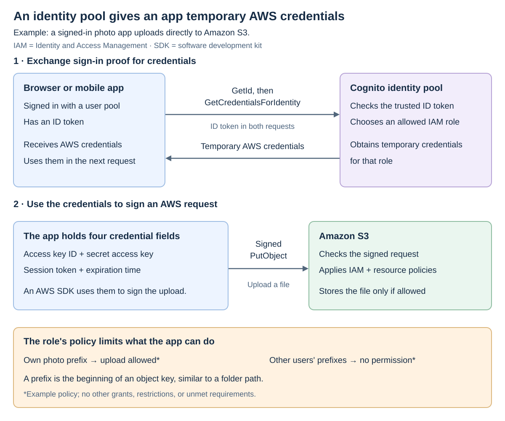

# Amazon Cognito

[Back to AWS](../Readme.md#content)

**Amazon Cognito helps people sign up and sign in to your application. Its user pools issue sign-in tokens; its identity pools provide temporary AWS credentials.** These are different jobs, and an application does not always need both.

Imagine a photo app. Users must sign in before viewing private photos. The app might call your backend to fetch them, or it might upload files directly to Amazon S3. This article explains what Cognito provides in each design, which token belongs where, and where permission checks happen.

## Two kinds of pool, two different outputs

**Authentication** answers “Who is this person?” **Authorization** answers “What may this person do?” Signing in establishes an identity. Your application and AWS permissions still control access to data.

The **backend** is your app's server-side code. Its **API (application programming interface)** gives the browser or mobile app a way to request data or actions.

| Component | Its job | What the app receives |
|---|---|---|
| **User pool** | Maintains a user directory and signs people in, directly or through another login provider. | Tokens describing the user and permitted API access. |
| **Identity pool** | Connects a trusted sign-in identity to an AWS Identity and Access Management (IAM) role. It can also support guest access when enabled. | Temporary AWS credentials for that role. |

An **IAM role** supplies permissions for AWS actions, such as uploading an object to an S3 bucket. A Cognito user is not automatically an IAM user, and creating a user pool does not give its users AWS account access.

## A user pool is your application's sign-in service

A user pool stores user accounts and attributes, such as an email address. It can handle registration, sign-in, account confirmation, password recovery, and configured security checks.

Users can sign in directly or through an external **identity provider**, such as Google, Apple, or a company's login system. This is called **federation**: the user pool accepts sign-in proof from another trusted provider and issues its own tokens for your app. Your backend can then work with Cognito tokens regardless of which configured provider the user chose.

You can use Cognito's hosted **managed login** pages or build a custom interface with supported authentication libraries and APIs. Managed login requires a user-pool domain and an app client. Available login features depend on the pool's feature plan.

### What is an app client?

An **app client** is a configuration inside a user pool for one of your applications. It defines settings such as allowed login providers, callback addresses, authentication flows, and token lifetimes. One user pool can have several app clients, for example for a website and a mobile app.

A **public client**, such as browser JavaScript or an installed mobile app, cannot safely keep a client secret. A **confidential client**, such as a server application, can keep a secret on its server. Do not put a confidential client's secret into a browser bundle or mobile package.

The **callback address** is where Cognito sends the user after sign-in. Register the expected addresses in the app client's configuration.

## Calling your own API with a user pool

In the photo app below, the browser signs the user in, receives tokens, and sends an **access token** to an Amazon API Gateway HTTP API. API Gateway validates the token and required scope. The backend then checks whether the requested photo belongs to the user. Read the purple sign-in section first, then the blue request section.

This design needs no identity pool. The backend can use its own IAM role to read files from S3. The browser does not need AWS credentials just because the backend stores data in AWS.

### The authorization code comes before the tokens

For this browser or mobile example, use the **authorization-code flow with PKCE**, meaning **Proof Key for Code Exchange**. It protects the exchange if someone intercepts the returned code.

The app creates a random verifier and sends a derived challenge when it starts sign-in. After successful authentication, Cognito redirects back with a short-lived authorization code. The app exchanges that code together with its original verifier for tokens. Cognito checks that the verifier matches the earlier challenge before returning them.

The authorization code is therefore an intermediate result. It is not the access token that the app sends to the photo API.

### The three tokens have different purposes

| Token | What it means | Example use |
|---|---|---|
| **ID token** | Information about the signed-in user, including their stable user-pool identifier, `sub`, and permitted profile attributes. | Identify the user in the app; provide sign-in proof to a configured identity pool. |
| **Access token** | Authorization information for API calls, including granted scopes. | Call the photo API with permission to read photos. |
| **Refresh token** | Allows the app to obtain new ID and access tokens without asking the user to sign in again, while it remains valid. | Renew an expired access token. |

ID and access tokens are signed **JSON Web Tokens (JWTs)**. A **claim** is a named piece of information inside one, such as its issuer or expiration time. The signature lets a recipient detect tampering; it does not hide the token's contents. Treat tokens as sensitive and send them over HTTPS.

A **scope** names a permitted operation or category of operations. In this example, `photos/read` is a custom scope configured for the photo API. It must be allowed for the app client and requested during authorization. It is not automatically present just because the user signed in.

The app sends its access token in an HTTP header: `Authorization: Bearer <access-token>`. It keeps the refresh token for token renewal rather than sending it to the photo API.

### A valid token still needs permission checks

Decoding a JWT only reads its contents. It does not prove that Cognito issued it.

When your own backend verifies Cognito access tokens, use a maintained JWT verification library and check the signature, expiration, expected user pool, intended client, `token_use: access`, and required permissions. ID tokens identify the app client through `aud`; access tokens use `client_id` and can also contain an `aud` audience when resource binding is used.

API Gateway's native HTTP API JWT authorizer checks the signature, issuer, audience or client ID, time claims, and configured route scopes. Require the appropriate scope on protected routes. The authorizer does not distinguish ID and access tokens by checking Cognito's `token_use` claim; scope checks help ensure the route receives a token intended for API authorization.

Finally, the backend must enforce the app's data rules. A valid token with `photos/read` does not mean “read every user's photos.” For `GET /photos/42`, the backend should check ownership or an explicit sharing permission using the verified identity.

## Calling AWS directly with an identity pool

Suppose the browser should upload photos directly to S3 using the AWS SDK, a **software development kit**. An identity pool can supply temporary credentials with limited permission for that upload. In this example, the browser already has a user-pool ID token. Follow the credential exchange first, then the separate request from the app to S3.

In the common **enhanced authentication flow**, the app supplies its user-pool **ID token** to `GetId` to obtain an identity-pool identity ID. It then supplies that identity ID and the login token to `GetCredentialsForIdentity`. The identity pool checks the trusted login, chooses an allowed role, and returns credentials. An SDK credential provider can handle these calls for the app.

Cognito obtains the credentials through **AWS Security Token Service (STS)**. In this enhanced flow, the app does not need to make a separate STS call itself. The user pool has not issued an “STS token”: the ID token and the resulting AWS credentials are different things.

The returned credentials include an **access key ID**, **secret access key**, **session token**, and **expiration time**. The SDK uses them to sign AWS requests. They expire and must be renewed when needed. The identity pool is not forwarding the photo upload; the app makes that request directly to S3.

### Limit the role to the resources the user needs

Configure the role's **trust policy** to accept the intended identity pool and authentication state. Its **permissions policies** then control allowed AWS actions and resources. Trust decides who can assume a role; permission decides what the resulting credentials can do.

For the photo example, you could allow `s3:PutObject` only under that user's photo prefix—a chosen beginning of an object key, similar to a folder path. Access to other users' prefixes should not be granted. This separation must be implemented in policy; Cognito does not infer it from your folder names.

The identity pool's identity ID differs from the user's `sub` in the user pool. In IAM policies, `cognito-identity.amazonaws.com:sub` refers to the **identity-pool identity ID**. Do not mix the two identifiers when building per-user resource paths.

### An identity pool can work without a user pool

An identity pool can trust a supported external provider directly. For example, an app with an existing supported login system might use it to obtain AWS credentials without adding a Cognito user directory.

Identity pools can also issue credentials to **unauthenticated guests** if guest access is enabled. Give the guest role only the permissions the app needs before sign-in. Guest credentials still have permissions and expiry; they do not mean unrestricted public access.

## Current login options and session behavior

User pools offer **Lite**, **Essentials**, and **Plus** feature plans. Essentials is the default for new pools. Managed login, passkeys, passwordless email or SMS one-time-code sign-in, and email multi-factor authentication require Essentials or Plus. The classic hosted login interface and SMS or authenticator-app multi-factor authentication are available across the three plans.

**Multi-factor authentication (MFA)** adds assurance beyond a single authentication factor. **Passkeys** use a cryptographic credential on an authenticator rather than a password typed into the app. Choose supported sign-in and MFA settings together; the options are configurable, not automatically enabled by creating a pool. Plus adds threat-protection capabilities, such as risk evaluation of sign-in attempts.

Refresh-token rotation can issue a new refresh token each time the app refreshes. The replacement keeps the remaining lifetime of the original refresh token; rotation does not extend the session forever.

Logout also needs careful handling. Revoking tokens in Cognito prevents their use in the relevant Cognito operations, but a revoked JWT can still pass an ordinary offline signature-and-expiration check. If your API must reject a session immediately after logout or an account action, it needs a revocation-aware check in addition to basic JWT verification. Do not assume that a valid signature proves the session is still active.

## Where Cognito stops

Cognito provides sign-in and identity-related access mechanisms. Your application still defines business rules, such as who may share a photo or delete an album. AWS resource access still depends on IAM and other applicable resource controls.

**Cognito Sync** is a separate legacy data-synchronization service. It is closed to new customers; existing workloads can continue, but AWS is not developing new features for it. AWS points users toward AppSync or DynamoDB alternatives. Adding Cognito sign-in does not automatically synchronize application data across devices.

For the surrounding services, see [IAM](../AWS%20IAM/Readme.md), [API Gateway](../Amazon%20API%20Gateway/Readme.md), and [Amazon S3](../Amazon%20S3/Readme.md).

# Sources

- [AWS: What is Amazon Cognito?](https://docs.aws.amazon.com/cognito/latest/developerguide/what-is-amazon-cognito.html)
- [AWS: Amazon Cognito user pools](https://docs.aws.amazon.com/cognito/latest/developerguide/cognito-user-pools.html)
- [AWS: App clients](https://docs.aws.amazon.com/cognito/latest/developerguide/user-pool-settings-client-apps.html)
- [AWS: Authorization-code grants with PKCE](https://docs.aws.amazon.com/cognito/latest/developerguide/using-pkce-in-authorization-code.html)
- [AWS: ID tokens](https://docs.aws.amazon.com/cognito/latest/developerguide/amazon-cognito-user-pools-using-the-id-token.html)
- [AWS: Access tokens](https://docs.aws.amazon.com/cognito/latest/developerguide/amazon-cognito-user-pools-using-the-access-token.html)
- [AWS: Refresh tokens and rotation](https://docs.aws.amazon.com/cognito/latest/developerguide/amazon-cognito-user-pools-using-the-refresh-token.html)
- [AWS: Verifying JSON web tokens](https://docs.aws.amazon.com/cognito/latest/developerguide/amazon-cognito-user-pools-using-tokens-verifying-a-jwt.html)
- [AWS: API Gateway HTTP API JWT authorizers](https://docs.aws.amazon.com/apigateway/latest/developerguide/http-api-jwt-authorizer.html)
- [AWS: Identity-pool authentication flow](https://docs.aws.amazon.com/cognito/latest/developerguide/authentication-flow.html)
- [AWS: GetCredentialsForIdentity](https://docs.aws.amazon.com/cognitoidentity/latest/APIReference/API_GetCredentialsForIdentity.html)
- [AWS: Temporary credential fields](https://docs.aws.amazon.com/cognitoidentity/latest/APIReference/API_Credentials.html)
- [AWS: IAM roles for identity pools](https://docs.aws.amazon.com/cognito/latest/developerguide/iam-roles.html)
- [AWS: Identity pools and guest access](https://docs.aws.amazon.com/cognito/latest/developerguide/identity-pools.html)
- [AWS: User-pool feature plans](https://docs.aws.amazon.com/cognito/latest/developerguide/cognito-sign-in-feature-plans.html)
- [AWS: Token revocation](https://docs.aws.amazon.com/cognito/latest/developerguide/token-revocation.html)
- [AWS: Cognito Sync availability change](https://docs.aws.amazon.com/cognito/latest/developerguide/cognito-sync-availability-change.html)
