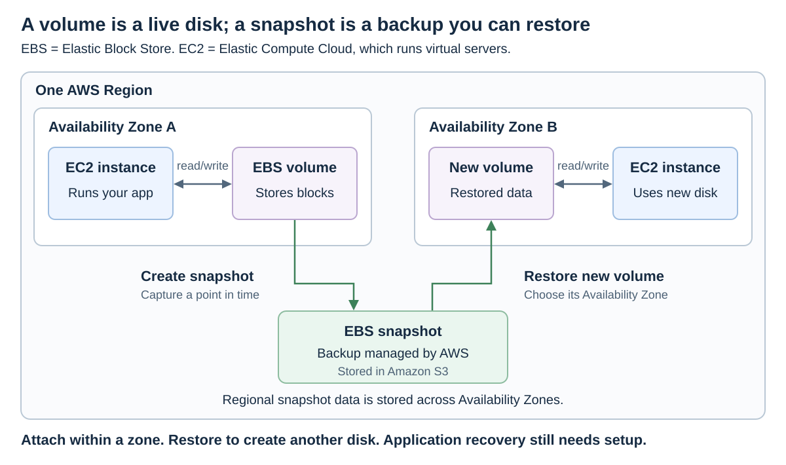
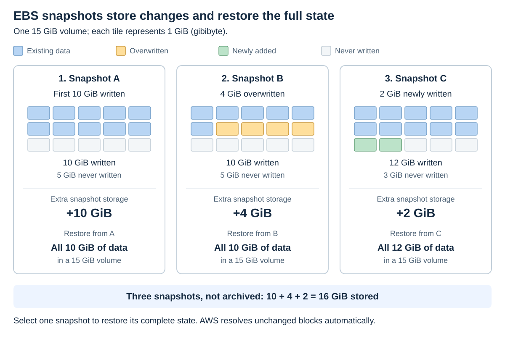

# Amazon Elastic Block Store (EBS)

[Back to AWS](../Readme.md#content)

**Amazon Elastic Block Store (EBS) provides persistent disks for Amazon Elastic Compute Cloud (EC2) virtual servers.** An EBS **volume** is a live disk that an instance reads and writes. An EBS **snapshot** is a backup of that disk at a particular point in time.

Use EBS when an application needs a disk for its operating system, files, or database. To use it well, understand where the volume lives, what controls its performance, and how to recover its data.

## What “block storage” means

EBS presents a **block device** to the instance: storage that software can read or overwrite in pieces called blocks. The operating system can put a **file system** on that device to organize those blocks into files and directories. EBS itself does not manage your folders or understand your database tables.

An instance can have several volumes. The **root volume** contains the operating system used to boot it. Additional **data volumes** might hold a database or application files.

For a new, empty data volume, attaching it is only part of the job. The operating system must recognize the device; you normally create a file system and **mount** it, making it accessible at a location such as `/data`. A volume restored from a snapshot usually already has its file system. Formatting that restored disk again would overwrite the data you want to recover.

## A volume belongs to one Availability Zone

An AWS **Region** is a geographic area containing several **Availability Zones (AZs)**, which are separate infrastructure locations. A volume and the instance attached to it must be in the **same AZ**. The volume is separate from the instance's host and is accessed over the network.

In the diagram, the left instance uses a volume in the same Availability Zone. The snapshot below it provides a way to create a separate volume in the other zone.

AWS replicates a volume's data across multiple storage servers **within its AZ** to protect against individual component failures. That does not make the volume accessible from another AZ or create an application replica there.

A regional snapshot is stored across AZs in its Region. You can restore it to a new volume in any AZ in that Region. To use a snapshot in another Region, copy it there first. The restored volume is independent of the original; it does not keep receiving later changes from it.

### Persistent does not mean impossible to delete

| What happens | What happens to EBS data |
| --- | --- |
| Reboot, stop, or start the instance | The EBS volume keeps its data. |
| Detach a data volume | The volume still exists and can be attached to a suitable instance in the same AZ. Unmount it cleanly before detaching. |
| Terminate the instance | Each attachment's `DeleteOnTermination` setting determines whether its volume is deleted. |
| Delete a volume | The live disk is removed. Existing snapshots remain available. |

`DeleteOnTermination=true` deletes the volume when the instance terminates. `false` preserves it. Root volumes normally default to deletion; data-volume defaults vary with how they were created and attached. **Check the setting on each attachment.** Preserved or unattached volumes still cost money.

## Capacity, IOPS, and throughput are different

Three settings describe different needs:

- **Capacity:** how much the disk can hold, measured in gibibytes (**GiB**) or tebibytes (**TiB**).
- **IOPS — input/output operations per second:** how many storage reads and writes can be completed each second.
- **Throughput:** how much data can move each second, usually measured in mebibytes per second (**MiB/s**).

One TiB is 1,024 GiB; one GiB is 1,024 MiB; one MiB is 1,024 kibibytes (**KiB**). **Latency** is the time one operation takes. A database making many small reads may care most about IOPS and latency. A large sequential file scan may care most about throughput.

### A small example

Suppose a volume is configured for **3,000 IOPS and 125 MiB/s**. Assume enough work is queued, the EC2 instance can keep up, and each request counts as one storage operation:

| Operation size | Calculation | First limit reached |
| --- | --- | --- |
| 4 KiB random reads | `3,000 × 4 / 1,024 ≈ 11.7 MiB/s` | IOPS: many tiny operations use little bandwidth. |
| 256 KiB reads | `125 × 1,024 / 256 = 500 operations/s` | Throughput: 500 larger operations already use 125 MiB/s. |

These are capacity calculations, not promised benchmark results. EBS can merge sequential requests or split large requests. Application behavior, operating-system caching, and the instance's own EBS limits also affect observed performance. Buying more volume IOPS will not help if the instance's EBS connection is already the bottleneck.

## Choosing a volume type

**Solid-state drives (SSDs)** suit frequent, small reads and writes. **Hard disk drives (HDDs)** suit large, sequential transfers where low cost matters more than fast random access.

| Type | Sensible use | Main distinction |
| --- | --- | --- |
| **`gp3` — General Purpose SSD** | Most boot disks, application disks, and general-purpose database storage. | Set capacity, IOPS, and throughput separately within the supported limits. |
| **`gp2` — General Purpose SSD** | Existing workloads using the older general-purpose type. | Performance depends on volume size; smaller volumes can use burst credits. |
| **`io2` Block Express — Provisioned IOPS SSD** | Demanding databases needing sustained performance and low latency. | Higher performance limits and higher designed durability than general-purpose volumes. |
| **`io1` — Provisioned IOPS SSD** | Existing provisioned-IOPS workloads. | An older option; consider `io2` for new demanding workloads. |
| **`st1` — Throughput Optimized HDD** | Frequently accessed, large sequential datasets. | Optimized for throughput; cannot be a boot volume. |
| **`sc1` — Cold HDD** | Infrequently accessed, large sequential datasets. | Lower-cost HDD storage; cannot be a boot volume. |

Magnetic `standard` volumes are a previous-generation option.

### What gp3 gives you

In AWS Regions, a gp3 volume includes **3,000 IOPS and 125 MiB/s** in its storage price. It does not depend on burst credits. Additional provisioned performance costs extra.

The supported range is **1 GiB–64 TiB**, with up to **80,000 IOPS** and **2,000 MiB/s**. These maxima have prerequisites:

- 80,000 IOPS requires a volume of at least **160 GiB**, following the 500 IOPS-per-GiB limit for additional IOPS.
- 2,000 MiB/s requires at least **8,000 provisioned IOPS** and **16 GiB**, following the throughput limit of 0.25 MiB/s per provisioned IOPS.

The EC2 instance must also support the requested performance. AWS Outposts, which runs AWS infrastructure on premises, has lower gp3 limits: 16 TiB, 16,000 IOPS, and 1,000 MiB/s.

**Durability** describes protection against data loss; **availability** describes whether data can be accessed. AWS's volume durability figures are not uptime percentages. Neither high durability nor within-AZ replication replaces a backup.

## Snapshots save changed blocks, but restore a complete point in time

The first snapshot saves the blocks written to the volume. Later snapshots of that volume normally store only blocks that are new or changed. This is an **incremental backup**.

Read the diagram from left to right. The volume has 15 GiB of capacity throughout. Overwriting 4 GiB changes data without increasing the amount currently stored on the disk; adding 2 GiB does increase it.

Snapshot A stores 10 GiB. Snapshot B adds 4 GiB of changed blocks. Snapshot C adds another 2 GiB. Retaining all three in the **standard tier** (ordinary, non-archived snapshots) uses **16 GiB of snapshot data** in this simplified example, while C can restore the full **12 GiB** of data present at its capture time.

You choose the snapshot you want to restore. **AWS manages the references to unchanged blocks; you do not rebuild a chain of backups yourself.** Deleting an older snapshot does not break later snapshots. AWS keeps blocks still referenced by a retained snapshot, so deleting one snapshot may free less space than you expect.

Snapshot storage reflects backed-up block data, not the volume's provisioned capacity. Deleting a file from the live volume does not erase it from earlier snapshots.

EBS snapshots are stored in Amazon Simple Storage Service (**S3**) buckets managed by AWS. You manage them through EBS/EC2 interfaces, not as ordinary files in a bucket you can browse. AWS does not automatically create your EBS backups: schedule snapshots with **Amazon Data Lifecycle Manager** or **AWS Backup**, or create them yourself.

### A snapshot is not automatically a consistent database backup

Snapshots capture data written to the volume at the time of the request. Data still buffered in application memory or the operating system may not be included.

For an application-consistent backup, coordinate with the application: flush buffered data and pause writes, or use a supported application-aware backup method. Applications using several volumes may also need a coordinated multi-volume snapshot. For a root-volume snapshot, AWS recommends stopping the instance first.

Snapshot creation is asynchronous. The backup stays `pending` while data is transferred, and becomes `completed` afterward. Its contents still reflect the capture point, not every write made while that transfer was running.

### Restoring does not always mean full speed immediately

Restoring creates a **new volume**, which you attach and use in place of the old one. A snapshot is not a running disk that you attach directly.

Blocks restored from snapshots must be loaded into the volume. Until initialization finishes, reads can have higher latency. For predictable preparation, AWS offers a **Provisioned Rate for Volume Initialization** of 100–300 MiB/s. **Fast snapshot restore**, when enabled and ready for the chosen snapshot and AZ, lets eligible restored volumes deliver full performance immediately. Both are paid options. Reading the volume's blocks to initialize it manually is another option.

A backup plan therefore needs a restore test: can the application use the recovered data, and how long does it take to become ready?

## Growing a disk and protecting it

**Elastic Volumes** lets supported instances change a volume's type or performance and increase its size without detaching it or restarting the instance. After increasing capacity, extend the partition if there is one and grow the file system too. Otherwise, the application may still see the old amount of usable space.

You cannot shrink an EBS volume in place. To move to a smaller disk, create a smaller volume and copy the data using an appropriate file or application tool.

### Encryption

EBS encryption uses **AWS Key Management Service (KMS)** keys. It protects data at rest and data moving between EC2 and its attached EBS volume. Applications use the disk normally; encryption and decryption are handled for them.

You can enable **encryption by default** for each account and Region. It affects newly created volumes and snapshot copies, not existing unencrypted resources. To encrypt an existing unencrypted volume, one supported route is to snapshot it and create a **new encrypted volume** from that snapshot.

Snapshots of encrypted volumes are encrypted. You cannot remove encryption through an EBS setting, and the required KMS permissions must remain available for operations such as restoring and attaching encrypted storage.

## EBS compared with other storage

| Storage | What the application gets | Typical reason to choose it |
| --- | --- | --- |
| **EBS** | A persistent block device attached to EC2. | A boot disk, database disk, or application disk. |
| **Instance store** | Temporary storage on the instance's host. | Scratch space or data that can be recreated. Data is lost on stop, hibernation, or termination. |
| **Amazon Elastic File System (EFS)** | A shared file system that multiple Linux clients can mount. | Several servers need the same files. |
| **S3** | Objects accessed through service requests. | Files, media, backups, and datasets stored as objects. |

EBS usually serves one instance per volume. **Multi-Attach** is a specialized exception for qualifying `io1` and `io2` volumes, supporting up to 16 compatible EC2 instances in the same AZ. It provides shared access to blocks, not a ready-made shared file system. Ordinary file systems such as ext4 or XFS are not designed for concurrent access from several servers. Use software that coordinates those writes, or choose shared file storage when that is what the application needs.

You pay for provisioned volume capacity even if the disk is mostly empty or the instance is stopped. Provisioned performance and snapshot storage can add separate charges. Choose the capacity and performance the workload needs, and retain backups deliberately.

# Sources

- [AWS: What is Amazon EBS?](https://docs.aws.amazon.com/ebs/latest/userguide/what-is-ebs.html)
- [AWS: EBS volumes and Availability Zone constraints](https://docs.aws.amazon.com/ebs/latest/userguide/ebs-volumes.html)
- [AWS: Preparing a volume for use](https://docs.aws.amazon.com/ebs/latest/userguide/ebs-using-volumes.html)
- [AWS: Preserving volumes on instance termination](https://docs.aws.amazon.com/AWSEC2/latest/UserGuide/preserving-volumes-on-termination.html)
- [AWS: Instance state changes](https://docs.aws.amazon.com/AWSEC2/latest/UserGuide/ec2-instance-lifecycle.html) and [detaching a volume](https://docs.aws.amazon.com/ebs/latest/userguide/ebs-detaching-volume.html)
- [AWS: Storage options for EC2](https://docs.aws.amazon.com/AWSEC2/latest/UserGuide/Storage.html)
- [AWS: EBS volume types](https://docs.aws.amazon.com/ebs/latest/userguide/ebs-volume-types.html)
- [AWS: General Purpose SSD volumes, including gp3 limits](https://docs.aws.amazon.com/ebs/latest/userguide/general-purpose.html)
- [AWS: I/O characteristics](https://docs.aws.amazon.com/ebs/latest/userguide/ebs-io-characteristics.html) and [EC2 EBS performance limits](https://docs.aws.amazon.com/AWSEC2/latest/UserGuide/ebs-optimized.html)
- [AWS: EBS snapshots](https://docs.aws.amazon.com/ebs/latest/userguide/ebs-snapshots.html) and [how incremental snapshots work](https://docs.aws.amazon.com/ebs/latest/userguide/how_snapshots_work.html)
- [AWS: Deleting snapshots](https://docs.aws.amazon.com/ebs/latest/userguide/ebs-deleting-snapshot.html)
- [AWS: Creating consistent snapshots](https://docs.aws.amazon.com/ebs/latest/userguide/ebs-creating-snapshot.html)
- [AWS: Replacing a volume from a snapshot](https://docs.aws.amazon.com/ebs/latest/userguide/ebs-restoring-volume.html) and [copying snapshots between Regions](https://docs.aws.amazon.com/ebs/latest/userguide/ebs-copy-snapshot.html)
- [AWS: Volume initialization](https://docs.aws.amazon.com/ebs/latest/userguide/initalize-volume.html)
- [AWS: Elastic Volumes](https://docs.aws.amazon.com/ebs/latest/userguide/ebs-modify-volume.html) and [extending the file system](https://docs.aws.amazon.com/ebs/latest/userguide/recognize-expanded-volume-linux.html)
- [AWS: EBS encryption](https://docs.aws.amazon.com/ebs/latest/userguide/ebs-encryption.html), [encryption by default](https://docs.aws.amazon.com/ebs/latest/userguide/encryption-by-default.html), and [KMS permissions](https://docs.aws.amazon.com/ebs/latest/userguide/ebs-encryption-requirements.html)
- [AWS: EBS Multi-Attach](https://docs.aws.amazon.com/ebs/latest/userguide/ebs-volumes-multi.html)
- [AWS: EBS pricing](https://aws.amazon.com/ebs/pricing/)
