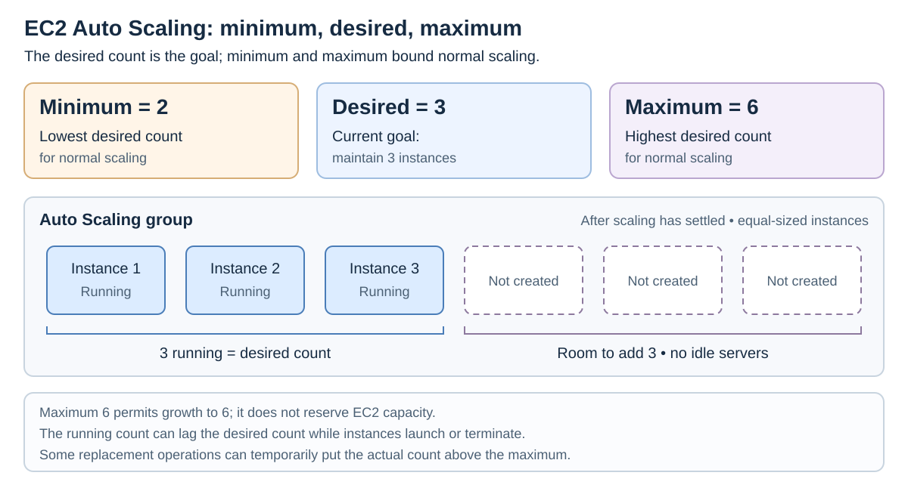
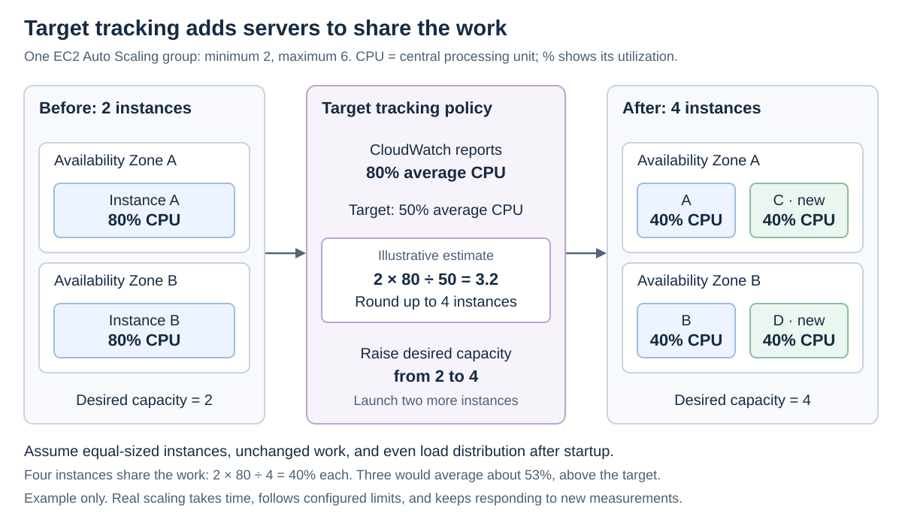

# Amazon EC2 Auto Scaling

[Back to AWS](../Readme.md#content)

**Amazon EC2 Auto Scaling maintains a group of servers and can add or remove servers as demand changes.** It also replaces unhealthy instances. These are two separate jobs: keeping the requested capacity available, and changing how much capacity you request.

Imagine an online shop running on [Amazon Elastic Compute Cloud (EC2)](../Amazon%20EC2/Readme.md) instances. It needs more servers during a sale and fewer overnight. An **Auto Scaling group (ASG)** manages those instances together. This article explains its capacity settings, scaling decisions, and how it works with a load balancer.

## Minimum, desired, and maximum mean different things

In this example, all instances have equal capacity, and the group measures capacity as an instance count.

| Setting | Meaning | Example |
| --- | --- | --- |
| **Minimum** | The lower limit for desired capacity. | `2`: ordinary scaling policies cannot reduce the target below two instances. |
| **Desired** | The number the group currently tries to maintain. | `3`: launch or replace instances as needed to reach three. |
| **Maximum** | The upper limit for desired capacity under ordinary scaling policies. | `6`: demand-based scaling can increase the target up to six. |

The diagram shows a settled group at its desired capacity. The dashed spaces are possible additions, not servers that are already running or reserved.

**Desired capacity can change.** If a policy raises it from three to five, Auto Scaling tries to launch two more instances. If one of the three instances fails while desired capacity stays at three, Auto Scaling replaces that instance instead of changing the target.

Actual capacity can lag behind desired capacity while instances launch, fail, or terminate. The maximum is also not an absolute cap on every temporary instance count: operations such as Availability Zone rebalancing can briefly exceed it. Setting a maximum does not reserve EC2 capacity or guarantee that launches will succeed.

## Tell the group what to launch and where

A **launch template** is the recipe for new instances. It can specify an **Amazon Machine Image (AMI)**, which supplies the starting operating system and software, plus an instance type, storage, **security groups** (network access rules), and startup instructions called **user data**.

Use launch templates for new designs. They support versions and modern Auto Scaling features. The older **launch configuration** is not required: it does not support new EC2 instance types introduced from 2023 onward, and accounts created on or after 1 October 2024 cannot create new launch configurations by any method.

The group also specifies the subnets where instances can run. An **Availability Zone (AZ)** is an isolated location within an AWS Region; each subnet belongs to one AZ. Choose subnets across multiple AZs so the application does not depend on one zone. Auto Scaling tries to distribute capacity across the chosen zones. See [Amazon VPC](../Amazon%20VPC/Readme.md) for the network layout.

Updating a launch template does not rewrite the software on existing instances. To roll out a new version, you can use an **instance refresh** with rolling replacements. It replaces instances in batches according to configured health and replacement limits; those settings determine whether new instances launch before old ones terminate.

## How a target tracking policy adds capacity

**Scale out** means add instances; **scale in** means remove instances. These are changes to the number of servers, rather than making one server larger.

**Amazon CloudWatch** collects measurements called metrics. A **target tracking policy** uses a metric and a target value, such as average **central processing unit (CPU)** utilization of 50%. EC2 Auto Scaling manages the associated CloudWatch alarms and adjusts desired capacity when the metric calls for a change.

Read the diagram from left to right. Two busy instances report an average of 80%. A simplified calculation suggests four instances could share the same work below the 50% target. The new instances take time to launch and become useful.

This is a teaching estimate, not AWS's exact scaling algorithm. It assumes equal-sized instances, unchanged work, and an even distribution of CPU-related load. Three instances would average about 53%; four would average about 40%. A result below 50% can therefore be sensible: you cannot launch a fraction of an instance.

Choose a metric that reflects work per unit of capacity. Average CPU can fit a CPU-bound application; load-balancer **requests per target** can fit a web service. Total incoming request count alone does not fall when you add servers, so it is unsuitable for target tracking. Scaling in is deliberately more cautious to avoid removing capacity too quickly.

## Choose how desired capacity changes

A group without a demand-based policy can still replace failed instances and maintain its desired capacity. It does not automatically infer how many servers the application needs.

| Method | What changes the target | Useful example |
| --- | --- | --- |
| **Manual** | You change desired capacity. | Temporarily run four servers for a test. |
| **Target tracking** | A metric moves away from a target value. | Keep average CPU near 50%. |
| **Step scaling** | An alarm triggers an adjustment based on how far a threshold was crossed. | Add more capacity for a large load increase than for a small one. |
| **Scheduled scaling** | A configured time changes desired capacity, minimum, maximum, or a combination. | Add capacity before a known morning rush. |
| **Predictive scaling** | Historical patterns forecast future demand. | Prepare for a recurring daily peak before traffic arrives. |

Scheduled actions and dynamic policies can work together. For example, raise the minimum before a sale, then let target tracking respond to the actual traffic. Schedule a later action to restore the normal minimum.

EC2 predictive scaling needs at least 24 hours of historical metric data to start forecasting. **Forecast-only mode does not change capacity.** In forecast-and-scale mode, predictive scaling adds capacity but does not remove it when the forecast falls; combine it with dynamic scaling for scale-in. By default it respects the maximum, although an explicit option can allow it to raise that limit.

Older notes also describe **simple scaling**, which applies a fixed adjustment and then uses a cooldown. AWS recommends target tracking or step scaling instead for better scaling performance.

## Load balancing and instance replacement are separate

An [Application Load Balancer (ALB)](../AWS%20Elastic%20Load%20Balancing/Readme.md) receives requests and selects a server. The Auto Scaling group controls which instances exist. A **target group** is the collection of destinations that the load balancer can route to.

When you attach the ALB's target group to the Auto Scaling group, instances are registered and deregistered automatically as the group changes. A newly launched server must pass the load balancer's initial health check before receiving normal traffic.

EC2 health checks are enabled by default for an Auto Scaling group. **To replace instances because the load balancer reports them unhealthy, enable Elastic Load Balancing (ELB) health checks on the group too.** Attaching the target group alone does not enable that option. Application-aware checks are necessary to detect failures that basic infrastructure checks cannot see.

If one server fails while desired capacity remains four, the group tries to restore four working instances. That is a health replacement. If traffic grows and a policy raises desired capacity to six, that is scaling out.

## Give new instances time to become useful

Booting a server, starting the application, and stabilizing its resource use take time. The group uses the lifecycle state `InService` for an instance that has entered service; its application may still be initializing. These settings handle different parts of that process:

| Setting | Its job | What it does not mean |
| --- | --- | --- |
| **Health-check grace period** | Gives a new `InService` instance time to initialize before Auto Scaling replaces it for failing health checks. | It does not stop the load balancer's checks. An instance that stops running can still be replaced immediately. |
| **Default instance warmup** | Keeps startup usage out of the group's aggregated scaling metrics and blocks dynamic scale-in while new instances warm up. | It does not prove that the application is ready or prevent a healthy target from receiving traffic. |
| **Cooldown** | Mainly delays further actions from simple scaling policies so the previous change can take effect. | It is not a universal pause: target tracking and step scaling can scale out without waiting for it. |

Configure warmup from observed application behavior; the group's default instance warmup is not enabled automatically. A **lifecycle hook** can pause a launch or termination at a defined point so your automation can finish startup work or shutdown tasks.

## Design for servers to come and go

**Scale-in normally terminates instances.** It does not merely stop them for the next busy period. With a load balancer attached, deregistration gives existing requests time to finish, subject to the configured delay. Long-running work still needs an application-level shutdown and retry strategy.

As a design consequence, do not keep the only copy of an order or shopping cart on a replaceable server. Store durable application state separately, and make startup repeatable so a new instance can serve the same application. Auto Scaling launches from your configuration; it does not copy the current memory of another instance.

Watch scaling activity errors as well as instance counts. EC2 capacity shortages, account quotas, permissions, or an invalid launch template can prevent the group from reaching its target. A larger desired number also cannot fix a database bottleneck by itself.

EC2 Auto Scaling has no additional service fee, but the resources it uses—such as instances, storage, and CloudWatch alarms—still cost money. Maximum capacity is a scaling control, not a spending limit.

## The similar AWS names

The original Anki note combines related services. Keep their responsibilities separate:

| Name | What it manages |
| --- | --- |
| **Amazon EC2 Auto Scaling** | EC2 instances in Auto Scaling groups, including instance replacement. This article's focus. |
| **Application Auto Scaling** | Supported capacity settings in other services, such as an Amazon Elastic Container Service (ECS) service's task count, DynamoDB provisioned capacity, or Aurora replica count. |
| **AWS Auto Scaling scaling plans** | Scaling instructions grouped across supported resources. AWS documents how to migrate these plans to EC2 Auto Scaling and Application Auto Scaling policies. |

For example, increasing an ECS service's task count and increasing the number of EC2 servers underneath it are different scaling decisions. A scaling policy must control the resource that is actually running out of capacity.

## Check your understanding

- **Minimum 2, desired 3, maximum 6: how many servers should a settled group have?** Three. Six is room to grow, not six pre-created servers.
- **One server fails, but demand has not changed: must desired capacity increase?** No. Replacement restores the existing target.
- **Does attaching an ALB automatically enable replacement based on its health checks?** No. Enable ELB health checks on the Auto Scaling group.
- **Does a 50% CPU target promise exactly 50% at every moment?** No. Measurements, startup time, changing demand, and whole-instance rounding affect the result.

# Sources

- [AWS — What is Amazon EC2 Auto Scaling?](https://docs.aws.amazon.com/autoscaling/ec2/userguide/what-is-amazon-ec2-auto-scaling.html)
- [AWS — Auto Scaling groups](https://docs.aws.amazon.com/autoscaling/ec2/userguide/auto-scaling-groups.html)
- [AWS — Minimum, desired, and maximum capacity](https://docs.aws.amazon.com/autoscaling/ec2/userguide/asg-capacity-limits.html)
- [AWS — Launch templates](https://docs.aws.amazon.com/autoscaling/ec2/userguide/launch-templates.html)
- [AWS — Launch configuration restrictions](https://docs.aws.amazon.com/autoscaling/ec2/userguide/launch-configurations.html)
- [AWS — Multi-zone placement and temporary capacity during rebalancing](https://docs.aws.amazon.com/autoscaling/ec2/userguide/auto-scaling-benefits.html)
- [AWS — Instance refresh](https://docs.aws.amazon.com/autoscaling/ec2/userguide/instance-refresh-overview.html)
- [AWS — Dynamic scaling methods](https://docs.aws.amazon.com/autoscaling/ec2/userguide/as-scale-based-on-demand.html)
- [AWS — Target tracking metrics, rounding, and scale-in behavior](https://docs.aws.amazon.com/autoscaling/ec2/userguide/as-scaling-target-tracking.html)
- [AWS — Scheduled scaling](https://docs.aws.amazon.com/autoscaling/ec2/userguide/ec2-auto-scaling-scheduled-scaling.html)
- [AWS — Predictive scaling behavior and limits](https://docs.aws.amazon.com/autoscaling/ec2/userguide/predictive-scaling-policy-overview.html)
- [AWS — Load balancer integration](https://docs.aws.amazon.com/autoscaling/ec2/userguide/autoscaling-load-balancer.html)
- [AWS — Auto Scaling health checks](https://docs.aws.amazon.com/autoscaling/ec2/userguide/health-checks-overview.html)
- [AWS — ALB target health and initial health checks](https://docs.aws.amazon.com/elasticloadbalancing/latest/application/target-group-health-checks.html)
- [AWS — Health-check grace period](https://docs.aws.amazon.com/autoscaling/ec2/userguide/health-check-grace-period.html)
- [AWS — Default instance warmup](https://docs.aws.amazon.com/autoscaling/ec2/userguide/ec2-auto-scaling-default-instance-warmup.html)
- [AWS — Scaling cooldowns](https://docs.aws.amazon.com/autoscaling/ec2/userguide/ec2-auto-scaling-scaling-cooldowns.html)
- [AWS — Instance lifecycle, deregistration, and lifecycle hooks](https://docs.aws.amazon.com/autoscaling/ec2/userguide/ec2-auto-scaling-lifecycle.html)
- [AWS — Scale-out illustrations and termination behavior](https://docs.aws.amazon.com/autoscaling/ec2/userguide/as-instance-termination.html)
- [AWS — Instance launch failures](https://docs.aws.amazon.com/autoscaling/ec2/userguide/ts-as-instancelaunchfailure.html)
- [AWS — Application Auto Scaling](https://docs.aws.amazon.com/autoscaling/application/userguide/what-is-application-auto-scaling.html)
- [AWS — Scaling plans and their supported resources](https://docs.aws.amazon.com/AWSCloudFormation/latest/TemplateReference/aws-resource-autoscalingplans-scalingplan.html)
- [AWS — Migrating AWS Auto Scaling plans to native scaling policies](https://docs.aws.amazon.com/autoscaling/plans/userguide/migrate-scaling-plan.html)
