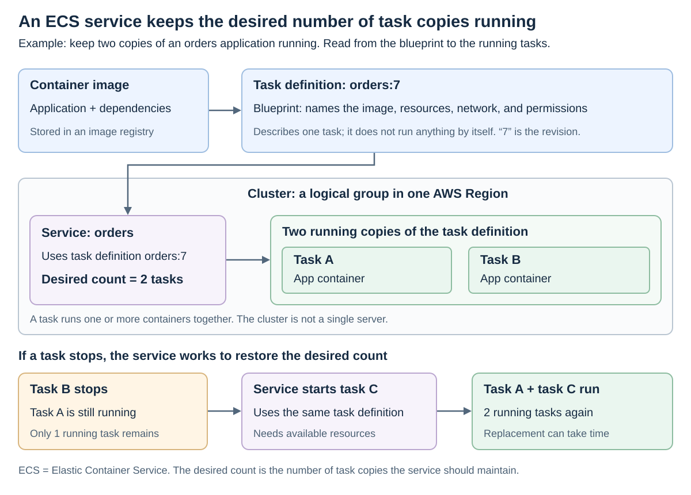
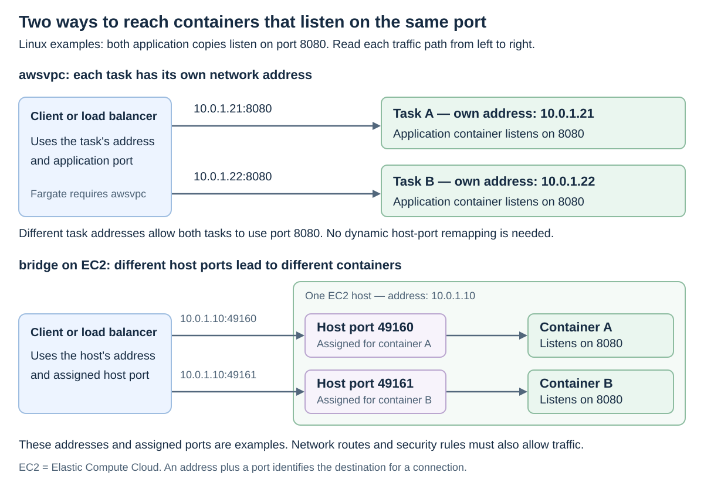

# Amazon Elastic Container Service (ECS)

[Back to AWS](../Readme.md#content)

**Amazon Elastic Container Service (ECS) runs and coordinates containerized applications.** You describe the containers and resources your application needs, then tell ECS to run a task or maintain a service. ECS schedules the work on your chosen compute capacity and manages the tasks' lifecycle.

The core idea is simple: a **task definition** describes what to run, a **task** is one copy of it, and a **service** works to keep the requested number of copies running. Next come the choices about compute, networking, scaling, and permissions.

## From an image to running tasks

A **container image** packages application code, libraries, and other files needed to run it. A **container** is a running process, or group of processes, created from that image with its own isolated environment. For example, an image might contain your orders application and its Java runtime.

Store images in a **registry**, such as Amazon Elastic Container Registry (**ECR**). ECR stores and distributes images; ECS uses those images to run your application. You build the image before deploying it.

| ECS term | Meaning | Orders application example |
| --- | --- | --- |
| **Task definition** | A versioned blueprint describing one or more containers, resource needs, networking, and other settings | `orders:7` describes the app image, memory, processor capacity, port, logging, and roles; `7` is the revision |
| **Task** | One instance of a task definition | Task A runs one copy of the orders app |
| **Service** | A controller that maintains a desired number of tasks | The orders service requests two task copies |
| **Cluster** | A logical group of tasks, services, and associated capacity in one AWS Region | The cluster contains the orders service and its tasks |

One task can contain an application container and a supporting **sidecar**, such as a telemetry collector. A sidecar is a helper container that runs alongside the application. Containers in one task are scheduled together; two tasks are two independently scheduled copies of that group.

Follow the diagram from the image and blueprint to the service and its tasks. The bottom row shows what happens when one task stops.

The task definition alone starts nothing. The service in this example uses `orders:7` and a **desired count** of two. If Task B stops, ECS works to launch a replacement. It still needs available compute capacity, working network access, and permission to start the task. Recovery takes time.

Use a **standalone task** for work that should run and finish, such as generating a report. Use a **service** for work that should keep running, such as a web application or queue worker. A standalone task does not have a service maintaining its task count.

## Choose where the containers run

ECS manages scheduling. The **compute option** supplies the processors, memory, and operating system on which the containers run. Fargate is one of these options for ECS.

| Compute option | Who manages the machines? | Main trade-off |
| --- | --- | --- |
| **AWS Fargate** | AWS provides the task's compute environment; you do not manage a fleet of EC2 hosts | You specify supported task resources and settings, with less control over the underlying machine |
| **Amazon EC2 instances you manage** | You manage the instance configuration, operating system, ECS agent, and capacity | Gives you direct control over the hosts, with more maintenance work |
| **Amazon ECS Managed Instances** | AWS provisions, scales, patches, and maintains EC2 instances for ECS | Provides EC2 hardware choices while AWS manages the host lifecycle; currently supports Linux containers |

**Amazon EC2** means Elastic Compute Cloud. An EC2 machine registered with ECS is called a **container instance**; it can host several tasks when resources and networking allow. An ECS cluster is therefore not necessarily one machine, and a Fargate cluster does not require you to create EC2 hosts.

A **capacity provider** connects ECS to a source of compute capacity. A capacity provider strategy selects where tasks should run. For example, an Auto Scaling group capacity provider connects ECS to a group of EC2 instances. ECS Managed Instances uses capacity providers and requires a capacity provider strategy.

ECS can also manage registered servers outside AWS through **ECS Anywhere**. The application still uses the ECS task model, but supported features depend on the compute environment. Choose the environment before assuming every task-definition setting will work there.

## A task needs resources and a network path

The task definition sets requirements such as processor capacity, memory, the image to start, and the port on which the app listens. **CPU** means central processing unit; in task sizing, it represents the processor capacity assigned to the workload. The selected image must match the operating system and processor architecture of the runtime.

With **`awsvpc` networking**, each task receives its own **Elastic Network Interface (ENI)**, a virtual network card, and a network address in your **Virtual Private Cloud (VPC)**, a network you control in AWS. Containers in the same task share that network context and can communicate through `localhost`. Separate tasks have separate task addresses.

**Fargate requires `awsvpc`.** EC2-hosted tasks can also use it. ECS Managed Instances supports `awsvpc` and `host` networking.

The diagram compares two Linux applications that both listen on port `8080`. The top example uses separate task addresses. The bottom example uses different ports on one EC2 host to reach different containers.

A **port** identifies the application endpoint at a network address. `containerPort` is the port on which the container's application listens. In **`bridge` mode**, `hostPort` exposes it through the EC2 host. Leaving `hostPort` unset, or setting it to `0`, lets ECS assign an available host port. The app can keep listening on `8080` even when callers reach it through host port `49160`.

In `awsvpc` and **`host` mode**, `hostPort` must be omitted or match `containerPort`; there is no dynamic host-port remapping. In `host` mode, containers use the host's network directly, so tasks exposing the same host port conflict.

These are not the only networking choices for every platform. Linux tasks on EC2 also support `none`, which has no external networking. Windows has its own supported modes. Check the modes for the operating system and compute option you use.

### Reaching the application

For a web service, an **Application Load Balancer (ALB)** can distribute requests among the service's tasks. ECS registers and removes targets as tasks start and stop. For tasks using `awsvpc`, the target group uses target type **`ip`**, because traffic goes to task network addresses.

Network reachability still needs configuration. Choose subnets and **security groups**, which are network traffic rules, that allow the intended connections. Tasks also need a path to pull images and reach services such as logging or secret storage. That path can use appropriate VPC endpoints or outbound internet access, depending on the dependencies.

For IPv4 internet access, putting a task in a public subnet is not enough by itself. Fargate can assign a public address when configured to do so; EC2-hosted `awsvpc` task interfaces do not receive public addresses. Private tasks commonly use a Network Address Translation (**NAT**) gateway for outbound internet access, or VPC endpoints for supported AWS services.

## Scaling the application and scaling its hosts are different jobs

**Service Auto Scaling** changes the service's desired task count through Application Auto Scaling. For example, it can increase the orders service from two tasks to four when a configured load metric rises. You choose the scaling policy and its limits.

**EC2 cluster auto scaling** changes the number of underlying EC2 instances through an Auto Scaling group capacity provider with managed scaling enabled. It supplies room for the tasks. Increasing the desired task count alone does not guarantee that more EC2 machines will appear.

For example, if four tasks are requested but the hosts can fit only two, the remaining work cannot start until suitable capacity becomes available. Fargate handles the underlying compute provisioning for its tasks, while ECS Managed Instances manages its EC2 capacity. Quotas, available capacity, and task configuration can still prevent launches.

### Placement rules on EC2

ECS first needs a host that can satisfy the task's resource requirements. Placement settings can then control which eligible host it chooses:

- A **constraint** is a required condition. For example, a `memberOf` expression can restrict tasks to hosts with matching attributes. If no host qualifies, ECS cannot place the task.
- A **strategy** is a best-effort preference. `spread` balances tasks across a chosen attribute, such as Availability Zone; `binpack` fills available processor capacity or memory more tightly; `random` chooses randomly among eligible hosts.

An **Availability Zone** is an isolated location within an AWS Region. Spreading a service across zones can reduce its dependence on one location. A placement strategy does not create the missing capacity. Fargate does not use these EC2 placement strategies or task-placement constraints.

## Give the application and ECS the right permissions

AWS Identity and Access Management (**IAM**) roles supply temporary credentials and permissions. Two similarly named roles do different jobs:

| Role | Who uses it? | Example permission |
| --- | --- | --- |
| **Task role** | Application code inside the task's containers | Read an order record from DynamoDB or an object from S3 |
| **Task execution role** | The ECS or Fargate agent, depending on the setup | Pull a private ECR image, send configured logs, or retrieve a secret referenced by the task definition |

Giving the execution role permission to read S3 does not give that permission to your application. Configure the task role for the application's AWS calls. On EC2, the container instance has an additional role for host-agent operations; do not confuse it with the task's application permissions.

Keep each role limited to its job. Avoid placing long-lived AWS access keys inside the image; task-role credentials are provided to the running containers.

## Deploy new versions and check whether they work

To change the task's image or configuration, register a new **task definition revision**, such as `orders:8`, and update the service to use it. Creating the revision does not update the service by itself.

With a **rolling deployment**, ECS replaces older tasks with new ones. The service's `minimumHealthyPercent` and `maximumPercent` settings control how many healthy tasks must remain and how many tasks may run during the transition. The deployment also needs enough resources to make progress.

Changing an image tag in the registry does not rewrite running containers. A new deployment starts new tasks using the selected image. Using an explicit image version or digest helps make the intended release clear; a **digest** identifies specific image content.

A task being **RUNNING** means its containers have started; it does not prove the application is serving useful responses. Configure **container health checks** in the task definition and, where appropriate, load balancer health checks. ECS monitors the container checks specified in the task definition, rather than automatically adopting every health check embedded in an image.

The service can replace unhealthy tasks. Replacement order depends on deployment settings and available capacity, so it cannot promise uninterrupted service. Supported configurations also offer optional **container restart policies**: these can restart an exited container inside the same task when their conditions are met. They are disabled by default, and differ from replacing the whole task.

## Keep important data outside a replaceable task

Treat a task as something that can stop and be replaced. Store durable application records in a suitable database or storage service, rather than relying on a task's temporary files surviving.

ECS also supports mounted storage. **Amazon Elastic File System (EFS)** provides shared files that can remain available to replacement tasks. **Amazon Elastic Block Store (EBS)** provides block storage, similar to a disk. Both have integrations for supported ECS configurations, including Fargate Linux; platform and deployment restrictions apply.

The EBS lifecycle needs particular care: the ECS-managed integration creates a **new volume per task**, optionally from a snapshot. It does not simply reattach any existing volume you choose. EBS volumes attached this way to **service-managed tasks are deleted when those tasks terminate**. Do not assume that attaching a durable storage product automatically makes that service's task data permanent.

## Observe the application as well as its tasks

Use service events and stopped-task details to investigate launch failures. A task that cannot pull its image, retrieve a secret, allocate resources, or pass a health check needs a configuration or application fix; repeated replacement alone will not solve it.

Configure the **`awslogs` log driver** to send container output to CloudWatch Logs. CloudWatch metrics and Container Insights can help show resource usage and application behavior. A **trace** follows a request across components and helps locate slow or failing calls.

For new tracing instrumentation, AWS recommends **OpenTelemetry**, a set of standards and tools for collecting telemetry. A collector can run as a sidecar when that fits the application. The AWS X-Ray software development kits and daemon entered maintenance mode on **February 25, 2026**, with releases limited to security fixes. OpenTelemetry can still send traces to X-Ray; the X-Ray service remains separate from the older instrumentation tools.

# Sources

- [Amazon ECS overview and compute options](https://docs.aws.amazon.com/AmazonECS/latest/developerguide/Welcome.html)
- [Docker: containers](https://docs.docker.com/get-started/docker-concepts/the-basics/what-is-a-container/)
- [Docker: container images](https://docs.docker.com/get-started/docker-concepts/the-basics/what-is-an-image/)
- [ECS task definitions](https://docs.aws.amazon.com/AmazonECS/latest/developerguide/task_definitions.html)
- [ECS clusters](https://docs.aws.amazon.com/AmazonECS/latest/developerguide/clusters.html)
- [ECS services and task replacement](https://docs.aws.amazon.com/AmazonECS/latest/developerguide/ecs_services.html)
- [Standalone tasks](https://docs.aws.amazon.com/AmazonECS/latest/developerguide/standalone-tasks.html)
- [ECS Managed Instances](https://docs.aws.amazon.com/AmazonECS/latest/developerguide/ManagedInstances.html)
- [Fargate task differences](https://docs.aws.amazon.com/AmazonECS/latest/developerguide/fargate-tasks-services.html)
- [EC2 task network modes](https://docs.aws.amazon.com/AmazonECS/latest/developerguide/task-networking.html)
- [Task networking with awsvpc](https://docs.aws.amazon.com/AmazonECS/latest/developerguide/task-networking-awsvpc.html)
- [Container and host port mappings](https://docs.aws.amazon.com/AmazonECS/latest/APIReference/API_PortMapping.html)
- [Application Load Balancers with ECS](https://docs.aws.amazon.com/AmazonECS/latest/developerguide/alb.html)
- [Outbound networking for ECS applications](https://docs.aws.amazon.com/AmazonECS/latest/developerguide/networking-outbound.html)
- [Service Auto Scaling](https://docs.aws.amazon.com/AmazonECS/latest/developerguide/service-auto-scaling.html)
- [EC2 cluster auto scaling](https://docs.aws.amazon.com/AmazonECS/latest/developerguide/cluster-auto-scaling.html)
- [Task placement strategies](https://docs.aws.amazon.com/AmazonECS/latest/developerguide/task-placement-strategies.html)
- [Task placement constraints](https://docs.aws.amazon.com/AmazonECS/latest/developerguide/task-placement-constraints.html)
- [Task IAM roles](https://docs.aws.amazon.com/AmazonECS/latest/developerguide/task-iam-roles.html)
- [Task execution IAM roles](https://docs.aws.amazon.com/AmazonECS/latest/developerguide/task_execution_IAM_role.html)
- [Container instance IAM role](https://docs.aws.amazon.com/AmazonECS/latest/developerguide/instance_IAM_role.html)
- [Task definition revisions](https://docs.aws.amazon.com/AmazonECS/latest/developerguide/update-task-definition-console-v2.html)
- [Rolling deployments and image resolution](https://docs.aws.amazon.com/AmazonECS/latest/developerguide/deployment-type-ecs.html)
- [Container health checks](https://docs.aws.amazon.com/AmazonECS/latest/developerguide/healthcheck.html)
- [Container restart policies](https://docs.aws.amazon.com/AmazonECS/latest/developerguide/container-restart-policy.html)
- [EFS volumes with ECS](https://docs.aws.amazon.com/AmazonECS/latest/developerguide/efs-volumes.html)
- [EBS volumes with ECS and their lifecycle](https://docs.aws.amazon.com/AmazonECS/latest/developerguide/ebs-volumes.html)
- [Container logs in CloudWatch](https://docs.aws.amazon.com/AmazonECS/latest/developerguide/using_awslogs.html)
- [OpenTelemetry collector as an ECS sidecar](https://docs.aws.amazon.com/AmazonECS/latest/developerguide/trace-data-containerdefinitions.html)
- [X-Ray and OpenTelemetry instrumentation](https://docs.aws.amazon.com/xray/latest/devguide/xray-sdk-migration.html)
