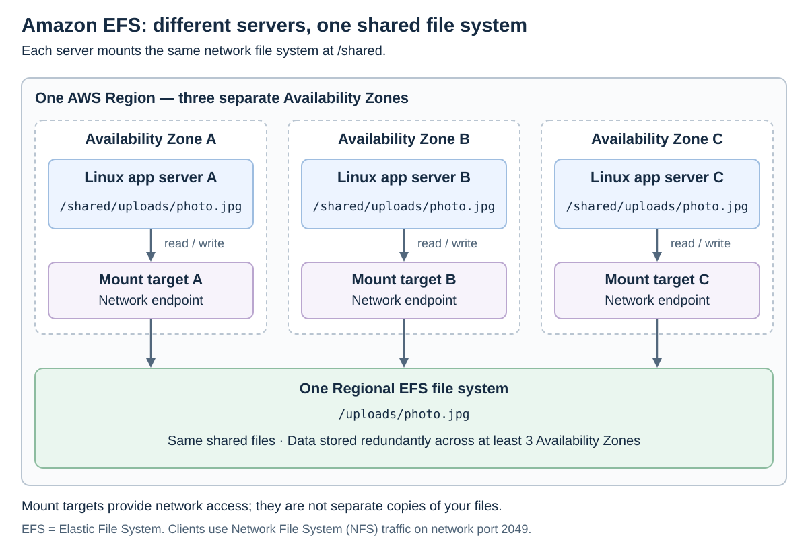
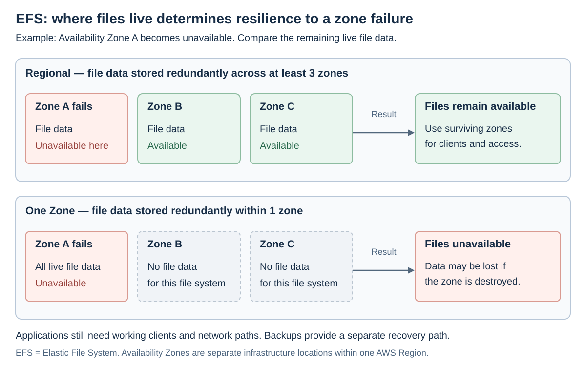

# Amazon Elastic File System (EFS)

[Back to AWS](../Readme.md#content)

**Amazon Elastic File System (EFS) is a shared file system that several applications or servers can use at the same time.** They read and write ordinary files and folders over a network. AWS runs the storage infrastructure, and the space used grows or shrinks as you add or remove files.

Think of a media application with several servers. Each server needs the same uploaded photos, even when a server is replaced. EFS gives those servers a common place to keep the files. To use it well, understand how clients connect, where the data lives, and how access, performance, and cost are controlled.

## One file system, many clients

A **client** is a machine or application environment using the file system. To **mount** a file system means to make it available at a local directory, such as `/shared`. Opening `/shared/uploads/photo.jpg` then accesses the file on EFS over the network.

EFS uses **Network File System (NFS)** version 4.1 or 4.0. This protocol lets a client work with remote files using familiar file operations. EFS supports Linux clients and integrations with containers and AWS Lambda. Microsoft Windows clients on **Amazon Elastic Compute Cloud (EC2)**, AWS's virtual server service, are not supported.

An **AWS Region** is a geographic area containing several **Availability Zones**, separate infrastructure locations. A **Virtual Private Cloud (VPC)** is a network you control in AWS. Inside that network, a **mount target** is the network endpoint through which clients reach EFS. It has a network address; it is not a separate copy of your file system.

In this example, each server uses a mount target in its own zone. All three paths lead to the same shared file system, so the application does not have to copy a photo separately to every server.

For a Regional file system, you can create **one mount target per Availability Zone**. Several subnets in the same zone can share it. Using a target in the client's own zone avoids unnecessary traffic between zones. Mount targets for one file system belong to one VPC at a time, but properly connected networks can also reach them.

Servers in your own data center can access EFS through private connectivity to the VPC, such as **AWS Direct Connect** or a **Site-to-Site VPN**, an encrypted network tunnel. Mount targets do not have public internet addresses.

### Sharing files does not coordinate your application

Suppose one server writes a photo and closes the file. Another server can then open that same file through its own mount. EFS follows NFS **close-to-open consistency**: closing a file and opening it on another client is the important boundary for seeing completed changes.

Two writers still need a way to avoid overwriting each other's work. EFS supports **advisory file locks**: cooperating applications can use them to coordinate access, but a lock does not automatically block every conflicting read or write. Replacing a server does not delete the EFS file system; deleting a shared file does affect the common data.

## Choose where the data lives

EFS offers two **file system types**. This choice controls resilience to a zone failure, separately from the storage classes used for individual files.

| Type | Where EFS stores the data | When it fits |
| --- | --- | --- |
| **Regional** | Redundantly across at least three Availability Zones in one Region | Shared data that must remain available if a zone fails; AWS's recommended choice |
| **One Zone** | Redundantly within one Availability Zone | Lower-cost storage when you can tolerate that zone being unavailable and recover the data if it is lost |

The diagram shows the effect of losing a storage zone. Regional EFS has data in other zones. A One Zone file system has no live EFS copy outside its selected zone.

One Zone has a single mount target in its storage zone. A client in another zone can connect to it, but that **does not turn it into Regional storage**. It adds traffic between zones and still depends on the original zone. A serious disaster affecting that zone can destroy the data.

Regional storage also needs a working application: clients, mount targets, network paths, and permissions in surviving zones. EFS does not move your application servers for you. Backups remain necessary for accidental deletion or unwanted changes.

## Control both the connection and the files

Access has several layers. Passing one layer does not bypass the others.

| Layer | What it controls | Example |
| --- | --- | --- |
| **Network rules** | Whether the client can reach a mount target | Security groups, which act as network firewalls, allow the client's outbound and target's inbound NFS connection on TCP port `2049` |
| **AWS Identity and Access Management (IAM)** | Which AWS identities can mount, write, or use root access when IAM authorization is configured | Give the application role `ClientMount` and `ClientWrite`, without unnecessary `ClientRootAccess` |
| **Unix file permissions** | Which users can read, write, or enter particular files and directories | The application's numeric user and group IDs must match the intended ownership and permissions |

**TCP** means Transmission Control Protocol, the network transport used for this connection. Network routes and any other network filtering must also allow the traffic. IAM authorization for NFS clients requires the **EFS mount helper**, a client utility that handles EFS mount options.

Do not assume that creating a file system requires every client to present an IAM role. Without a custom file system policy, the default policy allows anonymous clients that can reach a mount target; Unix permissions still apply. Configure network and file system policies for the access you intend.

### An access point gives an application a controlled view

An **EFS access point** can enforce a particular user identity and make a chosen directory appear as the root of the application's file system. For example, an upload service can see `/uploads` as its root and operate using a fixed numeric user ID.

An access point works **through a mount target**. It is not another network endpoint or a separate file system. IAM policies can require an application to use its assigned access point, while directory permissions control the permitted file operations.

## Put less-used files in cheaper storage classes

The **file system type** answers “which zones hold my data?” A **storage class** answers “how should this file be stored for its access pattern?”

| Storage class | Intended use | Main trade-off |
| --- | --- | --- |
| **Standard** | Frequently used files | Lowest access latency; new file data starts here |
| **Infrequent Access (IA)** | Files read only occasionally | Lower storage cost, with access charges and higher first-byte latency |
| **Archive** | Files read very rarely | Lower storage cost for long-lived inactive data, with access charges and a minimum storage duration |

Regional supports all three classes. One Zone supports Standard and IA. **Archive requires a Regional file system using Elastic throughput** and has a **90-day minimum storage duration** for billing. This is a billing rule, not a lock preventing earlier deletion.

**Lifecycle management** moves file data between classes according to policies for the file system. For example, a Regional policy can move a photo to IA after 30 days without access in Standard, then to Archive after 90 days since that last Standard access. Those thresholds are not 30 days plus another 90 days. Actual transitions run in the background and can take time.

You keep using the same file path after a transition. Names, directory structure, and other metadata stay in Standard. Merely listing a directory does not count as reading its file contents. EFS tracks access with its own timer, rather than the visible file access timestamp.

Moving data back to Standard on access is a separate option. Enable **On first access** if you want that behavior; reading an IA or Archive file does not otherwise automatically promote it.

Cost includes more than stored bytes. Reads and transitions can add charges, and IA and Archive have a minimum billed size of **128 kibibytes (KiB) per file**. A KiB is 1,024 bytes. Many tiny files or frequent rereads can make a supposedly cheaper class a poor fit. Check pricing for your Region and access pattern.

## Separate capacity from speed

EFS grows without you choosing a disk size in advance. That does not mean every workload gets unlimited performance.

- **Latency** is how long one operation takes.
- **Throughput** is how much data moves per second.
- **Input/output operations per second (IOPS)** counts storage operations completed per second.

**General Purpose** is the recommended performance mode and gives the lowest per-operation latency. **Max I/O** is an older mode with higher latency; it is not supported with One Zone or Elastic throughput.

Choose a **throughput mode** separately:

| Mode | How available throughput is determined |
| --- | --- |
| **Elastic** | EFS adjusts it with workload activity; throughput charges depend on data and metadata read or written |
| **Provisioned** | You choose a throughput level independently of file system size |
| **Bursting** | The baseline depends on data stored in Standard; accumulated burst credits allow temporary increases |

AWS recommends Elastic for unpredictable or spiky workloads. It does not use burst credits. Limits still depend on the file system type, throughput mode, Region, and client. Test with your actual files and access pattern rather than treating one published IOPS number as a guarantee for every EFS setup.

## Protect the data and plan recovery

**Encryption at rest** protects stored data. EFS uses **AWS Key Management Service (KMS)** for key management. The EFS console enables encryption by default; creation through the command line or programming interfaces requires you to enable it explicitly. You cannot turn an existing unencrypted file system into an encrypted one in place; copy its data into a new encrypted file system.

**Encryption in transit** protects the network connection. Use **Transport Layer Security (TLS)**, for example through the EFS mount helper's `tls` option. Encrypting the stored data does not itself encrypt every client connection.

**AWS Backup** can schedule backups and restore a whole file system or selected items. Automatic backups are enabled by default for console-created file systems; command-line and API creation default to automatic backups only for One Zone. Check the actual backup policy, retention period, and restore procedure.

A backup is an earlier recoverable state. Regional redundancy keeps the live data resilient to infrastructure failures, including changes you did not want. These solve different problems. If applications modify files while a backup runs, the backup can contain inconsistent data; coordinate writes or choose a quiet backup window when consistency matters.

## EFS, EBS, or S3?

| Application need | Storage model to consider |
| --- | --- |
| Several machines need shared files, directories, and file operations | **EFS:** managed network file storage |
| A virtual server needs a disk for an operating system, application, or database | **Elastic Block Store (EBS):** block storage attached to Amazon Elastic Compute Cloud (EC2) instances |
| An application stores and retrieves objects using keys in buckets | **Simple Storage Service (S3):** object storage |

For the media application, EFS fits when the software expects shared file paths. If the application is designed to upload and fetch objects from a bucket, S3 may fit better. Choose based on how the software accesses its data, then check performance, availability, and cost.

# Sources

- [Amazon EFS overview and supported clients](https://docs.aws.amazon.com/efs/latest/ug/whatisefs.html)
- [How EFS works, with Regional and One Zone architecture diagrams](https://docs.aws.amazon.com/efs/latest/ug/how-it-works.html)
- [Mount targets and Availability Zones](https://docs.aws.amazon.com/efs/latest/ug/accessing-fs.html)
- [File system types, storage classes, consistency, and locking](https://docs.aws.amazon.com/efs/latest/ug/features.html)
- [Network security groups for EFS](https://docs.aws.amazon.com/efs/latest/ug/network-access.html)
- [IAM authorization and the default file system policy](https://docs.aws.amazon.com/efs/latest/ug/iam-access-control-nfs-efs.html)
- [File ownership and Unix permissions](https://docs.aws.amazon.com/efs/latest/ug/accessing-fs-nfs-permissions.html)
- [EFS access points](https://docs.aws.amazon.com/efs/latest/ug/efs-access-points.html)
- [Storage lifecycle behavior](https://docs.aws.amazon.com/efs/latest/ug/lifecycle-management-efs.html)
- [Configuring lifecycle policies](https://docs.aws.amazon.com/efs/latest/ug/enable-lifecycle-management.html)
- [Performance and throughput modes](https://docs.aws.amazon.com/efs/latest/ug/performance.html)
- [File system configuration options](https://docs.aws.amazon.com/efs/latest/ug/creating-using-create-fs.html)
- [EFS pricing](https://aws.amazon.com/efs/pricing/)
- [Encryption at rest](https://docs.aws.amazon.com/efs/latest/ug/encryption-at-rest.html)
- [Encryption in transit](https://docs.aws.amazon.com/efs/latest/ug/encryption-in-transit.html)
- [EFS backups and backup consistency](https://docs.aws.amazon.com/efs/latest/ug/awsbackup.html)
- [Amazon EBS overview](https://docs.aws.amazon.com/ebs/latest/userguide/what-is-ebs.html)
- [Amazon S3 overview](https://docs.aws.amazon.com/AmazonS3/latest/userguide/Welcome.html)
