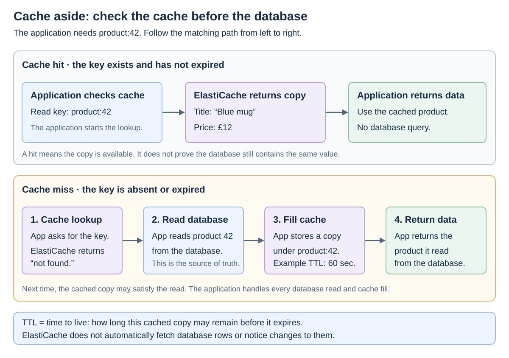
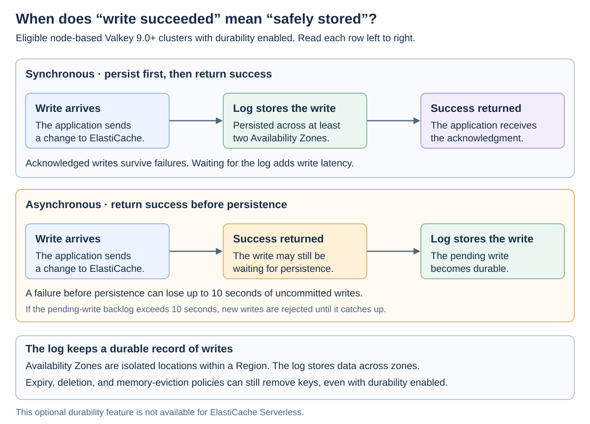

# Amazon ElastiCache

[Back to AWS](../Readme.md#content)

**Amazon ElastiCache is a managed, in-memory data store that helps applications access data quickly.** A common use is to keep copies of frequently read data so the application does not have to query its main database every time. ElastiCache supports **Valkey, Redis OSS, and Memcached**.

Start with how a cache speeds up a product page. Then compare the engines and deployment choices, and learn the difference between keeping a cache available and keeping its data durable.

## A fast copy beside your database

Imagine an online shop where thousands of visitors open the same product page. The product's name and price live in a database. The application can also store a copy in ElastiCache under the **key** `product:42`. The **value** is the product data associated with that key.

In this design, the database is the **source of truth**: it holds the authoritative product record. The cache holds a replaceable copy.

**Cache-aside**, also called **lazy loading**, means the application checks the cache first. A **hit** returns an existing, unexpired value. On a **miss**, the application reads the database and fills the cache for later requests. The diagram shows both paths.

The application controls these operations. ElastiCache does not automatically query Amazon RDS when a key is missing or synchronize itself with every database change. A hit avoids a database query; a miss adds cache work to the database read.

## Expiration and freshness are different

A **time to live (TTL)** sets how long a key remains valid before it expires. For example, a 60-second TTL expires the cached copy 60 seconds after it is stored. It does not refresh the copy automatically.

If the database price changes during those 60 seconds, the cached price can be stale. **A cache hit does not prove that the value matches the latest database record.**

When the application changes a product, it can update the cached value or **invalidate** it: remove the copy so a later read fetches the product again. Updating the cache as part of the write path is commonly called **write-through**. Failed cache updates and overlapping requests still need handling; two separate writes do not automatically form one transaction.

Choose how much staleness each operation can tolerate. A product description and a final payment decision may need different rules. TTL is one tool for managing freshness, not a guarantee of immediate consistency.

**Eviction** is different again: the cache removes a key to make room when memory is under pressure, according to its configured policy. A key can therefore disappear before its TTL ends. Applications using replaceable cached copies must handle misses as normal behavior.

## Choose an engine for the data you need

The **engine** is the software that stores values and understands the application's commands. Redis OSS means **Redis Open Source Software**.

| Engine | Main idea | Example |
|---|---|---|
| **Valkey** | An open-source store with strings, lists, sets, hashes, sorted sets, and other features that depend on the version. | Store session data or keep players ranked by score in a sorted set. |
| **Redis OSS** | A supported Redis engine with rich data structures and an established client ecosystem. | Run an existing application that depends on its supported Redis commands. |
| **Memcached** | A simpler key-value object cache. | Keep serialized product records or database query results. |

A **sorted set** associates each member with a score, which makes ranked lists useful for leaderboards. An engine's commands and data structures matter more than a blanket rule such as “one engine is always faster.” Check the commands and client behavior your application actually needs.

## Serverless or node-based?

Both deployment options support all three engines. **Serverless** means AWS manages the underlying cache capacity; it does not mean the application needs no caching logic.

| Choice | What AWS handles | What you choose |
|---|---|---|
| **ElastiCache Serverless** | Capacity scaling, underlying nodes, and replication across Availability Zones. | Engine, cache settings, access, usage limits, and application behavior. |
| **Node-based cluster** | Managed infrastructure, monitoring, node replacement, and maintenance facilities. | Node sizes, capacity, topology, placement, and engine configuration. |

An **Availability Zone (AZ)** is an isolated location within an AWS Region. Using several zones helps the service survive a failure affecting one location.

Serverless is useful when traffic is hard to predict or you want less capacity management. Node-based deployments give more control and support features such as optional Valkey durability. Node-based Valkey and Redis OSS can also use configured scaling policies; they are not limited to manual scaling.

For costs, Serverless meters stored data and processing usage. Node-based pricing primarily charges for provisioned node time. Compare the actual workload and required capacity; automatic scaling does not guarantee the lowest bill.

## Nodes, shards, and replicas

For node-based Valkey or Redis OSS, these terms describe different jobs:

- A **node** is one managed cache server with compute and memory capacity.
- A **shard** holds a portion of the data. It has one **primary** node that accepts writes and can have read-only **replicas** that hold copies.
- A **cluster** groups the data and nodes. With **cluster mode enabled**, data can be divided across several shards. With cluster mode disabled, there is one shard.

Suppose a cluster has two shards and one replica for each primary. It has four nodes, but only two different portions of the data. The replicas copy those portions; they do not double the amount of unique data the cluster can hold.

**More shards distribute storage and work. More replicas provide copies and additional read capacity.** Adding replicas does not add independent write primaries for the same shard.

Without the optional durability feature, Valkey and Redis OSS replication is asynchronous: a replica can lag behind its primary. A read from a replica can therefore return an older value, and a primary failure can lose recent writes that had not reached a surviving replica.

## Availability and backups solve different problems

**High availability** means keeping the service usable during failures. **Failover** means another node takes over after a failure. For node-based Valkey and Redis OSS, enable **Multi-AZ** with replicas in other zones so ElastiCache can promote a replica when the primary fails. Applications must still handle temporary errors and reconnect when needed.

Memcached needs a deployment-specific distinction:

- **Node-based Memcached** spreads keys across nodes without replica copies. A failed node loses the data on that node, which a cache-aside application can rebuild.
- **Serverless Memcached** has AWS-managed replication across zones and supports backups. It is incorrect to assume all ElastiCache Memcached deployments lack these features.

A **backup**, or snapshot, stores a point-in-time copy that can populate a new cache. ElastiCache supports backups for Valkey, Redis OSS, and Serverless Memcached. A snapshot is useful for restoration, but it does not preserve every write made after it was taken.

## Can ElastiCache store durable data?

**Yes, when you choose a configuration that provides it.** Durability means data can survive failures rather than relying only on the live cache nodes.

Eligible **node-based Valkey 9.0 and later** clusters support an optional **Multi-AZ transactional log**: a durable record of writes stored across Availability Zones. This feature requires cluster mode enabled, Multi-AZ, supported node types, and at least one replica per shard. It is not available with ElastiCache Serverless.

The two write modes differ in when the application receives success. Read each row from left to right.

### Synchronous writes

ElastiCache persists the write in the log across at least two Availability Zones **before** acknowledging success. AWS specifies that acknowledged writes are not lost during a failure. Waiting for persistence adds write latency.

### Asynchronous writes

ElastiCache acknowledges success **before** the log has necessarily persisted the write. This keeps writes faster, but a failure can lose up to the last **10 seconds** of uncommitted writes. If the persistence backlog grows beyond that time limit, the cluster rejects new writes until it catches up.

The log also changes replica recovery: replicas consume committed log entries and can recover without relying on the primary to resend the entire dataset.

**Durability does not prevent expiry, deletion, or eviction.** If this is your primary data store, configure those behaviors deliberately. For example, `noeviction` prevents memory pressure from removing keys, but writes that need more memory can then fail. It does not disable TTL expiration.

Amazon MemoryDB is another durable in-memory database compatible with Valkey and Redis OSS. AWS recommends considering it when you need active-active use across Regions, where more than one Region can accept writes. The choice is no longer simply “ElastiCache cannot persist data, so durability requires MemoryDB.”

## Make the application reliable too

A cache that normally absorbs most reads can hide how much capacity the database needs. If the cache becomes empty or unavailable, suddenly sending every request to the database can overload it.

Use bounded timeouts and control fallback traffic. When many requests miss the same key together, combine the refresh work so they do not all perform the same expensive read. Test the application with an empty or unavailable cache.

Monitor the **cache hit rate**, the share of lookups served from the cache, along with latency, memory use, evictions, errors, and replication lag where applicable. A high hit rate is useful only if the returned data is fresh enough for the operation.

For connections, an **endpoint** is the address used by the cache client. Node-based caches use private networking through an Amazon Virtual Private Cloud (VPC). Serverless can use a VPC endpoint; eligible Serverless Valkey 9.0+ caches also support public endpoints. Public endpoints require AWS Identity and Access Management (IAM) authentication and **Transport Layer Security (TLS) 1.3**, which encrypts the connection. Serverless encrypts data both in transit and at rest.

## When it is a good fit

Use ElastiCache when repeated reads, cached query results, session data, counters, or ranked data structures fit the application. Select availability and durability based on what losing that data would mean. A rebuildable product copy and a player's only saved progress need different protection.

Caching is less useful when nearly every request needs unique data or must read the latest authoritative state. It also adds another system and another consistency problem. For the product-page example, keep [Amazon RDS](../Amazon%20RDS/Readme.md) or [Amazon DynamoDB](../Amazon%20DynamoDB/Readme.md) as the source of truth and add ElastiCache when measurements show a benefit.

# Sources

- [AWS — What is Amazon ElastiCache?](https://docs.aws.amazon.com/AmazonElastiCache/latest/dg/WhatIs.html)
- [AWS — How ElastiCache works](https://docs.aws.amazon.com/AmazonElastiCache/latest/dg/WhatIs.corecomponents.html)
- [AWS — Caching strategies: lazy loading, write-through, and TTL](https://docs.aws.amazon.com/AmazonElastiCache/latest/dg/Strategies.html)
- [AWS Builders' Library — Caching challenges and strategies](https://builder.aws.com/content/3K9TeXp6strMiJ4vhakpRD7BQWO/caching-challenges-and-strategies)
- [AWS — Comparing Valkey, Memcached, and Redis OSS](https://docs.aws.amazon.com/AmazonElastiCache/latest/dg/SelectEngine.html)
- [AWS — Serverless and node-based deployment options](https://docs.aws.amazon.com/AmazonElastiCache/latest/dg/WhatIs.deployment.html)
- [AWS — Shards, primaries, and replicas](https://docs.aws.amazon.com/AmazonElastiCache/latest/dg/Shards.html)
- [AWS — Replication and failure behavior](https://docs.aws.amazon.com/AmazonElastiCache/latest/dg/Replication.html)
- [AWS — Resilience and deployment-specific Memcached behavior](https://docs.aws.amazon.com/AmazonElastiCache/latest/dg/disaster-recovery-resiliency.html)
- [AWS — Snapshot and restore](https://docs.aws.amazon.com/AmazonElastiCache/latest/dg/backups.html)
- [AWS — Durability in ElastiCache](https://docs.aws.amazon.com/AmazonElastiCache/latest/dg/durability.html)
- [AWS — Synchronous and asynchronous durability options](https://docs.aws.amazon.com/AmazonElastiCache/latest/dg/Durability.Options.html)
- [AWS — Durability requirements and limitations](https://docs.aws.amazon.com/AmazonElastiCache/latest/dg/Durability.Limitations.html)
- [AWS — Asynchronous durability buffer](https://docs.aws.amazon.com/images/AmazonElastiCache/latest/dg/images/durability-async-buffer.png)
- [AWS — ElastiCache and MemoryDB](https://docs.aws.amazon.com/AmazonElastiCache/latest/dg/related-services-choose-between-memorydb-and-redis.html)
- [AWS — Valkey and Redis OSS metrics](https://docs.aws.amazon.com/AmazonElastiCache/latest/dg/CacheMetrics.Redis.html)
