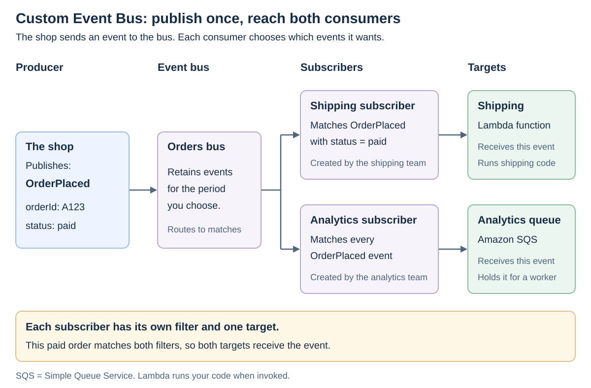
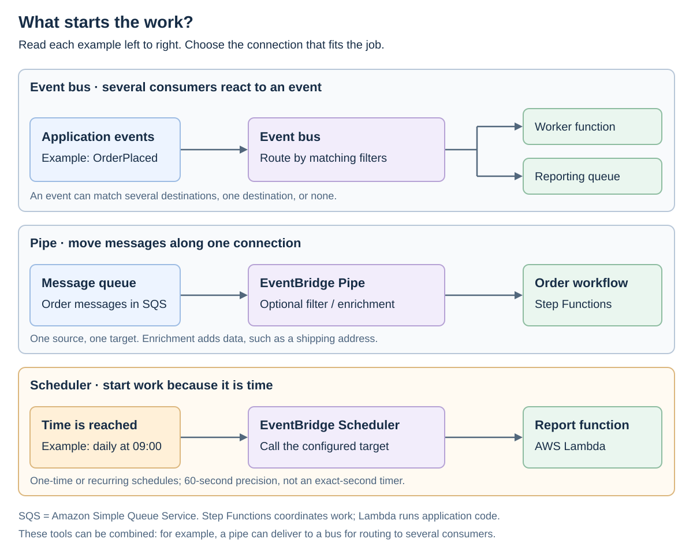

# Amazon EventBridge

<sub>[Back to AWS](../Readme.md#content)</sub>

**Amazon EventBridge connects applications by routing events to the places that need them.** An event says that something happened, such as “order A123 was placed.” The application publishes that fact, and other applications react independently. AWS runs the routing infrastructure for you.

Start with the event-routing example below, then compare the two event bus models. Finally, see how delivery failures work and when to use EventBridge Pipes or Scheduler.

## One event, several interested applications

Imagine an online shop. When a customer places a paid order, the shop needs to start shipping and record the sale for analytics. The shop publishes one `OrderPlaced` event. It does not need to call both applications itself.

These names describe the parts:

- The **producer** publishes the event. Here, it is the shop application.
- An **event bus** receives events and routes them according to filters.
- A **filter** describes which events a destination wants. For example, “paid orders only.”
- A **target** is the destination EventBridge calls, such as an AWS Lambda function or an Amazon Simple Queue Service (SQS) queue.
- A **consumer** is the application that uses the event. A consumer can run as a Lambda function or read events from a queue.

On a **Custom Event Bus**, each consumer creates a **subscriber**: a configuration containing its filters and one target. In this example, both subscribers match the paid order, so both targets receive it. These are independent deliveries.



An event bus can receive events from your applications, supported AWS services, and supported software as a service (SaaS) partners. EventBridge handles the connection and routing; your applications still supply the business logic, such as deciding how to ship an order.

## Know which event bus model you are using

AWS offers **Custom Event Bus** and **Custom Event Bus – Classic**. AWS recommends Custom Event Bus for new applications. Classic remains available, and the default bus also uses the rule-based model.

Older examples may call the rule-based service **CloudWatch Events**. EventBridge grew from that service, and the older rule-and-target API remains compatible.

| Question | Custom Event Bus | Default / Classic bus |
|---|---|---|
| How do I choose a destination? | Create a **subscriber** with filters and one target. | Create a **rule** with an event pattern and up to five targets. |
| Are events kept for later? | Every event is retained for the configured **1–365 days**. | Add an optional **archive** to keep selected events. |
| Can delivery preserve order? | A FIFO subscriber can preserve order within an event group. | Event order is not guaranteed. |
| How do I read older events? | Give a subscriber a starting position within retained history. | Replay events from an archive to its original bus. |

**FIFO** means *first in, first out*. It is an ordering option, not a promise that every event across the entire system runs in one global sequence.

The **default event bus** receives events that AWS services send to the default bus in your account and Region. For example, a rule can match an Amazon EC2 instance changing to the `running` state and invoke a Lambda function. A rule belongs to one bus; it does not inspect every bus in the account.

If an event matches several rules or subscribers, it can reach several destinations. If it matches none, nothing is invoked. On a Custom Event Bus, the event still remains in retained history until it expires. On a Classic bus, keeping it requires an archive that includes it.

## What does a filter actually match?

An **event pattern** describes the fields and values you want. It is a condition to check, not the complete event.

Here are the relevant fields of an order event published through `PutEvents`, the application programming interface (API) operation for publishing JSON events. JSON means JavaScript Object Notation, a format for structured data. This is an excerpt of the resulting event, not a complete publishing request:

```json
{
  "source": "com.example.shop",
  "detail-type": "OrderPlaced",
  "detail": {
    "orderId": "A123",
    "status": "paid"
  }
}
```

The shipping application's pattern could be:

```json
{
  "source": ["com.example.shop"],
  "detail-type": ["OrderPlaced"],
  "detail": {
    "status": ["paid"]
  }
}
```

This means: the source must be `com.example.shop`, the type must be `OrderPlaced`, **and** the status must be `paid`. The square brackets hold the allowed values for each field. Fields left out of the pattern, such as `orderId`, do not affect the match. Ordinary string matches are case-sensitive: `paid` and `PAID` differ.

- On a **Classic bus**, use this as the rule's event pattern.
- On a **Custom Event Bus**, use it as the subscriber's pattern with scope **`DATA`**, which tells EventBridge to inspect the event data. For events published through `PutEvents`, that data contains the envelope shown above, including `detail`.

The Custom Event Bus also supports `PutRawEvents`, which can publish a payload directly. Its data has a different shape: a field sent at the payload's top level stays there, rather than moving under `detail`. Write the filter for the actual event shape. A valid pattern with the wrong nesting can silently match nothing.

Test with a paid order that should match and an unpaid order that should not. For AWS service or partner events on a Custom Event Bus, use its `SYSTEM_METADATA` scope to match the verified origin, such as `aws:Source`; a publisher-controlled data field is not proof of origin.

## Retention, ordering, and repeated work

**Retention** is how long events remain available. **Replay** means delivering stored events again. On a Custom Event Bus, a new subscriber can read earlier retained events, and a paused subscriber can resume within the available history. For example, a new analytics application can process last week's orders without asking the shop to publish them again.

On a Classic bus, configure an archive in advance. Its filter determines what is stored. Replay sends those archived events back to the original bus, optionally to selected rules; replay does not guarantee the original event order.

For Custom Event Bus ordering, assign related events an **event group**, such as one order's identifier, and use a FIFO subscriber. That subscriber delivers events in publish order within each group. A failed delivery can hold up later events in its group while other groups continue. An unordered subscriber does not provide this guarantee.

Custom Event Bus can also suppress repeated publishes using a deduplication identifier or content-based deduplication. The deduplication window is **five minutes**. This does not make every business action happen exactly once forever: an intentional replay, an event published outside the window, or downstream retries can still repeat work.

Make important actions **idempotent**: processing the same logical event again should not repeat its effect. For example, give shipping requests a stable “ship order A123” key and have the shipping service recognize later requests with that key instead of creating another shipment.

## When delivery fails

EventBridge may be unable to call a target because the target is unavailable, throttles requests, or denies access. A **retry policy** controls how long and how many times EventBridge tries again. A **dead-letter queue (DLQ)** receives delivery failures for investigation and recovery.

The defaults and recovery data depend on the bus model:

| Setting | Custom Event Bus subscriber | Default / Classic rule target |
|---|---|---|
| Default retry limits | `MaxRetryAttempts = 5`; maximum event age **300 seconds**. | Up to **185 retries** within **24 hours** for retryable errors. |
| Failure queue contents | A failure record identifying the affected events. | Undelivered events with error metadata. |
| Recovery | Fix the problem and replay the identified events while they remain in bus retention. | Fix the problem and process or resend the saved events. |
| Queue detail | Use a FIFO SQS DLQ for a FIFO subscriber. | The target DLQ must be a **standard** SQS queue. |

Retries stop when either configured limit is reached. Set these values deliberately; copying a Classic design without its retry settings can greatly shorten the automatic delivery retry window. Some Classic errors, such as missing target permissions, go directly to the configured DLQ without retries.

Configure the failure queue and grant EventBridge permission to write to it. Then monitor delivery failures and failures to write to the DLQ. Without that recovery path, exhausted deliveries can be dropped. Retention and a DLQ do different jobs: retention keeps event history; the DLQ records which deliveries need attention.

### Accepted by the target does not always mean finished

For a Custom Event Bus Lambda target, `EVENT` invokes the function asynchronously. EventBridge treats a successful handoff to Lambda as delivered. Lambda then controls execution and its own asynchronous retries. An EventBridge delivery DLQ does not automatically capture a function error that happens later.

`REQUEST_RESPONSE` waits for the Lambda function and treats a function error as failed delivery. Use this mode when a FIFO subscriber must preserve function-processing order. With asynchronous invocation, ordering only extends to the handoff into Lambda's queue.

The same distinction applies at the start: a successful publish confirms acceptance by the bus, not completion by a consumer. Also check the source's delivery guarantees. AWS service events use either durable or best-effort delivery; a best-effort source can occasionally fail to deliver an event to EventBridge.

## Event bus, Pipes, or Scheduler?

Choose based on what starts the work and where it needs to go. A bus distributes events to interested destinations. A pipe connects one supported source to one target. Scheduler calls a target when a specified time arrives.



### Event bus: several consumers react to an event

Use a bus when shipping, analytics, and other applications should independently react to an order. Adding another consumer does not require the producer to call another endpoint.

### Pipes: move data from one source to one target

**EventBridge Pipes** connects one supported source, such as an SQS queue, to one target. It can filter events and optionally **enrich** them: call another service to add useful information before delivery.

For example, a pipe can read order messages from SQS, look up a shipping address, and start an AWS Step Functions workflow. Step Functions coordinates the application's processing steps. A pipe can also target an event bus when the next stage needs several consumers.

### Scheduler: start work because it is time

**EventBridge Scheduler** calls a target API on a schedule. Choose from:

- **Rate:** a regular interval, such as `rate(5 minutes)`.
- **Cron:** a calendar pattern, such as every weekday at 09:00 in a chosen time zone.
- **One-time:** a particular date and time, such as a reminder tomorrow.

Set the target, its input, the permissions to call it, and the retry and DLQ behavior. Scheduler supports flexible time windows when the work can start within a range rather than at one specific minute.

Scheduler has **60-second precision**. With no flexible window, a 09:00 invocation can occur between 09:00:00 and 09:00:59; it is not an exact-second timer. Target execution can finish later. Time zones and daylight-saving changes also matter for calendar schedules.

AWS recommends Scheduler for new scheduled work. The older **scheduled rules** are a legacy feature, run on the default event bus, and use Coordinated Universal Time (UTC). Do not confuse those rules with Scheduler.

## How it fits with the other AWS services

- **EventBridge** decides which destinations should receive an event and calls them.
- **SQS** holds messages for consumers to read and process. A bus can deliver to a queue so that the worker processes work at its own pace.
- **Amazon Simple Notification Service (SNS)** publishes messages from topics to subscribers. It also supports filtering; filtering alone is not a reason to assume EventBridge is always the right choice.
- **Lambda** runs your application code after an invocation. EventBridge does not replace that code.

A useful design is **shop → EventBridge → separate queues → separate workers**. Routing, buffering, and business processing each have a clear job. You can study the queue and function behavior in [Amazon SQS](../Amazon%20SQS/Readme.md) and [AWS Lambda](../AWS%20Lambda/Readme.md).

# Sources

- [AWS — What is Amazon EventBridge?](https://docs.aws.amazon.com/eventbridge/latest/userguide/eb-what-is.html)
- [AWS — Events in EventBridge](https://docs.aws.amazon.com/eventbridge/latest/userguide/eb-events.html)
- [AWS — CloudWatch Events and EventBridge compatibility](https://docs.aws.amazon.com/sdk-for-java/latest/developer-guide/examples-cloudwatch-send-events.html)
- [AWS — Default and Classic event buses](https://docs.aws.amazon.com/eventbridge/latest/userguide/eb-event-bus.html)
- [AWS — Custom Event Bus](https://docs.aws.amazon.com/eventbridge/latest/userguide/eb-custom-bus.html)
- [AWS — Custom Event Bus features and comparison](https://docs.aws.amazon.com/eventbridge/latest/userguide/eb-custom-bus-what-is.html)
- [AWS — Creating subscribers and delivery permissions](https://docs.aws.amazon.com/eventbridge/latest/userguide/eb-custom-bus-subscribers.html)
- [AWS — Event pattern syntax](https://docs.aws.amazon.com/eventbridge/latest/userguide/eb-create-pattern.html)
- [AWS — Custom Event Bus event structure](https://docs.aws.amazon.com/eventbridge/latest/userguide/eb-custom-bus-addressing.html)
- [AWS — Subscriber filtering and verified source fields](https://docs.aws.amazon.com/eventbridge/latest/userguide/eb-custom-bus-filtering.html)
- [AWS — Ordering and deduplication](https://docs.aws.amazon.com/eventbridge/latest/userguide/eb-custom-bus-ordering.html)
- [AWS — Classic archives and replay](https://docs.aws.amazon.com/eventbridge/latest/userguide/eb-archive.html)
- [AWS — Custom Event Bus retries and failure records](https://docs.aws.amazon.com/eventbridge/latest/userguide/eb-custom-bus-retry.html)
- [AWS — Classic target retries](https://docs.aws.amazon.com/eventbridge/latest/userguide/eb-rule-retry-policy.html)
- [AWS — Classic target dead-letter queues](https://docs.aws.amazon.com/eventbridge/latest/userguide/eb-rule-dlq.html)
- [AWS — Custom Event Bus Lambda target and processing order](https://docs.aws.amazon.com/eventbridge/latest/userguide/eb-custom-bus-target-lambda.html)
- [AWS — Lambda best practices and idempotent processing](https://docs.aws.amazon.com/lambda/latest/dg/best-practices.html)
- [AWS — Delivery levels for AWS service events](https://docs.aws.amazon.com/eventbridge/latest/ref/event-delivery-level.html)
- [AWS — EventBridge Pipes](https://docs.aws.amazon.com/eventbridge/latest/userguide/eb-pipes.html)
- [AWS — Scheduler schedule types, precision, and time zones](https://docs.aws.amazon.com/scheduler/latest/UserGuide/schedule-types.html)
- [AWS — Scheduler targets, retries, and dead-letter queues](https://docs.aws.amazon.com/scheduler/latest/UserGuide/managing-schedule.html)
- [AWS — Scheduler execution role and target permissions](https://docs.aws.amazon.com/scheduler/latest/UserGuide/setting-up.html)
- [AWS — Legacy scheduled rules and the Scheduler recommendation](https://docs.aws.amazon.com/eventbridge/latest/userguide/eb-create-rule-schedule.html)
- [AWS — Amazon SQS](https://docs.aws.amazon.com/AWSSimpleQueueService/latest/SQSDeveloperGuide/welcome.html)
- [AWS — Amazon SNS](https://docs.aws.amazon.com/sns/latest/dg/welcome.html)
- [AWS — SNS message filtering](https://docs.aws.amazon.com/sns/latest/dg/sns-message-filtering.html)
