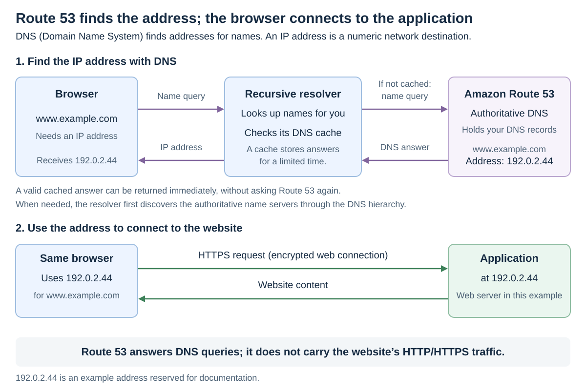
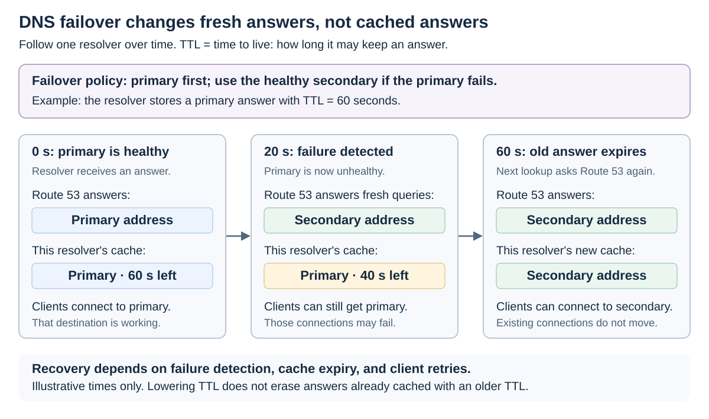

# Amazon Route 53

[Back to AWS](../Readme.md#content)

**Amazon Route 53 is a Domain Name System (DNS) service: it helps applications turn a name such as `www.example.com` into the address they need to connect to.** It can also register domain names and check whether application endpoints are healthy.

The key idea is that **Route 53 chooses a DNS answer; the client then connects to the destination.** It does not carry the website's requests and responses. This article explains that flow, the records behind it, and how routing policies and health checks affect the answer.

## A domain name, a hosted zone, and a record

These three things have different jobs:

| Thing | What it means | Example |
| --- | --- | --- |
| Domain registration | Reserves a domain name through a registrar, the company that manages its registration. | Register `example.com`. |
| Hosted zone | A container for the DNS records belonging to a domain and its subdomains. | The `example.com` hosted zone. |
| DNS record | An entry that tells DNS what to return for a particular name and record type. | An `A` record for `www.example.com` returns an IPv4 address. |

You can register a domain with one company and use Route 53 for its DNS. You can also use Route 53 DNS for an application running outside AWS.

For public DNS, the domain's **name-server delegation** must point to the name servers assigned to the correct hosted zone. Delegation tells the DNS system which servers have the authoritative answers: the records published by the domain's operator. Creating a hosted zone alone does not change an existing domain's delegation. When you register a new domain through Route 53, AWS normally creates the public hosted zone and sets up Route 53 as its DNS service.

Route 53 automatically creates two records in a public hosted zone:

- **NS — Name Server:** one record containing four authoritative name-server names. Use that zone's actual values when configuring delegation at your registrar.
- **SOA — Start of Authority:** administrative information about the zone, including a name server, an administrator contact, a serial number, and DNS timing values. It also helps control how long a resolver remembers a “name or record does not exist” answer.

The NS record identifies the zone's authoritative servers. The SOA record holds the zone's administrative details. You normally leave both in place.

## How the browser finds the application

A **recursive DNS resolver** looks up names on a client's behalf and keeps a temporary copy of answers, called a **cache**. An internet provider, a company network, or a public DNS provider may run that resolver. An **IP address** is the numeric network address the client uses to connect.

The upper lane below finds the address. The lower lane uses it to exchange web traffic directly with the application.

When the resolver needs a fresh answer, it asks the domain's authoritative name server. If it does not yet know that server, it follows DNS referrals through the root and top-level domain servers, such as the servers for `.com`.

Route 53 looks up the requested name and record type, applies the routing policy, and returns an answer. The resolver passes it to the client and may cache it. A cached answer can avoid another Route 53 query.

The browser then connects to the returned destination. Route 53 is not a web proxy and does not inspect the page's requests.

## The records you will use most

**IPv4** and **IPv6** are versions 4 and 6 of the Internet Protocol. They use different address formats.

| Record | Meaning | Example |
| --- | --- | --- |
| `A` | Name → IPv4 address. | `www.example.com` → `192.0.2.44` |
| `AAAA` | Name → IPv6 address. | `www.example.com` → `2001:db8::44` |
| `CNAME` — Canonical Name | Name → another DNS name, which must then be resolved. | `shop.example.com` → `store.example.net` |
| `MX` — Mail Exchange | Mail servers for a domain, with priorities. Lower numbers are preferred. | Priority `10`, server `mail.example.com` |
| `TXT` — Text | Text used for purposes such as domain verification or email configuration. | A verification token supplied by a service. |

These addresses are illustrative. DNS supports other record types too; this table covers the everyday starting points.

### CNAME and Route 53 alias records

The **zone apex** is the hosted zone's own name: `example.com` in an `example.com` zone. You cannot put a CNAME there. A CNAME also cannot share its name with other record types.

A **Route 53 alias** is an AWS extension that points a record at a supported AWS resource, or another record of the same type in the same hosted zone. An alias can be used at the zone apex, subject to the target's record type. It cannot turn an apex into a CNAME.

For example, an **Application Load Balancer (ALB)** distributes web requests among application servers. Create an `A` alias for `example.com` that targets the ALB. Route 53 returns the load balancer's addresses and follows address changes automatically. Do not copy the ALB's current addresses into ordinary A records.

“Alias” is a setting on a record, not a separate DNS record type returned to clients. An A alias produces an A answer. Its targets are restricted: an arbitrary external hostname needs a CNAME where allowed. Supported AWS targets include load balancers, CloudFront distributions, and S3 **website endpoints**.

## Public and private hosted zones

A **public hosted zone** supplies DNS answers on the public internet. A **private hosted zone** supplies answers through the DNS resolver in associated **Virtual Private Clouds (VPCs)**. A VPC is a private network you define in AWS.

For example, public DNS might resolve `www.example.com` to a public load balancer, while a private zone resolves `db.internal.example.com` to a database's private address. Private names can also be resolved from an on-premises network through a configured Route 53 VPC Resolver inbound endpoint.

For private hosted zones, set both VPC attributes `enableDnsSupport` and `enableDnsHostnames` to `true`. Associating a zone controls name resolution; applications still need a working network path and permission to connect.

You can use the same zone name publicly and privately to give internal and external clients different answers. One important trap: if the resolver selects a matching private zone but cannot find the requested record, it does **not** fall back to the public zone. Keep the records needed by internal clients in the private zone too.

## Routing policies choose the answer

A **routing policy** tells Route 53 how to select records for a DNS query. With policies such as weighted or failover routing, you create several records with the same name and type, then assign their weights or roles.

| Policy | Use it when… | Important detail |
| --- | --- | --- |
| **Simple** | One ordinary destination is enough. | A non-alias record can contain several IP addresses; Route 53 returns them all without health filtering. A simple alias has one target. |
| **Weighted** | You want a relative share of DNS answers to go to each destination. | Weights `90` and `10` mean a 90:10 split among eligible choices over many queries, not an exact split of web requests. |
| **Failover** | You want a primary destination and a standby. | The primary's health determines when to use the secondary. |
| **Latency** | The application runs in several AWS Regions and response time matters. | Uses AWS's regional latency measurements, not a live speed test for each request. |
| **Geolocation** | Particular countries or continents should use particular destinations. | Add a default record for locations you have not mapped or Route 53 cannot identify. |
| **Geoproximity** | Geographic distance should guide the choice. | A **bias** expands or shrinks the area served by a resource. It does not specify a traffic percentage. |
| **IP-based** | You know which client network ranges should use which destinations. | You supply the address-range mappings. This policy is not supported in private hosted zones. |
| **Multivalue answer** | Clients should receive several possible addresses. | Returns up to eight records considered healthy. Associate health checks to filter failures. This does not replace a load balancer. |

Caching explains why weighted routing is approximate at the application level: one DNS answer can be reused for many requests or by many users.

Latency and geographic distance are different measurements. A nearby Region can have a slower network path. For public DNS, location-based decisions usually see the resolver's address, or a shortened client address when the resolver sends the DNS Client Subnet extension. They do not necessarily know the user's exact location.

Geoproximity works directly on records; **Traffic Flow is optional**. Traffic Flow provides a visual editor for more elaborate routing configurations and geographic maps in public hosted zones.

## Health information must be connected to routing

A health check asks whether an **endpoint**, the address where a service can be reached, responds as expected. Checks run in the background, independently of DNS queries. For endpoint checks, each checker uses a configured interval of 10 or 30 seconds; failure thresholds and results from multiple locations determine health.

Common ways to obtain health information are:

- **Endpoint checks:** send requests to a public endpoint, for example an application's health page.
- **Calculated checks:** combine other checks, for example “at least two of these three checks must be healthy.”
- **CloudWatch-based checks:** evaluate the metric data stream behind a supported CloudWatch alarm. They do not simply read the displayed alarm state. Only some alarm configurations are supported; for example, an alarm that triggers on two breaches out of three periods cannot be used.
- **Application Recovery Controller (ARC) routing controls:** expose on/off controls through health checks for controlled failover.

Creating a check alone does not change DNS answers. Associate it with the appropriate record and choose a policy that uses health information.

For an ALB alias under a policy such as failover, **Evaluate Target Health** lets Route 53 use the load balancer's health information instead of requiring a separate Route 53 probe. The exact result depends on the load balancer's target health. Under **Simple routing**, Evaluate Target Health has no effect: Route 53 still answers with the one configured record.

Route 53's public endpoint checkers cannot directly probe a private IP address. For a private service, one option is to publish a health metric to CloudWatch and use a compatible alarm-based health check.

### What if everything is unhealthy?

Health-based routing is not a promise that every returned destination works. For a failover pair with health information for both records:

| Primary | Secondary | DNS answer |
| --- | --- | --- |
| Healthy | Either state | Primary |
| Unhealthy | Healthy | Secondary |
| Unhealthy | Unhealthy | **Primary** |

A record with no health check or applicable target-health evaluation is treated as healthy. Other policies also have behavior for all-unhealthy groups; multivalue routing, for example, can return unhealthy records when none are healthy.

## Why failover is not instant

**Time to live (TTL)** tells a resolver how many seconds it may keep a DNS answer before asking again. A longer TTL reduces repeated lookups, but makes address changes take longer to reach clients that already have the old answer.

In this example, one resolver caches the primary address for 60 seconds. Route 53 detects a primary failure while that answer is still cached. The secondary stays healthy. The times illustrate the cache behavior; they do not promise a particular detection or recovery time.

After Route 53 changes its choice, a resolver needing a fresh answer can receive the secondary immediately. A resolver holding the earlier answer may keep giving out the primary address until that cached answer expires. Existing application connections do not move just because DNS changes.

Recovery therefore depends on **failure detection, DNS caching, and client retry behavior**. Lowering a TTL does not erase answers already cached with the old TTL. Before a planned change, lower it far enough in advance for those earlier answers to expire.

For aliases to AWS resources, Route 53 uses the resource's TTL; you cannot set a separate TTL on the alias. An alias to another record in the same zone uses that record's TTL.

Non-alias records in the same weighted group must have the same TTL. When mixing them with weighted aliases to load balancers, use 60 seconds for the non-alias records to match the load balancer TTL. Unequal cache lifetimes would distort the traffic split.

## How Route 53 and a load balancer work together

Suppose a shop runs behind one ALB in each of two AWS Regions. You can create two failover A aliases named `shop.example.com`: one primary and one secondary, each targeting its Region's ALB with Evaluate Target Health enabled.

Route 53 selects the destination at DNS lookup time. The browser connects to that load balancer, and the load balancer distributes the web traffic among its registered application targets. Load balancers use their own health checks and thresholds; they also need time to detect failures.

This gives the services separate jobs: **Route 53 chooses an address; the load balancer handles traffic sent to that address.** Neither DNS nor a load balancer copies the application's database, restores lost sessions, or prepares a standby deployment. The secondary application must already have the data and capacity needed to serve users.

# Sources

- [AWS: What is Amazon Route 53?](https://docs.aws.amazon.com/Route53/latest/DeveloperGuide/Welcome.html)
- [AWS: Registering a new domain](https://docs.aws.amazon.com/Route53/latest/DeveloperGuide/domain-register.html)
- [AWS: Working with hosted zones](https://docs.aws.amazon.com/Route53/latest/DeveloperGuide/hosted-zones-working-with.html)
- [AWS: NS and SOA records](https://docs.aws.amazon.com/Route53/latest/DeveloperGuide/SOA-NSrecords.html)
- [AWS: DNS lookup and application traffic](https://docs.aws.amazon.com/Route53/latest/DeveloperGuide/welcome-dns-service.html)
- [AWS: Supported DNS record types](https://docs.aws.amazon.com/Route53/latest/DeveloperGuide/ResourceRecordTypes.html)
- [AWS: Alias and non-alias records](https://docs.aws.amazon.com/Route53/latest/DeveloperGuide/resource-record-sets-choosing-alias-non-alias.html)
- [AWS: Routing to an ELB load balancer](https://docs.aws.amazon.com/Route53/latest/DeveloperGuide/routing-to-elb-load-balancer.html)
- [AWS: Private hosted zones](https://docs.aws.amazon.com/Route53/latest/DeveloperGuide/hosted-zones-private.html) and [private-zone considerations](https://docs.aws.amazon.com/Route53/latest/DeveloperGuide/hosted-zone-private-considerations.html)
- [AWS: Choosing a routing policy](https://docs.aws.amazon.com/Route53/latest/DeveloperGuide/routing-policy.html)
- [AWS: Simple routing](https://docs.aws.amazon.com/Route53/latest/DeveloperGuide/routing-policy-simple.html) and [simple alias health evaluation](https://docs.aws.amazon.com/Route53/latest/DeveloperGuide/resource-record-sets-values-alias.html)
- [AWS: Weighted routing](https://docs.aws.amazon.com/Route53/latest/DeveloperGuide/routing-policy-weighted.html) and [weighted record TTLs](https://docs.aws.amazon.com/Route53/latest/DeveloperGuide/resource-record-sets-values-weighted.html)
- [AWS: Latency routing](https://docs.aws.amazon.com/Route53/latest/DeveloperGuide/routing-policy-latency.html)
- [AWS: Geolocation](https://docs.aws.amazon.com/Route53/latest/DeveloperGuide/routing-policy-geo.html), [geoproximity](https://docs.aws.amazon.com/Route53/latest/DeveloperGuide/routing-policy-geoproximity.html), and [geoproximity on DNS records](https://aws.amazon.com/about-aws/whats-new/2024/01/amazon-route-53-expands-geoproximity-routing/)
- [AWS: Traffic Flow](https://docs.aws.amazon.com/Route53/latest/DeveloperGuide/traffic-flow.html)
- [AWS: IP-based routing](https://docs.aws.amazon.com/Route53/latest/DeveloperGuide/routing-policy-ipbased.html) and [estimating a user's location](https://docs.aws.amazon.com/Route53/latest/DeveloperGuide/routing-policy-edns0.html)
- [AWS: Multivalue answer routing](https://docs.aws.amazon.com/Route53/latest/DeveloperGuide/routing-policy-multivalue.html)
- [AWS: Health-check types](https://docs.aws.amazon.com/Route53/latest/DeveloperGuide/health-checks-types.html) and [determining endpoint health](https://docs.aws.amazon.com/Route53/latest/DeveloperGuide/dns-failover-determining-health-of-endpoints.html)
- [AWS: Record selection with health checks](https://docs.aws.amazon.com/Route53/latest/DeveloperGuide/health-checks-how-route-53-chooses-records.html)
- [AWS: Active-active and active-passive failover](https://docs.aws.amazon.com/Route53/latest/DeveloperGuide/dns-failover-types.html) and [private-zone failover](https://docs.aws.amazon.com/Route53/latest/DeveloperGuide/dns-failover-private-hosted-zones.html)
- [AWS: Record TTL](https://docs.aws.amazon.com/Route53/latest/DeveloperGuide/resource-record-sets-values-basic.html)
- [AWS: Application Load Balancer health checks](https://docs.aws.amazon.com/elasticloadbalancing/latest/application/target-group-health-checks.html)
- [AWS: Disaster recovery options — replication, standby capacity, and traffic switching](https://docs.aws.amazon.com/whitepapers/latest/disaster-recovery-workloads-on-aws/disaster-recovery-options-in-the-cloud.html)
