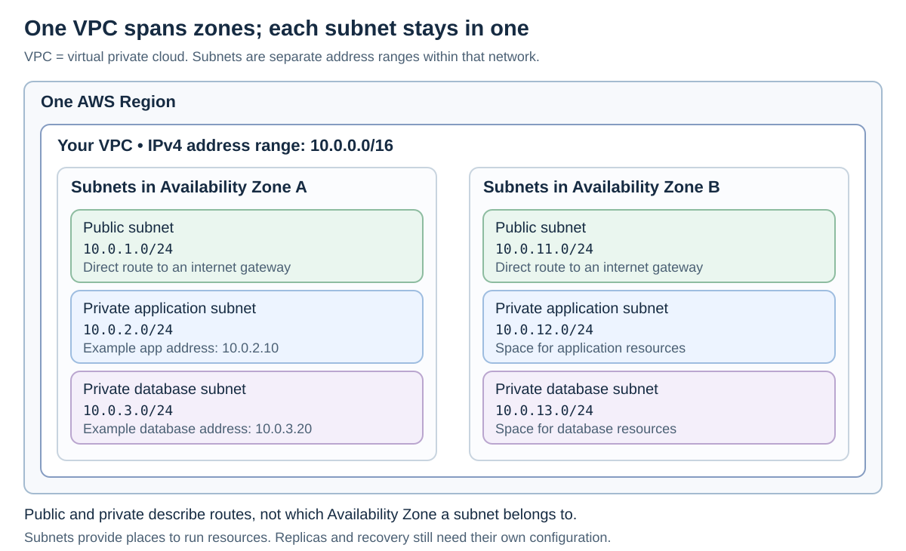
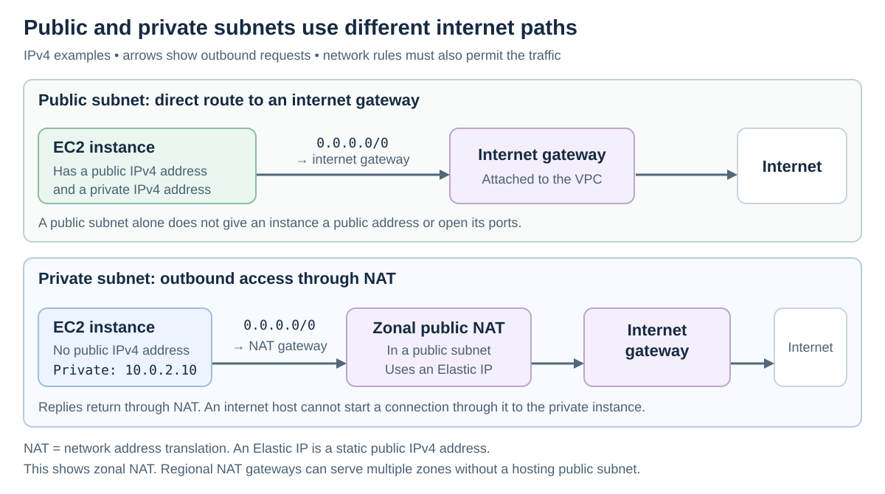
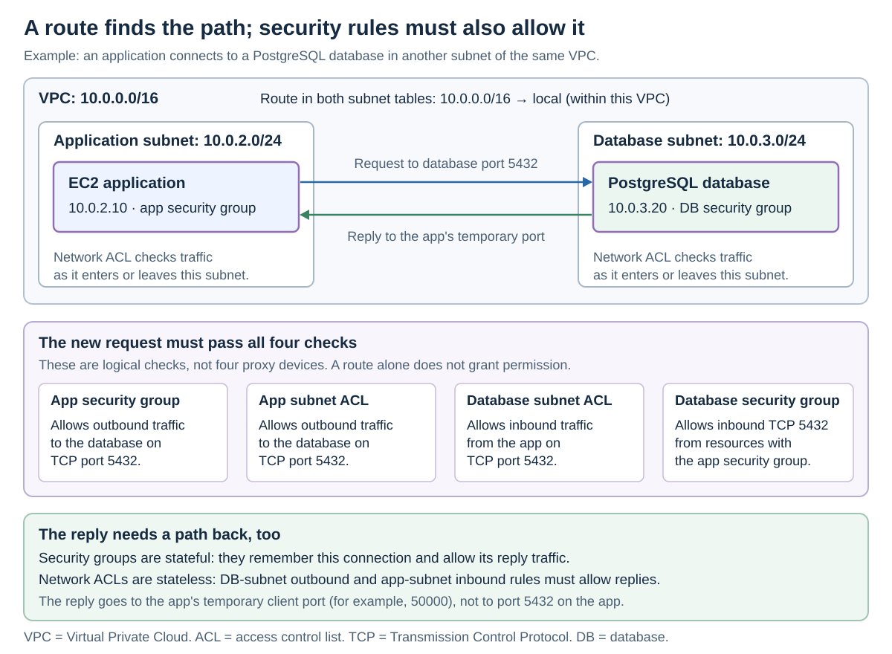

# Amazon Virtual Private Cloud (VPC)

[Back to AWS](../Readme.md#content)

**Amazon Virtual Private Cloud (Amazon VPC) gives you a logically isolated network in AWS.** You choose its address ranges, divide it into subnets, and control how resources communicate. A VPC is a network boundary; it does not automatically make every resource reachable or every connection safe.

Think of an online shop: customers reach its website, the application talks to a database, and the servers download updates. Those are three different connections with different access needs. This article explains where the resources live, how traffic finds a path, and which rules allow it through.

## VPCs, subnets, and addresses

A VPC belongs to one **AWS Region**. It can have subnets in several **Availability Zones (AZs)**, the separate locations within that Region. **Each subnet belongs to exactly one AZ.** See [AWS Regions and Zones](../AWS%20Regions%20and%20Zones/Readme.md) for the geography.

An **Internet Protocol (IP) address** identifies a network interface so traffic can reach it. A network interface is a resource's connection to the network. The first examples use IP version 4 (IPv4). For example, an [Amazon EC2](../Amazon%20EC2/Readme.md) instance in an IPv4 subnet receives a private IPv4 address from that subnet's range.

**Classless Inter-Domain Routing (CIDR)** is a compact way to write an address range:

| Example | What it describes |
| --- | --- |
| `10.0.0.0/16` | Our VPC's range: `10.0.0.0` through `10.0.255.255`. |
| `10.0.2.0/24` | A smaller range for an application subnet: `10.0.2.0` through `10.0.2.255`. |
| `10.0.2.10` | One private address in that application subnet. |

The number after `/` says how many leading address bits are fixed. A larger number leaves fewer addresses in the range. Subnet ranges must fit inside the VPC's range and must not overlap. In an ordinary IPv4 subnet like this `/24`, AWS reserves five of its 256 addresses, leaving 251 assignable addresses.

Read the diagram from the outside inward: Region, VPC, then subnets grouped by AZ. Both zones can contain both public and private subnets. The example addresses will reappear below.

This is a network layout, not a complete availability design. Creating subnets in two AZs does not copy an application or database into the second AZ. You must also configure the resources and their recovery behavior.

## A route table chooses where traffic goes

A **route table** is a list of destinations and the next places to send traffic. Each subnet uses one subnet route table at a time; several subnets can share the same table. A subnet without an explicit association uses the VPC's main route table.

For example, a public subnet might use these IPv4 routes:

| Destination | Target | Meaning |
| --- | --- | --- |
| `10.0.0.0/16` | `local` | Send traffic to addresses in this VPC through the VPC's internal network. |
| `0.0.0.0/0` | Internet gateway | Send other IPv4 traffic toward the internet. |

`0.0.0.0/0` matches every IPv4 address. **The most specific matching route wins**, so traffic from `10.0.2.10` to `10.0.3.20` uses the `/16` local route, not the `/0` internet route. This is called **longest prefix matching**.

A route supplies a path. It does not grant permission to use that path. Security rules still have to allow the traffic.

## Public and private describe the routes

An **internet gateway** connects a VPC to the internet. Attach it to the VPC and add the required routes.

- A **public subnet** has a direct route to an internet gateway.
- A **private subnet** has no direct route to an internet gateway. It can still communicate with other networks through configured connections.
- An **isolated subnet** has no routes outside its VPC. It can still communicate inside the VPC when security rules permit it.

For an EC2 instance to communicate directly with the internet over IPv4, it needs a public IPv4 address, the gateway and route, and permission through the relevant network controls. An **Elastic IP address** is a static public IPv4 address.

**Putting an instance in a public subnet does not automatically expose every port.** It also does not guarantee that the instance has a public address. Conversely, assigning a public address does not create a missing route.

## How a private server downloads updates

**Network address translation (NAT)** rewrites addresses as traffic passes through. A public NAT gateway lets a private instance start an IPv4 internet connection and receive its replies. An outside host cannot use that NAT gateway to start a new connection to the private instance.

Compare the two paths below. The lower path uses a **zonal public NAT gateway**: a NAT gateway hosted in a public subnet in one AZ. The private instance has no public IPv4 address of its own.

In this zonal example, the private subnet's route table sends `0.0.0.0/0` to the NAT gateway. The NAT gateway's public subnet has a route to the internet gateway. Together, they translate the outgoing traffic so the remote server sees the NAT gateway's Elastic IP. Replies are translated back to the originating instance.

NAT is useful for downloads and calls to external services. It is not the path customers use to open your private application. A common website design uses a public **load balancer**, which accepts customer requests and forwards them to application servers in private subnets.

### Current NAT choices

AWS also offers **regional NAT gateways**. In automatic mode, one regional gateway expands across AZs with your workloads and does not require a public subnet to host it. The traditional zonal design remains valid; for resilience, use a zonal gateway in each relevant AZ and route each private subnet to its same-AZ gateway. “Every NAT gateway lives in one public subnet” is therefore no longer a universal rule.

A **private NAT gateway** is a different connectivity option for private networks. It does not provide internet access through an internet gateway. “Public NAT” describes the gateway's connectivity, even when the instances using it are private.

### IPv6 has its own routes

The examples above use IPv4. **Internet Protocol version 6 (IPv6)** uses a different address format, and its default route is `::/0`. An IPv4 route does not also cover IPv6.

For outbound internet connections using public IPv6 addresses, an **egress-only internet gateway** permits connections started inside the VPC and their replies, while preventing connections started from the internet. NAT gateways also support **NAT64**, which translates IPv6 traffic for access to IPv4 destinations. These are different use cases.

## Security groups and network ACLs decide what is allowed

A **security group** controls allowed inbound and outbound traffic for associated resources, through their network interfaces. A **network access control list (network ACL, or NACL)** filters traffic as it crosses a subnet boundary.

A **port** identifies a service on a host. For example, suppose our PostgreSQL database listens on port `5432` using **Transmission Control Protocol (TCP)**. Its security group can allow that connection from the application's security group, instead of opening the database to every address.

| Question | Security group | Network ACL |
| --- | --- | --- |
| Where does it apply? | Associated resources' network interfaces. | Traffic entering or leaving an associated subnet. |
| What rules can it contain? | Allow rules only. | Allow and deny rules. |
| How are rules evaluated? | Permissions from the associated groups combine. | Lowest rule number first; the first match decides. |
| What about replies? | **Stateful:** replies to an allowed connection are automatically permitted by the security group. | **Stateless:** request and reply traffic each need matching allow rules. |

The diagram follows one connection from app `10.0.2.10` to database `10.0.3.20`, in different subnets of the same VPC. The boxes explain logical checks, not separate servers that proxy the request. The local route provides the path; both resources' security groups and both subnets' ACLs must permit the relevant traffic.

For this example, allow the app to send TCP traffic to the database on `5432`, and allow the database to receive it from the app's security group. Referencing that group selects the associated network interfaces; it does not copy the app group's rules into the database group.

**A stateful security group does not override a restrictive ACL.** ACLs must also permit the reply, which goes back to the client's temporary source port. Allowing only destination port `5432` in both directions is not enough.

The **default network ACL** initially allows inbound and outbound traffic. A **new custom ACL** initially denies traffic until you add allow rules. ACLs do not filter traffic between resources inside the same subnet. Security groups still apply there.

Network access is also separate from application access. Reaching the database port does not supply a database password. Likewise, a route to S3 does not grant permission to read its objects; [IAM](../AWS%20IAM/Readme.md) and the applicable policies still matter.

## Reach AWS services without an internet gateway

A **VPC endpoint** gives your VPC a private connection to a supported service or resource. Two common options are useful to learn first:

| Endpoint | How it works | Typical use |
| --- | --- | --- |
| **Gateway endpoint** | Adds service-specific routes to selected subnet route tables. | Reach [S3](../Amazon%20S3/Readme.md) or [DynamoDB](../Amazon%20DynamoDB/Readme.md) without an internet gateway or NAT device. |
| **Interface endpoint** | Uses endpoint network interfaces and private addresses in selected subnets, powered by AWS PrivateLink. | Reach supported AWS services privately. |

For example, an S3 gateway endpoint adds a route for S3's address ranges. That route is more specific than the default NAT route, so matching S3 traffic uses the endpoint. A **Domain Name System (DNS)** lookup translates a service name into an IP address; with private DNS enabled, supported interface endpoints let applications keep using the service's usual name while reaching the endpoint's private addresses.

An interface endpoint **does not require AWS Direct Connect**. Direct Connect is a separate way to connect an external network to AWS. Interface and gateway endpoints are common types, not an exhaustive list of all VPC endpoint types. Creating an endpoint also does not replace the service's authorization checks.

## Connect another network deliberately

Separate VPCs are not automatically connected, even in the same account. **VPC peering** connects two VPCs using private addresses and can work across accounts or Regions. Configure routes and security rules on both sides; their address ranges must not overlap.

Peering does not provide automatic onward routing. If A peers with B and B peers with C, A cannot reach C through B merely because those two connections exist. **AWS Transit Gateway** provides a central hub for routing between multiple connected networks.

For an office or data center, **AWS Site-to-Site VPN** provides a virtual private network connection, while **AWS Direct Connect** provides dedicated network connectivity to AWS. These solve a different problem from reaching one AWS service through an endpoint.

## Defaults, troubleshooting, and cost

A default VPC is a starting configuration with public subnets, an internet gateway, and DNS settings. You can change or delete its components, so inspect the actual configuration. A custom VPC's connectivity depends on what you create; the console can create several networking components together.

When a connection fails, first identify its source address, destination address, protocol, and port. Then check the route, address requirements, security groups, ACLs in both directions, and the destination application's configuration. When using a hostname, check that DNS resolves it to the intended address.

Two AWS tools help answer different questions:

- **VPC Flow Logs** record traffic metadata, such as addresses, ports, and whether traffic was accepted or rejected. You can enable them for a VPC, subnet, or network interface and send records to CloudWatch Logs, S3, or Amazon Data Firehose. They do not contain the application's message body, and some traffic is excluded.
- **Reachability Analyzer** examines network configuration to explain a supported path or a blocking component. It does not send test packets, so a reachable path does not prove that the application is running or healthy.

There is no additional charge for the VPC itself. Components and usage can cost money, including NAT gateways, interface endpoints, public IPv4 addresses, and data transfer. An unused NAT gateway can still incur charges; include networking resources when cleaning up a practice environment.

## Check your understanding

1. Two instances are in different subnets of one VPC. Do they need NAT to talk?

   

   
Answer

   No. Their private addresses can use the local route, subject to security rules.

   

2. A private instance can download updates through NAT. Can anyone connect to it through that NAT?

   

   
Answer

   No. NAT permits replies to connections started inside, not unsolicited connections from outside.

   

3. The database allows the app's security group. Is the connection guaranteed?

   

   
Answer

   No. The route, app's outbound rules, subnet ACLs, and database configuration must also permit it.

   

4. Does an S3 endpoint make every object readable?

   

   
Answer

   No. It supplies connectivity; permissions still control access.

   

# Sources

- [AWS — What is Amazon VPC?](https://docs.aws.amazon.com/vpc/latest/userguide/what-is-amazon-vpc.html)
- [AWS — How Amazon VPC works](https://docs.aws.amazon.com/vpc/latest/userguide/how-it-works.html)
- [AWS — Subnets, including the two-AZ diagram](https://docs.aws.amazon.com/vpc/latest/userguide/configure-subnets.html)
- [AWS — IP addressing and CIDR notation](https://docs.aws.amazon.com/vpc/latest/userguide/vpc-ip-addressing.html)
- [AWS — Subnet sizes and reserved addresses](https://docs.aws.amazon.com/vpc/latest/userguide/subnet-sizing.html)
- [AWS — Subnet route tables and longest prefix matching](https://docs.aws.amazon.com/vpc/latest/userguide/subnet-route-tables.html)
- [AWS — Internet gateways and public IPv4 connectivity](https://docs.aws.amazon.com/vpc/latest/userguide/VPC_Internet_Gateway.html)
- [AWS — Private servers, public load balancers, and NAT, including the architecture diagram](https://docs.aws.amazon.com/vpc/latest/userguide/vpc-example-private-subnets-nat.html)
- [AWS — NAT gateways, public and private connectivity, and NAT64](https://docs.aws.amazon.com/vpc/latest/userguide/vpc-nat-gateway.html)
- [AWS — Zonal NAT gateway resilience and same-AZ routing](https://docs.aws.amazon.com/vpc/latest/userguide/nat-gateway-basics.html)
- [AWS — Regional NAT gateways](https://docs.aws.amazon.com/vpc/latest/userguide/nat-gateways-regional.html)
- [AWS — Egress-only internet gateways for IPv6](https://docs.aws.amazon.com/vpc/latest/userguide/egress-only-internet-gateway.html)
- [AWS — Security groups and stateful replies](https://docs.aws.amazon.com/vpc/latest/userguide/vpc-security-groups.html)
- [AWS — Security group rules and group references](https://docs.aws.amazon.com/vpc/latest/userguide/security-group-rules.html)
- [AWS — Network ACLs and rule evaluation](https://docs.aws.amazon.com/vpc/latest/userguide/vpc-network-acls.html)
- [AWS — Default network ACLs](https://docs.aws.amazon.com/vpc/latest/userguide/default-network-acl.html)
- [AWS — Custom ACLs and return traffic ports](https://docs.aws.amazon.com/vpc/latest/userguide/custom-network-acl.html)
- [AWS — Gateway endpoints for S3 and DynamoDB](https://docs.aws.amazon.com/vpc/latest/privatelink/gateway-endpoints.html)
- [AWS — Interface endpoints, PrivateLink, and private DNS](https://docs.aws.amazon.com/vpc/latest/privatelink/privatelink-access-aws-services.html)
- [AWS — Endpoint policies do not replace service permissions](https://docs.aws.amazon.com/vpc/latest/privatelink/vpc-endpoints-access.html)
- [AWS — PrivateLink concepts and endpoint types](https://docs.aws.amazon.com/vpc/latest/privatelink/concepts.html)
- [AWS — VPC peering across accounts and Regions](https://docs.aws.amazon.com/vpc/latest/peering/what-is-vpc-peering.html)
- [AWS — Peering routes, overlapping ranges, and transitive routing limits](https://docs.aws.amazon.com/vpc/latest/peering/vpc-peering-basics.html)
- [AWS — Direct Connect](https://docs.aws.amazon.com/directconnect/latest/UserGuide/Welcome.html)
- [AWS — Default VPCs](https://docs.aws.amazon.com/vpc/latest/userguide/default-vpc.html)
- [AWS — VPC Flow Logs and delivery destinations](https://docs.aws.amazon.com/vpc/latest/userguide/flow-logs.html)
- [AWS — Flow log record fields](https://docs.aws.amazon.com/vpc/latest/userguide/flow-log-records.html)
- [AWS — Flow log limitations](https://docs.aws.amazon.com/vpc/latest/userguide/flow-logs-limitations.html)
- [AWS — How Reachability Analyzer works](https://docs.aws.amazon.com/vpc/latest/reachability/how-reachability-analyzer-works.html)
- [AWS — VPC component and public IPv4 pricing](https://aws.amazon.com/vpc/pricing/)
