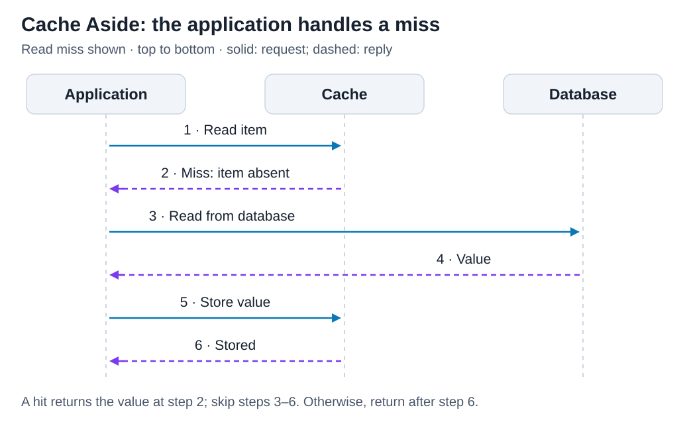
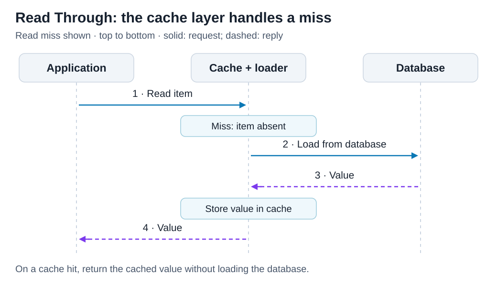
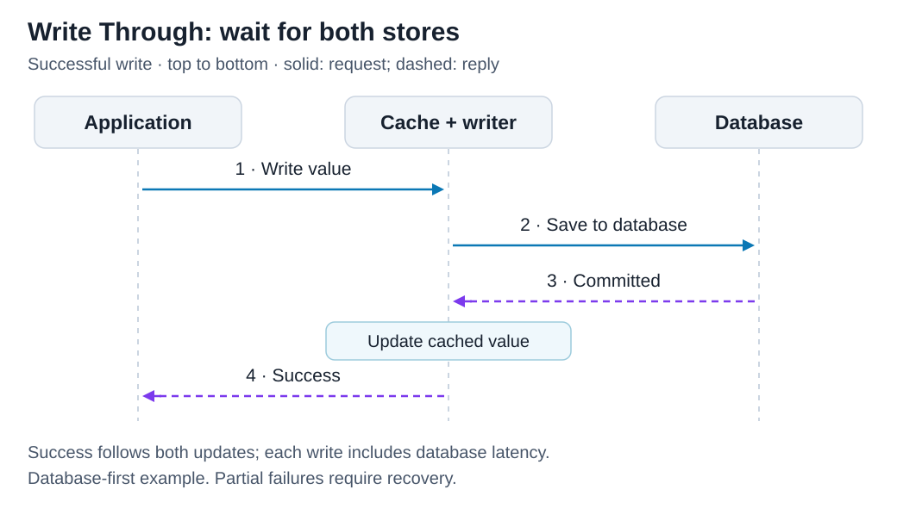
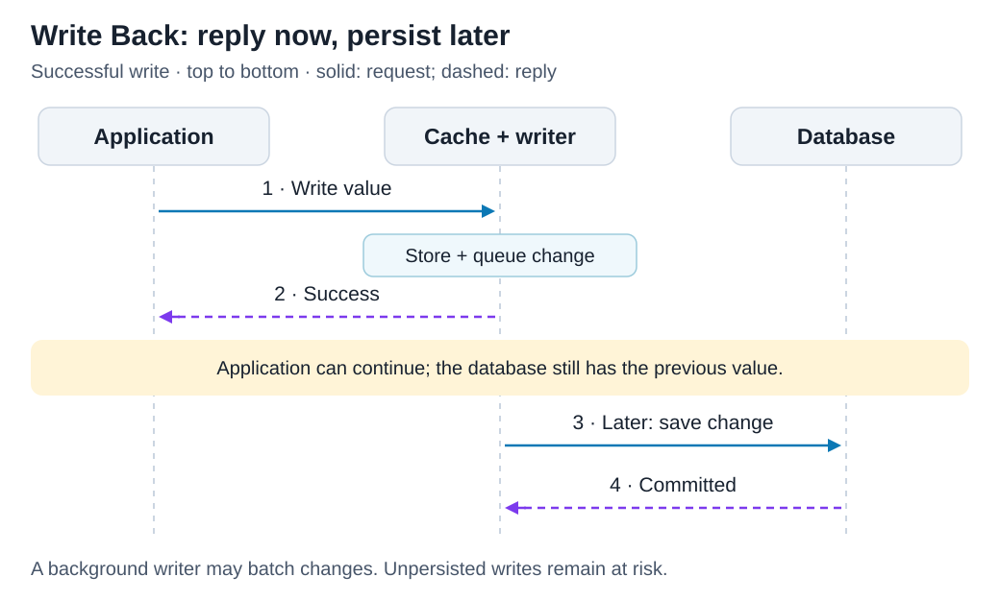
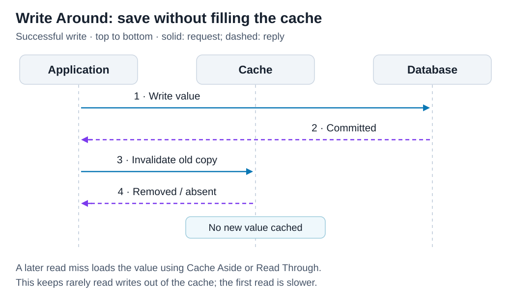

# Caching strategies

[Back to Computer Science](../Readme.md#content)

# Front

How do Cache Aside, Read Through, Write Through, Write Back, and Write Around move data between an application, a cache, and a database?

# Back

**Caching strategies decide who loads missing data and when writes reach the database.** A cache holds data for faster reads; a **hit** finds it, a **miss** does not.

**Read policies** (Cache Aside, Read Through) are about who fills the cache after a miss. **Write policies** (Write Through, Write Back, Write Around) are about when the database receives a write, and if the write updates the cache. A system usually uses one of each, for example Read Through with Write Through. Read each sequence top to bottom; dashed arrows are replies.

## 1. Cache Aside

**The application loads the cache.** It checks the cache; on a miss, it reads the database, caches the result, then returns it. On writes, commonly update the database and invalidate (remove) the cached copy. This write policy is Write Around (section 5). Cache Aside is useful for repeated reads of slowly changing data; misses are slower and concurrent requests can still serve stale data.

**Stale** data is a cached copy of a previous database value. A **TTL** (time to live) removes a cached value after a specified time. Thus, stale data cannot stay longer than the TTL. Below: a cache miss.

## 2. Read Through

**The cache layer loads missing data.** The application reads through it; on a miss, a loader fetches from the database, fills the cache, and returns the value. This moves loading logic out of the caller but requires a configured loader. Misses still wait for the database.

> Note: A **Redis** server has no loader or writer. Thus, the application uses Cache Aside. But the Java client **Redisson** adds them (`MapLoader`, `MapWriter`).

## 3. Write Through

**A write succeeds only after both stores are updated.** Below, the application writes through a cache layer that saves to the database and updates the cache before replying. An application can also write to the two stores without a cache layer: it updates the cache, but Cache Aside removes the cached copy. Reads can use the updated cache, but every write waits for the database and may cache rarely read data. Partial failures still need handling; this is not automatically an atomic transaction across both stores. For example, if the database commits but an error stops the cache update, reads can find the previous value in the cache.

## 4. Write Back

**Acknowledge the cache update; persist later.** Also called **write-behind**. A background writer sends queued changes to the database, possibly in batches. This reduces write latency and can reduce database work, but the database temporarily lags. Losing unpersisted cache data can lose acknowledged writes. If an error stops the subsequent database write, the application does not receive the error, because it received its result first. Below: success returns before the database write.

## 5. Write Around

**Write to the database without filling the cache.** Invalidate any older cached copy; a later read miss loads the new value using Cache Aside or Read Through. Without the invalidation, reads can find the previous value in the cache. Write Around avoids filling the cache with rarely read writes, but the first later read pays the database cost. Below: a write with invalidation; no new value is cached.

# Sources

- [AWS — ElastiCache caching strategies: lazy loading, write-through, and TTL](https://docs.aws.amazon.com/AmazonElastiCache/latest/dg/Strategies.html)
- [Microsoft Azure — Cache-Aside pattern, invalidation, expiration, and consistency limits](https://learn.microsoft.com/en-us/azure/architecture/patterns/cache-aside)
- [Oracle Coherence 14.1.2 — Read-Through, Write-Through, and Write-Behind caching](https://docs.oracle.com/en/middleware/fusion-middleware/coherence/14.1.2/develop-applications/caching-data-sources.html)
- [Hazelcast 5.1 — Write-through sequence, write-behind retries, and batches](https://docs.hazelcast.com/hazelcast/5.1/data-structures/working-with-external-data)
- [Redis — Cache layer patterns, Write Around, combinations, TTL, and failure tradeoffs](https://redis.io/blog/cache-layer-architecture-guide/)
- [Redis — Cache-aside use case: the application loads a miss and invalidates on update](https://redis.io/docs/latest/develop/use-cases/cache-aside/)
- [Redis — `GET` returns nil for a missing key](https://redis.io/docs/latest/commands/get/)
- [Redisson — Map persistence: `MapLoader` read-through, `MapWriter` write-through and write-behind](https://redisson.pro/docs/data-and-services/collections/#persistence)
