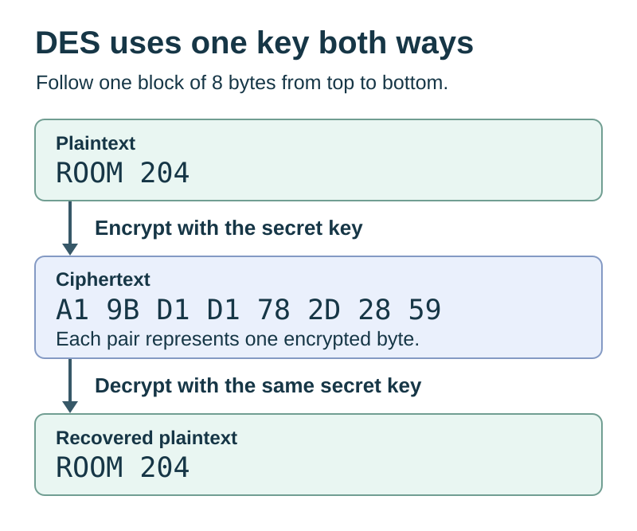

# Data Encryption Standard

[Back to Computer Science](../Readme.md#content)

The **Data Encryption Standard (DES)** is an older way to encrypt data. The sender uses a secret value called a **key** to turn the original data (**plaintext**) into encrypted data (**ciphertext**). The recipient uses the **same key** to recover the plaintext. This is called **symmetric encryption**.

## How much data does DES encrypt at once?

DES is a **block cipher**, meaning it encrypts a fixed amount of data at a time. One DES block holds **64 bits (8 bytes)**. In the example below, each character in `ROOM 204` takes one byte, including the space, so the message fills exactly one block. Follow the arrows to see how the recipient gets the room number back.

## Why was DES retired?

Only **56 bits** of the key control encryption. Each bit can be 0 or 1, so there are 2⁵⁶ possible keys. Computers can try enough of them to make guessing the key practical. In 2005, the U.S. National Institute of Standards and Technology withdrew DES and recommended the stronger **Advanced Encryption Standard (AES)**.

# Sources

- [NIST FIPS 46-3 — Data Encryption Standard, key length and block size](https://csrc.nist.gov/files/pubs/fips/46-3/final/docs/fips46-3.pdf)
- [NIST — Withdrawal of DES and transition to AES](https://csrc.nist.gov/news/2005/withdrawal-of-fips-46-3-fips-74-and-fips-81)
