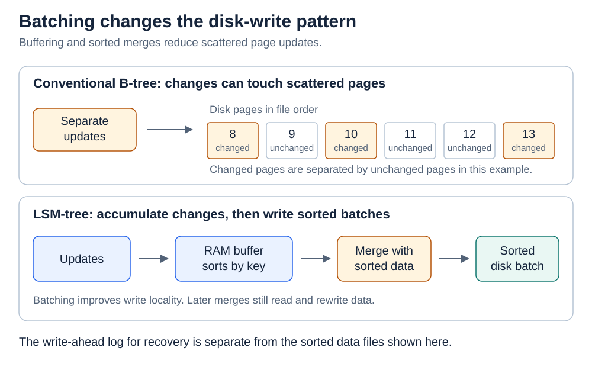
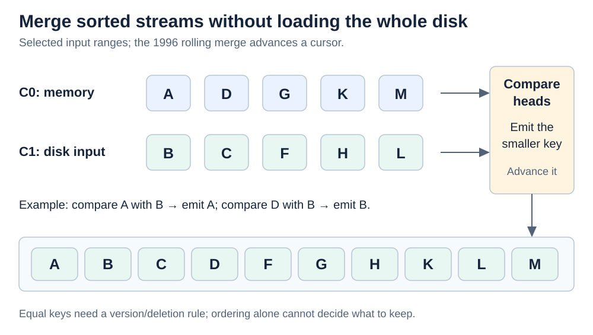
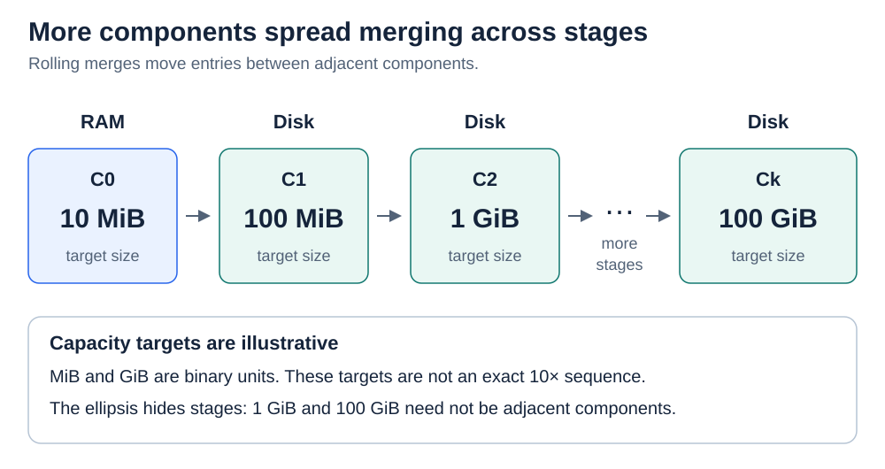
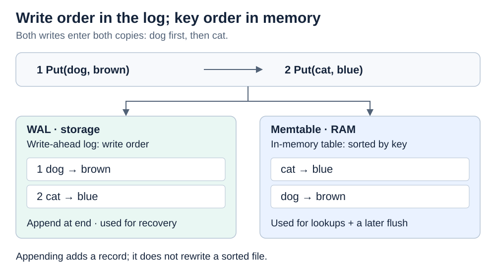
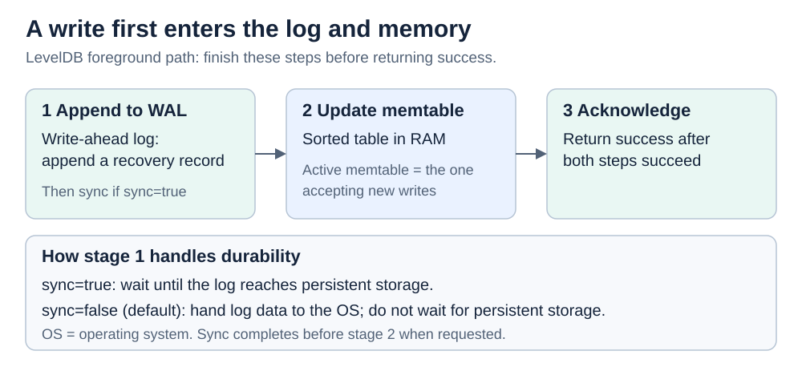
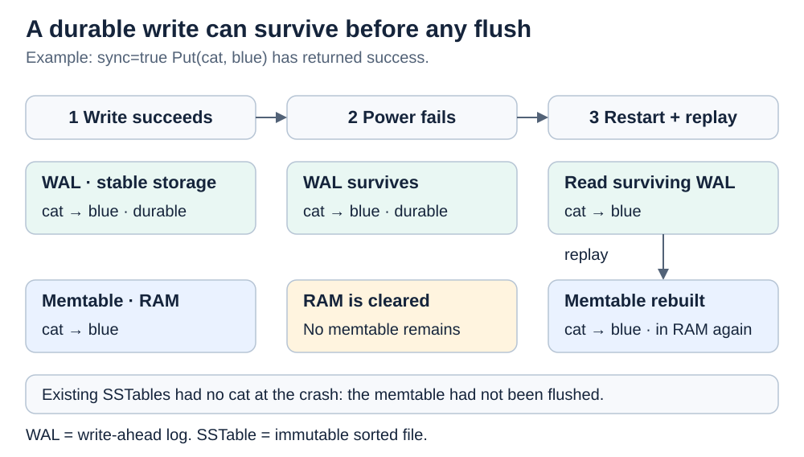
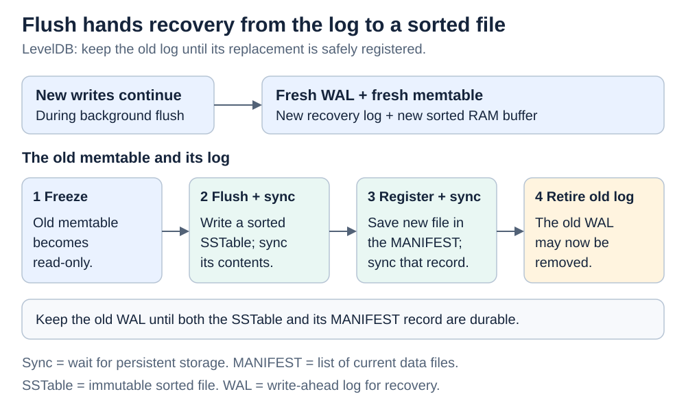
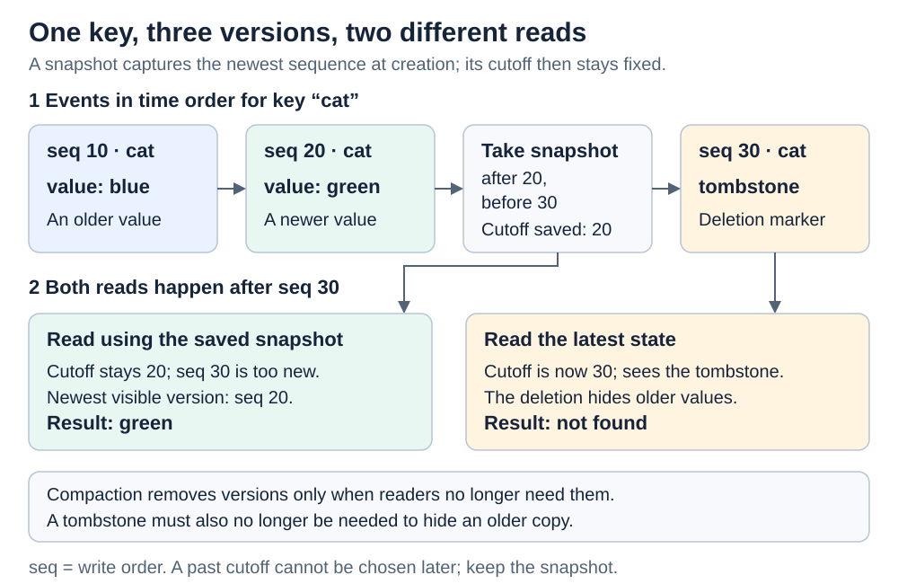
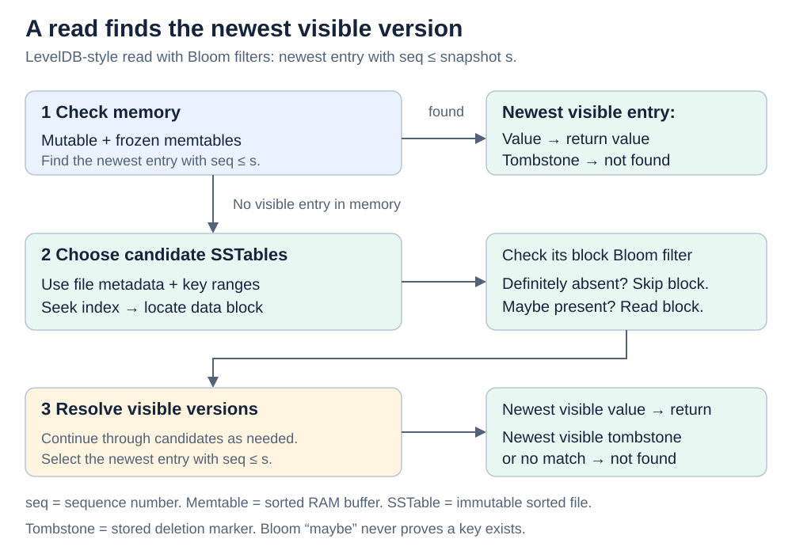
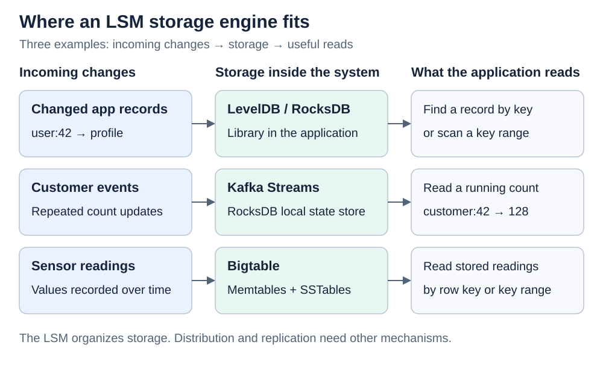

# Data structures. Log-structured merge-tree

[Back to Computer Science](../Readme.md#content)

A **log-structured merge-tree (LSM-tree)** is a way to store data that is built for heavy write traffic. It **collects changes in memory, writes them to disk in sorted batches, and merges those batches in the background**. This turns many small, scattered disk writes into a few large, sequential ones.

The sections below explain why batching helps, name the parts of an LSM engine, show how files are merged into levels, follow a write through a crash, explain versions and reads, and end with uses and costs. Most examples use **LevelDB**, a key-value storage library written at Google. A **storage engine** is the part of a database that saves and finds data, and “disk” also means solid-state drives (SSDs).

## 1. Why batch writes?

Every entry has a **key** that identifies it, such as `cat` in `cat = "blue"`. A **B-tree**, the standard disk-based index, keeps keys in disk **pages** (blocks of data). To insert or change a key, it reads the page, edits it, and writes it back. When many unrelated keys change and their pages are not cached in memory, the engine must read and write many small pages that sit far apart on the disk.

The top panel of the diagram shows that pattern: separate updates change pages 8, 10, and 13. The bottom panel shows the LSM-tree's alternative: collect the changes in memory, write them out as one new sorted file (a **flush**), and merge files later (**compaction**).

On a hard disk, each scattered write makes the head move (a **seek**) and then wait for the platter to rotate into place. A long sequential write pays that cost once for many entries. SSDs have no moving head, but small random writes still hurt them, because of how flash memory erases blocks and cleans up free space.

There is a catch: compaction rewrites the same data later (section 9). An LSM-tree makes fewer scattered writes, not necessarily fewer bytes written, and every rewrite uses disk bandwidth and wears out an SSD a little.

## 2. The pieces of an LSM engine

These five parts cover a write's whole journey, in order:

| Piece | What it is |
| --- | --- |
| **Write-ahead log (WAL)** | A file on disk where changes are appended, so they can be recovered after a crash (section 5). |
| **Memtable** | A table in memory (**RAM**) that keeps recent changes sorted by key. |
| **Flush** | Writing a full memtable to disk as a new sorted file. |
| **SSTable** (*Sorted String Table*) | A sorted file on disk. It is **immutable**: once written, it is never changed. |
| **Compaction** | Merging SSTables into new ones and dropping old entries once it is safe. |

One naming trap: the “log” in “log-structured” is not the WAL. The name comes from the Log-Structured File System, which inspired the idea of always writing data to new disk locations instead of overwriting old blocks. Compaction works the same way: it writes new SSTables and never edits old ones. The WAL is a separate file, used only for crash recovery.

Because nothing is edited in place, one key can have an old value in one file and a newer value in another. Sections 6 and 7 show how reads pick the right one.

## 3. How merging works

Compaction is built on the merge step of merge sort. Look at the next key in each sorted input, copy the smaller one to the output, and move forward in that input. When one input runs out, copy the rest of the other. In the diagram, A is smaller than B, so A goes first. Then B is smaller than D, and so on, until the output runs from A to M.

The merge only looks at the front of each input, so the inputs do not have to fit in memory. The engine reads each file a piece at a time into a small memory **buffer** and writes the output the same way.

The hard case is two entries with the same key, such as an old and a new value for `cat`. Key order alone cannot say which one to keep. Section 6 gives the rules.

## 4. Why files are grouped into levels

Merging each new file with all the data on disk would rewrite almost the whole database again and again. **Leveled compaction** avoids that: it sorts the disk files into levels and merges only a few files at a time.

Each SSTable covers a **key range**, from its smallest key to its largest. LevelDB calls its first disk level **L0**. Flushes usually add files to L0, so L0 files can overlap: two of them may both hold keys between D and F. In L1 and every deeper level, files never overlap.

Compaction takes a file from one level (from L0, possibly several that overlap), adds every file in the next level whose range overlaps it, and merges them into new files whose ranges do not overlap. In the diagram, the L0 files B…F and D…H overlap each other and the L1 files A…C and D…J. Merging these four gives A…E and F…J. The L1 file K…Z overlaps none of them, so it stays as it is.

In LevelDB 1.23, L1 is limited to 10 MB, and each deeper level may hold ten times as much as the level above it. Compaction starts when L0 has four files or when another level passes its limit. A flushed file can also go straight to L1 or L2 if it overlaps nothing there.

The payoff of the no-overlap rule: a lookup for one key checks at most one file in each level below L0, but it may have to check several files in L0.

## 5. How a write survives a crash

Until a flush, the newest changes exist only in the memtable, and **a power failure erases RAM**. Without a second copy, a write that was already reported as successful could disappear. Flushing after every write would fix that, but it would give up the batching. So the engine also writes each change to the WAL on disk. This makes writes **durable**: they can survive a crash.

### Two copies in two orders

The WAL is cheap to write because the engine only **appends**: it adds each record to the end of the file, in arrival order. Sorting is the memtable's job. In the diagram, `dog` arrives before `cat`. The WAL keeps that order, and the memtable puts `cat` first.

### The write path

LevelDB handles each write in three steps, shown left to right: append a record to the WAL, update the memtable, and only then **acknowledge** the write, which means report success to the caller.

The `sync` option decides how long step 1 waits:

- **`sync = true`**: until the record reaches persistent storage. The write then survives even a power failure.
- **`sync = false`** (the default): only until the operating system has the record. A crash of the database process loses nothing, but a crash of the whole machine may lose the last few writes.

### Recovery

After a crash, the engine **replays** the WAL: it reads the records and rebuilds the memtable from them. Follow the three columns in the diagram: `cat → blue` was synced to the WAL, the power failed before any flush, and the replay brings the write back even though no SSTable ever held it.

### When an old WAL can be deleted

When the memtable is full, LevelDB freezes it (makes it read-only) and starts a fresh memtable and a fresh WAL, so writes can continue while the frozen memtable is flushed in the background. The four numbered steps in the diagram show the order: the old WAL may be deleted only after the new SSTable is synced and registered in the **MANIFEST**, LevelDB's list of its current data files. Until then, the old WAL is the only safe copy of those writes.

Keep the two jobs apart: **syncing the WAL makes a write survive a crash, and flushing the memtable turns it into a sorted file.** A flush reads the frozen memtable, not the WAL. The WAL is read only during recovery.

## 6. Updates, deletes, and snapshots

SSTables are never edited, so an **update** simply writes a new entry for the same key. A **delete** writes a **tombstone**, a marker that says “this key is deleted” and hides older values. The old entries stay on disk until compaction can safely remove them.

To tell versions apart, LevelDB gives every write an increasing **sequence number** (`seq`). For each key, the entry with the highest sequence number is the newest. A **snapshot** lets an application read the data as it was at one moment: LevelDB saves the current sequence number as the snapshot's cutoff, and reads through the snapshot ignore anything newer.

In the diagram, `cat` gets `blue` at seq 10 and `green` at seq 20. Then a snapshot saves cutoff 20, and then `cat` is deleted at seq 30. Both reads happen after the delete. The snapshot read ignores seq 30 and returns `green`, while a normal read sees the tombstone and returns “not found”.

Compaction keeps any old version that an open snapshot can still see. It also keeps a tombstone while an older value of that key might still exist in a deeper level, because dropping the tombstone too early would bring that value back. Everything else can go. That is why an application cannot ask later for “the data as of seq 15”: unless a snapshot protected that version, it may already be gone. Databases use the same version-and-snapshot idea in [multiversion concurrency control](../Multiversion%20concurrency%20control/Readme.md#vocabulary).

## 7. How reads find a value

A **point lookup** asks for one key. For any key, data in memory is newer than data on disk, and data in a shallower level is newer than data in a deeper one. So LevelDB searches from newest to oldest and stops at the first entry that its snapshot can see:

1. **Memory:** the active memtable, then the frozen one if a flush is running.
2. **Disk:** the SSTables, level by level from L0 down, skipping files whose key range does not include the key. In L0, newer files are checked first.

If that first entry is a value, the lookup returns it. If it is a tombstone, the answer is “not found” and the search stops. So “this file does not have the key” means keep looking, but “the key is deleted” means stop.

Inside an SSTable, a small **index** points to the **data block**, a chunk of sorted entries, that could hold the key. If the table has a [**Bloom filter**](../Data%20structures.%20Bloom%20filter/Readme.md#how-it-works), LevelDB checks it before reading the block. “Definitely not here” skips the block, and “maybe here” means the block must be read to be sure. The diagram shows these steps in order, from memory down to the answer.

A **range scan**, such as all keys from `cat` to `owl`, merges the sorted entries from the memtables and the SSTables, just as compaction does, and applies the same version and delete rules.

## 8. Where LSM-trees are used

LSM-trees fit workloads with many small writes that also need lookups by key and scans in key order. Each row of the diagram follows one example from left to right: the incoming changes, the storage that holds them, and what the application reads back.

- **Embedded storage: LevelDB and RocksDB.** These are libraries that an application uses to keep changing key-value records in files on its local disk.
- **Stream-processing state: Kafka Streams.** Kafka Streams processes streams of events and keeps running results, such as a count per customer, in local state stores. Its persistent stores use RocksDB, so this state can grow larger than the Java heap.
- **Large distributed tables: Bigtable.** Google's Bigtable keeps data such as sensor readings in memtables and SSTables. Batching absorbs the steady stream of new writes, and sorted row keys make it efficient to scan related rows.

An LSM-tree only organizes storage. On its own, it does not spread data across servers or keep copies on other machines. Bigtable adds both on top.

## 9. The tradeoffs

Fast writes are not free. LSM-trees pay for them with three kinds of extra work, called **amplification**:

| Cost | What it means | Why it happens |
| --- | --- | --- |
| **Write amplification** | The disk may receive several times more bytes than the application wrote. | The WAL, the flush, and each later compaction write the same data again. |
| **Read amplification** | One lookup may need several disk reads. | The key may be in a memtable, in several L0 files, or in any deeper level. |
| **Space amplification** | The database files take more space than the live data. | Old versions and tombstones wait for compaction, and a compaction writes its new files before it deletes the old ones. |

Compaction must also keep up with incoming writes. If it falls behind, L0 files pile up, and the engine slows down or blocks new writes until compaction catches up. This is called a **write stall**. In LevelDB 1.23, each write is delayed by 1 ms once L0 has 8 files, and new writes stop until compaction catches up once it has 12.

So an LSM-tree is not simply “faster” than a B-tree. To choose between them, test both with your real queries, and count read work, compaction, and temporary disk space, not just write speed.

# Sources

- [The original LSM-tree paper (O'Neil et al., authors' copy)](https://www.cs.umb.edu/~poneil/lsmtree.pdf)
- [LevelDB 1.23: README](https://github.com/google/leveldb/blob/1.23/README.md)
- [LevelDB 1.23: files, levels, and compaction](https://github.com/google/leveldb/blob/1.23/doc/impl.md)
- [LevelDB 1.23: durability, snapshots, and filters](https://github.com/google/leveldb/blob/1.23/doc/index.md)
- [LevelDB 1.23: compaction and write-stall limits](https://github.com/google/leveldb/blob/1.23/db/dbformat.h)
- [LevelDB 1.23: writes, flushes, stalls, and dropped versions](https://github.com/google/leveldb/blob/1.23/db/db_impl.cc)
- [LevelDB 1.23: level sizes, lookups, and MANIFEST](https://github.com/google/leveldb/blob/1.23/db/version_set.cc)
- [LevelDB 1.23: SSTable synchronization](https://github.com/google/leveldb/blob/1.23/db/builder.cc)
- [LevelDB 1.23: table layout and block filters](https://github.com/google/leveldb/blob/1.23/doc/table_format.md)
- [LevelDB 1.23: SSTable lookup through the filter](https://github.com/google/leveldb/blob/1.23/table/table.cc)
- [RocksDB: architecture](https://github.com/facebook/rocksdb/wiki/RocksDB-Overview)
- [RocksDB: amplification and compaction costs](https://github.com/facebook/rocksdb/wiki/RocksDB-Tuning-Guide)
- [Kafka Streams 4.4: persistent state stores](https://kafka.apache.org/44/streams/developer-guide/processor-api/)
- [Bigtable: storage model, use cases, and replication](https://docs.cloud.google.com/bigtable/docs/overview)
- [Bigtable paper: memtables and SSTables](https://research.google.com/archive/bigtable-osdi06.pdf)
- [WiscKey: LSM-trees on SSDs (§2.4, §3.1)](https://www.usenix.org/system/files/conference/fast16/fast16-papers-lu.pdf)
