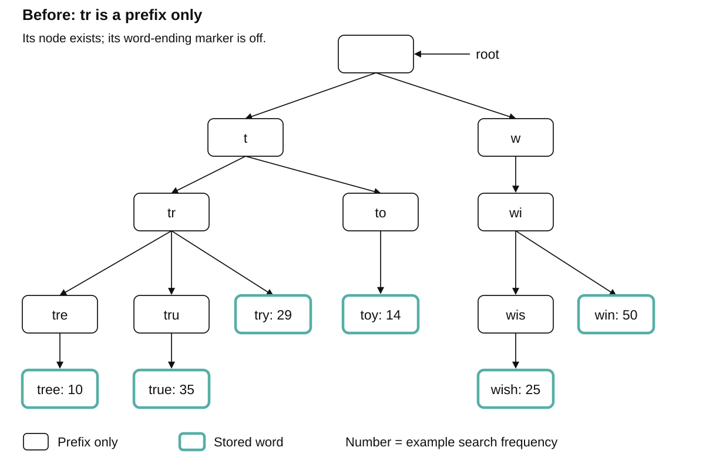
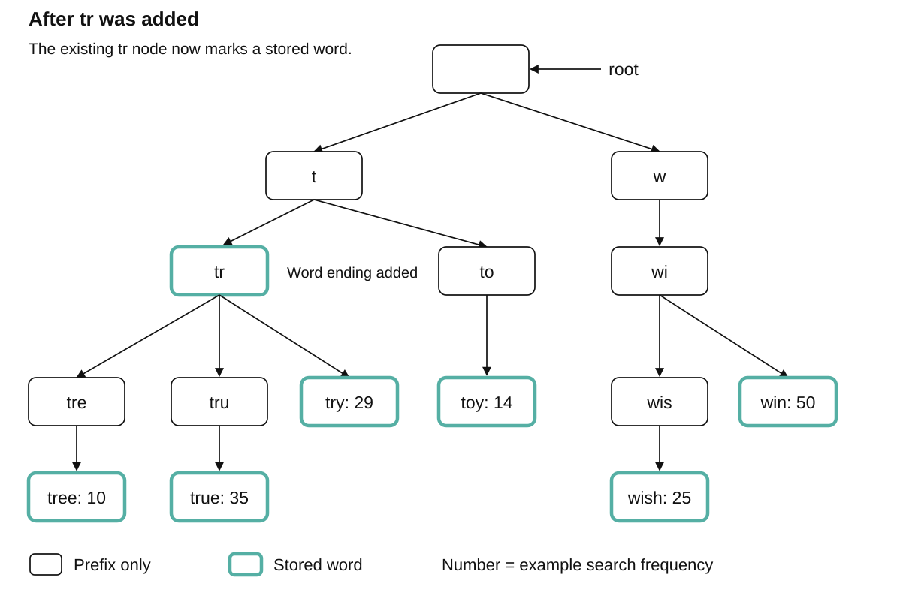

# Data structures. Trie

[Back to Computer Science](../Readme.md#content)

**A trie (prefix tree) groups strings, such as words, by their first character, then their second, and so on.**

For example, `tree`, `true`, and `try` all start with `tr`. That shared beginning is a **prefix**. When you type `tr` into a search box, autocomplete can go straight to the part of the tree containing those words.

## Follow one word

Each box in the diagram is a **node**. Start at the top box, the **root**. It is empty because you have read no letters yet. Follow one downward arrow per letter. Each label shows the letters read so far.

To find `true`, trace `root → t → tr → tru → true`. At `tr`, the next letter `u` tells you to take the arrow to `tru`. The thick teal outline around `true` marks a stored word. The number 35 shows how often it was searched for in this example.

## What happens when a search reaches `tr`?

| What are you looking for? | What happens at `tr`? |
| --- | --- |
| The exact word `true` | Two letters remain. Follow `u`, then `e`. The marked ending confirms a match. |
| The exact word `tr` | All letters match, but the thin black outline means no word ends here. The exact lookup fails. |
| The exact word `trap` | The next letter is `a`. No arrow from `tr` adds `a`, so the search stops immediately. |
| All words starting with `tr` | Collect the marked words along the branches from here. You find `tree`, `true`, and `try`. You can skip the branches for `toy` and `win`. |

## Add a word to an existing path

To insert a word, follow its letters, adding a node wherever the next step is missing. Then mark the last node as a word ending. For `tr`, the whole path already exists. Only the outline of `tr` changes in the diagram.

Now an exact lookup for `tr` succeeds. Ask for all words starting with `tr` and you get four matches. Include `tr` itself, then keep going to find `tree`, `true`, and `try`. A word can end at a node that still has branches.

## Time and space complexity

Assume a fixed alphabet and that choosing the next letter takes constant time.

- **Looking up, inserting, or deleting a word** takes **O(L)** time in the worst case, where `L` is the word length. A lookup for `true` follows just four arrows, however many other words are stored.
- **Finding a prefix** takes **O(P)** time for `P` letters. To list all matches, add the work of visiting each node below that prefix and writing each letter of the returned words.
- **Memory** depends on how many prefixes are distinct. Each new letter needs at most one new node. For `S` total letters across the stored words, that gives at most `S + 1` nodes including the root, or **O(S)** space. Reserving a link for every possible next letter at every node can leave many slots empty.

## Where tries are used

- **Autocomplete** can use search counts to rank matches. In the first diagram, `true` (35 searches) would appear ahead of `try` (29) and `tree` (10).
- **A spell checker** can use exact lookup to see whether its dictionary contains a word. Suggesting a correction takes additional matching logic.
- **Internet Protocol (IP) routing** uses trie variants to follow address bits and select the most specific matching network route.

In Java, Apache Commons Collections provides `PatriciaTrie` for string prefix queries. Java SE 26's standard Collections Framework has no built-in trie.

# Sources

- [Stanford CS106B — Letter tries, word endings, and lookup costs (slides 9–11)](https://web.stanford.edu/class/archive/cs/cs106b/cs106b.1212/lectures/28-lexicon/slides)
- [Sedgewick and Wayne, Algorithms — TrieST implementation](https://github.com/kevin-wayne/algs4/blob/master/src/main/java/edu/princeton/cs/algs4/TrieST.java)
- [Linux Kernel documentation — LC-trie and longest-prefix route lookup](https://docs.kernel.org/networking/fib_trie.html)
- [Java SE 26 — Outline of the Collections Framework](https://docs.oracle.com/en/java/javase/26/docs/api/java.base/java/util/doc-files/coll-reference.html)
- [Apache Commons Collections — PatriciaTrie](https://commons.apache.org/proper/commons-collections/apidocs/org/apache/commons/collections4/trie/PatriciaTrie.html)
- [Repository chapter 13 — Search Autocomplete, trie diagram](../../system%20design/13.%20Search%20Autocomplete/Readme.md)
